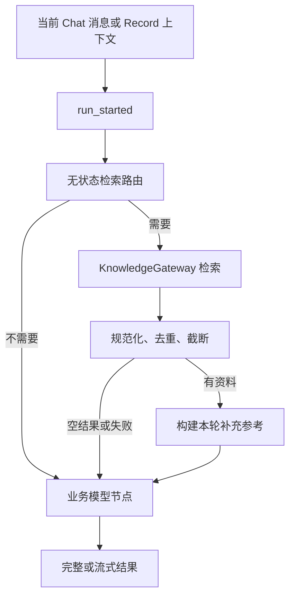

# Agent 知识库检索设计

> 状态：Chat/Record 按需检索与画像专科循证解释已实现；通用工具循环与证据分级未实现
>
> 更新日期：2026-09-09；画像更新基于 `dec9e0c` 工作区，未验证上游服务实时可用性

## 1. 目标与范围

本轮在 LangGraph 中接入 EviMed AI 检索 API V2，使 Agent 能在必要时查询指南、文献、药品说明书或临床试验，再结合检索结果完成当前 AI 任务。

第一版接入范围：

- `chat.reply`：普通聊天的完整回复和 SSE 回复。
- `record.question`：根据患者资料和应用层裁定生成承接说明、疑问答复及下一问，需要时检索支撑知识。
- `profile.retrieve_evidence`：画像读取时执行专科选题、受控检索与综合解释；使用独立的 `profile.plan_focus` 和 `profile.synthesize_evidence` 无状态 Profile，不执行下方 Chat/Record 路由。

不接入的能力：

- `record.plan`：分析患者状态、疑问及信息缺口，不处理题数，不检索。当前动态建档的阶段与预算由应用层控制，不注入患者分析上下文，见 [动态建档实现](../../wiki/record-dynamic-flow.md)。
- `analysis.health_report`：职责是忠实抽取报告原文，外部知识不得混入原始数据抽取。
- `chat.suggestions`：目前只生成推荐问题，不增加额外检索成本。

## 2. 工作流

以下是 Chat/Record 的按需检索路径。画像循证另见 [画像设计第 10 节](user-health-profile-design.md#10-循证支持设计)；最终报告的 EviMedClient/PublicEvidenceClient 仍是独立证据管线，不能将这里的范围描述为所有 Report 检索已经统一。



这是“确定性工作流 + 局部受控 Agent”，不是允许模型任意执行工具。模型只能在四种公开检索源中生成最多两条查询；本地代码负责枚举、数量和长度校验。

## 3. 组件边界

```text
utils/knowledge.py
  EviMed HTTP 客户端，保留同步/异步调用

agents/knowledge/protocol.py
  KnowledgeGateway 厂商无关协议

agents/knowledge/evimed_gateway.py
  将四种 EviMed 响应归一为 KnowledgeDocument

agents/knowledge/routing.py
  路由输出校验、并发检索、去重和上下文限额

agents/graphs/chat/graph.py
agents/graphs/record/graph.py
  业务 Graph 中的路由、检索与最终模型节点

agents/graphs/health_profile/graph.py
  profile.retrieve_evidence：肠道、代谢优先的选题、检索与解释
```

`KnowledgeGateway` 与 `LLMGateway` 相互独立。前者只负责外部医学资料，后者继续是所有模型调用的唯一入口。

## 4. 检索决策与限制

路由 Profile 为 `knowledge.route`，使用 `STATELESS` 策略，不读写 Chat 模型历史。路由返回严格 JSON：

```json
{
    "needRetrieval": true,
    "queries": [
        {
            "source": "guide",
            "query": "2型糖尿病 二甲双胍"
        }
    ]
}
```

本地约束：

- `source` 只允许 `guide`、`literature`、`instruction`、`clinical_trial`。
- 每轮最多 2 条查询，单条查询最长 256 个字符。
- 每条查询最多取 3 条结果，每轮最多向模型提供 6 条去重资料。
- 单条摘要最多 900 字符，本轮知识上下文最多 6000 字符。
- 临床试验只用于明确询问试验、招募或研究进展的场景。

以上限额适用于 Chat/Record。画像专用流程最多 6 个主题、8 个查询、并发 3、12 条展示资料，总时限 60 秒，不修改共享 `routing.py` 的限额。画像请求原始证据时将 `KnowledgeQuery.include_source_text` 设为 `true`；EviMed 通过可选的指南块保留及 `sourceTexts` 元数据提供可核验原文，旧 `content` 和普通调用形状不变。仅有 AI 摘要的条目不能独立支持新增疾病风险；详细策略、缓存和降级见[画像循证支持设计](user-health-profile-design.md#10-循证支持设计)。

## 5. AION Context 与成本边界

普通聊天使用 `AION_FULL`。如果直接把检索全文拼入 `content`，AION 会把它作为用户历史永久保存，造成以后每轮 Token 成本上升，也可能错误复用旧证据。

因此 `LLMRequest` 增加 `supplemental_context`：

```text
content                 原始用户输入
supplemental_context    只供本轮模型使用的检索资料
```

`AionLLMGateway` 发起请求时将两者组合，但在持久化 AION Context v1 前，会把最新 turn 的 user content 恢复为原始 `content`。助手最终回答仍正常进入历史。

这一策略保证：

- 检索资料原文只作为本轮补充发送，不在后续历史中整段重复；助手回答中的引用和摘要仍进入历史，仍会消耗后续 Token。
- 后续对话只保留原始用户消息和助手回答。
- 知识库资料更新后，不会因历史 Context 中的旧全文被无意固定。

## 6. 失败降级

知识检索是增强能力，不是 Chat 和 Record 的可用性前置条件：

- 未配置 EviMed API Key：不执行路由和检索，直接使用原 Graph。
- 路由模型返回非法 JSON：按“不检索”处理。
- 单个检索通道失败：保留其他成功通道的结果。
- 所有检索通道成功但没有命中：内部状态为 `empty`。
- 至少一个检索通道失败且没有任何可用资料：内部状态为 `unavailable`。
- `empty` 和 `unavailable` 都不传入补充上下文，继续原模型流程。

降级不改变 Chat、Record 的现有 HTTP/SSE 契约。

知识库客户端会区分 HTTP 错误、非 JSON 响应、业务错误和响应结构错误。日志经 `utils.log.getLogger` 统一输出，内部使用 loongspears 日志实现和 config.env.LOG_LEVEL；记录异常类别、HTTP 状态、响应 Content-Type 和业务错误码，不记录 API Key、检索词、响应正文或用户健康内容。

## 7. 安全与数据边界

- 检索资料是外部输入，补充上下文明确禁止模型执行其中的指令。
- 路由 Prompt 要求查询词不包含姓名、联系方式等身份信息。
- 日志不记录 API Key、检索词、知识库响应正文或用户健康内容。
- 检索资料只是参考证据，不是用户健康事实，不能写入用户画像事实集。
- 模型不得编造检索结果中没有的文献；Chat 使用资料时应标注 `[资料N]`。

## 8. 环境配置

本功能使用独立的 Agent 知识库配置，不与 Report 模块的 `SHULAN_EVIMED_*` 证据检索配置共享密钥或地址：

```text
SHULAN_KNOWLEDGE_API_BASE_URL
SHULAN_KNOWLEDGE_API_KEY
SHULAN_KNOWLEDGE_API_TIMEOUT_SECONDS
```

未配置 API Key 时功能自动禁用，不影响 Chat、Record 启动与原功能。

## 9. 已知限制和后续任务

1. 当前是“路由模型 → 受控检索 → 业务模型”，不是通用模型—工具—模型循环。
2. 路由会在候选场景额外产生一次无状态 LLM 调用，需根据真实数据评估准确率、延迟和成本。
3. 当前没有对检索结果执行独立重排和医学证据等级计算。
4. Chat 暂未在 API 响应中单独返回结构化引用，第一版由模型在正文中使用 `[资料N]`。
5. 需建立固定医疗场景评估集，验证不检索、正确检索源、引用一致性和失败降级。

通用原生工具调用仍受 AION 工具结果协议限制，本功能不会将 `ISSUE.md` 中的 I-001 标记为已解决。
