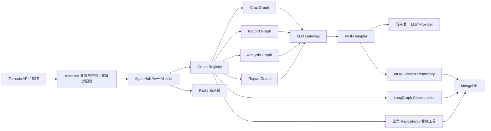

# AI Agent 目标架构

状态：核心底座、Chat/Record/Analysis/Report、画像提取与循证已接入；通用工具循环和高级上下文仍待实施

更新：2026-10-10；源码基线：`develop@c9b8988`，未执行真实环境验收。当前实现与历史设计分类见 [架构导航](README.md)，Report 维护见 [当前接入指南](report-agent-integration-guide.md)。

## 1. 目标

Shulan 将 LangGraph 建设为项目唯一的 AI 编排中枢，所有 LLM 功能最终都必须通过已注册的 Graph 进入模型层。Tornado 继续承担 HTTP API 与 SSE 接入；AION 继续承担模型提供商差异、模型调用和模型会话协议。

本架构采用“确定性工作流 + 局部受控 Agent”，不建设能够任意行动的万能 Agent。

## 2. 架构决策

1. Tornado 继续作为 HTTP API、参数校验和 SSE 接入层。
2. LangGraph 作为 AI 工作流、运行状态、路由、恢复和流式事件的核心运行时。
3. `AgentHub` 是业务代码调用 AI 能力的唯一入口。
4. AION 作为统一 LLM 接入层，Report 主叙事、follow-up 和报告上下文选择已进入 AgentHub；业务 Graph、modules 和 adapters 不得创建模型 SDK Client，唯一接入点是 AionLLMGateway。静态边界不等同于真实提供商切换验收。
5. 单次部署只启用一个模型提供商，通过 `SHULAN_LLM_PROVIDER` 整体切换，不支持按请求任意切换厂商。
6. MongoDB 持久化业务会话、Agent checkpoint、模型上下文、用户画像、原始报告来源及独立最终报告批次/产物/回调任务；Redis 承担临时建档、分布式会话锁和短期缓存。原始上传来源、AI 生成产物与执行任务具有不同所有权。
7. 用户、咨询主体和健康事实分离；同一位家人跨会话复用稳定 `subjectId`。
8. 当前通过 KnowledgeGateway 调用外部 EviMed 检索，Shulan 不维护本地向量索引；后续存储/检索引擎替换由适配边界隔离。
9. 最终运行系统为 Linux，Python 环境为 `conda activate shulan`；操作系统强绑定设计必须先评审。
10. 现有外部 API 契约在迁移期间保持不变，每项能力逐个迁移并设置人工确认关卡。

## 3. 目标调用链



正式迁移完成后的固定路径为：

```text
Tornado
  -> modules 应用层 / 领域适配器
  -> AgentHub
  -> LangGraph
  -> LLMGateway
  -> AION
  -> 当前模型提供商
```

`services/` 只保留旧导入兼容，新业务实现进入 `modules/`，HTTP 参数和传输映射进入 `web/`。Report 三项 Graph 已注册；Redis 会话 lease 由业务用例获取，不是 AgentHub 自动为所有能力加锁。

## 4. 四类上下文的所有权

| 层次 | 内容 | 所有者 | 生命周期 |
|---|---|---|---|
| 请求上下文 | `userId`、`sessionId`、`subjectId`、`requestId`，以及本轮临时画像摘要 | Agent Runtime | 单次运行，不 checkpoint |
| 图执行状态 | 当前节点、节点输出、错误、重试和运行版本 | LangGraph | 单个 thread，可 checkpoint |
| 模型对话上下文 | system、user/assistant 轮次、reasoning、usage | AION + Shulan Context Repository | 单个模型会话 |
| 健康长期记忆 | 用户画像、主体、健康事实、来源和修订历史 | Shulan 领域层 | 跨会话长期保存 |

约束：

- LangGraph checkpoint 不是用户画像，也不是业务会话的权威数据源。
- AION Context 不是健康长期记忆。
- 用户可见会话和业务数据继续由 Shulan 持有；AION Context 是可恢复、可重建的模型运行数据。
- Graph State 不复制完整 AION Context；当前 Chat 保存 conversation_key 等运行字段，模型 Context revision 由 Context Repository/Gateway 管理。精确 checkpoint-revision 回放映射尚未实现，不能把概念引用名当作已存在的 State 字段。
- 普通对话的长期画像由 Shulan 画像领域按预算读取，经 `AgentRunContext` 临时交给 Graph；它不是 AION 对话历史，也不得写入 LangGraph checkpoint。AION 持久化本轮时仍只保存原始用户消息。
- 数据库连接、AION Client、Tornado Handler、异步生成器和密钥不得进入 Graph State。

## 5. AION Context v1 的定位

当前安装的 AION 提供 Client 级进程内上下文：同一个 `Client(context=True)` 自动记录成功完成的 user/assistant 轮次，并在后续调用中重放。它支持 Context v1 的查看、导入和导出，但当前不负责数据库持久化、自动压缩、Token 裁剪、相关性筛选或跨进程共享。

因此：

1. 一个有状态 AION Client 只能属于一个模型会话，不能作为全局多用户 Client 使用。
2. Shulan 负责把 Context v1 保存到 MongoDB，并在新进程或新 Client 中恢复。
3. 同一会话的重叠调用由 Redis lease 控制，AION Client 自身的进程内锁不能替代分布式锁。
4. 第一版优先使用“按运行创建 Client、导入 Context、调用、导出 Context”的正确性方案；是否增加有限容量的 Client 缓存应在测量连接开销后决定。
5. AION 未来增加压缩和筛选能力时，只替换 LLM Gateway 的 ContextPolicy，不要求业务 Graph 重写。

## 6. 当前布局与待补能力

以下为当前 Agent 平台的主要目录，省略部分文件。整个应用的模块化目标见 [应用架构](application-architecture.md)，具体接入方法见 [Agent Core Wiki](../../wiki/agents.md)。

```text
agents/
  hub.py                    # 业务侧唯一 AI 入口
  contracts.py              # 通用请求、结果、事件和标识
  errors.py
  runtime/
    registry.py             # capability -> compiled graph
    context.py              # AgentRunContext
    container.py            # 通用依赖组装
    application.py          # 生产 Profile / Graph 注册
    lifecycle.py            # AgentRuntime 资源生命周期
  llm/
    protocol.py             # LLMGateway 抽象
    types.py                # LLMRequest/Result/Chunk/Profile
    profiles.py             # 命名模型配置
    aion_gateway.py         # 唯一 AION Chat Client 接入点
  persistence/
    checkpoint.py
    llm_context.py
    mongodb_llm_context.py
    locks.py
  graphs/
    chat/                   # 回复、推荐问题、Profile 和注册
    record/                 # 问题规划与追问
    analysis/               # 体检报告模型解读
    health_profile/         # 候选提取与画像循证
    validation/             # 基础设施验证图
    report/                 # 主叙事、follow-up、只读报告检索及注册
  knowledge/                # 检索协议、路由和 EviMed Gateway
  testing/
    fake_llm.py
    fake_knowledge.py
    memory_context.py

health_profile/             # 当前长期画像领域、事实与摄取 Worker
modules/health_profile/     # 迁移门面；内部标准分层仍待完成
```

早期草图中的 `agents/memory/` 不再作为健康画像代码的搬迁目标：主体、事实、策略和来源属于独立画像领域，Agent 只提供推理/检索能力。独立 run repository、通用工具注册/权限和集中观测审计仍待设计，不是现有目录或接口。

现阶段 LangGraph 以 Python 库形式嵌入 Tornado，不使用 LangGraph Agent Server，因此不要求增加 `langgraph.json`。Web 进程的生命周期属于顶层 `runtime/`，不要与 `agents/runtime/` 的模型/Graph 资源生命周期混淆。

## 7. 核心组件边界

### 7.1 AgentHub

`AgentHub` 根据 capability 调用 Graph，并统一提供完整和流式入口。Tornado Handler 不感知具体图、AION Client 或模型厂商。

当前已注册 capability：

```text
chat.reply
chat.suggestions
record.plan
record.question
analysis.health_report
profile.extract_record_candidates
profile.extract_chat_candidates
profile.retrieve_evidence
```

`report.narrative`、`report.followup`、`report.retrieve_context` 已注册，分别用于主叙事、后续模型任务和只读报告上下文。第三项支持普通 Chat 追问独立保存的最终报告，不把报告结论写成健康事实；详见 [Report 完整接入指南](report-agent-integration-guide.md)。`knowledge.route` 是路由 ModelProfile，不是单独对外注册的业务 capability；`profile.ingest/reconcile/compose_summary` 也不是当前已注册 Graph。

### 7.2 GraphRegistry

- Graph 在应用启动时构建并编译一次，不在每个请求中重新创建。
- Registry 保存 capability、graph version 和已编译 Graph 的映射。
- 每项业务能力使用自己的 State，不建设包含所有业务字段的“万能 State”。

### 7.3 LLMGateway

LLMGateway 对 Graph 暴露统一的完整和流式模型调用，隐藏 AION 的构造、Context v1、厂商参数和异常类型。

只有 `agents/llm/aion_gateway.py` 创建 AION Chat Client；静态扫描范围已包含业务 adapters。ModelProfile 管理 Prompt、model、thinking、context_policy 和 model_kwargs；统一预算、重试与熔断仍不是注册 Profile 自动提供的保障，由具体用例/适配器显式管理。

### 7.4 内部流式事件

统一事件至少包含：

```text
run_started
reasoning_delta
content_delta
progress
tool_started
tool_finished
run_completed
run_failed
```

Tornado 负责将其映射为当前外部 SSE 协议。完整调用与流式调用使用同一张 Graph。

## 8. 模型上下文策略

不能因为 AION 支持上下文就给所有模型调用开启记忆。

| 能力 | 初始策略 | 说明 |
|---|---|---|
| `chat.reply` | `AION_FULL` | 真实多轮对话 |
| `chat.suggestions` | `STATELESS` | 根据当前资料独立生成 |
| `record.plan` | `STATELESS` | 输入来自明确业务状态 |
| `record.question` | `STATELESS` | 问答历史由 Graph State 显式提供 |
| `analysis.health_report` | `STATELESS` | 一次性分析任务 |
| `profile.extract_record_candidates`、`profile.extract_chat_candidates` | `STATELESS` | 候选提取，不复制模型历史 |
| `profile.retrieve_evidence` | `STATELESS` | 画像选题、知识检索、综合解释与引用校验，无 checkpoint |
| `report.narrative` | `STATELESS` | 明确输入；可读取经校验的长期画像，不继承 Chat Context |
| `report.followup` | `STATELESS` | 服务器允许列表选择内部任务与固定模板，不继承跨报告历史 |
| `report.retrieve_context` | `STATELESS` | 受控选择报告批次与产物类型，正文由预算渲染器提供给 Chat；不是外部知识库检索 |

预留但暂不实现：`AION_RECENT`、`AION_COMPRESSED` 和 `AION_RETRIEVAL`。

## 9. 分阶段实施

每一阶段必须在人工检查和 Git 提交后再开始下一阶段。

以下保留原总体路线：Core、Gateway、Mongo checkpoint/Context、Chat、Record、Analysis、Report 和首版画像/知识检索已接入；独立 Agent run Repository、通用工具循环和高级上下文压缩仍未实现。阶段状态与真实环境验收分别记录，不将全部目标合并标记完成。

1. **架构基线**：修订设计文档，固定职责、上下文所有权和验收边界。
2. **Agent Core**：建立 AgentHub、GraphRegistry、运行上下文、事件协议和 LLMGateway 骨架。
3. **AION Gateway 验证**：使用 Fake LLM 和隔离真实模型 Graph 验证完整、流式、会话隔离及 Context 恢复。
4. **持久化运行时**：接入 MongoDB checkpointer、AION Context Repository、Agent run 记录和 Redis lease。
5. **普通聊天迁移**：依次迁移 complete、stream、suggestions；现有 API 契约保持不变。
6. **健康建档迁移**：保留 Redis 两小时未完成会话策略，用确定性 Graph 表达建档过程。
7. **分析和报告迁移**：迁移 DocMind 协作、报告分析和报告生成节点。
8. **中央化验收**：禁止 `modules/`、`services/`、业务 `adapters/` 绕过平台调用模型，持续执行包含 Report 的统一 AI 入口门禁。
9. **高级能力**：工具、长期健康记忆、知识检索和高级上下文策略。

## 10. 总体验收目标

- 所有 LLM 调用都通过 AgentHub 和已注册 LangGraph。
- 模型提供商只通过配置整体切换，Graph 不包含厂商分支。
- 不同用户和会话之间不存在 AION Context 泄漏。
- 外部 API 和 SSE 契约在迁移期间保持兼容。
- Agent 运行可观测、可恢复、可审计，并保留 usage 与缓存明细。
- 未完成健康建档的 Redis 两小时策略不变。
- 运行时代码不依赖 Windows 路径、文件锁或 Windows 专用进程机制。

普通聊天当前实现见 [Agent Wiki](../../wiki/agents.md)，[POC 评审](chat-langgraph-poc-review.md)只作历史记录。健康长期记忆见 [完整画像设计](user-health-profile-design.md)。旧版 [AION 工具/多消息设想](aion-agent-protocol.md)与[早期记忆摘要](health-memory-design.md)均已归档，不是当前实施前置条件。
