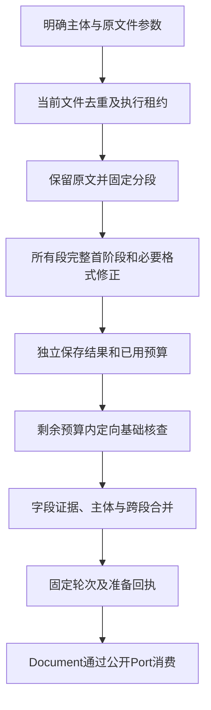

# Analysis 当前基础信息实现与交接计划

- 状态：Analysis 当前公共端口的合入前审核整改；本轮覆盖 R1–R4 及真实持久归档，最终受测提交以 I-048 的新验收记录为准；默认切换与删除仍按串行合入关口完成。
- 更新日期：2026-11-13；本轮整改起点：refactor/analysis@03f3d95，同一工作树已引入用户通过!132合入的develop@054a2fc。
- 需求依据：[当前需求](../product/analysis-basic-info-requirements.md)；HTTP仍以[API.md](../api/API.md)为准。
- 本轮不代改Document、Profile、Bootstrap或Report，不新增上传、强制重解析或版本选择入口。

## 1. 锁定边界

用户明确没有生产数据，不实现历史缓存、旧执行器、旧格式及旧任务版本兼容。已删除此前新增的解释器注册表、历史cache/old_pending分派和失败回退；当前同一实现内的幂等、文件去重和部分恢复继续保留。

CurrentHealthReportInterpreter使用唯一current提示词、证据校验、合并及两阶段预算；技术身份如实记录，不由调用方选择。现用默认原实现是串行合入的暂留接线，不是历史数据兼容，也不是最终双业务模式。本批不能宣称全项目已单算法或已默认接通。

## 2. 当前核心流程



完整当前文件命中不重跑OCR/模型。可恢复I/O继续原当前执行；retryable内容按原协议建立新固定轮次。与当前身份不符的资料明确失败，不寻找旧执行器、重标结果或借新增字段补抽。

## 3. 实现与注入

| 文件/入口 | 责任 |
|---|---|
| modules/analysis/application/current_interpreter.py | 唯一current完整抽取、独立基础诊断、两阶段检查点。 |
| modules/analysis/application/basic_info.py | 档位、值和候选引用、主体隔离与合并。 |
| prompts/analysis/health_report_current.txt | 当前完整临床和基础信息提示词。 |
| agents/graphs/analysis/current.py | 显式安装current能力，不自动切现用默认装配。 |
| HealthReportProcessingService | current准备、固定纯读和过渡默认入口隔离。 |

组合根依赖就绪后通过公开构造参数current_interpreter注入当前解释器，并调用register_current_analysis_health_report安装当前能力。构造无I/O；未配置current时prepare明确失败，不能退回默认实现。本域不改Bootstrap。

当前产物元数据为OutputSelection('health_report', '2', 'analysis-health-report-v13')，如实表示当前修订；它不是调用者版本选项。Document消费实际字段、固定引用和绑定，不白名单修订或自行挑执行器。

## 4. 公开Port和固定DTO

```python
async def prepare_document(*, user_id: str, subject_id: str, **file_kwargs) -> ProcessedHealthReport: ...

async def read_prepared_round(
    *, user_id: str, subject_id: str, document_id: str, interpretation_round: int
) -> PreparedDocumentRound: ...
```

prepare复用既有文件索引、归档与租约链，不新建并行上传流程。主体必须明确，固定publish=False和require_text=True。调用方不能覆盖revision、selection、发布模式、类型提示或内部执行器；返回真实preparation_binding、input_snapshot、output_selection和structured_data，不发布来源或写画像。

当前解释首次固定前统一规范化根和子报告的基础字段观察时间。已完成的模型检查点继续沿用，已验证但尚未固定的解释仅在时间变化时重新持久化，固定摘要取自最终保存的解释。固定写入已成功而回执丢失时，核对已有归档的引用和摘要后完成原轮次。

PreparedDocumentRound公开字段固定为user_id、subject_id、document_id、preparation_binding、parsed_document、interpretation、output_selection。round位于preparation_binding.input_snapshot.interpretation_round；binding含真实parse/interpretation refs、执行/校验身份与两个摘要。parsed_document保留完整原文结构，不能从text重建并冒称真实parse_digest。

read使用现有get_archived_round获取scope内固定记录，只用该记录的payloadRefs读取材料。归档清单查找可以读取scoped索引，但不能拿最新解释、轮次或payloadRefs替代指定归档；核对scope/document/round、两个摘要以及重复读一致性。读取不建档、下载、OCR、AI、修复、写入或发布。

参数错误使用ValueError；scope内无固定轮次使用DocumentNotFoundError；归档身份/摘要不符或current依赖未配置使用DocumentParsingError。异常不触发另一实现或自动历史恢复。

## 5. 当前抽取与预算

1. 首阶段完成所有段完整临床抽取及最多一次必要格式修正。基础问题记独立diagnostics，不占临床repair、不降低完整临床质量。
2. 所有首阶段保存后，第二阶段才用剩余总预算，每段最多一次基础核查；失败、超时、取消或ACK不确定保留首阶段结果，不重获额度。
3. 检查点固定原文哈希、分段范围、主体归属、当前执行身份和轮次，同版本恢复使用已保存状态，不分派旧实现。
4. AI逐字段简单给medium/low；程序核对允许档、单一受检者、值与引用，不用confidence或章节规则重做AI语义判断。
5. 字段及规范化候选均校验自身quote/value；非法候选不制造真实冲突，原始输出留轨迹。遮盖姓名只留未决，不升级姓名事实。共同合并同时汇集已提取值和已验证待核实候选，互斥则顶层null/conflicting；规范化转为冲突时保存原已验证类型化值及证据。候选不能被单值吞掉、不能自行晋级或升档；42与42.0按同值年龄处理，bool仍拒绝。跨片段保留主体屏障，同一原文核查不凭空增加跨片段锚点要求。显式subjectStatus=ambiguous仍遍历所有输入元数据，不因该片段无可用值/候选而丢失；空字段也保留此判断依据，不借此制造新值或候选。
6. 性别明确单一枚举、月龄换算保留原表达。日期未知为null，不借上传时间或其他子报告日期，不反推生日或把算法年龄当实际年龄。

### 5.1 格式修正、容器与持久化一致性

临床选择复用递归 accepted_count，保持有效答复优先；修正被舍弃时仍保留所选临床树的未解格式问题。每份已验证回复先从完整根及后代投影 basicInfo/basicInfoMeta，再独立汇集基础证据；不通过临床集合合并伪造新项目。rawData、result 与 _verifiedData 保留同一累计依据，恢复继续已有调用计数。

共同基础投影递归收集原输入容器，即使字段和候选均为空也保留显式 ambiguous。临床 document_sections、标题日期 metadataEvidence、去镜像及 sourceSection 编号继续各自处理；内部嵌套树不表示扩大 AI 输出 schema。

同一原始节点的累计兼容根用仅内部的 `_basicInfoMerged` 标记区分：原始模型回复不信任此键，完整树仍按既有主体规则处理；程序已累计的根不再将已覆盖的子节点重复算作独立来源。标记随本执行内部检查点恢复，在最终节点清理中剥离，不进入公开结果、固定 interpretation 或 DTO。不通过引文相同猜测来源相同，不放宽独立根、兄弟或跨片段无锚点门禁。

当前解释器使用现有归档适配器已允许的名称，不增加新存储协议。NNNNN 为五位 ASCII 编号：

| 阶段 | 输入／输出 | 检查点 |
|---|---|---|
| first | analysis_input_NNNNN / analysis_output_NNNNN | analysis_part_NNNNN |
| repair | analysis_input_NNNNN_repair / analysis_output_NNNNN_repair | 原首阶段检查点 |
| basic_check | analysis_input_NNNNN_0 / analysis_output_NNNNN_0 | analysis_part_NNNNN_0 |

固定子号 _0 仅隔离基础核查存储，原 payload.phase、当前执行身份、原文哈希、片段偏移及轮次保持真实。未知或越界名称仍由既有适配器拒绝，不移除持久化或吞掉归档错误。公开 prepare 必须使用真实 MongoDocumentTraceStore 与合成 BSON 集合验证三阶段及中断恢复；不会在同一 trace 混跑默认解释器，也不会把核查伪装为新分段。

## 6. 过渡默认清单和阶段5删除

| 暂留项 | 原因 | 删除责任与条件 |
|---|---|---|
| 原HealthReportInterpreter默认业务实现 | 已合Document正式消费仍约束原真实执行身份。 | Document当前适配用户合入后，Analysis折叠成唯一当前实现，删除旧默认业务方法。 |
| health_report.txt与原默认能力注册 | 原默认链尚未统一切换。 | Analysis与组合根最后切换后删除原提示词与暂留注册，不保留并列选择。 |
| current_interpreter与现用default隔离注入 | 防止伪装身份或current失败回退。 | 最终单入口装配后删过渡分离接线，prepare/read公开签名保持。 |

阶段5属于用户已批准的最终目标，不能在前置提供方未合入时越域实施。暂留默认保持真实原身份和原算法，不能将current输出改标为旧身份绕过Document硬检查。

## 7. 交接顺序与实际声明

统一任务为[I-048](../../ISSUE.md#i-048-双来源基础信息与共享profile交接)。Profile当前来源提供方已由用户通过!132合入develop@054a2fc，本轮同一工作树引入真实提供方并完成相关组合复验；没有从其他分支导入Document未合实现。下一必要合并关口是Analysis公共端口由用户合入develop，Document随后在所属分支真实消费Analysis与Profile；默认组合和过渡实现删除仍待依赖齐备，不以合并消费者根代替提供方。

2026-11-13，Analysis负责人/root/profile_plan_review与Document负责人/root/document_provider已确认两个Port和七字段DTO，签名在本轮基线同步后保持。Document真实调用该公开端口仍等待Analysis由用户合入；不访问私有reuse、不导入未合实现、不重跑AI。同checkout现用来源组合通过不表示新增current材料链已默认接通。

Analysis本轮核对current端口与同步真实Profile后的边界。后续由所属模块和主线程完成默认切换、过渡实现删除、必要API同步和真实组合验证。

## 8. 验证矩阵

| 组 | 覆盖 |
|---|---|
| 当前提取 | 三字段、low/medium、无来源、无效值/候选引用、脱敏姓名、多受检者、跨段单值与pending候选共同合并；年龄42/42.0同值、bool拒绝。 |
| 两阶段 | 首阶段优先、最多三次业务调用、核查失败不丢临床、合法冲突候选不被首阶段单值吞掉、重试不重获预算。 |
| 公开准备 | 无revision选择、明确主体、current未配置不回退、新文件完整一次提取、无发布。 |
| 当前幂等 | 同文件复用、同版本I/O中断恢复、retryable内容新轮次且原轮次固定。 |
| 固定纯读 | 七字段DTO、scope/round/refs/digest、最新payload改变仍读原归档、篡改拒绝、零写入/AI。 |
| 过渡默认 | 原默认不被current隐式切换，调用方不能注入current执行器或版本。 |
| 删除核查 | 无本轮历史registry/cache/old_pending分派；阶段5未完成时不声称全项目已单算法。 |
| 真实Profile边界 | 同checkout现用正式来源、完整来源、fresh及归档读取组合；新增current材料链仍等待Document真实接入。 |

本轮独立复核后修复basic_info.py并新增test_basic_info_conflict_merge.py：直接合并、真实分段和基础核查均保留合法互斥候选，原值转为候选时不丢类型化值；同值pending不晋级或升档，非法值/引文/等级不制造冲突，异主体及同来源无锚点边界保持。与既有current抽取和prepare组合128项通过，覆盖空候选主体ambiguous的直接及实际分段/核查路径；修复前及中间域测、已中止的完整候选均被替代，最终相关域测和完整验收以新文件指纹、日志及非作者复核为准。核对本域候选Python的Ruff/check与format，并检查两份本域Markdown格式与链接；完整pytest由主线程统一执行。验证使用合成I/O，不读取私有.env或真实健康资料，不将离线通过视为部署验收。

前一批Analysis收敛已将三项“升级解释器后重开旧的不完整结果”专项替换为同当前实现的非可重试结果幂等回归，原升级恢复语义已被用户决策替代。retryable恢复仅沿用现有机制，不新增force-reparse或强制重解析参数。current prepare在I/O前拒绝report_type_hint；冷文件与完整当前缓存均不能借此追加AI补抽，独立Report输出能力不变。

本轮 R1–R4 专项、非作者复核及最终完整验证记录于 `D:/996-work/shulan-test-artifacts/analysis-r1-r4-review-final.{log,xml,json}`；修复前 `03f3d95` 的完整通过记录不替代本次验收。保留原临时两轮审核文档不变，平台 PR 关联与正式批准交由用户处理。
