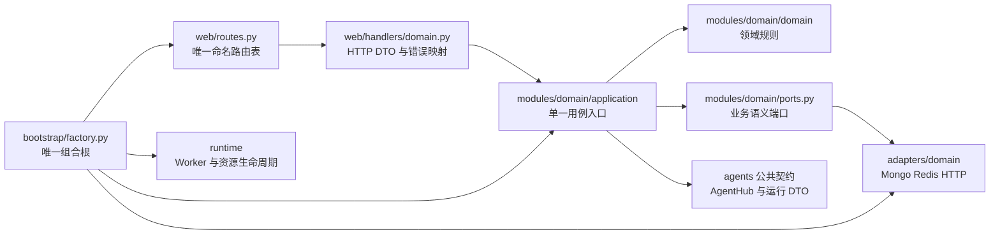

# API 实现架构合规与迁移指南

> 状态：当前治理基线
>
> 审计日期：2026-10-10；源码基线：`develop@c9b8988`，仅核对源码与文档
>
> 适用范围：本仓库 Tornado 进程注册的 28 条公开路由

## 1. 文档目的

本文把 [Shulan 应用架构](./application-architecture.md)落实到当前 API，实现三个目标：列出每组接口当前是否符合目标架构；明确仍然存在的兼容边界和生产风险；为 Web、业务模块、Runtime、Health Profile 与 Report 负责人提供可以独立交付的迁移方向。

本文不修改 [当前 API 契约](../api/API.md)。迁移期间必须保持请求字段、状态码、响应包络、SSE 事件顺序和 Report 回调契约不变。外部语音与通用文档解析服务虽然收录在聚合 API 文档中，但不由本仓库 Tornado 路由提供，不纳入本文的代码合规统计。

## 2. 审计结论

当前全部 28 条本地路由集中注册在 `web/routes.py`。Analysis、Record、Chat 已完成第一轮模块化；Health Profile 内部仍由旧包实现。Report 已接入 Agent、受控画像、产物/查询、Chat 追问、持久化受理/恢复和回调 Worker；肠道屏障通过独立服务与集合提供主报告。Health settings、统一错误映射、资源契约及兼容入口仍保留过渡实现。本轮源码核验不代表全部门禁或生产验收通过，完整状态见 [架构导航](README.md)。

合规状态使用以下定义：

- **第一阶段合规**：已满足集中路由、分域 Handler、显式依赖和应用服务归位，可以在保持兼容的前提下继续增量收口。
- **部分合规**：入口已使用新 Web 架构，但内部仍依赖 Service Locator、旧包、跨模块异常或具体基础设施。
- **Legacy**：仅为了兼容接入集中路由，尚未建立标准 Service、ports、持久任务或完整资源所有权。

## 3. 标准调用链



每条 API 最终必须满足以下规则：

1. `web/routes.py` 是唯一公开路由清单，每条 `URLSpec` 都有稳定且唯一的名称。
2. Handler 只处理 HTTP/SSE DTO、认证、传输校验和错误映射，并通过 `initialize()` 接收一个最小应用入口。
3. Handler 不从 `application.settings` 查找业务或运行时对象，不创建数据库、HTTP、模型 Client 或可靠后台任务；跨请求的准入能力通过类型化 Web Runtime Context 提供。
4. 应用服务只暴露本模块拥有的 Command、Query、Result 和稳定应用异常；跨业务模块调用通过本模块 port 完成，并在应用边界翻译外部异常。AgentHub 的稳定公共契约是明确允许的共享平台依赖，不视为业务模块互相调用。
5. 具体 MongoDB、Redis、HTTP、Prompt、Outbox、模型 Client、LLM Gateway 实现或文件实现只存在于 `adapters/`、`agents/` 基础设施内部或组合根，并由 `bootstrap/` 构造和注入；应用模块不得导入具体 Graph builder、节点或提供商 Client。
6. 已受理后必须继续执行的任务在成功响应前持久化；Worker、租约、重试、死信和 redrive 不由 Handler 临时创建。
7. Worker 与可关闭资源由 `ApplicationBundle`、WorkerRegistry 和 `ResourceRegistry` 明确持有，不依靠反射或隐式全局对象推断所有权。
8. HTTP 和 SSE 使用统一的应用错误分类；Handler 不按异常类名兼容，也不为每个接口重复捕获所有 `Exception`。

## 4. 当前接口合规矩阵

| 路由或路由组 | 数量 | 当前实现链 | 状态 | 主要未完成项 | 建议负责人 |
|---|---:|---|---|---|---|
| `/health`、`/health/live`、`/health/ready` | 3 | `web/handlers/health.py -> application.settings` | 部分合规 | 显式注入 RuntimeHealthService；移除 Handler 对 lifecycle、supervisor 和环境配置的字符串查找；删除固定延迟 | Web/Runtime |
| `/api/v1/interpret/health-report` | 1 | `web/handlers/analysis.py -> modules/analysis/application -> ports -> adapters` | 第一阶段合规 | 使用已构造且类型化的 AnalysisService；把 Health Profile 冲突翻译成 Analysis 自有异常；接入统一错误映射 | Analysis/Web |
| `/api/v1/qa/create` | 1 | `web/handlers/record.py -> modules/record/application -> ports -> adapters` | 第一阶段合规 | Record 应用层翻译 Analysis/Health Profile 异常，Handler 不再同时认识三个模块；接入统一 DTO 和错误映射 | Record |
| 其余 `/api/v1/qa/*` | 6 | `web/handlers/record.py -> modules/record/application -> ports -> adapters` | 第一阶段合规 | 用稳定 Record 应用异常替代宽泛 `ValueError`；移除逐 Handler 的 `except Exception`；逐步拆分过大的应用服务 | Record/Web |
| `/api/v1/chat/*` | 5 | `web/handlers/chat.py -> modules/chat/application -> ports -> adapters` | 第一阶段合规 | 删除按异常类名兼容和宽泛异常映射；统一 HTTP/SSE 错误分类；新模块公共入口停止绕经 `services.chat` | Chat/Web |
| `/api/v1/health-profile/*` | 8 | `web/handlers/health_profile.py -> modules/health_profile` 懒门面 -> 顶层 `health_profile/` | 部分合规 | 包含原报告指标查询；内部 ports、Repository/Worker、builder 与资源所有权仍需收口 | Health Profile |
| `/api/v1/report` | 1 | `web/handlers/report.py -> DurableReportService -> ReportPipeline`，由 `bootstrap/` 与 `adapters/` 组装注入 | 部分合规 | 现有持久化、Agent 与画像接线需真实环境验收；单一应用入口和资源契约继续收口 | Report |
| `/api/v1/report/list`、`/api/v1/report/get` | 2 | `web/handlers/report_query.py -> report_artifact_store` | 部分合规 | 已保存产物查询与用户隔离；稳定查询用例/错误及统一 DTO 继续收口 | Report/Web |
| `/api/v1/gut-barrier/report` | 1 | `web/handlers/gut_barrier.py -> GutBarrierService` | 部分合规 | 独立存储、恢复和主报告投递已接线；模板/回调、真实样本与部署验收待完成 | Gut Barrier |

路由层迁移本身已经完成；上表中的“第一阶段合规”不表示最终收口完成。Analysis、Record、Chat 仍共同受第 9 节的错误映射、类型化容器、Agent 公共契约和兼容入口债务影响；全部 Handler 还共同依赖第 5.3 节所述的生命周期准入迁移。

## 5. Health 探针迁移方向

### 5.1 当前问题

`HealthCheckHandler`、`LivenessHandler` 和 `ReadinessHandler` 当前从 `application.settings` 读取 `lifecycle` 与 `task_supervisor`，架构测试也明确跳过了这三条路由的显式依赖检查。`/health` 还通过固定 `asyncio.sleep(1)` 制造延迟。它们属于运行时接口，不需要业务 Service，但仍应使用明确的只读端口。

### 5.2 目标接口

在 `runtime/health.py` 定义不依赖 Tornado 的 `RuntimeHealthService` 或等价只读接口，返回稳定的 liveness、readiness、生命周期状态、活跃请求数和活跃任务数。`bootstrap/` 使用 `ApplicationLifecycle`、`TaskSupervisor` 和环境信息构造该对象，三条路由通过 `URLSpec` kwargs 注入同一个实例。

```python
class RuntimeHealthService(Protocol):
    def liveness(self) -> HealthView: ...
    def readiness(self) -> HealthView: ...
    async def diagnostics(self) -> HealthView: ...
```

迁移完成后应删除 Health Handler 对 `application.settings`、`config.env` 和固定 sleep 的依赖，并把三条路由纳入显式注入架构门禁。liveness 必须只回答进程是否存活，不调用慢外部依赖；readiness 只读取能否接收新流量的权威状态；需要真实依赖探测时单独定义诊断语义和超时预算。

### 5.3 全部请求的生命周期准入

Health 探针不是唯一的 settings 依赖。全部业务 Handler 继承的 `LifecycleRequestHandler` 当前也从 `application.settings['lifecycle']` 取得请求准入和租约来源。该能力属于跨请求的 Web Runtime 关注点，不应被复制到每条业务路由的 kwargs，也不应继续使用字符串 Service Locator。

目标是在 `web/application.py` 建立类型化 `ShulanApplication` 与只读 `WebRuntimeContext`。`bootstrap/` 使用唯一的 `ApplicationLifecycle`、`TaskSupervisor` 等运行对象构造 Context，`LifecycleRequestHandler` 通过类型化 `self.application.runtime_context.request_admission` 获取准入端口；`RuntimeHealthService` 读取同一个 Context 的快照。Context 不能包含业务 Service、Worker、数据库或外部 Client。

迁移必须验证普通 HTTP、SSE、Report 显式注入路由、Health 豁免、DRAINING 拒绝和请求租约释放仍读取同一状态源。完成后删除 `web/lifecycle.py` 与 Runtime fallback 中对 `settings['lifecycle']` 的读取，并增加禁止字符串生命周期查找的架构门禁。

## 6. Analysis 与 Record 的跨模块边界

### 6.1 当前问题

`HealthReportHandler` 直接捕获 Health Profile 的 `HealthReportSourceConflictError`；`QASessionCreateHandler` 同时认识 Analysis 与 Health Profile 异常，并保留按异常类名映射状态码的兼容代码。这使 Web 层承担了跨域编排知识，模块内部实现重命名也会影响 HTTP Adapter。

### 6.2 目标方向

Analysis 对 Health Profile 来源保存的依赖应在 `modules/analysis/ports.py` 以业务语义端口表达，Adapter 抛出的异常由 Analysis 应用服务翻译为 `AnalysisConflictError`、`AnalysisUnsupportedInputError` 和 `AnalysisDependencyError`。Record 对报告处理的依赖同样通过 `HealthReportProcessor` port 调用，并翻译为 Record 自有的 `RecordConflictError`、`RecordInvalidInputError` 和 `RecordDependencyError`。

Handler 最终只导入自己所服务模块的 Command、Result 和应用异常。跨模块异常翻译必须在应用服务边界完成，不能通过异常类名字符串维持兼容。

## 7. Health Profile 迁移方向

### 7.1 当前问题

八条 Health Profile 路由已经显式注入 `HealthProfileService`，包含原报告指标分页查询；但 `modules/health_profile/application` 仍是对顶层 `health_profile/` 的懒加载门面。内部 Repository、Store、Worker 和生产构造尚未全部按 ports/adapters 分离。

### 7.2 目标目录

```text
modules/health_profile/
├── domain/
│   ├── models.py
│   ├── policies.py
│   └── errors.py
├── application/
│   ├── commands.py
│   ├── queries.py
│   └── service.py
├── ports.py
└── workers.py

adapters/health_profile/
├── mongodb.py
├── job_queue.py
├── sources.py
└── agent_extraction.py
```

迁移应先固定 `HealthProfileService` 的公共 Command/Query/Result，再把 Repository、JobQueue、来源读取和候选抽取定义为模块自有 ports；随后机械移动领域代码和具体 Adapter，最后由 `bootstrap/` 提供无副作用 builder。Worker 必须通过标准 WorkerRegistry 注册，全部 Client 通过 `ResourceRegistry` 声明所有权。旧顶层包可以在调用方迁完前保留单向兼容 re-export，但新模块不得反向导入旧包。

## 8. Report 负责人交接方向

### 8.1 当前实现与边界

生产 `/api/v1/report` 通过 route kwargs 注入 `DurableReportService`，先持久化再返回 processing。生成、恢复和回调 Worker 由 runtime 周期调度；显式注入旧 Pipeline 的测试或嵌入方保留进程内兼容路径。Report Graph、受控画像、共享文件服务、五类产物存储、列表/详情和 Chat 报告上下文均已接线。

中断恢复保留已保存产物，并为缺失类型生成确定性失败结构，不重新调用解析或模型。回调独立持续退避补投，接收端须幂等；当前没有回调尝试次数上限、死信终止或 TTL。详细状态与验收见 [Report Agent 指南](report-agent-integration-guide.md) 第 14 节。肠道屏障使用独立集合和服务，主报告/解读分工见 [肠道屏障 Wiki](../../wiki/gut-barrier.md)。

### 8.2 剩余治理方向

1. 收口 Handler 的单一应用入口、稳定 Command/Query/Result/Error 和完整模块资源声明，逐步移除旧 Pipeline 反射探测与兼容构造。
2. 保持模型只经 AgentHub/LLMGateway，统一 AI 静态扫描已包含 adapters；后续持续验证实际生产调用链。
3. 验证真实 MongoDB 多进程领取、续租、进程强退、补偿及回调幂等；不以替身测试替代部署验收。
4. 独立 Worker 进程、通用 WorkerRegistry 和医生审核/删除治理另行设计；不重复创建现有任务与产物仓库。

[应用架构第 9 节](application-architecture.md#9-report-未来接入契约)保留进一步收口的设计参考，其中旧接口签名和 activation/release 方案不是当前实现契约；[旧迁移手册](report-api-migration-guide.md)仅供历史背景参考。

## 9. 共用 Web 与兼容层收口

### 9.1 统一 DTO 与错误映射

当前 Analysis、Record、Chat 和 Health Profile Handler 普遍各自解析 JSON、捕获宽泛异常并重复构造 HTTP/SSE 错误。应建立不含业务规则的 `web/schemas/` 与 `web/errors.py`：DTO 负责字段形状和传输校验，错误映射器只接受稳定应用异常类别并产生当前 API 包络。未知异常统一交给 `BaseHandler` 记录并返回 500，SSE 使用相同错误码生成终态 `error` 事件。

每个业务模块必须先提供稳定应用异常，Web 层才能删除 `ValueError`、异常类名字符串和逐 Handler 的 `except Exception`。这一迁移必须由模块负责人和 Web 负责人一起完成，避免错误状态码漂移。

### 9.2 类型化组合根

`AppContainer` 当前多数业务字段仍标注为 `Any`。各模块公共入口稳定后，应改用 `AnalysisService`、`RecordService`、`ChatService`、`HealthProfileService`、`RuntimeHealthService` 和 Worker Protocol；路由只读取这些稳定类型。`web/application.py` 的 `debug`、环境名和日志设置应由 `bootstrap/` 显式传入，避免 Web 模块在导入时读取业务配置。

### 9.3 删除兼容环

`modules/{analysis,chat,record}/application/__init__.py` 当前仍懒加载 `services.*`，而 `services/*.py` 又反向 alias 到 `modules/*/application/service.py`。正确过渡方向只能是旧路径单向 re-export 新路径：新模块公共入口直接加载本模块 `service`，旧 `services.*` 暂时 re-export 新模块，确认没有旧调用方后删除旧路径。

`server.py` 当前还动态创建旧 Handler 别名并通过 settings 回填业务 Service；`main.py` 也仍经 `server.run()` 启动。迁移契约测试和外部调用方后，生产入口应直接进入 `bootstrap/` 与 `runtime/`，`server.py` 只保留无业务查找的薄转发或删除。

### 9.4 收窄 Tornado settings

最终 `application.settings` 只保留 Tornado 框架级设置和框架运行必需对象。业务 Service、AgentRuntime、Worker、来源服务和 Pipeline 通过路由 kwargs、`AppContainer` 或 `ApplicationBundle` 持有。删除顺序应为：先迁移生产调用方和测试，再删除 `server.py` fallback，随后删除 `AppContainer.compatibility_settings()` 中的非框架 key，最后增加禁止新增业务 settings 的静态门禁。

### 9.5 AgentHub 公共契约边界

`agents/` 是共享 AI 平台，业务应用层可以依赖其稳定公共契约，例如 `AgentHub`、`AgentRequest`、`AgentRunContext`、Result/Event DTO 和稳定 capability 标识；这是一项经过批准的平台依赖，不要求每个业务模块再包装一个无语义增益的 AI port。具体 `AionLLMGateway`、模型 Client、Graph builder、Graph 节点和提供商配置仍属于平台内部或 Adapter，不得进入业务应用层。

当前 Analysis、Record、Chat 从 `agents.graphs.*` 导入 capability 常量。Platform 负责人应把稳定 capability 标识提升到 `agents` 公共 facade 或独立公共注册表，业务模块随后改用公共导入；架构门禁应允许公共契约并禁止应用层导入 `agents.graphs` 的实现路径。

## 10. 负责人交付清单

每个接口负责人提交迁移 PR 时应确认：

- [ ] API.md 中的请求、响应、状态码、SSE 或回调契约没有变化；如确需变化，已按 API 编辑手册版本化。
- [ ] 路由只在 `web/routes.py` 注册，名称稳定且唯一。
- [ ] Handler 只依赖一个本模块应用入口或一个运行时只读端口。
- [ ] Handler 不读取业务 settings、不创建具体 Client、不启动可靠后台任务。
- [ ] Command、Query、Result 和 Error 的所有权属于当前模块。
- [ ] 跨模块和 Adapter 异常已在应用边界翻译。
- [ ] 具体基础设施只在 Adapter 中实现并由 bootstrap 注入。
- [ ] Worker 和资源所有权显式，关闭顺序和失败路径有测试。
- [ ] HTTP、SSE、应用服务、Adapter、bootstrap 和架构门禁测试已覆盖。
- [ ] 旧入口只保留单向兼容，并有明确删除条件和 TODO。

## 11. 推荐实施顺序

1. Report 负责人基于已有 Agent、产物/查询、Chat 和持久化链路完成真实环境验收，并继续收口应用入口与资源契约；不重复实施旧六步计划。
2. Health Profile 负责人完成 ports/Adapter、builder 与 Worker 所有权拆分。
3. Web/Runtime 负责人改造三条 Health 探针和全部请求的类型化 WebRuntimeContext，并建立统一错误映射。
4. Analysis、Record、Chat 负责人提供稳定模块异常和 DTO，使 Web 层删除宽泛兼容逻辑。
5. Platform 负责人收紧 AppContainer 类型、WorkerRegistry、Tornado settings、`services/` 与 `server.py` 兼容面。
6. 在 Linux 和真实进程管理器中验证长 HTTP、SSE、Worker、Report 恢复和退出码。

## 12. 验证门禁

至少应长期保留以下自动化门禁：

- 路由完整、命名、唯一且无隐式注册；
- 所有 Handler 包括 Health 与 Report 都显式注入；
- Handler 不导入基础设施、不使用业务或 lifecycle 字符串 settings；
- 除 `agents` 公共契约与纯工具外，应用层的业务依赖只来自本模块 domain/ports，不依赖 Tornado、旧 `services/` 或具体 Adapter；
- 应用层只从 `agents` 公共 facade 使用 AgentHub 契约，不导入 `agents.graphs`、具体 Gateway 或模型 Client；
- 统一错误码和 SSE 终态契约测试；
- bootstrap 单次构造与 Protocol 注入测试；
- Worker 原子领取、续租、重试、死信、redrive、幂等和强退恢复测试；
- ResourceRegistry/WorkerRegistry 的逆序关闭、幂等和多失败聚合测试。

当前实施状态和负责人快速索引见 [API 架构实施状态 Wiki](../../wiki/api-architecture.md)。
