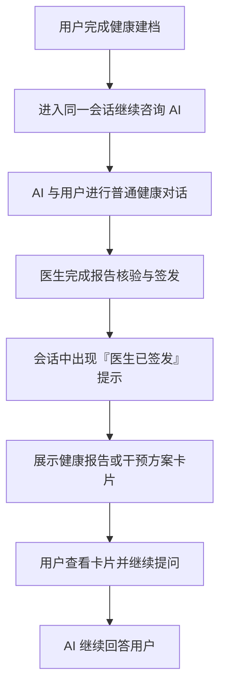

# 医生签发内容插入对话流设计草案

> 状态：历史草案，第一版已于 2026-08-14 实现
>
> 状态复核：2026-09-03，源码基线 `6625647`；后续字段和 Outbox 已迭代，本文不作为现行实施或 API 契约
>
> 当前实施规范：[`chat-doctor-signed-card.md`](chat-doctor-signed-card.md)
>
> 当前 API 契约：[`../api/API.md`](../api/API.md)
>
> 适用范围：建档完成后，同一会话中的普通 AI 对话

本文保留需求形成阶段的设计背景。第一版最终采用的字段、状态码和调用方式以当前实施规范与 API 文档为准；下文明确标记为“原始建议”或“未来方向”的内容不属于现行接口契约。

当前实现已使用 `displayType/customType/title/content/payload`，并在 AI 忙碌时先持久化 Outbox、返回 `202 queued`。本草案中的旧建议不应覆盖这些行为。会话级 SSE、WebSocket 和卡片自动进入模型上下文均未实现；完整状态见 [架构导航](README.md)。

## 1. 需求背景

用户完成健康建档后，可以在同一个会话中继续与 AI 健康助手交流。建档数据同时用于生成健康报告，报告经过真实医生核验和签发后，需要以区别于普通文本消息的卡片形式出现在该会话中。

该功能不表示医生人工接管对话。医生只负责核验和签发专业内容；卡片送达后，对话仍由 AI 继续服务。

客户端看到的流程：



医生签发和卡片送达是异步事件，不要求用户正在发送一条模型消息。

## 2. 第一版实施结果

第一版已经实现以下能力：

1. 可信业务系统通过接口向指定用户、指定会话插入一条自定义消息。
2. 自定义消息使用 Shulan 业务角色 `custom`，不伪装成用户、AI 或模型系统消息。
3. 历史接口按消息顺序返回该消息，前端据此渲染报告卡片。
4. 调用方使用非空 `content` 传入用户可直接阅读的正文；`displayType` 标识展示形式，`customType` 标识业务内容类型，`title` 提供可选展示标题。
5. 每次插入使用稳定的 `eventId` 保证幂等，避免重试产生重复卡片。
6. 建档正式结束后即进入普通对话阶段，无需等待用户先发送消息；进行中的建档问答不能接收卡片，也不会被提前结束。
7. 服务端固定保存 `aiContextMode=none`，卡片内容和 `payload` 均不参与后续 AI 对话。
8. 卡片插入、用户发言和 AI 回复复用同一个业务 Session lease，避免并发覆盖。
9. 请求内容先写入 MongoDB Outbox；AI 正在输出时返回 `202 queued`，待完整 AI 回复保存后再把卡片追加到其后，服务重启后可以继续恢复投递。

第一版不包含医生直接发送普通文本并接管对话、生产客户端视觉规范、完整报告审核流程、实时推送、卡片更新或撤回，以及 AI 自动读取卡片关联报告。API 测试页面已经提供卡片模拟样式，但不作为生产客户端视觉稿。

## 3. 消息角色与模型边界

`custom` 是 Shulan 对话业务协议中的角色，不是 OpenAI/AION 模型消息角色：

```json
{
    "role": "custom",
    "displayType": "CARD",
    "customType": "HEALTH_REPORT_CARD",
    "title": "健康评估报告",
    "content": "您的健康报告已经由医生审核完成，请点击查看详情。"
}
```

因此必须遵循以下边界：

- `custom` 消息可以保存在业务会话并返回给客户端。
- 前端通过 `role=custom` 识别卡片，并从 `payload` 读取必要的展示信息。
- `custom` 消息不得原样发送到只接受标准角色的模型接口。
- 插入卡片不会调用 AgentHub、LangGraph、AionLLMGateway 或 AION Context。
- 当未来需要卡片影响 AI 时，由 Agent 根据 `reportId` 加载对应的权威报告，并转换为受控的可信上下文。

## 4. 第一版实际消息结构

```json
{
    "messageId": "msg_01",
    "eventId": "report-signed-20260814-001",
    "role": "custom",
    "displayType": "CARD",
    "customType": "HEALTH_REPORT_CARD",
    "title": "健康评估报告",
    "content": "您的健康报告已经由医生审核完成，请点击查看详情。",
    "payload": {
        "reportId": "report_001",
        "reportType": "health_report",
        "version": 1
    },
    "aiContextMode": "none",
    "timestamp": "2026-08-14T10:30:01+08:00"
}
```

| 字段 | 说明 |
| --- | --- |
| `messageId` | Shulan 生成的消息唯一标识。 |
| `eventId` | 上游业务事件唯一标识，用于幂等插入。 |
| `role` | 固定为 `custom`。 |
| `displayType` | 可选展示形式；当前只允许 `CARD`，未传时也默认为 `CARD`。 |
| `customType` | 可选业务内容类型，受服务端枚举限制；未传时默认为 `DOCTOR_MESSAGE_CARD`。 |
| `title` | 可选展示标题。 |
| `content` | 用户可以直接阅读的正文。 |
| `payload` | 权威资源引用及未来扩展数据，不保存完整大报告。 |
| `aiContextMode` | 第一版由服务端固定为 `none`，调用方不能控制。 |
| `timestamp` | 服务端实际插入会话的时间。 |

完整报告仍由报告领域保存。聊天消息保留展示快照、资源 ID 和版本，以便报告更新或撤回后仍可追溯当时送达的内容。

原始草案曾把 `customType` 作为未来方向，现行契约已经将其提升为受枚举约束的顶层字段，使客户端不需要解析 `content` 或 `payload` 才能确定卡片样式。`source` 仍未作为输入字段；医生身份与签发审计未来应从权威报告记录或认证上下文获取，不能仅依赖插卡请求体。

## 5. 已实现接口

第一版提供以下业务消息插入接口：

```http
POST /api/v1/chat/messages/custom
Content-Type: application/json
```

请求示例：

```json
{
    "eventId": "report-signed-20260814-001",
    "userId": "user_001",
    "sessionId": "session_001",
    "displayType": "CARD",
    "customType": "HEALTH_REPORT_CARD",
    "title": "健康评估报告",
    "content": "您的健康报告已经由医生审核完成，请点击查看详情。",
    "payload": {
        "reportId": "report_001",
        "reportType": "health_report",
        "version": 1
    }
}
```

服务端固定写入 `role=custom` 和 `aiContextMode=none`，不允许调用方通过该接口伪造 `user`、`assistant` 或 `system` 消息。服务端负责生成 `messageId` 与 `timestamp`。本轮按产品决定暂不实现应用层鉴权，因此当前不会从认证信息记录调用来源。

请求先保存到 MongoDB Outbox。会话空闲且立即投递时返回 HTTP 200 和已保存消息；AI 正在输出时返回 HTTP 202、`status=pending`、`message=null`，医生端无需等待或重试。同一个 `eventId` 与相同 `displayType/customType/title/content/payload` 重复调用时返回当前状态及 `created=false`，不再创建第二个事件。相同 `eventId` 对应不同消息字段时返回 `409`。

## 6. AI 上下文控制

第一版只有一种已实现行为：

| `aiContextMode` | 当前行为 |
| --- | --- |
| `none` | 只向客户端展示，完全不进入模型上下文；由服务端固定写入。 |

草案中的 `summary` 和 `full` 没有进入第一版接口。未来若有真实业务需求，可以把它们作为 Agent 的报告读取策略重新评审；Agent 应读取当前有效版本的权威报告，而不是把 `custom` 消息或卡片标识直接交给模型。

报告更新、撤回、历史卡片状态变化以及 Agent 对报告版本的选择均属于后续功能。

## 7. 会话规则

- 建档已经正式结束且普通对话状态已经建立：在取得会话 lease 后按顺序追加自定义消息。
- 建档已经正式结束但用户尚未发送普通聊天消息：服务端初始化普通对话状态后插入卡片。
- 建档问答仍在进行：返回 `409`，避免破坏两小时临时建档流程。
- 会话不存在：返回 `404`，不会创建空 Chat 会话。
- 请求内容在获取 lease 前先进入持久化 Outbox；投递、用户发送消息和 AI 回复使用同一业务会话 lease，防止并发覆盖 `messages`。
- AI 正在输出时卡片保持 `pending`，完整 assistant 消息保存并释放 lease 后再追加卡片。

当前数据库中，建档结束后的会话可能短暂保存为 `type=qa,status=completed`。这是内部延迟转换形态，不表示业务上仍处于 QA 过程，也不是对 API 调用方公开的目标会话类型。

## 8. 客户端展示约定

- `role=user`：用户消息气泡。
- `role=assistant`：AI 助手消息气泡。
- `role=system`：现有系统提示；不用于医生报告卡片。
- `role=custom`：先根据 `displayType` 选择顶层渲染方式，再根据 `customType` 选择具体卡片样式，使用 `title/content` 展示标题和正文，并从 `payload` 读取权威资源引用。

医生报告卡片应明确展示“医生已审核/已签发”、报告标题、签发时间和查看入口，视觉上不得伪装为 AI 回复。

当前选择在用户进入/恢复页面时同步历史，并在会话页面保持前台期间定时轮询；长期 SSE 与 WebSocket 暂缓。若后续要求即时送达，可以增加独立会话事件长连接，但不复用单次 AI 回复的短生命周期 SSE。四种方案、长期 SSE 调用模型和持久化队列设计见 [`chat-doctor-signed-card.md`](chat-doctor-signed-card.md) 第 11 节。

## 9. 安全与审计

按照本轮产品决定，第一版暂不实现应用层身份认证。该接口能够制造“医生签发”业务内容，生产环境不能把它作为无保护的公网能力开放；在增加项目级认证前，应由网络隔离或可信 API 网关限制调用方。

后续可以评审内部服务 Token，例如 `SHULAN_INTERNAL_API_TOKEN` 与 `Authorization: Bearer <token>`。Token 不得写入日志、测试文件或 Git。医生身份和签发审计应来自权威报告记录，不能只相信请求体中的自报字段。

当前已经对 `content`、`eventId`、`title` 和 `payload` 进行非空、类型、长度、JSON 可序列化及大小校验，并对 `displayType` 和 `customType` 实施枚举白名单。

## 10. 第一版验收状态

- [x] 相同签发事件在同一用户、同一会话中最多出现一次。
- [x] 服务端固定保存 `role=custom`。
- [x] 卡片在业务历史中保持正确顺序，并由历史接口返回。
- [x] 客户端测试页面可以识别并独立渲染 `custom` 消息。
- [x] 卡片不改变 AION 保存或重建的模型上下文。
- [x] 未完成建档不会因卡片插入而转换成普通聊天。
- [x] 建档结束后无需等待用户先发消息，卡片可以成为第一条主动业务消息。
- [x] 不存在的会话不会被自动创建。
- [x] 用户消息、AI 回复和卡片插入复用同一 Session lease，不会并发覆盖。
- [x] AI 输出期间的医生消息可靠进入 Outbox，并在完整 assistant 消息之后投递。
- [x] 服务启动后的周期扫描可以恢复遗留 `pending` 事件。
- [x] 单元测试与 API Handler 契约测试覆盖成功、幂等、冲突和上下文隔离。

## 11. 已确认决策与后续方向

第一版已经确认：

1. `content` 是用户可直接阅读的非空正文，最长 16,384 个字符。
2. `displayType` 是可选顶层字段，当前只允许 `CARD`，未传时也默认为 `CARD`。
3. `customType` 是可选顶层字段，未传时默认为 `DOCTOR_MESSAGE_CARD`；首版支持 `DOCTOR_MESSAGE_CARD`、`HEALTH_REPORT_CARD`、`INTERVESE_CARD`、`DIAGNOSIS_CARD`。`INTERVESE_CARD` 保留客户提出的原始协议拼写。
4. `title` 是可选顶层展示字段，最长 256 个字符。
5. 会话不存在时返回 `404`，不自动创建 Chat 会话。
6. 第一版只支持由服务端固定写入的 `aiContextMode=none`。
7. 第一版已经实现可靠排队和自动投递，但不提供实时推送；客户端通过轮询或恢复历史发现卡片。
8. 报告更新、撤回和卡片失效尚未实现，后续需要独立设计事件与展示规则。

后续可选方向包括统一内部服务认证、卡片类型注册表、生产客户端视觉协议、实时事件通道、卡片更新与撤回，以及 Agent 通过受控 ReportRepository 读取当前有效报告。
