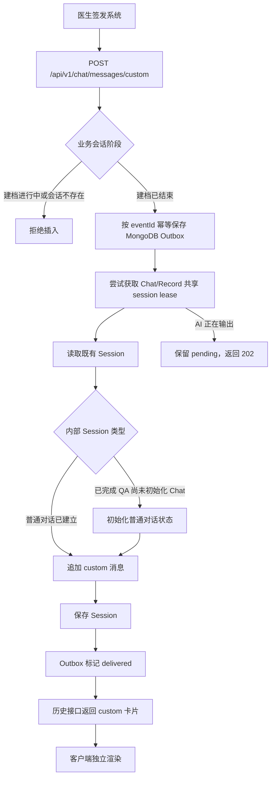
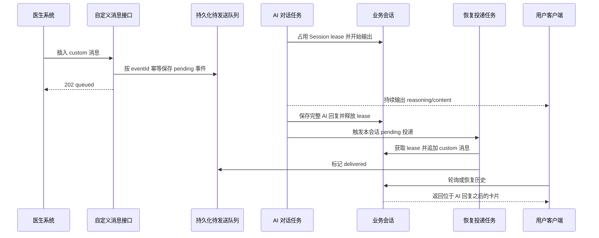

# 医生签发内容插入对话流设计

> 状态：第一版 Outbox 投递已实现；长 SSE/WebSocket 暂缓，非当前接口
>
> 更新日期：2026-09-03；源码基线：`6625647`
>
> 适用范围：既有普通 Chat，以及建档已正式结束后延续的同一业务会话

当前实现入口为 `web/handlers/chat.py`、`modules/chat/application/service.py`、`adapters/messaging/chat_outbox.py`，周期恢复投递由 `runtime/application.py` 调度。第 11.2、11.3、11.6 节为未实施备选，不应据此调用不存在的 `/chat/events` 接口。整体状态见 [架构导航](README.md)。

## 1. 目标

真实医生核验并签发报告、诊断意见或干预方案后，业务系统可以向已经结束建档并进入普通对话阶段的既有会话插入一条 `custom` 消息。后续该能力也可以承载医生主动发送的其他业务内容。客户端把它渲染成区别于用户和 AI 文本气泡的卡片。

该功能不是医生接管对话，也不是一次模型调用。卡片送达后，用户仍可继续和 AI 对话。

## 2. 已确认边界

1. `custom` 是 Shulan 业务消息角色，不是 OpenAI/AION 模型角色。
2. 自定义消息写入业务 Session，并由历史接口按原顺序返回。
3. 第一版固定 `aiContextMode=none`，消息内容和 `payload` 都不进入模型上下文。
4. 插入过程不调用 AgentHub，因为它不包含 AI 推理。
5. 调用方使用 `displayType` 标识展示形式、`customType` 标识业务内容类型，并使用 `content` 提供可直接展示的正文；服务端固定 `role=custom`，不能借此伪造 `system`、`user` 或 `assistant` 消息。
6. 第一版不提供实时推送；在线客户端通过重新获取历史或产品现有通知机制发现卡片。
7. 第一版暂不实现接口认证，但该接口不能在生产环境中作为无保护的公网能力开放。

## 3. 调用与数据流



该链路没有通向 AgentHub、LangGraph、AionLLMGateway 或 AION Context 的边。

## 4. 消息结构

```json
{
    "messageId": "13c63166-0b5f-45ce-b91d-58db56df72f8",
    "eventId": "report-signed-20260814-001",
    "role": "custom",
    "displayType": "CARD",
    "customType": "HEALTH_REPORT_CARD",
    "title": "健康评估报告",
    "content": "您的健康报告已经由医生审核完成，请点击查看详情。",
    "payload": {
        "reportId": "report-001",
        "reportType": "health_report",
        "version": 1
    },
    "aiContextMode": "none",
    "timestamp": "2026-08-14T10:30:00+08:00"
}
```

| 字段 | 所有者 | 说明 |
|---|---|---|
| `messageId` | Shulan | 消息唯一 ID，由服务端生成 |
| `eventId` | 调用方 | 上游业务事件幂等键 |
| `role` | Shulan | 固定为 `custom` |
| `displayType` | 调用方/Shulan | 可选展示形式；当前只允许 `CARD`，未传时也保存为 `CARD` |
| `customType` | 调用方/Shulan | 可选业务内容类型；未传时保存为 `DOCTOR_MESSAGE_CARD` |
| `title` | 调用方 | 可选展示标题，最长 256 个字符；未传时不保存该字段 |
| `content` | 调用方 | 用户可直接阅读的正文，必填，最长 16,384 个字符 |
| `payload` | 调用方 | 权威资源引用和未来扩展数据，最大 16 KiB |
| `aiContextMode` | Shulan | 第一版固定为 `none` |
| `timestamp` | Shulan | 实际插入业务会话的服务端时间 |

首版 `displayType` 只有一个枚举值：

| 枚举值 | 使用场景 |
|---|---|
| `CARD` | 客户端使用业务卡片展示消息 |

首版 `customType` 枚举如下：

| 枚举值 | 使用场景 |
|---|---|
| `DOCTOR_MESSAGE_CARD` | 通用医生主动消息，也是未传字段时的默认值 |
| `HEALTH_REPORT_CARD` | 医生审核并签发的健康报告 |
| `INTERVESE_CARD` | 医生签发的干预方案；保留客户约定的原始拼写 |
| `DIAGNOSIS_CARD` | 医生签发的诊断意见 |

`displayType` 决定客户端使用哪一种顶层渲染方式，`customType` 决定该渲染方式下的业务内容与具体卡片样式。虽然当前枚举值都带有 `CARD` 后缀，客户端仍不能仅解析名称后缀代替判断 `displayType`。`INTERVESE_CARD` 保留客户约定拼写，这些字符串是稳定协议值。正文由 content 承载，payload 建议只保存资源 ID、类型、版本等引用；若采用外部详情页，完整内容由签发/业务系统保存并提供，不能假定 Shulan 已有最终报告存储或查询 API。

## 5. 幂等与并发

幂等范围为：

```text
(userId, sessionId, eventId)
```

- 首次请求：先创建 Outbox 事件并返回 `created=true`；会话空闲时立即投递，会话繁忙时返回 `202 queued`。
- 相同事件和相同消息字段重试：返回现有 `pending/delivered` 状态和 `created=false`，不重复创建事件或追加消息。
- 相同 `eventId` 但 `displayType/customType/title/content/payload` 任一不同：返回 `409`，不覆盖既有卡片。

请求内容在尝试获取 lease 前已经保存到 MongoDB Outbox。卡片投递与用户发言、AI 回复、QA 完成操作使用同一个业务 session lease。因此同一会话内串行，不同会话可以并行，避免整份 Session `replace_one` 互相覆盖，也不会因为 AI 长时间输出而丢失医生消息。

## 6. 会话规则

| 业务阶段 | 行为 |
|---|---|
| 建档已经正式结束，普通对话已经建立 | 直接追加 |
| 建档已经正式结束，但用户尚未发送普通聊天消息 | 初始化普通对话状态后追加；卡片可以成为第一条主动业务消息 |
| 建档问答仍在进行 | 返回 `409`，不会插入卡片或提前结束建档 |
| 会话不存在 | 返回 `404`，不创建空会话 |
| 其他未知会话类型 | 返回 `409` |

在当前持久化实现中，建档结束后的会话可能暂时仍保存为 `type=qa,status=completed`，直到第一个 Chat 侧事件到达。这只是内部延迟转换状态，不表示接口允许在 QA 过程中插入卡片。调用方只需要判断建档是否已经正式结束，不需要等待用户主动发送普通聊天消息。

转换生成的 QA 系统摘要仍按既有规则在用户首次发言时建立 AI Context；`custom` 消息会被上下文渲染器明确忽略。

## 7. 模型上下文隔离

当前聊天模型历史由 AION Context Repository 管理。插卡接口不会调用 Gateway，所以不会修改 AION Context。旧会话在 Context 丢失后从业务历史重建时，只渲染 `system/user/assistant`，忽略 `custom` 及其 `payload`。

如果未来需要 AI 理解医生报告，应采用以下方向：

```text
custom 消息中的 reportId
  -> Agent 通过受控 ReportRepository 读取当前有效版本
  -> 校验签发、撤回和版本状态
  -> 转换为明确标注“医生审核内容”的可信模型上下文
```

不能把 `custom` 角色或卡片 JSON 原样发送给 OpenAI/AION，也不能让历史卡片替代报告领域的权威数据。

## 8. 安全与后续认证

当前项目没有统一应用层认证，本轮按产品决定暂不新增认证代码。生产部署必须通过网络隔离或可信 API 网关限制调用方，普通用户不能直接调用该接口伪造医生内容。

后续推荐增加通用的内部服务认证，例如：

```text
SHULAN_INTERNAL_API_TOKEN
Authorization: Bearer <token>
```

Token 不得进入日志、页面、测试 fixture 或 Git。医生身份和签发审计应来自权威报告记录，不能只相信插卡请求体中的自报字段。

## 9. 第一版不包含

- 医生发送普通文本并接管对话。
- WebSocket、长期 SSE 或其他实时卡片推送通道。
- 卡片更新、撤回、失效和版本迁移事件。
- AI 自动读取或解释卡片关联报告。
- 把完整报告复制到聊天 Session。

## 10. 验收标准

- 同一签发事件在历史中最多出现一次。
- `role` 永远由服务端写为 `custom`。
- 未完成建档或不存在的会话不能接收卡片。
- 完成 QA 可转换为 Chat 并接收卡片。
- 卡片与用户/AI 消息使用同一并发保护和时间顺序。
- AI 输出期间收到的卡片先持久化，并在完整 AI 回复之后写入历史。
- 服务重启后可以恢复投递仍为 `pending` 的 Outbox 事件。
- 历史接口完整返回卡片字段。
- Context 重建和正常模型调用均不包含 `custom` 内容。
- API 页面可以插入并以独立样式回放卡片。

## 11. 异步卡片发现与实时推送方案

> 当前决策：采用进入/恢复页面同步历史与前台定时轮询；长期 SSE/WebSocket 暂缓

当前实现已经通过 MongoDB Outbox 可靠接收医生消息并写入业务历史，但尚未通过长连接主动推送给用户客户端。医生系统与用户客户端不是同一个调用方时，保持打开的用户页面仍需重新请求历史才能发现新卡片。当前客户选择在会话页面前台定时检查，用户离线时不轮询，后续进入或恢复页面时再同步历史。

### 11.1 四种方案与当前选择

| 方案 | 发现时机 | 实时性 | 客户端与服务端代价 | 当前结论 |
|---|---|---|---|---|
| 进入/恢复页面同步历史 | 页面首次进入、重新进入或从后台恢复 | 低 | 最简单，无常驻请求 | 作为离线恢复和最终兜底 |
| 前台定时轮询 | 页面保持前台时每隔数秒查询 | 秒级 | 客户端需要定时器；服务端承受周期请求 | **当前采用** |
| 会话级长期 SSE | 页面停留期间保持服务器单向事件连接 | 实时 | 需要长连接、心跳、重连和多实例分发 | 暂缓 |
| WebSocket | 页面停留期间保持双向连接 | 实时 | 协议和运维复杂度最高，但更适合双向事件与小程序 | 暂缓 |

当前方案实际是“方案 2 + 方案 1”：在线会话使用轮询发现变化，进入/恢复页面时使用完整历史补偿。现有 `/chat/history` 会原样返回 Session 的 `messages`，其中包含已保存的 `custom` 消息，因此后端已有接口可以支持第一版。当前接口没有增量游标，每次会返回完整历史；会话规模增大后再评审 `afterSequence` 等增量读取能力。

生产客户端仍需要实现以下行为，本项目中的 API 测试页面目前只有手动加载历史按钮：

1. 进入会话页面或页面恢复前台时立即请求一次历史。
2. 页面保持前台时按约定周期请求历史；进入后台或离开页面时停止。
3. 以 `messageId/eventId` 去重，或者用最新历史安全地重建当前消息列表。
4. AI 流式回复结束后立即额外同步一次，减少卡片恰好在生成期间到达时的等待。

轮询只解决客户端如何发现已经投递到业务历史的消息。可靠接收由 MongoDB Outbox 负责：医生消息若恰好在 AI 生成期间到达，接口返回 `202 queued`，上游无需等待 AI 或自行重试；AI 完整回复保存并释放 lease 后会立即触发该会话的队列投递。服务启动后还会周期扫描遗留的 `pending` 事件，恢复因重启或暂时故障中断的投递。

### 11.2 长连接的客户端兼容策略

实时推送采用增量接口，不替换现有接口：

| 能力 | 兼容策略 |
|---|---|
| `/chat/send/complete` | 保持不变 |
| `/chat/send/stream` | 保持当前一次 AI 回复对应一条短生命周期 SSE 的方式 |
| `/chat/history` | 保持不变，继续作为事实恢复与断线补偿入口 |
| `/chat/messages/custom` | 保留现有请求结构；会话繁忙时已经返回 `202 queued` |
| 会话事件订阅 | 新增长期 SSE；只有需要实时卡片的客户端才接入 |

未升级客户端仍可通过历史接口看到卡片，不会因新增 SSE 而失去兼容性，但不能获得实时展示。升级客户端需要在进入普通对话页面后建立事件订阅，并增加事件去重、断线恢复以及 AI 输出期间暂存卡片的逻辑。

建议的事件接口形式为：

```http
GET /api/v1/chat/events?userId=<userId>&sessionId=<sessionId>
Accept: text/event-stream
```

客户端离开会话页面时应主动关闭连接。若产品需要同时接收多个会话的通知，可以在后续评审为用户级单连接复用多个 `sessionId`，避免一个页面建立多条长期连接。

### 11.3 长期 SSE 与用户主动对话的关系

会话事件 SSE 与 AI 回复 SSE 是两条职责不同的连接：

```text
POST /chat/send/stream   -> 只承载本轮 AI reasoning/content，回复结束即关闭
GET  /chat/events       -> 只承载异步业务事件，页面停留期间保持连接
```

不能把医生卡片写入某一次 AI 回复的 SSE，因为用户没有提问时不存在这条连接，而且另一请求的 Handler 不应直接写入当前 AI 请求的响应流。

SSE 只有服务器到客户端的下行能力，用户问题仍然必须通过普通 HTTP 请求发送。长期 SSE 可以采用两种调用模型：

**兼容模型：保留现有短 SSE，再增加业务事件 SSE。**

```text
用户问题     -> POST /chat/send/stream
AI 本轮回复  <- 该 POST 对应的短生命周期 SSE
医生等异步事件 <- GET /chat/events 对应的长期 SSE
```

这种方式不改变现有聊天接口，但 AI 输出期间客户端同时存在一条短 SSE 和一条长期事件 SSE。

**统一下行模型：所有服务端事件都从长期 SSE 返回。**

```text
用户问题 -> POST /chat/messages，服务端返回 accepted/runId
AI reasoning/content、医生消息 -> 长期 SSE，事件中携带 runId/sessionId
```

这种方式只有一条下行连接，但需要把现有同步聊天接口改造成异步命令接口，客户端、错误处理、任务状态和取消语义都要重新设计。如果后续只为低频医生消息增加实时能力，优先选择兼容模型；只有在产品准备统一所有会话事件时才考虑统一下行模型。

### 11.4 已实现的持久化投递流程

当前共享 Session lease 仍使用非阻塞获取，但自定义消息接口会在获取 lease 之前把请求可靠写入 MongoDB Outbox。会话繁忙只会延迟投递，不会拒绝或丢弃医生内容。



AI 空闲时，请求入队后会立即取得 lease、写入会话并返回 HTTP 200；AI 忙碌时返回 HTTP 202，待本轮回复完整保存并释放 lease 后再处理。医生接口的 `eventId` 同时作为待发送和已投递阶段的幂等键，防止调用重试产生重复卡片。周期任务每秒扫描一次 `pending` 会话，负责服务重启恢复和即时触发失败后的补偿。

Outbox 使用独立 MongoDB collection，记录 `pending / delivered / failed` 状态和投递次数。`(userId, sessionId, eventId)` 唯一索引保证多个实例并发接收重试时仍然幂等；各实例通过同一个 Redis session lease 竞争投递权。MongoDB 业务会话历史仍是客户端读取卡片的最终事实来源。

如果后续增加会话事件 SSE，必须先成功写入业务历史并把 Outbox 标记为 `delivered`，再发布实时事件。多实例分发可以使用 Redis Pub/Sub；若需要分发层自身支持重放，可以评审 Redis Streams。客户端断线重连后仍通过历史和 `messageId/eventId` 去重。

### 11.5 持久化排队与历史顺序

顺序由服务端的同一会话 lease 决定，不依赖医生端或用户端等待：

```text
AI 已持有 lease
  -> 医生消息写入 Outbox(pending)
  -> AI 完整回复写入 Session
  -> AI 释放 lease
  -> custom 消息追加到 Session
```

- 如果医生消息先取得 lease，它会先写入历史，后开始的用户/AI 消息排在其后。
- 如果 AI 已取得 lease，医生消息一定排在该轮完整 assistant 消息之后。
- 同一会话中的多个待发送事件按照 Outbox `createdAt` 顺序一次性投递。
- Session 写入成功但 Outbox 状态更新前发生故障时，恢复任务会先按 `eventId` 查找历史；已存在的相同消息只补记 `delivered`，不会重复追加。

当前客户端只需在 AI SSE 结束后或轮询周期到达时重新获取历史。未来增加长期 SSE 后，客户端仍应按 `messageId/eventId` 去重，但不需要自行决定医生卡片相对 AI 回复的持久化顺序。

### 11.6 长连接容量与部署要求

Tornado 的异步 I/O 不会为每条 SSE 连接创建一个线程，空闲连接的 CPU 消耗通常较低；但每条连接仍会占用文件描述符、socket 缓冲区、Handler/协程内存，以及反向代理和负载均衡器的连接槽位。连接规模取决于同时在线的客户端或页面数量，而不是平台注册用户总数。

当前 `runtime/application.py:run_application()` 通过单个 `HTTPServer.listen()` 启动服务，`server.run()` 保留兼容入口；不能在没有容量验证的情况下直接承诺承载大规模长期连接。正式实现前需要：

1. 每个活跃客户端只保留一条业务事件连接；切换会话或离开页面时及时关闭。
2. 使用 15-30 秒心跳清理失效连接，并让客户端采用带退避的自动重连。
3. 在 Linux 上确认文件描述符上限、TCP 参数、反向代理超时，并关闭 SSE 响应缓冲。
4. 多进程或多实例部署时使用 Redis 等共享分发层，不能依赖进程内订阅表。
5. 逐级进行预期并发连接数的压测，观察文件描述符、进程内存、CPU、事件投递延迟、断线率和重连风暴；容量结论必须来自目标 Linux 环境的实测。
6. 尽量通过 HTTP/2 网关承载客户端连接，并避免同一浏览器页面打开多条 SSE。

如果未来出现医生实时接管、双向输入、在线状态或回执确认等需求，再评估 WebSocket；当前只有服务器向客户端推送业务事件，SSE 的协议和运维复杂度更低。
