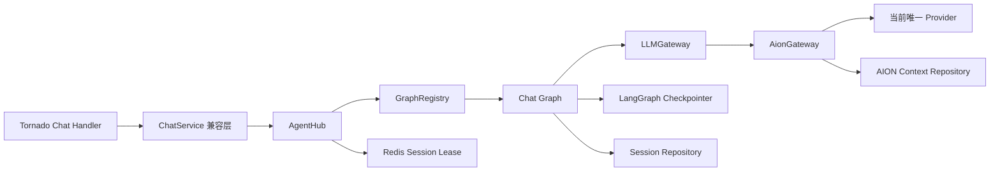
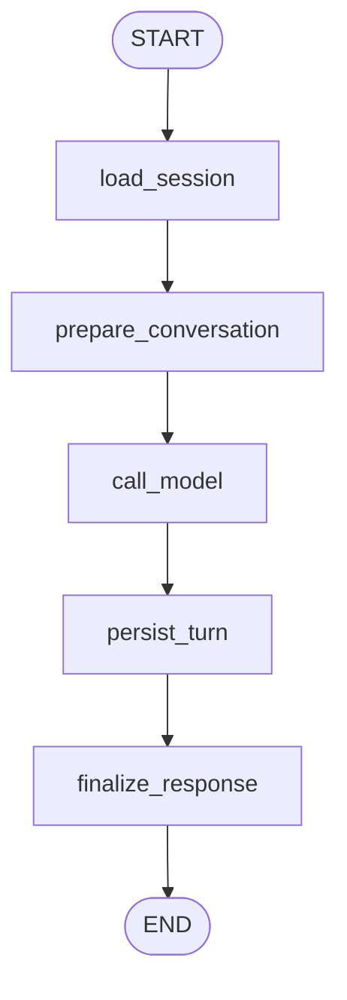

# 普通对话 LangGraph POC 设计评审

状态：实施已完成，本文作为 POC 设计与决策记录保留

评审日期：2026-08-11 完成复审：2026-08-19

状态复核：2026-09-03，源码基线 `6625647`。以下版本号、旧入口、示例路径和实施步骤是 POC 时期记录，不是当前运行指南。现有生产业务位于 `modules/chat/application/service.py`，测试位于 `tests/unit/agents/` 等分层目录；当前状态见 [架构导航](README.md) 和 [Agent Wiki](../../wiki/agents.md)。知识检索与长期画像摄取已在 POC 之后实现，不应把本文的首版非目标理解为当前缺项。

范围：普通对话完整输出、SSE、模型上下文、运行状态和后续 MongoDB checkpoint

> 当前实现已经完成 Agent Core、AION Gateway、MongoDB checkpointer、Redis lease 以及 Chat complete/stream/suggestions 的生产迁移。本文第 13—17 节记录当时的实施步骤和验收门槛，不能继续作为“尚未实施”的状态清单。当前能力与已知限制见 [Shulan Agent Core Wiki](../../wiki/agents.md)。

## 1. 评审结论

普通聊天仍然是 Shulan 引入 LangGraph 的第一条业务纵切，但实施顺序调整为：先建立通用 Agent Core 和 LLM Gateway，再把普通聊天接入。第一版不实现工具调用、健康事实自动写入、向量检索或上下文压缩。

当前 AION 已提供 Client 级自动上下文、Context v1 导入导出、完整与流式调用以及 usage 元数据。旧评审中“必须先支持原生消息列表才能开展 POC”的判断已经失效，不再是阻塞项。

POC 继续使用 LangGraph 自定义模型节点调用 AION，不绕过 AION 直接依赖 OpenAI SDK 或 `langchain-openai`。

## 2. POC 时期代码基线（历史）

- Python 3.12，运行环境为 `conda activate shulan`。
- 生产目标环境为 Linux。
- Tornado 6.5.2。
- LangGraph 1.2.9。
- AION `0.3.2.dev17+g4c4a64f46`，项目依赖固定到 commit `4c4a64f46d3f8053d06db28addf10bd65dc4974d`。
- PyMongo 4.16.0，Redis 8.0.1；MongoDB checkpoint 使用 `langgraph-checkpoint-mongodb` 0.4.0。
- `config/env.py` 已提供 `LLM_PROVIDER`、`LLM_API_KEY` 和 `LLM_DEFAULT_MODEL`。
- 当前业务代码仍直接导入 `aion.deepseek.chat`，尚未真正使用统一 provider 工厂。
- 当前普通聊天仍把最近 20 条历史消息渲染为一个字符串后调用模型。

## 3. 现有 API 契约

迁移时必须保持：

- `GET /api/v1/chat/suggestions`
- `POST /api/v1/chat/send/complete`
- `POST /api/v1/chat/send/stream`
- `POST /api/v1/chat/history`

完整输出继续返回现有 `reply`、`reasoning` 和 `timestamp`。SSE 对外继续使用 `start`、`reasoning`、`content`、`finish` 和 `error`。

完整和流式接口必须由同一张 Graph 提供，避免两套上下文和持久化逻辑逐渐分叉。

## 4. 当前 AION 上下文能力

### 4.1 已具备

- `Client(context=True)` 自动记录成功完成的 user/assistant 轮次。
- 后续调用自动构造 system、历史轮次和当前 user 消息。
- 同步、异步、完整和流式调用使用一致的原子提交规则。
- 失败、取消、无正文或未消费完成的流式响应不保存半轮历史。
- Context v1 支持不可变快照、完整或最近 N 轮导出以及原子导入。
- 每轮可以保存 provider、model、thinking、reasoning、时间和 usage。
- usage 的 raw 数据可以保留提供商返回的缓存命中等明细。

### 4.2 当前不具备

- 数据库或文件持久化。
- 跨进程共享。
- 自动摘要、压缩或 Token 裁剪。
- 基于相关性的历史筛选。
- 任意历史编辑和自动合并。
- 同一有状态 Client 的并发调用。

### 4.3 对 Shulan 的直接影响

现有 `ChatSessionManager` 在 Tornado 应用启动时只创建一次。如果直接把其中的 `chat_client` 改成 `context=True`，所有用户会共享同一段模型上下文。因此 POC 必须通过 LLM Gateway 为每个模型会话隔离 AION Client 和 Context。

第一版模型会话流程：

```text
获得会话 lease
  -> 加载 AION Context v1
  -> 创建独立 context=True Client
  -> 导入 Context
  -> 完整或流式调用
  -> 导出已提交 Context
  -> 保存业务消息和 Context revision
  -> 释放 lease
```

AION Context 是模型运行数据，不取代 `collection_sessions` 中面向业务和 history API 的会话数据。

## 5. POC 组件边界



边界规则：

1. Handler 不感知 LangGraph 和 AION。
2. `services/chat.py` 在迁移后只调用 AgentHub，不直接调用模型。
3. Graph 不导入 DeepSeek、Qwen 或 OpenAI SDK。
4. AionGateway 是唯一能够创建 AION Chat Client 的模块。
5. Session Repository 保存业务权威数据；Context Repository 保存可恢复的模型上下文。
6. Checkpointer 保存图执行状态，不复制完整业务会话或完整 AION Context。

## 6. Agent Core 公共契约

普通聊天接入前先提供以下通用组件：

```text
AgentHub
  invoke(capability, request, context)
  stream(capability, request, context)

GraphRegistry
  capability -> compiled graph + graph version

AgentRunContext
  userId
  sessionId
  subjectId?
  requestId
  runId

LLMGateway
  complete(request)
  stream(request)
```

初始内部事件：

```text
run_started
reasoning_delta
content_delta
run_completed
run_failed
```

Graph 使用 LangGraph `custom` stream 输出 AION 的 reasoning/content 增量。Tornado 只负责把内部事件映射为当前 SSE。

## 7. Chat Graph

第一版不包含工具循环：



节点职责：

- `load_session`：加载或创建 chat session；识别已完成 QA session 的首次聊天转换。
- `prepare_conversation`：确定业务 session、内部 thread 和 AION context key；旧会话缺少 Context 时准备重建输入。
- `call_model`：通过 LLMGateway 调用 `chat.reply` ModelProfile；流式输出内部事件。
- `persist_turn`：幂等保存业务消息、AION Context revision、usage 和 runId。
- `finalize_response`：形成现有 API 所需的完整结果。

## 8. State 和 Runtime Context

概念 State：

```text
ChatGraphState
  runId
  requestId
  agentThreadId
  llmContextKey
  llmContextRevision
  userMessage
  assistantContent
  reasoningContent
  usage
  status
  lastError?
```

运行时请求身份放在 `AgentRunContext` 中，节点输出和可恢复运行状态放在 `ChatGraphState` 中。

禁止放入 State：

- AION Client。
- MongoDB 或 Redis Client。
- Tornado Request/Handler。
- API Key。
- 异步生成器或网络响应对象。
- 完整、持续增长的 AION Context 文档。

首次建立聊天会话时生成不透明 `agentThreadId`。业务 `userId/sessionId` 不直接用作 LangGraph `thread_id`，避免碰撞和在 checkpoint 索引中暴露业务标识。

## 9. ModelProfile 和上下文策略

普通聊天至少建立两个 Profile：

| Profile | ContextPolicy | 说明 |
|---|---|---|
| `chat.reply` | `AION_FULL` | 同一 chat session 的多轮对话 |
| `chat.suggestions` | `STATELESS` | 根据当前 QA/画像数据独立生成 |

Profile 负责 system prompt、默认 model、thinking、超时和重试配置。Graph 只引用 Profile 名称，不直接拼装 provider 参数。

## 10. 持久化边界

### 10.1 业务会话

`collection_sessions` 继续作为 history API 和用户可见消息的权威来源。写入必须使用 `runId/requestId` 保持幂等。

### 10.2 AION Context

Context Repository 保存：

```text
contextKey
revision
format
version
system
turns
updatedAt
```

Context 文档是运行时派生数据。缺失时可以根据业务会话构造 AION 允许的最小 Context v1；格式升级由 Repository 或 AionGateway 处理。

第一版不把完整 Context 放进每个 LangGraph checkpoint，避免长会话在每个图步骤重复写入。

### 10.3 LangGraph checkpoint

无网络单元测试先使用 `InMemorySaver`。接入真实 API 流量前必须完成 MongoDB checkpointer 的兼容性验证、索引验证和重启恢复测试。

建议使用独立基础设施 collection，不与业务会话、用户画像或报告混存。

## 11. 并发和幂等

LangGraph checkpoint 和 AION Client 的进程内锁都不能替代业务侧分布式并发控制。

建议 Redis lease：

```text
key = shulan:agent:chat:lock:<hash(agentThreadId)>
value = runId
TTL = 模型最长执行时间 + 安全余量
```

- 同一会话同时只运行一个模型调用，不同会话可以并行。
- 只有相同 `runId` 可以续期或释放 lease。
- Linux 多进程部署不依赖本地文件锁或单进程内存锁。
- Context 保存采用 revision 乐观检查，防止旧运行覆盖新上下文。
- 严格的客户端重试幂等需要稳定 `requestId`；正式上线前确定是否增加可选请求字段。

## 12. SSE 和断连

事件映射：

| 内部事件 | 对外 SSE |
|---|---|
| `run_started` | `start` |
| `reasoning_delta` | `reasoning` |
| `content_delta` | `content` |
| `run_completed` | `finish` |
| `run_failed` | `error` |

`finish` 只能在业务消息和 AION Context 成功提交后发送。

AION 在流式生成未完成或消费中断时不会提交半轮 Context。SSE 客户端断连后是否继续完成模型调用并保存回复仍需在接入真实聊天 API 前确认；Agent Core 本身只预留取消和继续执行两种策略。

## 13. 分步实施和人工确认关卡

### Step 1：架构基线

- 修订目标架构和本评审。
- 固定 Context 所有权、组件边界和验收条件。
- 不修改业务代码。

### Step 2：Agent Core 骨架

- 新建 `agents/` 基础目录。
- 实现 contracts、errors、AgentRunContext、GraphRegistry 和 AgentHub 空运行骨架。
- 不接入现有业务和真实模型。

### Step 3：LLM Gateway 与 Fake 模型

- 定义 LLMGateway、请求/结果/流式类型、ModelProfile 和 ContextPolicy。
- 使用 Fake Gateway 验证完整与流式 Graph。

### Step 4：AionGateway 与隔离真实模型 Graph

- 使用 `aion.create_chat_client()` 和当前全局 provider 配置。
- 验证完整、流式、reasoning 和 usage。
- 验证同一会话两轮记忆、两个会话隔离和 Context 导出恢复。
- 不接入现有聊天 API。

### Step 5：持久化运行时

- 接入 MongoDB checkpointer、AION Context Repository 和 Redis lease。
- 验证服务重启恢复、revision 冲突和异常重试。

### Step 6：普通聊天迁移

- 依次迁移 complete、stream、suggestions。
- 每迁移一个外部能力都单独评审和提交。

## 14. 测试计划

### 无网络测试

- capability 注册、重复注册和未知能力。
- AgentRunContext 和 Graph State 可序列化。
- Fake Gateway 的完整与流式事件顺序。
- 同一个 Graph 同时服务完整与流式调用。
- AION Context key 的用户/会话隔离。
- Context revision 冲突不覆盖新数据。
- 内部事件到 SSE 的确定性映射。

### 本地集成测试

- 测试 MongoDB/Redis + Fake Gateway。
- checkpoint 重启恢复。
- 同会话并发和不同会话并发。
- Context 保存失败后的明确错误和可恢复状态。
- 业务投影幂等。

### 真实提供商 smoke test

- 当前配置提供商的完整和流式调用。
- reasoning、usage 和 raw cache usage。
- 两轮连续对话。
- 两个独立会话无信息泄漏。
- 导出 Context 后用新 Client 恢复。

### Linux 验证

- 使用同一 Python/Conda 版本运行测试。
- 不依赖 Windows 路径、PowerShell、文件锁或 Windows 专用进程机制。
- 验证 SIGTERM 时的运行停止和持久化窗口。

## 15. POC 验收门槛

- 现有完整输出、SSE 和 history 契约全部通过。
- 所有聊天模型调用经过 AgentHub、Chat Graph 和 AionGateway。
- `services/chat.py` 不再直接创建 AION Chat Client。
- 同一模型会话可恢复，不同用户/会话严格隔离。
- 服务重启后 thread 和模型 Context 均可恢复。
- Graph State 不保存 Client、密钥或完整增长型 Context。
- `finish` 前业务消息和模型 Context 已提交。
- 旧的最近 20 条字符串拼接逻辑不再承担普通聊天上下文。
- 未完成健康建档 Redis 两小时策略完全不变。
- Linux 验证通过，日志不记录未脱敏健康正文。

## 16. 暂不属于 POC 的内容

- 工具调用和工具循环。
- 健康事实自动提取与写入。
- 向量库和语义检索。
- 自动摘要、压缩和相关性筛选。
- 多提供商同时运行。
- LangGraph Agent Server 或 LangSmith 托管部署。

## 17. 实施前仍需确认

以下问题不会阻塞 Agent Core 和隔离验证图，但会阻塞真实聊天 API 切换：

1. 同一会话繁忙时等待、排队还是立即返回冲突。
2. 是否为消息接口增加可选 `requestId`，支持严格的客户端重试幂等。
3. SSE 客户端断连后是否继续完成并保存模型回复。
4. 是否继续向客户端和 history 暴露完整 reasoning；当前默认保持现有契约。

## 18. 参考资料

- [AI Agent 目标架构](./agent-target-architecture.md)
- [AION Context v1](https://gitee.com/loongspears/aion/blob/develop/docs/CONTEXT_FORMAT_V1.md)
- [LangGraph persistence](https://docs.langchain.com/oss/python/langgraph/persistence)
- [LangGraph streaming](https://docs.langchain.com/oss/python/langgraph/streaming)
