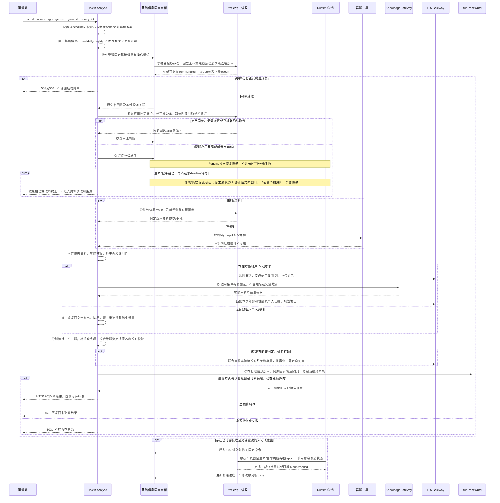
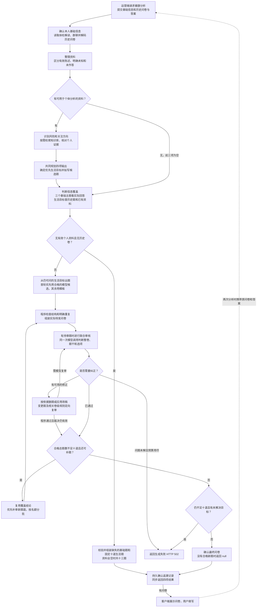

# 健康分析生成接口实现计划

- 状态：统一集成候选已接通六入参、共享 Profile 真实写入、Runtime 补偿和固定评估。真实在线依赖及部署待验收。
- 更新日期：2026-11-18。
- 本次修订：按实际回答补问基础主题，组卷后对题干及选项执行有界内容复审和定向改写。
- 核对基线：`develop@c0b75ac`，迭代分支 `refactor/health-analysis-questionnaire`。原开发及验收依赖见 I-047。
- 需求依据：[健康分析生成接口需求](../product/health-analysis-requirements.md)。
- 对外契约见 [API.md](../api/API.md#生成健康分析)。

## 1 实现目标和约束

将现有 Questionnaire 的内容分析和问卷生成能力演进为独立 Health Analysis 业务。新业务在单次 HTTP 中读取三类资料，完成五步循证分析，返回四项结果；客户端负责问卷填写。Record 逐题建档及 Report 最终报告均保持独立。

本次增量在该业务中增加独立的用户确认基础信息上下文：姓名、年龄、性别均必填，当前分析以上传值为准，通过Profile公共命令核对并同步该userId的本人画像。画像应用失败不阻断分析，前提是更新意图已可靠受理；Runtime后续只补偿该基础信息命令，不运行分析、发卷或Report。只有基础信息不改变HA-009三类临床资料全空的判断。

实施首先复用既有模型、知识库、固定报告归档和群聊工具，不另建供应商直连或新的原件解析流程。新增领域可拥有自己的政策和投影，不能运行时依赖 Record、Report 或拟退役 Questionnaire 的私有规则。

“同步返回”是客户端契约，独立的画像报告读取与群聊读取可以并发。先校验六入参，再按userId定位本人资料、按groupId查询群聊，并固定当次实际使用的资料。预期资料查询失败时按该来源不可用处理；主体归属、程序及必要持久化错误保留原语义。三类来源都没有有效个体分析资料时，前三项为空，问卷按独立主题状态与生活题覆盖组装。所有成功分支在最小追溯记录获得持久确认后返回HTTP 200。

## 2 当前实现与改造位置

下表保留 `develop@4418996` 开发前的源码基线与本期改造位置。本地代码已经完成本期离线实现，当前集成及复验状态见I-047，表中的设计职责不再表示全部仍待编码。

| 能力 | 当前源码事实 | 本期处理 |
|---|---|---|
| 问卷公开入口 | [Handler](../../web/handlers/questionnaire.py) 只接收 `userId/sessionId/fileList`，提供生成、查询、提交和因素查询。 | 新增独立健康分析入口，不把旧提交生命周期搬进来。 |
| 问卷生成 | [generation.py](../../modules/questionnaire/generation.py) 固定3背景＋7生活＋最多5报告题，输出问卷及 `guidance`。 | 从三类来源分别核对三个基础主题的实际回答，依次补问缺失主题，并按资料选择生活习惯题。 |
| 因素研究 | [factors.py](../../modules/questionnaire/factors.py) 已有目标、知识库、联网补检索、候选、条件和答后匹配。 | 复用算法与校验经验，以本次已携带的答案同步匹配，不等待提交。 |
| 来源材料与引用 | [factors_evidence.py](../../modules/questionnaire/factors_evidence.py)、[factors_answers.py](../../modules/questionnaire/factors_answers.py) 分离医学材料和个人回答。 | 扩展个人证据到三源，保留引用、否定、条件、时间及覆盖。 |
| 题型与答案 | [schemas.py](../../modules/questionnaire/schemas.py) 已有分页Schema、三题型、选项和答案规范化。 | 提取或冻结协议能力；新输入支持多卷且允许部分回答。 |
| 生成政策 | [generation_policy.py](../../modules/questionnaire/generation_policy.py) 已独立冻结政策，不依赖 Record 可变模板。 | 由新域拥有后续政策版本，不重新引入 Record 私有依赖。 |
| 画像纯读 | [ProfileSnapshotReader](../../health_profile/snapshots.py) 的 `resolve_scope/read/read_page` 纯读，但只返回事实快照。 | 不把事实快照当作完整报告解读；由 Profile 补齐公共纯读材料出口。 |
| 画像完整展示 | [HealthProfileService](../../health_profile/service.py) 的 complete 视图输出原始项目及状态；部分入口会初始化本人主体。 | 不将这些入口描述为无副作用的完整解读读取，避免为查询隐式建主体或运行解释。 |
| Document固定读取 | [archived_extractions.py](../../modules/analysis/archived_extractions.py) 已能枚举归档并读取固定 `result`；[Profile归档端口](../../health_profile/document_archive_contracts.py) 已接入。 | 提供方同时暴露原始解读及补充来源观测的公开贡献契约，复用固定读取、归属和生命周期，避免新域直连存储。 |
| 群聊工具 | [tool.py](../../modules/chat_history/tool.py)、[client.py](../../adapters/chat_history/client.py) 已实现单次查询，尚无默认业务接入。 | 显式接入新域，补发送人映射、消息归一和覆盖状态。 |
| Chat与Report消费 | [Chat服务](../../modules/chat/application/service.py)、[Report适配器](../../adapters/report/factory.py) 读取旧已提交问卷。 | 新业务不自动进入这些链；旧消费者继续兼容历史问卷。 |
| 执行版本 | [questionnaire agent](../../modules/questionnaire/agent.py) 和 [factor tasks](../../modules/questionnaire/factor_tasks.py) 保存冻结执行身份。 | 旧任务不改成新算法；新入口使用独立执行身份。 |
| 并发与留痕 | 现有LLMGateway不提供健康分析共享并发限制，STATELESS调用及WorkflowAgentPort也不自动保存本次完整证据关系。 | 新域显式提供进程内共享限流及RunTraceWriter，不能将接入网关或Agent等同于已经满足。 |

以上保留原实施基线。`8633b2d` 已完成新域、实际纯读提供方和模拟客户端的本地组合，完整离线12658 passed / 275 skipped；该结果属于原三入参版本，不覆盖本次基础信息增量。

历史增量分析（以下缺口按末节进度逐项解决）：原Handler和Service均限制三个字段；现有Profile主体命令可改姓名，但没有本方案所需的三项确认同步命令、确认版本及补偿契约；画像概览优先从生日计算年龄，单独追加年龄事实可能仍返回旧值；生成与发布校验使用 `profile_gender`，尚未统一消费本次上传年龄/性别，也没有本次基础信息补偿链。以下章节描述增量目标，旧版本实现与测试记录不能替代这些验收。

## 3 领域边界与组织方式

### 3.1 新领域的职责

建议使用 `modules/health_analysis/` 作为新业务目录，`web/handlers/health_analysis.py` 提供 HTTP 入口。这是现有问卷业务的改造归属，旧 `modules/questionnaire/` 在兼容期间仅承载既有任务与历史流程。

| 模块 | 应承担职责 | 不承担的职责 |
|---|---|---|
| Health Analysis | 校验并固定权威基础信息，通过公共端口受理同步意图和发起Profile同步；三源投影、五步分析、目录覆盖、四项内容、去重与留痕。 | 直改Profile数据库、将AI推断写成事实、Record会话、旧问卷提交或最终报告生成。 |
| Web | 请求DTO、固定userId/groupId传递、错误映射、通用包络、同步响应及本路由正文日志策略。 | 拼数据库、创建模型Client或后台生成任务。 |
| Profile | 本人范围及报告纯读；提供用户确认基础信息的显式写命令、首次基础建档、当前有效值与概览、来源/版本/冲突治理及同步回执。 | 新健康评价、补充题规划或将基础信息同步藏进报告reader。 |
| Document | 固定解析结果、材料归属、贡献文件与生命周期的公共读取。 | 用户健康评价及健康分析输出格式。 |
| Chat History | OpenIM查询协议与HTTP工具、上游响应结构及明确错误。 | 推断患者身份、生成健康事实或自动解析附件。 |
| Knowledge与LLM平台 | 公共知识检索、模型调用、预算与工具执行基础设施。 | 领域政策和个人因素结论。 |
| Bootstrap与Runtime | 显式装配Profile读写、同步意图存储及补偿worker、共享限流和留痕；持有补偿的启动、停止、重启恢复和资源生命周期。 | 在HTTP结束后继续生成结果，或复用旧问卷任务承担基础信息补偿。 |

目录建议按实际规模落地，不为文档中的每个概念强行创建一层目录：

```text
modules/health_analysis/
    application.py       # 单次同步用例与取消传播
    agent.py             # 新域运行入口和执行版本
    contracts.py         # 命令、四项结果、资料快照与应用异常
    ports.py             # 报告、基础信息同步/受理、群聊、知识、模型和留痕依赖
    basic_info.py        # 待增量：三项校验、确认上下文及受控投影
    basic_info_sync.py   # 待增量：同步意图、有界尝试及基础信息补偿用例
    materials.py         # 三源归一、可用于个体分析的资料、历史题及适用性上下文
    surveys.py           # 外部Schema和多份答案解码
    factors.py           # 五步中的风险、循证候选和个体匹配
    generation.py        # 四项内容的共同规划和组装
    policy.py            # 版本化生活目录、基础主题模板、适用性和题量政策
    deduplication.py     # 已问内容、已知信息与两类新问题去重
    trace.py             # 最小可追溯记录及持久确认规则
adapters/health_analysis/
    profile.py           # Profile公共纯读契约到本域资料
    basic_info_sync.py   # 待增量：Profile公共写命令及同步意图持久化适配
    chat_history.py      # 现有群聊工具到本域沟通材料
    model.py             # 统一LLMGateway及本域Prompt
    trace.py             # RunTraceWriter的内部持久存储适配
bootstrap/health_analysis.py
web/handlers/health_analysis.py
prompts/health_analysis/
```

### 3.2 Agent与共享代码

建议新运行身份采用 `health_analysis.main` 及独立版本，不将旧 `questionnaire.main/questionnaire-main-v1` 的含义改写为新健康分析。新域是后续问卷业务的主入口，兼容期的旧Agent只运行原来已经接受的协议。

不引入总控路由模型或自主跨业务循环。三源读取是固定应用步骤；模型负责有明确输入和输出的分析阶段。所有模型仍经过共享 `LLMGateway`，知识库通过公开 `KnowledgeGateway` 注入。

Schema和来源校验若被新旧两域共同使用，应抽成语义稳定的公开协议或由新域冻结一份明确版本；旧任务继续使用原冻结实现。不能为了少量代码复用让新域长期导入旧服务、私有Prompt或旧的提交状态机，也不借本次任务重写全库架构。

基础信息上下文、适用性、确认命令和执行追溯使用各自固定版本。分析快照与投递进度分离。

## 4 公共依赖、权威基础信息与三源读取

### 4.1 API参数、归属与固定范围

请求使用现有API边界：六入参校验通过后，以userId定位本人画像及资料，groupId直接传给既有群聊查询工具。不要求调用方登录、网关身份、用户与群组关系证明或新增访问控制服务，也不把缺少这些未约定的配置当作503。姓名用于本人的显式确认，不用于跨用户搜索或重新归属报告。

Profile与Document仍须核对固定userId/subjectId及材料归属、本人类型和生命周期，跨用户或亲属引用明确拒绝；Profile确认命令和后台补偿使用第4.7节的固定主体及版本，不在重试时重新定位或改绑。既有AccessAuthorizer/VerifiedAccessScope及未配置时默认503是此前额外增加的代码门禁，N0须移除相关调用、装配和测试前提；本轮只改文档，不宣称代码已移除，也不引入替代身份系统。

### 4.2 Profile报告材料出口

该项是提供方增量，不能只由健康分析消费者绕过公共边界解决。建议 Profile 提供独立纯读聚合口，内部复用既有 Document 归档读取，语义如下：

| 操作 | 输入 | 结果要求 |
|---|---|---|
| 解析本人范围 | `userId`，不要求健康分析传 `sessionId`。 | 既有本人scope或missing，不调用 `ensure_self_profile` 创建主体。 |
| 读取既有画像性别元数据 | 既有本人scope，按公开画像契约纯读。 | 保留原值及来源状态供核对和追溯，不覆盖本次上传性别，不负责画像同步。 |
| 枚举关联的可读报告 | 已解析scope、分页游标和有界页容量。 | 归属固定本人主体的解读身份、来源生命周期和覆盖情况。 |
| 读取已保存完整解读及贡献观测 | 固定解析引用、来源贡献身份及各自生命周期标记。 | 原始结构化 `result` 与公开source observations同时提供；每项保留独立版本、处理质量、来源定位及真实关联事实状态。 |
| 处理缺档和变化 | 原有归档及来源状态。 | 区分没有资料、缺档、临时不可读、撤回/退休和读取中变化。 |

该出口保持原有报告纯读职责，可携带既有性别元数据供比较；本次问题适用性始终使用已校验上传年龄/性别，画像缺失、冲突、查询或同步失败不改变这一依据。基础信息不是第四类临床材料，不使三类空来源变成有临床资料；已有AI摘要与原报告记录仍分别标记。首次基础建档只走第4.7节显式命令，报告reader不初始化主体。

新域通过自身 `ProfileReportReader` 之类的Port消费提供方公开契约，不读取 Profile、Document 或数据库的私有字段。必须验证新旧归档、混合报告贡献文件、未发布、无日期、仅待核实及空项目材料；去除镜像重复，保留真实独立记录。原始 `result=None` 不等于该报告没有材料：有效补充来源观测仍可独立贡献，需携带其来源身份、版本、生命周期和与原结果的镜像关联。最新解读缺档但旧有效贡献仍可读时，分别保留真实固定引用和版本，不能给旧贡献套用最新解读描述项的身份。原结果与观测重复呈现时依据公开关联消除镜像，不能按项目名和值粗暴合并不同真实日期、来源或实际独立的记录；每个来源变化分别按自身标记处理。

跨页读取固定当次解析引用。报告归档或来源水位变化可有界重读，普通存储故障按来源不可用处理。确认回执固定的本人主体或生命周期变化按 HTTP 409 处理。分页总预算不足时记录覆盖限制，读取遵循现有容量约束。读取过程不下载、OCR 或解析材料。

### 4.3 群聊工具接入

显式构造并注入现有 `query_chat_history` 工具，将校验后的groupId固定为本次查询参数，不增加用户群组关系验证或证明对象。复用既有工具调用边界，不让模型自行修改群组或决定跳过资料读取，也不为这一查询新增通用自主工具循环。

接入前核实两项提供方约定：`userId` 与 OpenIM `sendID` 的对应，以及一次返回是否具备完整性/分页协议。没有明确上游协议时只处理本次返回，不能自行拼分页参数。

本域适配器完成以下处理：

1. 校验并保留 `chatLogs`、`chatLogsNum` 及单条消息身份。
2. 按服务端ID优先去重并稳定整理时间，不以附件URL作为消息ID。
3. 排除撤回和系统通知的正文，将未知消息类型作为未采用资料。
4. 区分患者本人、工作人员、家属及未知发送人；保留直接陈述、转述、问句、建议和假设。
5. 仅把可证明归属的用户健康信息投影为个人资料，其余保留适当背景或排除。
6. 图片和文件保留附件线索，本期不下载并运行OCR或Analysis。
7. 将查询超时、上游业务错误和结构错误转换成本次群聊来源不可用，使用其他来源继续；内部保留错误类别。请求参数、主体归属、取消及程序错误按所属边界传播，不增加访问控制依赖错误。

群聊提供方或调用方尚不能提供可靠发送人映射时，不能把所有文本都归给患者；发送人未知属于资料归属不明，保留未采用原因，并继续使用其他可证明归属的资料。映射用于判断谁说了什么，不成为整次请求的额外门禁。上线验收核对真实发送人约定；离线用例使用明确合成映射。

### 4.4 多份问卷解码

新增多卷解码器，复用现有Schema规则及允许未答记为未知的语义，不复用旧 `submit` 的会话、ready状态、一次性提交及幂等生命周期。分析输入允许部分作答，即使旧Schema标为必答，未作答仍进入信息缺口。

内部题目身份至少由“问卷序号＋页面/题目定位＋题名”构成。每个答案保留原始值、题干、选项快照、可读回答和原始指针；原始对象不在规范化过程中被修改。

区分两套输出：

- `askedQuestions`：全部合法已有题目，用于严格排除新卷重复；包括未答题。
- `personalAnswers`：真实回答及其未知、否认与冲突语义，用于基础主题覆盖和个人证据匹配。

禁止用一个未分scope的字典合并各卷答案，也不根据 `question.name` 猜测其医学含义。单卷重复题名、非法题型、未知选项值和不合约定结构走请求错误，不静默删除后当作正常空资料。

### 4.5 本次资料快照

在同步意图受理时固定基础信息，再与三源归一结果组成消费者快照；身份/同步部分和传给模型的年龄/性别投影分开：

| 内容 | 用途 |
|---|---|
| 来源类型、scope、原始引用、内容摘要、取得时间 | 证明本次实际采用的材料与归属。 |
| 规范化name/age/gender、字段指针、confirmedAt、commandRef、targetRef及字段治理版本 | 本次权威基础信息，受控保存用于核对、同步和追溯；HA本域confirmVersion只作投递关联，与三类临床materials分开。 |
| `effectiveDemographics` 中的ageYears/gender、确认时点及来源指针 | 五步、覆盖、规划和校验共同使用的当次上传年龄/性别；不含姓名，不改取后来变化的画像值。Profile实时ageBasis/asOf不改写该冻结输入。 |
| 同步操作标识、画像差异、Profile回执或持久意图引用 | 区分已同步、无需变更、待补偿和被新确认取代；与可变投递进度分开。 |
| 报告固定解析引用/版本/内容校验值、原result及贡献观测的身份、状态、时间和项目定位 | 防止分析途中换用其他轮次或已撤回资料，并保留独立贡献及镜像关系。 |
| 消息ID、发送人角色、时间与陈述类型 | 区分用户事实、转述、建议和问句。 |
| 问卷序号、题目定位、选项映射、原值和规范化回答 | 跨卷隔离及语义去重。 |
| 已问内容、已知信息及冲突 | 指导缺口规划，避免重复采集。 |
| 个体分析资料、基础主题回答与历史题 | 个体分析仅使用三类来源中的有效资料。每个主题按本次固定证据判断是否已回答。所有旧题保留用于生活题去重。 |
| 既有画像及报告中的人口学元数据 | 保留历史来源、确认时间和差异，仅供核对；不与本次有效年龄/性别竞争当前优先级。 |
| `available/empty/unavailable/partial` 等来源状态和覆盖 | 内部追溯，不增加四项以外的业务字段。 |

保留真实否认、0值和阴性以及基础年龄0。明确“不清楚”是实际回答，可覆盖对应主题；待核实观察、明确未知、姓名、年龄、性别和只有题目的历史问卷不足以独立触发个体分析。无有效资料时前三项为空，问卷按缺失主题和生活题覆盖组装。

### 4.6 最小可追溯记录与持久确认

新域声明 `RunTraceWriter` Port，使用简单内部持久存储保存本次运行记录，由bootstrap注入；不新增面向客户端的任务、结果轮询或回调产品。记录以HTTP包络已有uuid和内部runId关联，至少包含以下内容：

- 本次固定userId/groupId、本人主体及资料归属的必要元数据、执行身份、实际模型标识、政策和生活目标目录版本、提示词版本或校验值。
- 本次确认的基础信息、字段来源、confirmedAt、固定targetRef、字段治理版本及画像差异，显式写入回执或可恢复commandRef；姓名仅保存在必要受控部分，不进入模型正文、检索或普通日志。
- 实际采用的报告固定引用、版本及内容校验值，原结果和贡献观测的独立身份、生命周期、镜像关系；固定引用必须对应可恢复的版本，不能只指向会被替换的最新内容。
- 外部聊天和问卷答案实际采用的必要快照、题干与选项映射、身份及原始定位；可变消息ID或答案摘要不能代替可还原的采用内容。
- 实际采用的医学材料片段和来源、风险/候选/个人条件/最终问题之间的结构化关联、覆盖限制、过滤理由及最终四项输出。

不保存模型思维链，也不默认复制全量群聊。B0需冻结必要内容的容量上限、保留与清理策略，以及固定引用的可恢复边界；不满足可恢复要求的来源需保存必要采用片段，不能留下仅有可变引用的“追溯记录”。

最终结果校验后，最小记录必须在总deadline内取得持久保存确认，才返回HTTP 200；正常基础卷和合格目标耗尽而无新卷的成功分支同样适用。写入仅允许有界重试，同一内部runId及相同内容幂等保存；相同runId内容冲突应明确失败。持久确认失败建议503，总执行预算耗尽建议504，不以尽力记录、访问日志、只调用过writer或启动未受控后台任务代替确认。失败时可记录不含健康正文的uuid、runId及错误类别，但不能因此声称满足AC-20/AC-33。已确定的主体、生成错误或504只尽力保留失败元数据，记录失败不覆盖原错误，也不将主体冲突改写为留痕503。同一runId写入幂等不表示不同客户端重试返回相同内容。

成功前同时核验必要基础信息同步意图已可靠受理；Profile应用未完成不阻断四项结果，但不能把意图写入失败混入来源降级。不可变分析记录保存当次状态及引用，可变补偿进度由同步存储另行维护，后续完成或被新版本取代时不重写原trace及其校验值。

### 4.7 基础信息确认命令与可靠补偿

新增独立于报告reader的公共写入协作，由Health Analysis组织用户确认输入，Profile拥有权威确认受理、本人建档、字段治理和同步回执，持久意图适配器与补偿worker经bootstrap注入。输入先完成六入参校验，固定操作标识、内容校验值、确认时间及基础信息；不能用模型抽取、临床摄取队列或直连Profile私有集合代替。

| 端口职责 | 输入及回执 | 必须满足的语义 |
|---|---|---|
| Profile权威确认受理 | operationId、payloadHash、userId、规范化三项值和confirmedAt；返回commandRef、固定targetRef及各字段governanceEpoch。 | Profile先持久固定命令、主体/建档预留和字段治理版本，再返回registered；重试同操作返回原回执，内容冲突拒绝。该必要受理失败503、总超时504。 |
| 同步存储与投递关联 | 原commandRef、目标及字段版本、HA本域confirmVersion、投递状态和回执。 | 本域版本仅作投递顺序与追溯关联，不分配Profile治理资格；本地关联写入/ACK丢失经公共查询和恢复出口找回原命令，不制造第二份可执行意图。 |
| Profile字段应用 | commandRef、固定targetRef和原字段版本；回执含主体/画像版本及各字段状态。 | 复核归属、生命周期、取消状态和字段屏障；已完成幂等返回，落后字段superseded，仍有效的未完成字段继续，不伪造三项全部同步。 |
| Runtime 投递与恢复 | 提供方公开列出本域已受理未终结命令、原版本及字段进度 | 使用 Profile CAS 防止并发旧值回写。Runtime 每轮有界分页及设置单条超时，临时错误在后续定时扫描恢复。已取消、被拦截的固定命令停止。 |

Profile应更新姓名的主体展示及年龄/性别的当前有效表示，处理别名事实冲突并保留历史来源。显式改名可以更新subject.displayName；报告自动抽取仍不能改人工标签。确认姓名须有公共字段依据及来源引用，未来demographic.name/overview.name与主体展示从同一当前选择投影，不能只改标签后形成第二套名称真值。命令属于用户明确确认信息，不能顺便把生成内容标为user_confirmed。

先取得权威持久受理回执，再在本次总deadline内有界尝试Profile应用；预期依赖故障、局部超时或暂时并发竞争保留pending继续分析。主体归属/绑定错误、取消、程序错误及总deadline耗尽继续传播，不通过宽泛捕获包装为待补偿成功。当前分析始终使用自身请求快照，不等待画像查询读到新值。

确定的主体拒绝或程序契约错误应把已受理意图标为blocked/需处理，自动worker不继续重放该错误命令；重驱仍校验固定用户主体归属、生命周期、字段屏障和命令取消状态，不需要登录凭据或外部证明续期。请求断开、取消或总超时终止请求内执行，此前已可靠受理的确认可由Runtime独立投递；显式取消持久命令则推进其取消状态并阻止未完成应用，不能因重驱恢复。

三个字段均已应用或完成无变化确认时才确认完整同步；仍有待处理字段则pending，部分字段已被取代时携带逐字段回执，不能标为目标三项完整同步。Runtime只重放原操作，保留已完成/被取代/受阻进度，不重新分配版本。不承诺跨HTTP强幂等，新的HTTP请求仍是新的显式确认，可按共同治理规则有意改值。

已可靠受理的基础信息确认不因后续模型失败、追溯失败、响应丢失或断开而撤销；后台补偿可以继续，但不能继续生成结果、发卷、查询临床资料或触发Report。当前请求成功仍须满足分析追溯和意图持久化两项条件，不要求Profile立即同步完成。存储管理、保留清理与失败重驱责任列入增量交接，不宣称当前已具备。

#### 4.7.1 权威受理与固定主体

Profile公共登记命令以operationId和payloadHash幂等保存不可变三项值、confirmedAt、目标及字段版本；只有Profile受理日志已经将这些内容关联并能恢复时，才返回registered。Profile提供按原操作查询及枚举未终结命令的公共出口，Runtime可直接恢复。因此Profile已受理但HA本地关联写失败或ACK丢失时，仍能找回原回执，不依赖跨两个域的事务或内存任务。必要登记尚未确认时不能把“主体未知、以后再找”当作pending成功。

targetRef固定userId、subjectId及lifecycleEpoch。已有本人主体必须为该用户的有效本人；首次不存在时，Profile本人锚点通过持久CAS预留唯一subjectId、lifecycleEpoch及creationReservationRef，所有本人创建入口共用该预留，本次基础画像由Profile显式确认命令创建；既有API已经约定的本人初始化语义保持，并经同一主体锚点协调。预留是稳定创建身份而非访问控制凭据。登记/创建回执丢失、资料归档、重启或重驱均按原commandRef找回原目标，不重新执行“查当前本人再创建”。主体停用、删除或生命周期推进后旧命令受阻；新请求需要新目标版本，旧命令不能自动迁移或复活主体。

#### 4.7.2 字段屏障、CAS与部分恢复

Profile为name、age、gender维护公共字段治理版本，显式确认受理在Profile控制记录上以CAS取得各字段governanceEpoch，并绑定原operationId。HA的confirmVersion不参与资格比较。既有subjects/upsert改名、事实确认/更正/删除及其他显式基础信息入口都经同一提供方协议推进受影响字段版本；之后人工治理使此前登记旧命令在对应字段失效。未受影响字段保留原资格。删除屏障约束删除前的旧操作，不永久禁止以后明确的新HTTP确认；新确认能否改值由其新操作及公共规则决定，旧操作重试不得重领epoch。

每字段使用持久写计划保存原操作、目标、epoch、候选事实/确认来源及预期profileVersion。材料化事实和审计按操作/字段幂等，只有固定生命周期和字段epoch仍匹配时，才通过Profile发布CAS更新公共当前选择及字段完成标记；尚未提交的写计划不成为公开当前值。多记录存储按Profile持久操作日志恢复，当前值读取只使用已发布版本，不能把中间事实或本域投递状态当作当前真值。竞争失败后重读仅可核验原epoch：仍匹配则继续原计划，已推进则该字段superseded，不能拿新epoch重放旧值。

ACK丢失时先查原字段回执；已完成不重复建事实、推进版本或追加审计。命令在一字段完成后中断时，恢复分别核对其余字段；人工只改姓名不会使原年龄/性别重复执行，也不能让旧姓名写回。旧来源摄取及恢复保留原身份和时间，不取得新的显式确认epoch；可保存历史材料，但不能绕过人工当前选择或删除屏障。公共当前值、画像概览、事实快照及新的Record/Chat/Report读取适配使用同一提供方选择，原固定快照保持原版本。

#### 4.7.3 无变化确认与年龄依据

值相同也登记确认来源、confirmedAt、operationId及字段水位，再返回no_change。相同值可复用等价事实并追加独立确认依据，不重复建事实；此前只有DOB派生年龄、没有独立年龄确认时，须保存本次确认周岁及时间的真实依据，不能因数值相同而省略。较新no_change已经完成后，较旧不同值命令仍被字段屏障阻止。受理记录属于可恢复命令，生效后的当前值及依据仍由Profile公共选择唯一提供。

年龄目标公共契约统一使用ageBasis语义：reported_at_report为报告观察时点年龄，confirmed_at_time为明确确认的时点年龄，dob_derived为独立可信生日派生年龄。独立可信生日须有用户明确填写/确认等可核对来源，不因模型confidence、报告自动提取或恰好算出相同年龄而升级。相符判断使用原confirmedAt按Profile统一日期基准计算，不能使用迟到补偿的实际执行日；冲突生日保留来源并标待核实，不由整数年龄反推生日。

只有独立可信且在confirmedAt与上传周岁相符的生日可成为实时年龄依据；实时概览按读取asOf计算dob_derived。生日缺失、不可信或冲突时，使用最近有效的confirmed_at_time并返回/渲染其确认时间和“确认时点年龄”含义，不自动逐年增长。生日依据失效时回退到仍有效且未被治理屏障排除的确认年龄，不丢失同值确认，不恢复删除或撤回来源。新版本Profile公共契约承载ageBasis、依据引用和asOf，所有当前值消费者共用；HA四项业务输出不增加第五字段。固定分析使用当次上传年龄，固定快照保存各自asOf及值/依据，补偿和跨生日不改写原快照。

Profile 公开契约统一提供当前值、确认时间及年龄依据。报告抽取和健康分析分别使用固定材料和请求快照，通过同一 Profile 提供方影响当前值。

## 5 单次同步执行流程



### 5.1 基础主题覆盖与空资料问卷

分别判断可用于个体分析的资料、三个基础主题是否已回答和历史生活题覆盖。历史题目即使未答也可用于生活题去重；基础主题只用实际回答或同等明确信息判断。

| 分支 | 前三项 | 问卷策略 |
|---|---|---|
| 存在有效个体分析资料 | 使用实际资料按依据生成。 | 按固定顺序补问缺失的基础主题，按资料规划生活习惯题。 |
| 没有有效个体分析资料 | 三项均为空字符串。 | 按固定顺序补问缺失的基础主题，生活题按历史去重。三类资料全空且无历史题时，返回三道基础题和十道生活题。 |

在覆盖检查中使用已固定的三源内容判断主诉或健康目标、个人疾病史、血亲家族史。逐主题保存实际资料引用和依据，明确肯定、否认以及真实的“不清楚”“记不清”可以覆盖对应主题。旧题题干、空答案、普通指标、待核实观察和归属不明的陈述不能单独证明覆盖；本人的血亲病史陈述可支持家族史，保留适用主体。明确回答冲突时保留依据并跳过对应基础题。

空资料分支跳过个体风险、评价、因素推断及医学检索。基础模板组装、生活题规划和校验仍使用本次年龄及性别；有历史时可以有界调用语义去重。

基础生活题按通用采集目的发布，无须伪造个人异常或个人化医学引用。只有按第6节完成当前政策支持范围的覆盖判定，确认没有可发布新题时，问卷才为空；模型没有生成题目或覆盖判定失败不等于耗尽。正常基础卷分支与整体生成故障必须分开，不能用默认基础卷掩盖技术错误。

### 5.2 五步分析的改造

有临床资料时保留原有目标、候选因素、医学来源、个人条件和匹配状态。报告、消息和答案生成临床证据，本次年龄/性别以独立字段定位参与适用条件判断；不把姓名传入模型或把基础信息塞进临床materials误触发有资料分支。模型不能用旧画像、报告或聊天重新选择当前年龄/性别。

旧 `prepare→plan→submit→evaluate` 拆分为本次请求内的“资料整理→风险/目标→循证研究→匹配→四项规划”。后续外部答案通过新的请求再次参与匹配，不调用旧 `QuestionnaireFactorTasks`，也不修改旧任务快照。

通过校验的题目按身份关联候选。基础题补问尚未回答的主题，生活候选优先覆盖实际缺口，手术、病史、用药和症状等临床深入内容用于分析或健管师开放清单。未覆盖条件如实保留。

### 5.3 知识检索与模型调用

使用公共 `KnowledgeGateway` 查询指南和文献。沿用实际材料归一、原文passage和逐字引用检查，适用性和关联支持另行判断；知识库里的AI摘要不自动升级为原文。

可沿用现有知识库无适用结果后的受控联网补检索。所有联网仍经过统一网关，搜索词使用通用医学概念，模型任务正文和检索词分开；用户身份、个人报告组合和聊天内容不拼入公开检索词。是否采用联网及失败原因保留内部追踪。

基础信息姓名也列入查询泄露防护，不将完整基础信息载荷作为检索词。检索取得的年龄范围、性别、主体和时点条件须保留真实依据；仅“好发/高风险年龄”不转为硬排除，也不由模型编造疾病年龄阈值。

知识不足时保留患者资料和中性问题，过滤无依据的关系与检查建议。不将“检索执行过”作为“关系已经得到证实”的验收条件，也不把模型自造URL登记为来源。

### 5.4 四项共同规划

有有效资料时，规划器共同规划前三项及生活习惯题，携带个人证据、医学依据和信息目标映射。无有效资料时前三项为空。程序根据三个主题的回答情况选择适用模板，按原顺序补问缺失项，再与通过范围、适用性和去重校验的生活题组卷。

综合评价使用实际保留的风险和因素，不继续使用仅拼接前四个异常的旧 `_summary()` 充当最终评价。检查与开放问题采用结构化内部条目，对外类型按第8节及当前API统一。

### 5.5 问卷生成、补题与内容复审

实线表示一次请求内的选题、补题和内容复审，虚线表示运营端在下一次分析时通过 `surveyList` 传入历史问卷及答案。相关实现见[问卷生成器](../../modules/health_analysis/generation.py)、[覆盖判断与发布审核](../../modules/health_analysis/deduplication.py)和[整卷内容复审](../../modules/health_analysis/survey_quality.py)。



联合审核用规则 ID、问题字段和原因定位单题意见，追溯保存各轮题目裁决及改动。输出协议不完整或非法时，同一请求可使用原纠正预算，对同一版本和同一批题补做一次完整审核。复审输入附固定错误码，所有裁决通过协议检查后才可应用，成功追溯记录恢复的草稿版本及原因。改稿校验失败时，保留该题和校验原因，在原有纠正预算内重试待改题。内容复审将原意见随改动题提交，并复用通过题作为卷内比较材料。补题前的覆盖重评只更新尚未发布审核通过或确定排除的目标。

补题优先审核首次出现的题面，包括模型拟稿被拒后尚未审核的目录模板。全卷每批最多 20 题，首次补题的剩余名额可重审原题面。此后只处理仍待审核的新题面。同批题干重复时先暂缓其中一题，入选题被拒后可再次评估暂缓的题。每个生活目标最多提供一个模型拟稿和一个目录模板作为候选，批次共用原截止时间和纠正预算。历史生活题的问卷范围和完整题面均与本服务目录模板匹配时，程序直接记录历史覆盖及题目指针。

后置审核的整题排除初版支持一项可直接核验的情形：可靠本人聊天或饮酒题历史实际答案明确不饮酒时，可以移除单次饮酒量题并记录依据。其他适用性问题按原目标尝试改写。年龄依据仍参与当前题目的适用性校验。

题库版本 `health-analysis-lifestyle-catalogue-v3` 更新准备睡觉、实际睡眠时长、休息安排和正餐构成的固定模板。政策版本 `health-analysis-policy-v5` 将生活场景、具体时刻、时长口径、分类层级和选项完整性同时传入规划、联合审核与改写。具体选项已覆盖可回答范围的生活题移除未知占位项。基础主题题的模板和改稿沿用固定互斥否认项，并保留原编码的「不清楚」，用于记录明确的否认或未知回答。程序核对目录已确认的选项以及准备睡觉、实际睡眠时长、休息安排和正餐构成的固定题型。模型候选题型不符时使用目录模板，动态选项组合的实际范围由联合审核判断。

## 6 去重与发布校验

本次有效年龄/性别先参与候选适用性匹配，再进入发布复核。对患者本人新问题，男性过滤子宫、宫颈相关内容，女性过滤前列腺、睾丸相关内容；题干、说明、选项、noneText及开放正文均检查。已知姓名、年龄、性别不重复采集，既有生活卷范围和性/性征内容限制保持不变。规则及判断记录携带来源、主体、时间范围和版本，不只靠题目名称或模型自报通过。

已明确的性别枚举和年龄范围/边界由程序执行，不交给模型重新推断本次值或自由放宽。语义审核负责内容、主体与条件是否正确对应，不能以模型自报suitable替代这些确定性判断。

年龄硬过滤只使用有明确适用范围和端点语义的依据；好发年龄只调整相关性排序。历史疾病按其发生时点处理，亲属按对应主体处理，不能用患者当前人口学信息抹掉历史或家族资料；月龄、孕周等未明确条件仍为未知。只有目标经依据确认不适用时才能关闭该目标，单题措辞、选项或模型校验失败仍按原有有界补题政策处理。

### 6.1 语义覆盖模型

原 `develop@4418996` 的旧问卷仅靠facet和题干原文不足以满足新域要求；`8633b2d` 健康分析已经实现逐目标语义覆盖、发布前审核及有界补题。本次保留这些机制，补入权威年龄/性别、主体和时间的适用性依据，不把现成语义去重描述为尚未实现。

新域维护版本化生活信息目标目录，以现有24细项作为起点，允许将一个细项明确细分为实际不同的采集目标，并记录父子目标及覆盖关系；24个key不是全部可问语义的唯一划分。扩展目标仍须符合生活习惯范围，不以换标签、改措辞或增加无实质区别的时间词制造新信息。目录版本在执行时固定，新增或调整细分须同步覆盖样例和政策版本。

对本次目录内目标逐项形成覆盖记录，而不是只检查模型返回的题目。至少区分以下状态并保留来源与判断依据：

| 状态 | 必须记录的依据 |
|---|---|
| 可问 | 尚未被历史或可靠个人资料覆盖，且符合本次分支和适用性。 |
| 历史已覆盖 | 对应的历史问卷、题目定位及实际采集条件；未答也算已问。 |
| 资料已覆盖 | 对应的报告、消息或真实答案及其主体、时间、回答粒度。 |
| 不适用 | 本次分支、生活范围或年龄/性别等可靠适用条件的排除依据，不包含生成题目的格式或表达错误。 |
| 语义不确定 | 无法可靠比较的目标和资料、具体缺口及本次处理状态，不能直接标为已覆盖。 |

目标状态与候选题发布状态分别记录：候选题可为合格、重复、格式/内容不合格或判重不确定。局部过滤某道候选题不自动将其对应目标改记为不适用或已覆盖；仍可问目标须由其他合格题、经过校验的目录模板或有界补题处理。

语义比较分两步：

1. 程序用规范化题干、已知题库 key、选项含义、条件和来源绑定检查明确重复。四道修订模板在问卷范围、旧题题干、题型、说明及选项均匹配已发布模板时，直接识别为同一目标。其他题面按实际范围进行语义去重。覆盖记录保留实际历史题引用，旧生活题答案继续按生活题归类。
2. 在本次模型规划中要求输出已有题覆盖和信息缺口映射，并由程序检查其完整性；对不同措辞的重复使用语义判断。不能只相信模型自己换了facet标签。

原健康分析已有覆盖判断和独立发布前语义审核，增量继续保留并传入统一适用性上下文。调用批次或合并优化须验证控制等效且计入预算，不要求每题多次评审，也不能借优化去掉现有发布门槛。语义仍不确定的选择题先过滤；确有新增沟通深度才进入健管师清单，不换渠道原样重问。

生成前先形成候选目标集合，生成后核对最终题目与集合、过滤原因和未生成目标的关系。合格目标仍足够而题目不足时，只在剩余预算及次数上限内补题或使用已通过校验的目录模板；补题仍经过同样的历史去重和发布校验。单题无效或无法可靠判重先局部过滤、记录理由并保留其他合法结果，不因单题失败或不确定自动升级整请求错误；但不确定本身也不能证明耗尽。不能把模型漏生成、目录扫描未完成或覆盖服务失败当作“没有新题”。已有10～20道通过全部发布校验的合格题时，未选目标的局部不确定不阻断成功。只有未决目标导致少题或空卷所需的整体覆盖结论不能成立，或不足10题时仍有明确可问目标却无法合法生成，才返回明确生成错误；总预算耗尽则504。正常少题或无卷须有本期候选的处理覆盖及未发布原因。

### 6.2 两类问题分别校验

| 比较范围 | 发布规则 |
|---|---|
| 已有问卷与新补充卷 | 同一信息视为重复，包括未答、换题名、换措辞和改选项顺序。 |
| 已知个人信息与新问题 | 本次三项确认信息及其他已可靠覆盖条件不重复采集；临床来源冲突可具体核实，不能借画像基础信息差异重问或否定本次确认。 |
| 新卷内部 | 相同缺口合并，一题可关联多个候选。 |
| 问卷与健管师清单 | 允许同主题的不同深度；问卷采存在性，清单可采药名、时间、变化等细节。 |
| 健管师清单内部 | 合并相同开放内容，不因用词不同重复提问。 |
| 检查清单 | 同一目的和等价检查合并，已有足够结果不重复建议。 |

### 6.3 发布门槛

新卷只输出附件协议中的 `radiogroup/checkbox`，选项短且具体，题目与选项身份有效。按主诉或健康目标、个人疾病史、血亲家族史顺序加入尚未回答的主题，再从生活目录选择补充题。

问卷和健管师清单共同执行既有性/性征相关内容限制，以及本次年龄/性别适用性规则。有效值仅取已校验请求：男性无本人子宫、宫颈问题，女性无本人前列腺、睾丸问题；画像缺失、冲突或同步失败不改取其他来源。参数缺失在入口报错，不降为忽略分流。校验覆盖题干、说明、选项、noneText和开放正文，不删除原始资料或历史问题。

继承新卷允许不回答的政策；新请求三项基础信息必填与新卷题目不强制回答是两件事。特殊阶段、主体及历史条件仍需明确资料，不凭年龄/性别补猜。无虚构输入入口，个体分析引用保留临床证据及必要人口学字段定位，通用基础题使用模板来源。

按以下顺序发布：

1. 按分支过滤主题与非生活题，执行新增问题适用性校验。
2. 生活题对全部历史题、明确已有资料和新卷内部执行语义去重。缺失基础主题即使曾发布也可补问。保留开放问题的细节互补。
3. 问卷目标10～20题，最多20题。以实际返回的基础主题与已通过校验的生活题之和判断题量充足性，有三道基础题和七道合格生活题时达到目标。
4. 完成目录覆盖及有界补题后，允许只返回缺失基础主题或其余合格生活题。两类均无可发布项时返回空卷。
5. 校验问卷结构、选项与最终题数，零题以 `null` 表达。
6. 固定基础卷采用已确定的模板和程序校验。其余非空卷在同一次模型调用中核对整卷、题干、选项及原语义发布规则。历史问卷按原题和选项解码。

联合审核先审实际待发卷。审核给出可用改稿时按允许字段应用，依据确实不适用时删除。改动题及受影响的卷级规则重新判断，仍适用的旧裁决直接复用。初版采用两次纠正的内部预算，正式取值依据真实样例确定。模型或校验整体失败返回 502，总期限耗尽返回 504。成功结果保留各轮裁决、采用的修正和最终稿。 [问卷联合审核方案](health-analysis-questionnaire-review-plan.md)

`advancedSurveySchema=null` 仅表示本次固定政策支持范围内无可发布新题，不宣称所有可能的生活问题已被穷尽。留痕须能说明该次目录、逐项目标状态和无卷原因，不能仅以空候选列表证明耗尽。

## 7 同步预算与错误处理

本期不新增面向客户端的生成任务、结果查询或回调。请求标识可沿用现有设施，但最小可追溯记录按第4.6节显式持久保存，不以“先202再后台生成”代替同步契约。

| 范围 | 实现要求 |
|---|---|
| 总执行期限 | 从参数校验开始计入归属检查、排队、同步意图受理、有界Profile应用、来源、模型及最终留痕；每次调用都受剩余总预算约束。 |
| 基础信息同步 | 先持久受理再有界应用；预期应用故障保留pending继续分析，意图受理/保存失败503，总deadline耗尽504。后台补偿是独立持久投递，不接管分析或延长HTTP期限。 |
| 来源读取 | 画像和群聊查询独立有界；仅预期的资料依赖错误及单来源超时按空处理，其余来源继续。主体归属错误、CancelledError、程序错误和留痕交付错误继续传播，不通过一般异常捕获吞为空来源；总deadline耗尽仍为504。 |
| 报告与问卷容量 | 输入仍按单卷和多卷容量限制；输出问卷目标10～20题且去重优先，不能将其误列为未定容量。分页和分批不静默冒充全量。 |
| 知识与模型并发 | 由bootstrap一次构造新域共享的进程内信号量并注入服务/模型适配器，复用LLMGateway但不假定其自带限流。排队计入总deadline，目标、候选、检索批次及待调度任务数量均有上界。 |
| 纠正与重试 | 正常问卷一次联合审核。补题、定向改写及复审计入总期限和共享并发，初版使用内部纠正预算。 |
| 客户端断开与取消 | 请求内调用传播取消，不吞成空来源/同步成功，不后台发卷；取消前已可靠受理的基础信息意图可由Runtime继续投递，不回滚真实确认信息。 |
| 停服准入 | 保留已有生命周期门禁和活跃请求追踪；排空前受理的同步请求按既有规则处理。 |
| 记录 | 按第4.6节确认追溯和必要同步意图均可靠保存，记录回执或pending引用；姓名、基础信息及差异值不进普通日志，补偿进度不改冻结trace。 |

旧问卷中的45秒规划、360秒答前准备和600秒因素任务预算不是本次用户指定的服务时限，不能直接叠加作为新接口承诺。B0使用代表性合成资料先验证同步可行性，记录输入规模、分批数、预计/实际模型调用数、并发与排队、阶段耗时和总时长，再冻结初始容量及预算；不能等B5才首次验证。B3实测五步、语义覆盖及补题的实际调用数并核对预算，B5验证真实代理、网关和运营端的完整等待链与P95延迟。预算不成立时先调整受控容量或编排并重新验证，不修改已确认的同步产品契约。

新域服务在应用进程内共享限流，不为每个请求重建信号量，也不借本次任务修改其他业务的全局网关策略。多进程、多实例的总并发需由部署实例数与每实例配置核算，并与供应方额度匹配；本期不新增Redis限流平台。配置上界、排队等待和取消均以组合测试核实。

建议错误语义如下，最终随API定版：

| 情况 | 建议对外行为 |
|---|---|
| JSON、六项必填字段、基础信息类型/范围、Schema或答案值不合法 | 400；不通过画像补齐name/age/gender，不受理同步意图或访问资料。 |
| 固定材料或命令不属于请求userId/本人主体 | 沿用相关接口的归属错误；新确认命令明确返回主体冲突，不读取或写入该引用，不以空来源或pending绕过。 |
| 未配置额外登录或用户群组关系服务 | 不构成错误；N0移除此前多加的入口门禁，不因此返回503。 |
| 画像与本次基础信息不一致或本人不存在 | 通过显式命令更新或按稳定预留建基础画像；差异本身不是参数或归属错误，当次按上传值分析。 |
| 基础信息应用的预期故障、局部超时或部分未完成 | 意图已可靠受理时保留待补偿，继续分析；不改取旧画像，不要求客户端轮询分析任务。 |
| 同步意图无法持久受理或无法确认必要投递记录 | 503，不返回成功；总deadline耗尽504，不能以尽力保存或内存任务代替。 |
| 资料查询超时、上游错误或无可读资料 | 该来源按空，继续处理已有资料；按错误类别和调用边界判断，不单凭上游HTTP状态码决定。 |
| 无有效个人资料，历史题存在 | HTTP 200，前三项为空；补问缺失的基础主题，从基础生活目录按历史去重选择。 |
| 三类资料全空且无历史题 | HTTP 200，前三项为空；返回三个基础主题与十道生活题。 |
| 知识库不可用但存在个人资料 | 受限生成可核实内容，缺少依据的因素或检查条目不伪造。 |
| 模型整体不可用或纠正后仍无合法结果 | 明确上游生成错误，建议502；不伪装为患者没有资料。 |
| 少题或无卷所需的整体目录覆盖判定无法完成 | 明确生成错误，建议502；不能以null卷掩盖模型漏生成或覆盖故障，已得到10～20道合格题不因未选目标局部不确定失败。 |
| 成功结果的最小留痕无法取得持久确认 | 建议503，不返回200，不转换为空来源或无卷成功。 |
| 总执行超时 | 明确超时，建议504；不返回未校验半成品。 |
| 生命周期拒绝新请求 | 沿项目现有503准入行为。 |

不承诺同步请求的客户端重试必然得到相同内容：画像、群聊和外部答案可能变化。首期不新增 `requestId` 入参或跨请求结果缓存；内部每次固定自己的采用快照、来源版本和执行版本。RunTraceWriter对同一内部runId的有限重试幂等不构成跨HTTP请求的生成幂等。若后续需要强幂等，应另定包含全部资料版本的键，不能仅用 `userId+groupId` 长期复用旧结果。

### 7.1 新路由的普通日志策略

现有Web基类会在prepare阶段记录请求、在write/访问完成时记录响应，并可能在异常摘要中包含输入值；仅在新Handler的post中关闭正文记录太晚。由Web提供Handler级日志策略，在prepare记录前生效，新健康分析路由默认只记录uuid/runId、状态、错误类别、字段或问卷/题目数量、字节数和耗时等安全元数据。其他路由保持原行为。

策略覆盖请求/响应预览、非法JSON、大正文回退、参数校验、上游异常及补偿重试摘要，不输出姓名、基础信息值、画像差异、答案、聊天或报告正文。受控留痕按第4.6节独立保存，不能复制到访问日志。增量以合成姓名和健康哨兵检查正常、参数/主体错误、502/503/504、断开及补偿路径，并验证必要元数据仍可定位。

## 8 HTTP契约基线与增量目标示例

当前 API 使用 `POST /api/v1/health-analysis`、application/json、通用包络和四项结果。Handler、Service 和客户端采用第 8.1 节六入参，默认组合调用真实 Profile 确认端口。

| 字段 | 实现类型 | 空值与内容 |
|---|---|---|
| `healthReview` | string | 无内容为 `""`；综合健康评价。 |
| `suggestedMaterials` | string | 无建议为 `""`；有内容时用编号文本表达检查名称和理由。 |
| `advancedQuestions` | string | 无问题为 `""`；有内容时用编号文本表达深入问题及用途。 |
| `advancedSurveySchema` | object / null | 补问缺失的基础主题并追加合格生活题，总数目标10～20、去重优先。三个主题均已回答且生活题已覆盖时为 `null`。 |

前三项字符串沿合作方示例；内部仍采用结构化条目以便校验。若调用方需要数组，应一次性调整正式字段、示例、空值和前端，不双轨暗猜类型。

### 8.1 六入参与请求示例

新增字段使用合作方 `c5c8501` 提交的顶层name、age、gender，不包装为嵌套对象。下表为已确认的目标校验，answer保持原平铺映射；本轮不改API.md或实现，其字段表、全部示例、状态码和客户端须在后续代码批次一并同步。

| 字段 | 类型及必填性 | 目标约束 |
|---|---|---|
| `userId` | string，必填 | 沿当前API标识约束，用已核验用户/本人范围定位，不按姓名找人。 |
| `name` | string，必填 | 去首尾无意义空白后非空；保留本人姓名，不能用画像补齐或从姓名推断性别。 |
| `age` | integer，必填 | 0～150周岁，0合法；不接收布尔、字符串、小数或null，不反推生日。 |
| `gender` | string，必填 | 仅“男”或“女”；内部映射为明确男女枚举，保留请求字段来源，不接受未知值回退画像。 |
| `groupId` | string，必填 | 沿当前API标识约束，使用可信验证后的群组范围。 |
| `surveyList` | array，必填 | 沿原多卷容量及Schema/平铺answer协议，可为空。 |

三项基础信息缺失或非法返回400，不能先读取画像来凑齐参数。该必填变更不兼容原三入参调用，运营端及API Lab须与代码一起升级；现有Report接口及合作方同一提交中的报告入参变动另行处理。下例展示本轮消费者协议，数据均为虚构；使用默认生产服务仍需完成共享提供方接线。

```json
{
    "userId": "health-analysis-demo-user",
    "name": "示例用户",
    "age": 30,
    "gender": "女",
    "groupId": "health-analysis-demo-group",
    "surveyList": [
        {
            "schema": {
                "title": "已有健康问卷",
                "pages": [
                    {
                        "name": "daily_activity",
                        "elements": [
                            {
                                "type": "radiogroup",
                                "name": "activity_days",
                                "title": "您平时一周有几天进行日常锻炼？",
                                "choices": [
                                    {
                                        "value": "days_1_2",
                                        "text": "1～2天"
                                    },
                                    {
                                        "value": "days_3_or_more",
                                        "text": "3天及以上"
                                    },
                                    {
                                        "value": "unknown",
                                        "text": "不清楚"
                                    }
                                ]
                            }
                        ]
                    }
                ]
            },
            "answer": {
                "activity_days": "days_1_2"
            }
        }
    ]
}
```

### 8.2 字段形状与生活题结构片段

以下演示四项字段和“生活频次已知、新卷询问不同维度、开放清单深入实际场景”的分工。为避免重复展开，本例仅展示问卷中一题的结构片段，不是可发布的完整问卷或题量验收样例。正式新卷目标10～20题；只有合格不重复候选不足10时，才允许更少。

```json
{
    "healthReview": "您已说明每周进行1～2天日常锻炼。后续可结合每次活动时长、活动类型和实际执行情况完善生活习惯评价。",
    "suggestedMaterials": "",
    "advancedQuestions": "1. 请介绍日常活动的具体安排，以及哪些情况会影响您按计划活动，便于了解实际执行条件。",
    "advancedSurveySchema": {
        "title": "健康情况补充问卷",
        "description": "请补充尚未了解的活动时长。",
        "pages": [
            {
                "name": "activity_details",
                "elements": [
                    {
                        "type": "radiogroup",
                        "name": "activity_duration",
                        "title": "您每次进行日常锻炼通常持续多久？",
                        "isRequired": false,
                        "choices": [
                            {
                                "value": "less_than_15",
                                "text": "不足15分钟"
                            },
                            {
                                "value": "minutes_15_30",
                                "text": "15～30分钟"
                            },
                            {
                                "value": "over_30",
                                "text": "超过30分钟"
                            }
                        ]
                    }
                ]
            }
        ]
    }
}
```

### 8.3 无个人资料时的data规则

无个人资料时 `healthReview`、`suggestedMaterials`、`advancedQuestions` 固定为 `""`，`advancedSurveySchema` 按主题和生活题覆盖情况生成：

| 请求与资料 | 问卷输出 |
|---|---|
| 无有效个人资料，历史题存在 | 补问未回答的基础主题，按全部历史题去重选择生活题。 |
| 三类资料全空且 `surveyList=[]` | 三个基础主题加十道生活习惯题，共十三题。 |
| 仅有明确“不清楚”等未知回答 | 对应主题已回答，问卷只补问其余缺失主题和未覆盖生活题。 |
| 三主题均已回答，历史已覆盖所有合格生活题 | 无新卷，使用 `null`。 |

以下四空示例适用于最后一行且无有效个体分析资料的情况：

```json
{
    "healthReview": "",
    "suggestedMaterials": "",
    "advancedQuestions": "",
    "advancedSurveySchema": null
}
```

### 8.4 原始Schema资料的包裹层冲突

[根版问卷Schema](../product/survey-system-schema.md) 的提交示例是 `{"answers": {...}}`；[新附件](../product/问卷和报告接口文档/图片和附件/survey-system-schema.md) 文字仍写根对象含 `answers`，示例却是平铺答案。本期新接口已经明确 `surveyList[].answer` 为平铺映射，并同步当前API；原始资料的冲突保留为对接参考，实际接入时由提供方澄清。

不能自动遇到名为 `answers` 的题目就误解为包裹层。若需要兼容两种输入，必须有显式版本或无歧义规则及测试，不能静默猜测。

## 9 旧链兼容与切换

新健康分析接入不等于删除旧 Questionnaire 服务。旧数据和已受理任务的兼容范围如下：

| 旧链内容 | 兼容要求 |
|---|---|
| 已生成、待提交问卷与两小时期限 | 继续按原规则读取和提交，不能因新入口上线中途失效。 |
| 已受理生成或提交意图 | 使用原固定manifest继续恢复，不转换成新同步请求。 |
| 答后因素任务和结果 | 原快照、输入指纹、执行版本和回执保持，允许原Worker完成。 |
| 问卷画像来源与投递 | 保留原事实来源、材料和恢复，不改成AI分析事实。 |
| Chat门禁与上下文 | 仅对旧问卷session继续生效，新健康分析不创建该门禁。 |
| Report已提交问卷读取 | 原上下文投影保持；本次不让Report自动读取外部surveyList或新评价。 |
| 历史数据与查询 | 不覆盖、不自动重算、不迁移为新问卷实例。 |

建议分两步切换：先上线新业务并完成运营端接入验证，再按明确时点停止旧创建入口的新受理；历史读取、提交和恢复在兼容期保留。新旧入口的目标不同，兼容期不向新业务重复投放旧问卷生成规则。

不得复用旧Agent同名版本执行新算法，也不批量修改历史 `questionnaireAgentManifest`、`profileSourceSelection`、`inputSnapshot` 或 `submissionResponse`。是否最终删除旧入口和代码另列任务，不在本期实现中顺带完成。

## 10 实施批次与交接

### 10.1 原实现与本轮文档边界

原三入参版本、模拟客户端及基础测试已本地交付，真实在线测试仍无法提供；原交接见 [I-047](../../ISSUE.md#i-047-健康分析b0前置交接与公共纯读依赖)。当前开发期保护为120秒总期限、2MB输入与来源、20份历史卷/1000题、每进程4个模型/知识槽、4个执行与16个排队请求、8批每批24000字符、两次追溯写入尝试，均不是生产P95或容量承诺。独立Mongo追溯majority确认、无自动TTL，真实访问和保留清理责任仍待交接。

下表保留开发批次职责。第 10.2 节列出已接通的基础信息增量及验收要求。请求内受理和有界应用计入总期限，定时补偿独立运行。

本次统一集成分支供用户审核后合入 develop。模块职责、依赖交接、非作者复核和全量离线测试遵守贡献指南。

| 批次 | 归属与交付 | 前置依赖 | 验收门槛 |
|---|---|---|---|
| B0 契约与可行性冻结 | 路由、四字段类型/空值、平铺answer、生活目录和开发期保护已按原离线范围实现；容量、旧入口切换及留痕保留清理责任继续交接。 | 本需求及调用方、资料提供方交接；此前多加的入口门禁由N0移除。 | AC-02、AC-03、AC-28、AC-32、AC-37；真实输入规模、调用数、总预算及P95口径须在启用实际依赖前验证，不以旧门禁合成样例或假依赖耗时替代。 |
| B1 Profile公共纯读 | Profile提供原result及来源贡献观测的公共出口；Document按需要提供独立固定版本、生命周期与镜像关系。 | B0明确的资料归属及生命周期契约。 | AC-04～AC-06、AC-36；result为空仍可读有效贡献，最新缺档与旧贡献并存时身份真实；无建主体、下载、模型和发布副作用。 |
| B2 三源归一与追溯结构 | 原三源、多卷解码、群聊角色及RunTraceWriter底座；增量人口学上下文、同步引用和更新后的双判定由N2补齐。 | B0；B1可先用契约假提供方，不能据此开启真实读取。 | 原底座已有离线记录；更新后的AC-03、AC-07～AC-12、AC-20、AC-33、AC-36须随增量重验。 |
| B3 循证、覆盖与预算复测 | 迁移政策和循证能力，实现生活卷、HA-009分支、性别规则、目录覆盖与有界补题；实现新域共享并发消费并实测五步及校验的模型调用数。 | B2固定材料/目录契约；公共Knowledge/LLM及B0预算。 | AC-13～AC-24、AC-29～AC-31、AC-35、AC-37；单题失效局部保留，少题/无卷有处理覆盖证据，不以漏生成冒充耗尽；实测预算成立。 |
| B4 同步应用、留痕与装配 | 新Handler、独立Agent、组合根一次构造的共享信号量和RunTraceWriter、deadline、持久确认、错误映射、取消、prepare前日志策略、API及前端调试入口。 | B1～B3及存储、Web日志的实际提供方。 | AC-01、AC-02、AC-25、AC-27、AC-28、AC-32～AC-35；按固定userId/groupId处理、全部200分支持久确认、错误隔离与正文抑制、跨请求共享上限通过默认装配组合。 |
| B5 兼容与真实联调 | 旧任务和消费者回归；运营端经真实代理/网关完成同步等待，真实合成资料检索、模型效果、留痕查验、日志哨兵及多实例配置核算。 | B4及各提供方集成，B0/B3性能记录。 | AC-26、AC-32～AC-37、完整离线回归和完整等待链的实际验收；P95及容量/排队边界匹配后再执行约定切换。 |

B2、B3可按稳定端口并行推进，默认装配验收必须使用实际提供方。每批明确负责文件，不在健康分析分支顺带重写Profile、Document或Report。若公共端口仍不足，应记录具体契约差距，而不是在消费者中直接访问私有存储。

### 10.2 基础信息增量批次与验收

| 批次 | 负责人边界及交付 | 依赖与验收 |
|---|---|---|
| N0 输入、API边界及协议 | Health Analysis/Web声明六入参DTO、有效基础信息、固定userId/groupId及目标HTTP契约；移除AccessAuthorizer/VerifiedAccessScope额外门禁、装配和旧默认503测试前提，与调用方同步必填变更。 | HA-004、HA-020、HA-022、HA-024；AC-23、AC-28、AC-32、AC-38。冻结第4.7节公共受理、固定主体及共享字段屏障协议，不引入替代身份系统。 |
| N1 Profile写命令与同步底座 | Profile交付权威持久确认、固定主体/建档预留、跨入口字段治理、无变化确认、年龄依据及公共当前值；同步适配器交付原命令投递与回执关联。 | AC-39～AC-42、AC-46～AC-50；既有人工入口、本人创建、旧来源恢复和消费者通过同一提供方契约接入。HA本域版本不替代Profile屏障，报告reader仍纯读。 |
| N2 应用与Runtime补偿 | Health Analysis接入确认快照、受理后有界同步、三源和临床存在性判定；Bootstrap/Runtime装配存储、公共写端口、补偿worker和恢复/排空。 | N0、N1；AC-04、AC-11、AC-12、AC-33、AC-40～AC-43。意图受理失败不200，应用失败可pending继续；补偿不生成结果。 |
| N3 分析、覆盖和适用性 | Health Analysis统一五步/匹配/规划/校验的本次年龄性别上下文及新版本，规则含主体、时间和实际依据；姓名只在受控身份/同步部分。 | N2快照协议；AC-20、AC-23、AC-30、AC-43～AC-45。不编年龄阈值，不按好发年龄硬排除，不扩展生活卷题库。 |
| N4 契约、客户端及组合验收 | Web/API负责人同步API.md、版本和示例；API Lab与合成脚本增加三项字段、冲突/缺档/补偿场景；各owner完成模块测试，主线组合复验。 | N1～N3提供方交接；完整Ruff、tests/unit、页面/合成HTTP及恢复用例重新绑定增量提交，不能引用旧12658结果代替。 |

实现、交接与验证记录见 [I-048](../../ISSUE.md#i-048-双来源基础信息与共享profile交接)。真实模型、数据库及多实例可靠性另行验收。

## 11 验证计划

### 11.1 需求与测试对应

验收矩阵涵盖原底座、六入参和共享 Profile 组合。旧离线记录仅适用于对应候选。

| 测试组 | 关键场景 | 对应验收 |
|---|---|---|
| V1 多卷输入 | 同名题跨卷、text/单选/多选、部分必答未填、none、未知、非法值、原对象不变。 | AC-03、AC-08、AC-28 |
| V2 Profile实际组合 | 多报告、正常/异常/无日期/待核实、无有效事实但有解读；result=None且贡献观测非空、最新缺档但旧有效贡献可读、独立版本/生命周期、镜像去重和不同真实日期记录保留。 | AC-04～AC-06、AC-36 |
| V3 群聊归一 | 重复/乱序、撤回、系统消息、未知类型、发信人映射、转述与假设、附件线索。 | AC-07 |
| V4 来源与基础分支 | 八种资料组合、逐源或全源失败、真实未知与默认未答。仅有基础信息或待核实观察时前三项为空；三源全空且无历史时生成十三题，按本次年龄及性别校验。 | AC-08～AC-12、AC-43 |
| V5 五步循证 | 目标多批覆盖、知识库状态、真实引文/摘要区别、适用性、支持/反证/未知/冲突和问题绑定。 | AC-13、AC-20～AC-23 |
| V6 内容及去重 | 旧生活题未答、同义题、换facet、多候选共用条件；基础主题未答可补问，开放清单保留临床深入内容。 | AC-14～AC-19、AC-24、AC-29 |
| V7 同步HTTP | 只返四业务字段、完整等待、超时/取消/错误、生命周期503；主体与留痕错误不进入空来源处理，不单凭上游状态码降级，无新job/回调/SSE。 | AC-01、AC-02、AC-25、AC-27、AC-28、AC-32、AC-33 |
| V8 旧链回归 | 旧问卷创建与历史、待提交、回执丢失恢复、因素任务、Chat门禁/上下文、Report读取。 | AC-26 |
| V9 真实合成联调 | 真实Profile/Document、MongoDB/Redis、群聊身份、知识库和模型；完整用户场景与延迟。 | 全部相关业务验收 |
| V10 目录覆盖、主题与题量 | 报告、本人群聊与旧卷答案分别或共同覆盖主题；只缺一项时只补一项。验证明确否认、真实未知、血亲病史、资料冲突和归属不明；三个基础主题加七道合格生活题达标，总量最多20题。生活题覆盖不足时遵守有界补题及原错误语义。 | AC-17～AC-19、AC-29、AC-31 |
| V11 年龄/性别适用性 | 问卷和开放正文/说明/选项/noneText：男性无本人子宫/宫颈，女性无本人前列腺/睾丸；画像冲突、读取或同步失败仍用上传值。年龄范围内外与端点、好发年龄、精细年龄未知、历史/亲属主体均正确，不把候选失败当目标不适用。 | AC-23、AC-30、AC-44 |
| V12 API定位与资料归属 | 合法userId定位本人、groupId直接查询；无额外登录/关系证明服务仍可执行。跨用户/亲属/错误主体引用不读写、不重绑定，发送人未知只形成资料限制。 | AC-32、AC-40 |
| V13 持久追溯 | 所有200分支追溯与必要意图均已持久确认；当前确认版本及Profile回执/pending引用可查；后续补偿不改原trace。保存失败503、总超时504，原错误不被失败留痕覆盖。 | AC-20、AC-33、AC-41、AC-45 |
| V14 普通日志及查询隐私 | 正常、参数/主体错误、502/503/504、断开、非法JSON、大正文、校验异常及补偿日志无姓名/基础信息/差异/健康哨兵；模型正文和医学查询无姓名或完整载荷，保留定位元数据。 | AC-34、AC-45 |
| V15 共享并发 | 同进程多个HTTP请求合计在途调用受同一上限约束；排队耗时计总预算，等待超时不再启动调用，取消释放槽位，目标/检索/候选及等待任务数有界；核对多实例总量。 | AC-27、AC-35 |
| V16 前置性能 | B0代表性输入及P95统计口径、B3实际模型调用数和覆盖/补题成本、B5代理及运营端完整等待；高并发排队、最大容量、留痕确认成本均计入预算。 | AC-37 |
| V17 基础信息输入 | 六入参和三项必填；空白姓名、null、年龄负值/151/小数/布尔/字符串、非法性别拒绝，0/150合法；不从画像或姓名猜缺失信息。 | AC-38 |
| V18 画像当前值及首次建档 | 一致无重复事实，差异/缺失改当前表示；旧生日不遮盖确认年龄且不反推日期，首次仅Profile命令建本人，不改报告/亲属、不复活失效主体。 | AC-04、AC-39、AC-40 |
| V19 补偿、版本及生命周期 | 预期应用故障/局部超时/部分成功可pending继续，意图保存失败不成功；同操作重试、响应丢失、并发乱序、新版本先应用、重启及重驱不回写旧值，后续生成失败不撤销已受理更新。 | AC-33、AC-41、AC-42 |
| V20 跨入口治理和部分恢复 | 人工改名、事实更正/删除、无变化新确认推进字段屏障；旧确认逐字段失效，未受影响字段可继续；旧来源恢复不领新epoch，显式新HTTP确认可有意改值。 | AC-46、AC-49 |
| V21 固定主体和权威回执 | 并发首次创建、稳定预留、登记/创建ACK丢失、HA关联写失败、归档和重启恢复仍为原subjectId/lifecycleEpoch；主体失效或被替换后受阻，不查询当前本人改绑。 | AC-40、AC-48 |
| V22 无变化与CAS | 相同值仍登记确认来源和水位；v2无需变更后v1不同值不能回写；字段发布CAS竞争、回执前中断、部分成功遇人工治理、命令显式取消和重驱均不重复或越过旧屏障。 | AC-47、AC-49 |
| V23 年龄依据和统一日期 | 可信/不可信/冲突DOB、跨生日与跨年、0岁；相符判定用confirmedAt而非迟到补偿日，同值确认后DOB撤回仍保留确认时点年龄；实时asOf与固定快照各自一致，旧消费者不被旧生日遮盖。 | AC-39、AC-47、AC-50 |

在 `tests/unit/health_analysis/` 组织新域离线用例，提供方测试放所属目录；实际组合测试放 `tests/unit/bootstrap/` 等既有位置。已有问卷测试中可复用的合成材料保留明确来源，不能只改断言字段名而遗漏新资料组合和语义去重。

离线语义用例不仅断言模型返回了某个label，还要验证同义输入最终不发布重复题、真实来源映射正确、不同深度的开放问题能够保留。真实模型验收检查检索相关性、引文支持、用户归属、因果措辞和问题实际价值，不能由格式通过替代。

### 11.2 检查与验收记录

生产代码每批执行改动文件的Ruff检查、format检查及完整 `python -m pytest tests/unit`，记录待合并提交与结果；定向用例不能替代全量。前端调试页面按现有 `tests/api` 规范同步，并验证等待、超时、两种无资料基础卷、去重耗尽无卷及新问卷渲染。

本轮同步Python、客户端、提示词与文档，按实际候选执行Ruff、完整pytest、Node及文档检查。原 `8633b2d` 的12658 passed / 275 skipped、页面113项与合成HTTP10场景均保留为旧基线，不声称已经运行或验证六入参和补偿。后续N4须对更新后的实际提交重新完整验收。

实际依赖验收使用合成报告、合成聊天和合成答案，不自动读取私有 `.env` 或真实用户健康资料。配置由维护者提供，工具和网关采用项目已有加载边界。离线通过、默认接线和服务部署分别记录。

### 11.3 性能和质量样例

样例覆盖报告/聊天/答案主导、临床冲突、来源失败、历史覆盖、未答旧题、仅基础信息、有无历史Schema、多批长资料与并发；新增画像一致、冲突/生日遮盖、首次建档、应用故障及补偿乱序恢复。记录输入规模、调用数、受理/同步尝试、排队、来源、模型、校验及持久化总时长；请求内与后台补偿耗时分别统计，不用假依赖数字承诺生产延迟。

输入容量、清单上限和执行预算按这些样例定值；问卷10～20题目标与去重优先例外已经确认，不为追求短时延静默丢掉关键材料，也不保证任意规模均能在单次HTTP内处理。超容量请求的明确校验和分页内部预算随正式契约一起确定。

B0在完整开发前做代表性同步可行性验证并记录样本量、模型/提供方版本、冷/热状态、并发水平、P95计算方式及失败请求计入口径；样本不足以支持P95结论时明确记录限制。B3以实际五步和去重实现复测调用数量、延迟与留痕预算，超出B0边界时先修订容量/预算并复核正式契约；B5再验证实际代理、网关、运营端及实例数量的完整等待链，不能用早期单请求或假模型耗时替代。

## 12 文档同步与完成条件

当前 API 已更新六入参、真实确认受理和常见错误。统一集成候选同步需求、技术说明、模拟客户端和验证矩阵，历史离线记录仅适用于对应候选。

后续N4与代码一起更新API.md字段表、全部示例、兼容性和状态语义，按编辑手册定版版本；同时更新API Lab、演示脚本、相关Wiki/导航和TODO/ISSUE，不回写历史API。模拟页面加入三项必填输入、画像不一致及失败补偿的合成场景；四项业务输出与原客户端填写职责不变。

后续生产交付以统一集成分支的实际提供方组合、非作者复核和完整离线回归为准，由用户审核并合入 develop。真实数据库、模型、知识接口及部署另行验收。

真实接入及部署继续要求真实提供方/模型/知识质量、画像与同步存储可靠性及存储管理/保留/清理责任、普通日志边界、并发额度和完整等待链性能分别验收。全部200分支确认分析追溯与必要同步意图已可靠保存；Profile允许按已约定语义异步完成，不能把意图丢失当降级成功。Record独立与旧消费者兼容仍须成立，离线通过不表示真实条件已达成。

现行路由继续使用原包络、四项类型、空值、平铺 answer 和同步返回。HA-009 基础卷、生活题范围、10～20 题和去重优先使用本次年龄与性别。正式部署仍需验证实际等待链。

## 13 2026-11-12 独立消费者历史交付

2026-11-12 的独立消费者基于 `feature/health-analysis@69c5c57`，当时按公开端口与合成依赖验证。

- 已实现严格六入参、去除额外授权及关系证明门禁。聊天发送人映射作为独立`PatientSenderReader`只读端口，不猜userId与sendID相等；默认未知映射仍记录覆盖限制。
- `ConfirmedBasicInfo`固定当次年龄/性别并传入全部模型阶段，基础信息不单独构成临床资料；正常评价不因画像应用失败而改用旧画像值。
- `BasicInfoSynchronizer`消费Profile公开register/apply/get/list_pending JSON契约；受理回执丢失只查询原operation，应用暂不可用仅保留已持久受理回执，必要受理失败503，总期限504。固定命令身份变化明确冲突。
- `BasicInfoCompensationWorker`与Runtime既有`SourceRecoveryRunner`组合，每次有界处理一页、持有游标，重启重新扫描公开pending；只应用原命令，不调用模型、临床查询或发卷，不改写已保存trace。实际持久库和生命周期/字段版本治理属于Profile提供方，不能用测试Fake替代默认实现。
- 明确医学原文的年龄范围通过`age_applicability`验证引用、单位和范围后计算含端点结果；好发年龄、家属及历史范围不硬排当前本人，月龄/孕周不由周岁补猜。过滤单个候选不关闭生活目标、不删除原始事实；AI解释原文范围的语义准确性保留真实模型验收。
- 追溯契约更新为`health-analysis-trace-v2`，保存本次确认与原回执；默认服务未接真实提供方时返回必要确认503。旧固定trace不回写，四项输出及HA-009分支保持。

本段记录 2026-11-12 的独立消费者历史交付。共享 Profile 真实接线之后的验证、分工和组合范围见 [I-048](../../ISSUE.md#i-048-双来源基础信息与共享profile交接)。

### 13.1 本域候选验证

最终生产代码候选使用shulan Python 3.12执行完整`python -m pytest`：12698 passed / 275 skipped，508.78秒；276项健康分析/HTTP/装配专项通过。25个变更Python文件通过Ruff check及format --check；API Lab Node回归113项通过；合成HTTP矩阵10场景通过，8个成功响应都有独立持久合成追溯文件。Markdown格式、JSON、41个相对链接及3个锚点、25个HA和50个AC编号/矩阵覆盖通过。非作者复核指出并修复发送人映射可达性、回执三字段终态一致性、姓名正文投影及短名不破坏协议键/枚举的问题。

完整日志/JUnit保存在工作区外`C:/Users/MSR/.codex/tmp/health-analysis-basic-info-full-final.log`与同名XML；这些是离线合成验证，不包含真实服务或部署验收。此结果仅覆盖本域消费者候选，不能替代Profile提供方及跨模块实际组合验收。
