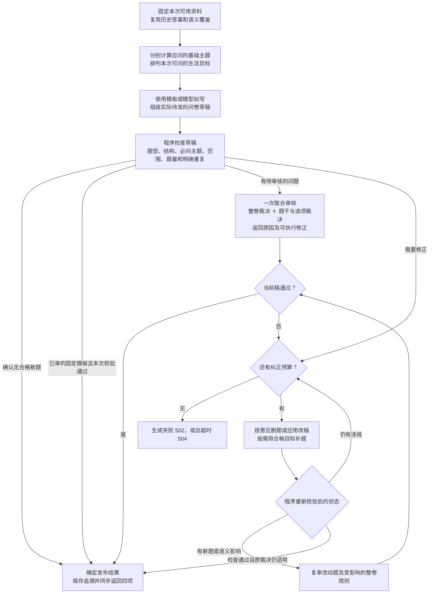

# 健康分析问卷联合审核流程与实现方案

> 方案讨论稿，更新于 2026-11-18。

本方案面向 `health_analysis.main` 中的问卷生成和审核，依据[问卷生成与审核需求](../product/health-analysis-questionnaire-requirements.md)。对外契约见[健康分析接口](../api/API.md#生成健康分析)。

## 1 智能体范式与执行边界

问卷子流程属于 **评估—优化工作流（Evaluator–Optimizer）**。生成阶段出草稿，评估阶段按规则审查并给出可执行反馈，优化阶段应用允许的修正，再按影响范围复审。状态流转、可改字段、发布条件和退出由程序控制。评估和优化是调用职责，可通过现有 LLM Gateway 执行。 [Anthropic 的评估—优化工作流](https://www.anthropic.com/research/building-effective-agents)

主智能体仍由 `HealthAnalysisAgent` 执行。问卷审核放在实际待发问卷成形之后、最终响应和追溯保存之前。当前题库有三种基础主题模板及 24 个生活目标模板。工作区中的早期试做先审核候选，再对选中题目做内容复审和定向改写。本方案用同一次模型调用检查整卷和单题，首轮同时合并问卷原有的语义发布判断。 [主智能体入口](../../modules/health_analysis/agent.py) · [题库](../../modules/health_analysis/policy.py) · [现有生成流程](../../modules/health_analysis/generation.py)

## 2 流程图



## 3 规则与检查的放置位置

在 Health Analysis 域内维护一份带版本的审核规则清单。每条规则包含适用对象、触发条件、验收标准、示例和允许的修正动作。规则范围可以是整卷、普通题、指定采集目标或选项。特定题用稳定的目标 ID 匹配规则，题干改写后仍按原目标审。题库、规则和当次资料均属于本次审核的输入。

| 落点 | 职责 |
|---|---|
| 初稿生成 | 给现有规划提示词提供关键规则与本次候选目标，优先使用合适的题库模板。已确定的基础应问清单由程序组装。 |
| 程序预检与最终校验 | 复用问卷结构解析、题面校验和确定性查重。按同一清单核对主题、题型、选项编码、必答状态、题量和可机械判断的规则。 |
| 联合审核 | 同一次模型调用核对卷级问题和所有待评估题。检查目标一致性、适用性、语义重复、问法清晰度和选项质量，意见定位到规则和题目。 |
| 改写与复审 | 改写收到命中的规则、题目和修正权限。复审使用修改后的内容、已保留题和相关资料，再核对受影响的规则。 |

固定模板的审核结论与题库和规则版本绑定。纯模板草稿的内容和适用性均可确认时，可复用这些结论，再由程序执行当次校验。出现动态改写、新题或上下文判断时，按该内容进入联合审核。

## 4 处理步骤

1. **固定依据并生成应问清单。** 复用三源资料快照与 `SemanticCoverage.assess` 的主题覆盖、生活目标覆盖和原因。程序从三个基础主题中逐项选出本次缺答的主题，排序后放在生活题前。历史生活题、已知条件及适用性结论继续约束生活题候选。
2. **形成一版真实待发的草稿。** 用当前题库模板或模型候选组装，保留题目 ID、采集目标、来源和呈现顺序。程序先检查 Schema、题型、选项唯一性、明确重复和题量。草稿最多 20 题。可补题目标及其覆盖状态随当前草稿保留，为删除后的必要补题提供依据。
3. **复用发布审核入口做一次联合审核。** 演进现有 `review` 请求，把原来的问卷语义判断与题干、选项和卷级检查集中在同一份审核输入。审核模型只收到当前待发稿、规则、本次应问主题和判断所需的资料摘要或来源引用。现有检查建议与健管师开放问题沿其各自规则审核，问卷修正仅作用于问卷。问卷的已有目标一致性、生活题范围、年龄适用性和新颖性门槛继续参与发布判定。
4. **校验审核协议并应用修正。** 程序核对草稿版本、规则 ID、题目 ID 和裁决覆盖。明确不适用且有有效依据的生活题可删除。题意合格时可以仅修选项。需要修改题干或说明时保留原采集目标。题型变化、拆题等动作按已确认权限处理。改写建议带有可用稿时直接应用到指定字段，需要进一步拟写时才调用现有改写阶段。涉及补题时先使用合格的待选目标，并把新题纳入检查。
5. **按影响定向复审。** 程序对修正后的整卷重新执行结构、必问主题、题量和确定性去重检查。只删除明确不适用的题且其他原裁决仍适用时，可复用该版本的其余裁决。新增题或题干、选项的语义变化需要模型复审，输入包含改动题和与其有关的保留题、历史题及个人资料。需要整卷语义判断的规则一并复查。修正稿中的适用性和去重必须以实际文本为依据。
6. **确认并交付。** 程序依据最后一版的硬校验和有效裁决决定是否发布。审核结果与实际发布内容共同进入现有受控追溯，确认持久保存后同步返回四项结果。确认无可发新题时问卷为 `null`。纠正预算用尽仍有未通过的规则或缺失裁决时返回 `502`。达到总期限时返回 `504`。

## 5 联合审核的输入、输出和修改边界

输入包括草稿版本、规则版本、待发卷、每题采集目标、本次应问主题、适用性和覆盖判断所需资料。日常问卷只引用与当前判断有关的内容，复用现有模型输入脱敏。主题、选项和证据都使用本次固定的数据。

审核响应的问卷部分提供每条应审卷级规则和每道应审题目的裁决，状态为通过、需纠正或不确定。程序按稳定标识关联，并把缺失裁决留作未解决项。遇到问题给出字段、依据和建议操作。下面的合成示例展示对选项的局部修正。

```json
{
    "draftVersion": 1,
    "surveyFindings": [
        {
            "ruleId": "required_background_topics",
            "status": "passed",
            "questionIds": [
                "family_history"
            ]
        }
    ],
    "questionFindings": [
        {
            "questionId": "family_history",
            "status": "passed",
            "issues": []
        },
        {
            "questionId": "ha_sleep_duration",
            "status": "requires_revision",
            "issues": [
                {
                    "ruleId": "options_match_question",
                    "field": "choices",
                    "reason": "题目询问睡眠时长，原选项回答的是频率",
                    "action": "replace_choices",
                    "choices": [
                        {
                            "value": "under_6",
                            "text": "不足6小时"
                        },
                        {
                            "value": "6_to_under_8",
                            "text": "6至不足8小时"
                        },
                        {
                            "value": "8_or_more",
                            "text": "8小时及以上"
                        }
                    ]
                }
            ]
        }
    ]
}
```

建议稿由程序按允许的操作应用到对应问题。新草稿版本重新绑定裁决，只有题文、规则和依赖内容仍适用的旧裁决才可复用。必问基础目标和生活选题范围由程序重新核对。模型提出的删题须满足明确的适用性或去重依据。

## 6 代码落点与复用

| 位置 | 实施计划 |
|---|---|
| [问卷生成编排](../../modules/health_analysis/generation.py) | 组装待发卷，持有本次应问清单、候选与草稿版本，按程序校验、联合审核、修正、定向复审和发布条件流转。 |
| [题库和发布规则](../../modules/health_analysis/policy.py) · [问卷协议](../../modules/health_analysis/surveys.py) | 固定规则和结构校验复用本域实现。新卷规则覆盖模板和动态题，历史答案沿其原 `schema` 解码。 |
| [覆盖、查重与发布审核](../../modules/health_analysis/deduplication.py) · [适用性](../../modules/health_analysis/applicability.py) | 复用覆盖、原文去重、语义发布约束与年龄规则验证。在首轮联合调用及定向复审中检查实际题目，原版已通过且仍适用的裁决可直接使用。 |
| [模型适配器](../../adapters/health_analysis/model.py) · [发布审核提示词](../../prompts/health_analysis/review.md) | 使用现有网关和阶段调用方式。精简审核上下文，按卷级、题干及选项规则输出结构化意见，必要时提供改稿。 |
| [应用服务及追溯](../../modules/health_analysis/application.py) | 保留同步期限、错误处理和成功前持久确认。记录规则版本、审核范围、各轮意见、采用的修正和最终稿。 |

## 7 预算与实施验收

- 正常的动态问卷首稿目标为一次联合审核调用。统计起点是实际待发草稿成形，资料整理和问卷规划的调用数另行计入总耗时。规则及适用性均可确认的固定模板分支可用程序和已审核的结论完成发布检查。
- 审核、反馈改写和定向复审共用原同步请求的截止时间及并发管理。最大返修轮数结合真实样例的通过率和耗时确定。每轮开始前检查剩余预算，输出尚未通过且纠正预算用尽时返回 `502`，总期限耗尽时返回 `504`。
- 实施先固化共用规则和典型样例，再将问卷语义审核接到联合调用。随后接入允许的修正、定向复审和最终发布检查。离线阶段覆盖缺一个主题、从不饮酒删题、机械题干改写、选项修正、改写后重复、覆盖耗尽和预算失败，并用替身核对模型调用次数。
- 真实模型联调用经过确认的样例比较首轮通过率、修正成功率、误删及漏审情况，分别统计审核模型调用数、审核阶段耗时和接口总耗时。根据结果核定返修上限和发布取舍。
