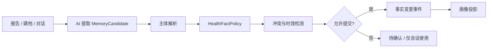

# 健康记忆与事实主体设计

状态：已被完整画像方案取代，作为早期决策摘要保留

更新：2026-09-03；源码复核基线：`6625647`

> 当前实现和后续边界以 [用户健康画像设计方案](./user-health-profile-design.md) 为准。主体、事实、事件、投影、持久化摄取任务以及 Analysis 体检报告/Record/Chat 首版摄取已经实现；这里的“体检报告”不是 `/api/v1/report` 最终报告。最终报告尚未接入 Agent 和长期画像读取。本文不再作为实施状态清单，其中 `MemoryWriter`、`FamilyHistoryLink` 和主体合并等名称或流程是早期概念示意，不代表现成组件。

## 核心原则

- AI 自主识别候选健康事实，但不能直接修改用户画像。
- `userId` 表示产品用户，`subjectId` 表示健康事实描述的人。
- 本人、血亲、非血亲家属、朋友和未知主体的数据相互隔离。
- 同一位家人跨会话映射到稳定 `subjectId`。
- 血亲疾病通过家族史关联影响本人上下文，不能写成本人的当前疾病。
- 事实更新保留来源、置信度、时间、旧版本和变更原因。

## 受控写入流程



模型只能输出 `MemoryCandidate`。确定性策略负责主体、事实类型、保存范围和冲突处理，只有 `MemoryWriter` 具备画像写权限。

## 主体连续性

- `subjectId` 由系统生成，不使用姓名、手机号或“父亲”等关系作为主键。
- 会话开始时可以显式选择本人或已有家人主体。
- 只有一个明确候选时可以自动解析；存在继父/生父、多位兄弟姐妹或同名朋友等歧义时必须询问。
- 主体创建、合并和拆分都产生审计事件。
- 不同产品用户创建的主体默认不得跨账号自动合并。

## 家族史与朋友咨询

```text
父亲主体：糖尿病史
        └─ FamilyHistoryLink ─→ 本人：存在糖尿病家族史

朋友主体：某项症状
        └─ 默认只服务朋友咨询，不进入本人画像
```

## 事实边界预留

使用可配置的 `HealthFactPolicy`：

```text
factType
allowedSubjectKinds
persistenceScope: session | profile | report_only
requiresConfirmation
defaultValidity
conflictStrategy
sensitivityLevel
```

未登记类型不自动写入长期画像。早期 POC 只定义接口和候选事件；当前普通对话已经通过持久化摄取任务写入受控候选，是否生效仍由确定性事实策略和用户确认决定。
