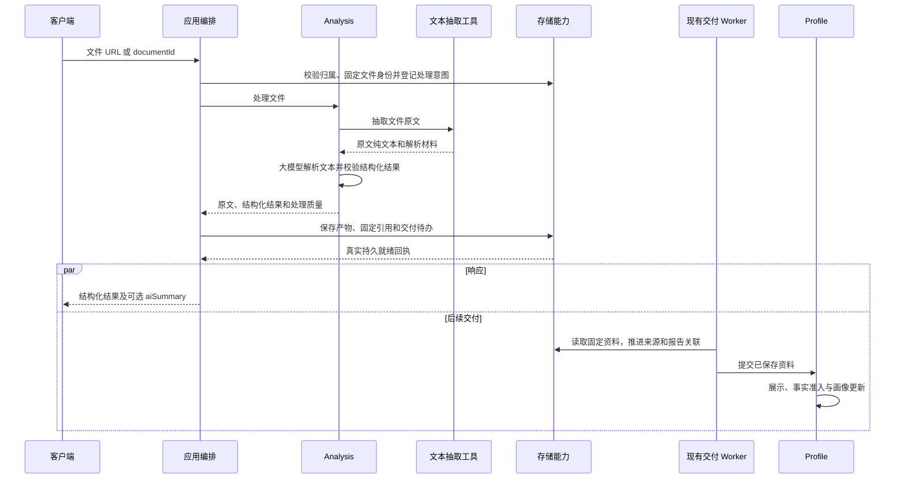

# 体检报告 AI 解读实现与计划

- 状态：文档已验收，2026-11-11 已明确授权实施；按独立模块分支开发并集成到当前任务分支，尚未部署。
- 更新日期：2026-11-11。
- 核对基线：`develop@db6d459703b8d4048f94525cfc971bfda010f91a`。
- 需求依据：[体检报告 AI 解读改造需求](../product/health-report-interpretation-requirements.md)。
- 当前契约：[API 文档](../api/API.md)。公开变更须在实现时同步该文档，本文不替代当前契约。

## 1. 目标与执行约束

Analysis 的本质工作只有两步：解析上传文件得到原文纯文本，再调用大模型把文本解析为完整结构化数据。简短摘要属于结构化输出。后续由应用服务协调存储和画像对接，存储与画像各自负责本质工作。

统一改造现有 `analysis.health_report` 和 `analysis/health_report.txt`，不按调用方分出不同 Analysis 实现。依赖方所需的专用抽取、报告组织、上下文或表达由依赖方自己完成，不回流为通用解析能力的定制分支。

按 `AGENTS.md` 和贡献指南分职责、分任务分支实施，公共能力先登记并交接。复用既有模块、索引、归档和 Worker，不因本次职责澄清新建 Agent、队列或进行大规模目录迁移。

### 1.1 已锁定的选择

| 事项 | 选择 |
|---|---|
| Analysis 核心 | 文件到文本、文本到结构化数据，包含必要的校验、分段、纠正和简单概述。 |
| 存储 | 可靠保存原件及两份处理产物，固定执行引用，维护业务关联和恢复依据。 |
| 画像 | 消费保存的资料，负责展示、事实准入、核验和投影更新。 |
| 应用编排 | 校验请求、协调处理与存储，根据真实持久回执决定响应和后台交付。 |
| 消费者 | 使用公共结果，自行完成特殊需求和本域适配。 |
| 响应时机 | 必要归档、固定引用和持久待办成立后返回，后续来源发布及画像应用后台推进。 |
| 历史资料 | 现存归档原样读取，缺档如实说明，不自动补摘要、重算或迁入来源。 |

## 2. 当前实现与差距

| 编号 | 当前事实 | 本期调整 |
|---|---|---|
| G-01 | 现有模型任务和提示词已属于 Analysis，但提示词要求摘要为 null。 | 直接改造当前任务，允许简单概述，保留完整抽取。 |
| G-02 | 多个业务入口通过共享文件处理服务取得 Analysis 结果。 | 保持通用解析契约，消费者的专用加工留在消费者模块。 |
| G-03 | `AnalysisFormalPublication.finish` 在响应前执行基础来源和别名交付。 | 改为等待必要存储回执，后续交付移到已有后台执行。 |
| G-04 | 原文、模型留痕及结果已归档，但恢复准备仍可能依赖可变文件索引。 | 在每轮完成归档时保存不可变引用清单，不等 HTTP 收尾才固定。 |
| G-05 | 无日期项目不一定进入有效事实，完整结果还包含 unresolvedItems。 | 画像完整视图读取保存的完整资料，展示与事实准入分开。 |
| G-06 | 公开原报告指标查询仍可能只读旧观察存储。 | 修复 I-043，接入正式来源原始资料并保留既有数据读取。 |
| G-07 | 无临床来源的解析不能仅从正式发布账本发现。 | 存储提供按归属的归档枚举，覆盖仅待核实项、仅元数据等资料。 |
| G-08 | 同文件多 reportId 并发首次发布存在别名缺失。 | 来源交付协调同材料竞争，修复 I-044。 |

主要入口：[Analysis 处理服务](../../modules/analysis/application/service.py)、[应用编排](../../modules/analysis/analysis_formal.py)、[固定准备](../../modules/analysis/analysis_formal_preparation.py)、[画像查询](../../health_profile/service.py)、[问题记录](../../ISSUE.md)。

## 3. 职责与目标数据流

| 所属能力 | 本期职责 | 公共边界 |
|---|---|---|
| Analysis | 调用文本抽取工具，再调用大模型取得完整结构化数据；处理抽取质量及简单摘要。 | 返回通用产物和处理质量，不决定画像事实或消费者的业务投影。 |
| 文本抽取工具 | 接收已校验文件，执行 DocMind 文本抽取。 | 返回实际文本及解析材料，不生成临床事实或业务报告。 |
| Document／存储 | 文件身份、原件与解析归档、快照、固定引用、业务关联和来源交付所需持久记录。 | 提供通用可靠读写和资料生命周期，不组装画像展示响应。 |
| Profile | 完整资料展示、已有事实关联、事实治理、准入和画像应用。 | 通过公共资料读取接口工作，不要求 Analysis 为画像重新抽取。 |
| 应用服务、Web 与组合根 | 应用服务协调两步处理、存储和持久交付；Web 处理传输；组合根显式注入依赖和 Worker。 | Web 不跨模块拼数据库，模型不决定存储或交付成功。 |
| Report、Record 等消费者 | 取得通用解析资料后完成自己的业务加工。 | 特殊需求由消费者自行负责，不增加 Analysis 专用分支。 |

物理目录可沿用现状。关键是职责与调用边界清楚，不把存储、来源发布或画像逻辑塞进 Analysis 模型任务。

## 4. Analysis 两项核心能力

### 4.1 文件到文本

沿用现有下载、内容身份、DocMind 调用及执行协调，取得该文件实际原文。文件引用需要先核对用户和主体。存储命中已保存材料时，应用服务可复用原件和文本，避免重复调用工具。

原件二进制、完整 DocMind 响应、布局和文本按现有机制留存。Analysis 使用实际文本，不用模型重写文本代替第一份产物。

### 4.2 文本到结构化数据

直接改造现有提示词及抽取流程，输出当前通用报告结构。覆盖正常与异常、数值与定性、影像叙述、混合子报告及待核实项目；缺日期或单位不丢弃已有结果。

分段、格式纠正和受控恢复继续使用现有预算与检查点。调用记录保留实际输入、输出、分段和纠正依据，不为 Report、Record 或画像再运行一套专用模型抽取。

### 4.3 摘要与质量

允许模型在抽取时一并生成简短 `aiSummary`，不增加独立深度分析调用。最终校验、合并和原件核对完成后定稿：普通完整结果可保留有依据的模型概述；发生过滤、分段或部分失败而无法证明概述依据时，复用最终保留项目生成简单概述。

无可靠结果时摘要为 null，partial 明确依据有限。菌群等原件核对后的摘要只包含最终保留项目。摘要不进入中立观察或健康事实，消费者所需的进一步解读由消费者完成。

`processing` 继续表达 complete、partial、unavailable 及限制。存储失败、来源交付状态和画像事实状态独立表达，不由模型质量标记替代。

## 5. 存储就绪与应用响应

### 5.1 固定资料

复用现有归档、三类快照、准备绑定和交付账本，不新增功能分流。存储在本轮结果归档完成时保存一次性固定清单，包含用户、主体、文件身份、canonicalReportId、本轮执行身份、实际原文与完整结果引用及内容摘要。

固定引用必须能在后续请求推进新一轮恢复后继续读取。不能只保存 documentId，再从可变 payloadRefs 查找“最新结果”；同次执行重放也不能串用后来轮次。固定 HTTP 响应须经过最终展示投影，再使用现有分块归档保存；交付记录只保留响应引用和内容摘要，避免大结果超出单条存储限制。

### 5.2 响应前顺序

1. 应用服务登记持久处理和交付意图，核对文件归属并预留 reportId。
2. Analysis 完成两项处理，存储能力保存原文、结构化数据及既有留痕。
3. 存储固定本次归档清单、必要快照和响应依据。仅待核实项、仅元数据或 unavailable 的已归档结果也有真实固定记录，不伪造临床来源。
4. 保存交付就绪证据并读回核验。写成功但回执丢失时，按同一执行身份复核已有记录。
5. 应用服务构造响应，不同步执行基础来源和别名完整交付。

必要归档或就绪记录失败时返回实际 5xx，不先成功响应再依靠内存协程保存。尚未取得的来源标识和任务引用保持缺失或空值。

## 6. 来源交付与恢复

复用 document-formal、document-outbox、analysis-delivery 和 Profile Worker 的生命周期。交付从固定资料出发，完成正式来源、真实接收回执、报告历史和调用方别名。

在任何可独立推进的基础来源命令提交前，必须确认归档、固定引用和就绪证据已成立；不能只在某个 Worker 入口检查，避免另一个 Worker 提前发布。已有待办缺少新就绪字段时，仅在能够证明其固定归档完整时补齐证据，不要求保留另一套模型流程。

后台只恢复固定资料准备和交付，不重新下载 URL、运行 OCR 或模型。无法证明原轮次资料时明确保留失败或不可用原因，不借用最新结果。

同次受理执行重放复用固定结果。reportId 维持业务引用语义，重复使用不阻止 partial/unavailable 的既有受控恢复；后续轮次形成自己的固定资料，已归档报告首次快照保持。旧轮次晚于较新来源恢复时只补其固定历史和别名，不回退较新基础来源，也不发布依赖过期材料的补充来源。没有临床来源的资料继续保留 Document 归档及请求报告引用，不为补历史而制造临床来源。

同文件不同 reportId 的基础来源按来源身份协调。竞争者复核同材料已完成来源后继续各自别名，避免反复首次准入直至永久失败。别名交付失败可恢复，不把已保存的解析结果改成解析失败。

来源接收不等于画像已应用；真实来源标识、接收状态和任务引用由所属交付模块提供。撤回、退休及人工更正结果继续受程序保护。

## 7. 存储公共资料读取

Document／存储提供按用户、主体及文件筛选的通用归档枚举和固定读取，返回文档身份、原文及完整结果引用、处理质量和来源生命周期。原文仅供内部授权读取，不在本次画像 HTTP 响应展开。

复用正式来源的有界发现与有效贡献读取，并为文件索引补充 scope 和文件 ID 的有界枚举及必要复合索引，覆盖未发布、仅待核实项和仅元数据的解析。历史观察及准备绑定只作为可验证的读取依据，不在查询中捕获快照或补跑解析。

同一固定归档从不同入口发现时按固定身份去重。固定解析身份仅由原件和实际解析资料确定，生命周期变化通过独立状态标记校验，不能把同一次解析改成另一份资料。正式来源只读取有效贡献；已退休、撤回中或已撤回的资料不能从旧观察、准备记录或原始归档回退原值。历史缺档与没有资料分别表达。

同文件存在当前有效来源及更高轮次的新归档时，完整展示须立即取得新固定解析，不等待发布或画像 Worker；新资料保持 pending 且不借用旧事实核验。标准展示仍按原有效来源读取，双方通过固定解析身份区分。新归档自身不授予来源或事实生效状态。

存储提供通用资料和读取游标，不负责原始项目展平、事实准入、核验状态或画像 HTTP 的 items/documents 组装。上述展示工作由 Profile 消费者完成。

## 8. Profile 完整展示与接口

### 8.1 展示选择

- 原报告指标列表复用 `POST /api/v1/health-profile/document-observations/list`，增加可选 view，取值 standard 或 complete，省略时为 standard。
- 画像详情复用 `POST /api/v1/health-profile/get`，增加 documentObservationView，取值同上；结果仍位于 documentObservations。
- 保留 userId、subjectId、documentId、cursor 和 limit，limit 默认 20、范围 1–100。非法选择或游标为 422，主体不存在为 404，跨 scope 文件返回空页。
- standard 保留既有展示范围，并修复 I-043 的正式来源原始指标缺口。complete 展示完整保存内容；两个选择由同一画像实现提供。

### 8.2 展开、分页和状态

Profile 展开完整结果中的顶层及子报告观察、影像所见/诊断和 unresolvedItems。通过固定解析身份及原始指针识别同一物理记录，去掉 expansion 镜像和兼容投影，不按名称和值合并不同日期、标本或方法的真实记录。

完整页保留 items 和 nextCursor，增加 documents 与 status。status 使用 ready、partial、unavailable 表达本页读取情况。项目保留 observationId、documentId/documentIds、sourcePointer、observation，增加 extractionId、resolutionStatus、日期和真实事实关联状态；缺字段保留 missingFields 和 reason。没有项目的报告只返回文档级记录。

sourceRevision 仅在有真实来源依据时返回；完整视图中可为空，不制造占位来源。sourceStatus 使用 pending、active、not_published、withdrawn、unavailable，active 必须有真实已应用依据。未唯一关联事实时保持 unconfirmed，factStatus 为空，不伪造 pending 事实或可靠性数值。

按有界索引和 seek 游标读取，不全库扫描后排序。Profile 游标绑定 scope、文件筛选、展示选择、扫描位置及当前固定资料与项目偏移。一个文件跨页继续读同一结果，固定绑定或生命周期变化时返回 409。无项目文档占一个分页单位，项目与无项目文档合计不超过 limit；允许空页携带后续游标。

get_profile 不得把参数错误或生命周期冲突吞成 unavailable；仅真实资料读取失败才按范围降级。保留现有默认本人空画像初始化行为，资料读取本身不调用解析、模型、发布或恢复。

### 8.3 事实使用

完整资料可见不等于事实生效。Profile 自行决定事实准入、核验、更正、删除、趋势和概览，不补造时间或数值，不把摘要及原报告诊断升级为确诊。

其他消费者通过公共结果完成自身加工。需要适配时由消费者模块负责，不把其私有提示词、上下文或业务规则加入 Analysis。

## 9. 实施批次与依赖

各批只能从当前任务分支 refactor/health-report-interpretation 创建独立模块分支，按职责登记 ISSUE 和交接。经非作者复核和本地验证后只合回该任务分支，最后由用户统一审核并合入 develop。不得创建或合入从 develop 派生的旧模块分支；已有代码可以在正确基线上重现实现。主智能体不直接推送或合入 develop。物理目录保持现状，职责调整不等同于新增存储服务。

| 批次 | 归属 | 交付 | 门禁 |
|---|---|---|---|
| B1 | Analysis 核心 | 改造当前文件解析与模型抽取，允许简单摘要。 | 两份产物、字段完整性、摘要边界和分段纠正通过；无消费者专用抽取。 |
| B2 | Document／存储与交付 | 固定归档清单、就绪证据、公共资料读取及 I-044 并发修复。 | 必要存储失败不成功响应，跨轮次可恢复，无后台 OCR/LLM 重跑或重复摄取。 |
| B3 | Profile | 消费 B2 资料，提供完整视图并修复 I-043。 | 未发布和待核实资料可见，事实准入、分页、归属及撤回保护成立。 |
| B4 | 应用编排与组合根 | 接入 B1—B3，缩短同步等待，显式注入依赖并同步公开契约。 | 默认装配和消费者回归、完整离线检查、非作者复核通过后再进入真实验收。 |

B1 的处理能力可独立验证；完整业务响应依赖 B2 的可靠存储，画像展示依赖 B3，不把这些依赖变成 Analysis 模型职责。消费者确需适配时单独按所属模块交接，不为保持其私有加工而增加 Analysis 分支。I-043、I-044 仅在对应行为验收后关闭。

## 10. 测试、发布与文档同步

| 用例组 | 对应验收 | 关键场景 |
|---|---|---|
| T1 职责与契约 | AC-01、AC-14 | Analysis 两项核心任务；消费者自行加工；真实默认装配和公共输出契约。 |
| T2 抽取与摘要 | AC-03、AC-04、AC-05 | 各报告类型和混合子报告；零值、定性、比较符；长文本与纠正；最终结果和摘要一致。 |
| T3 存储与响应 | AC-02、AC-06、AC-07 | 阻塞来源/Profile仍可响应；归档和就绪失败不成功；并行 Worker 在就绪前不发布。 |
| T4 恢复与幂等 | AC-07、AC-12、AC-13 | 回执丢失、取消、重启、后来轮次推进、多 reportId 并发；固定资料不串用，别名最终存在。 |
| T5 完整资料 | AC-08、AC-09、AC-10 | 无日期、缺结果、影像、评分、未标准化、仅 unresolved、仅标题日期及缺档。 |
| T6 读取治理 | AC-11、AC-12 | 主体隔离、分页冲突、有效贡献、退休和撤回；查询无处理副作用，历史不重跑。 |
| T7 组合验收 | AC-10、AC-14 | I-043 列表与详情一致、I-044 别名竞争；调用方完成所属适配，事实治理不放宽。 |

每批生产代码修改完成改动文件 Ruff 检查及完整 `python -m pytest tests/unit`，记录对应提交；定向测试不能替代全量离线测试。真实验收使用合成报告，覆盖 DocMind/模型、MongoDB/Redis 和进程重启，不读取私有 .env 或真实用户健康资料。

发布先验证存储与消费契约，再接通默认编排。历史已有归档原样读取；必要新字段兼容既有缺字段记录，不自动迁移或重算历史。人工补投、迁移及生产配置维护保持独立操作范围。

实现时同步 API.md 的摘要、展示选择、分页、文档级状态、空值、错误和异步应用说明；技术细节留在架构及 Wiki，不回写历史 API。同步 TODO、ISSUE 和文档导航的真实状态，不以文档完成代替代码、离线或部署验收。

需求与计划文档在当前任务分支维护。本次用户已验收文档并明确授权提交与实施；此前停止记录仍保留在 I-046，已有工作经复核后复用，不以其存在代替验收。文档交付检查 Markdown、JSON、相对链接、Mermaid 结构、需求编号及交叉引用。
