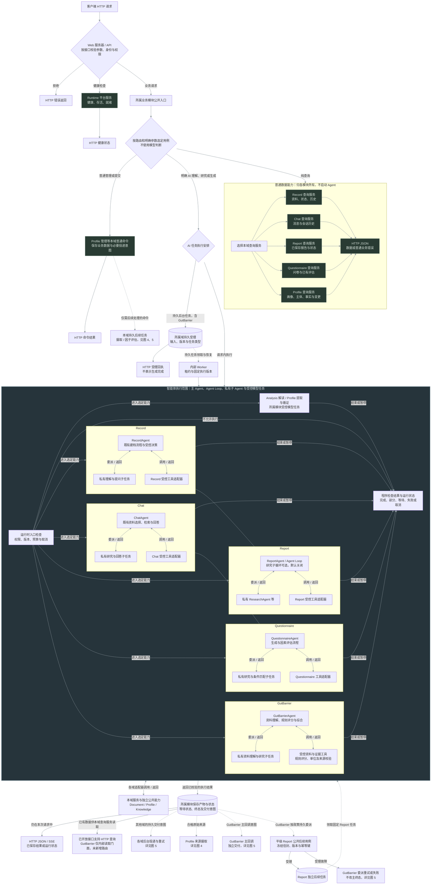
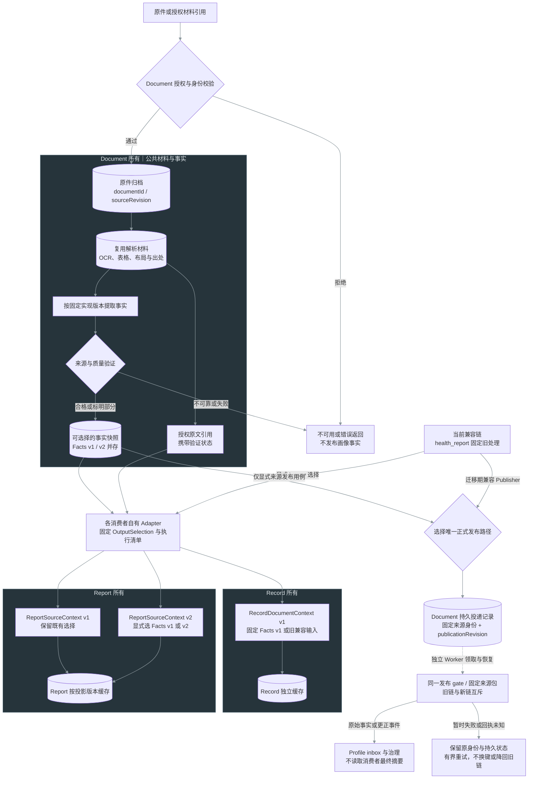
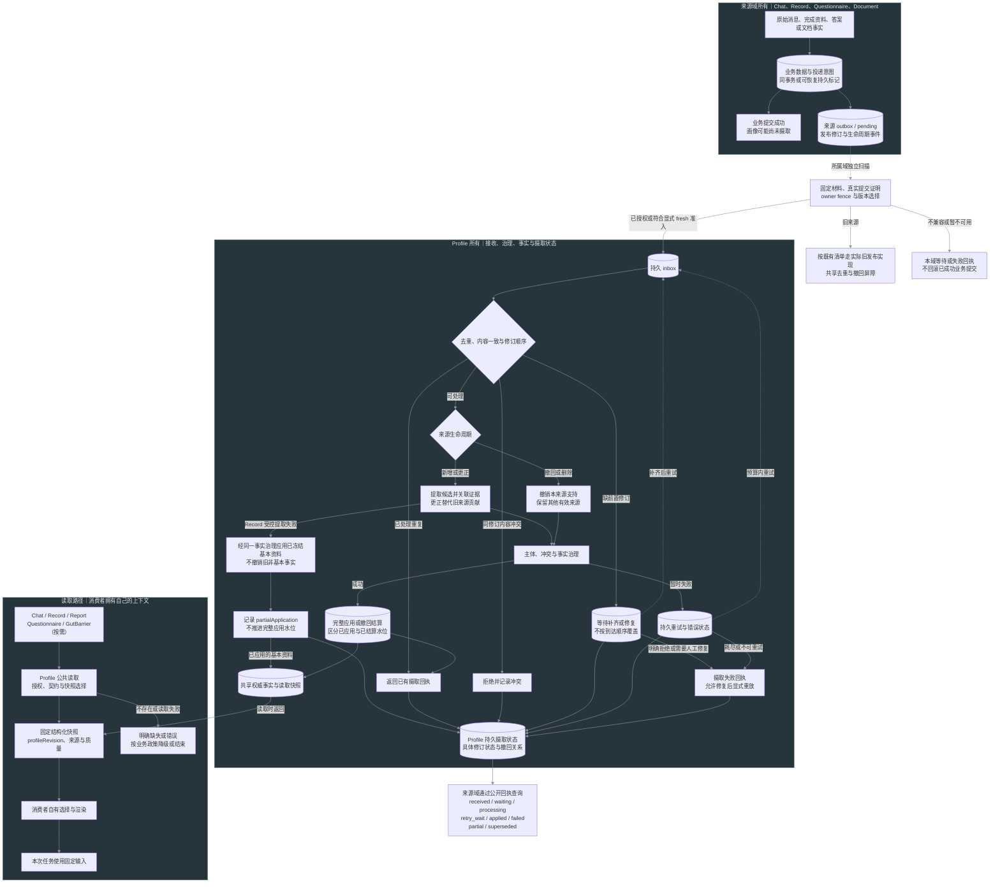
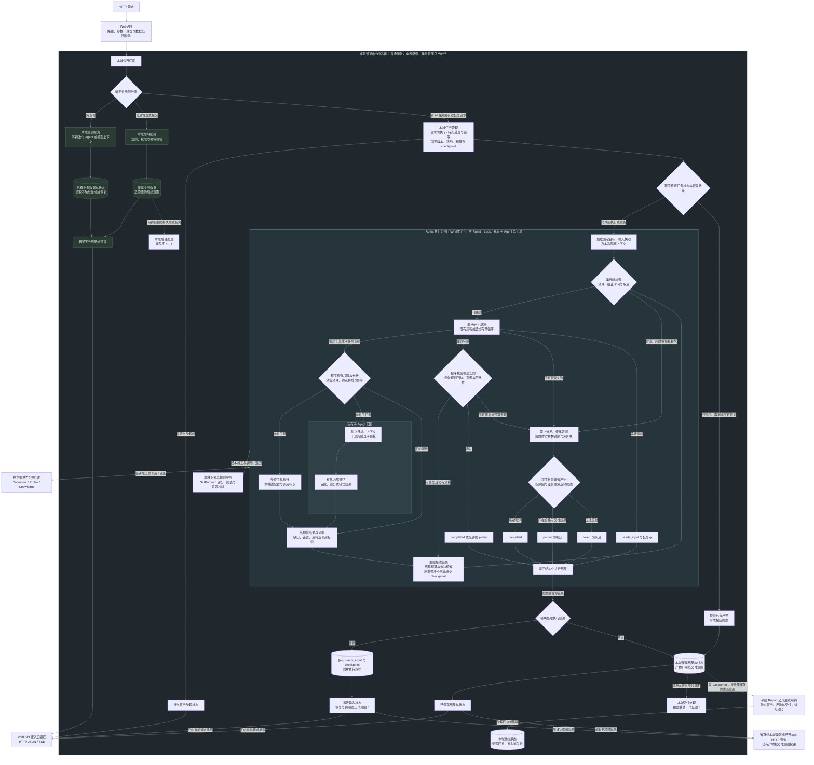
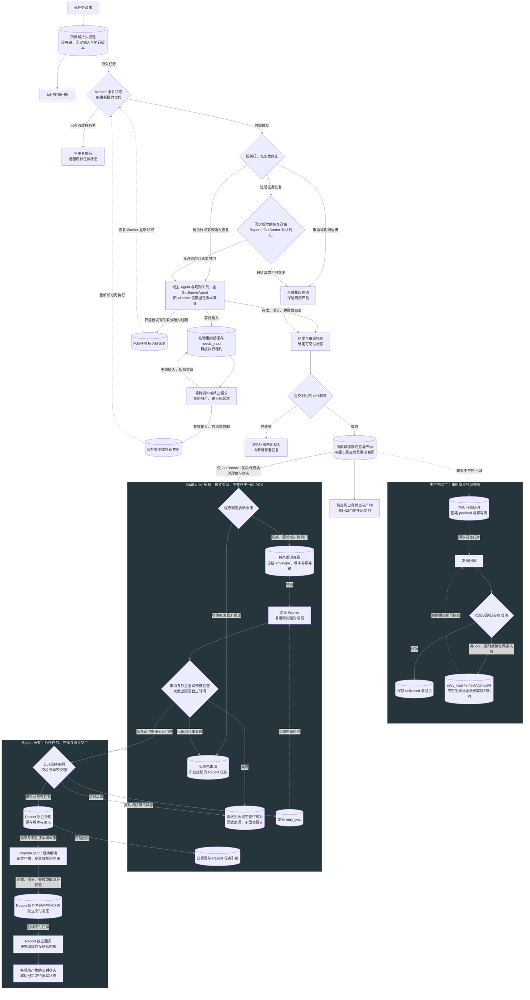
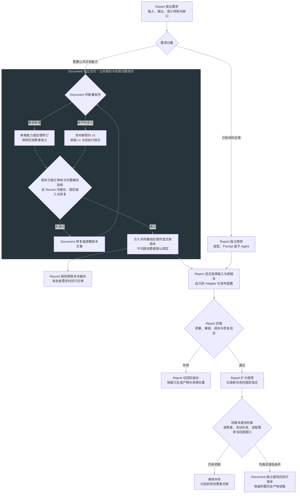

# 业务域多智能体架构与模块解耦迁移方案

> 状态：阶段 0—6 本地实现已完成；六张图仍含按需演进的目标能力，不代表全部目标已实施或已经上线
>
> 日期：2026-11-10
>
> 范围：Web API 内部的域主智能体与子智能体、Document/Profile/Knowledge 公共能力、独立 Analysis、GutBarrier、普通查询与管理、运行生命周期和分阶段迁移。实施范围已按用户后续指示扩展为阶段 0—6；阶段 7 独立服务部署不实施。

采用按业务域组织的层级主控—子任务多智能体架构（Supervisor–Worker）：Record、Chat、Report、Questionnaire、GutBarrier 分别拥有自己的主 Agent、内部子 Agent、运行状态和业务规则。Document、Profile、Knowledge 提供独立拥有、显式版本化的共享能力。模块之间通过公共契约和适配器协作。

本次迁移以尽可能保全现有业务行为为前提，先明确各功能流程的业务归属并复用现有实现，分阶段完成公共契约解耦与域 Agent 封装，按需抽出工具并整理提示词；解决共享输出的变化扩散，再按收益增加自主规划与工具循环。Report 的新需求只能改变 Report 自有解释；确实需要共享能力升级时，由被依赖模块单独交付新契约，Report 显式接入，Record 继续使用已选定的契约和处理版本。

## 本地实施进度（2026-11-10）

本任务以 `refactor/agent` 为集成分支，模块在独立子分支和 worktree 完成实现、非作者审核及完整离线测试，主协调者在候选集成分支复核组合后合回；最终由用户提交 `develop` PR。下表区分本期已交付能力与部署/后续演进边界，不用离线通过代替部署验收。最后代码候选完整离线测试为 12228 passed / 275 skipped；最终提交重验记录与各模块提交见 [ISSUE](../../ISSUE.md)。

| 范围 | 本地已交付 | 尚待完成 |
|---|---|---|
| Document 消费隔离 | `OutputSelection` 固定契约和实现；Record 使用固定快照、本域 renderer 与创建 checkpoint；Report 本域投影/缓存、固定文档 Adapter 和默认装配已接通 | 真实模型、存储并发与发布部署验收 |
| Document 公共数据 | 不可变材料/事实快照、固定原件与失败材料读取、派生解读桥、准备回执、Record 兼容 Publisher 生产装配及旧 Report v16 兼容发布命令；持久来源投递、撤回与观察水位；完整来源 capture/reader 与 fresh 准入；受管理来源更正、v16 补充、退休证据和无环纯读资源；统一正式命令、有界执行与持久恢复，业务投影准备和纯读独立；Report 显式 Formal V2 复用固定投影，Record 正式准备 V2 与 Analysis 解析前意图均已独立交付；三域默认根装配、唯一 Profile resolver、共享旧发布 gate 和独立恢复周期已接通 | 历史来源不自动迁移；真实并发和部署验收仍另行完成 |
| Profile 边界 | 四类来源接收/治理；Record v2 部分应用与撤回结算；公共结构化分页和旧摄取状态；Report 公共快照消费、Chat/Record 独立 renderer、真实 Adapter 与默认装配；完整文档来源 resolver、历史证明及显式新来源准入；Record/Chat 本域固定材料、真实准入与业务提交后持久投递；Questionnaire 公开已提交材料、旧扫描与发送隔离，Profile 问卷材料 V2 保留完整答案及提交证明；Document 问卷附件持久 Publisher 校验真实 ready，Questionnaire 本域消费者已完成真实准入、附件及答案投递闭环；Chat 撤回结算核对较新修订与 applied 水位，超出新来源上界的既有输入首次固定 legacy；固定版本证据语义纯接口与 Questionnaire 本域消费、清单及 checkpoint | 四类来源默认接线及独立周期已按 Document → Questionnaire → Record → Chat 完成；历史来源显式迁移、真实并发和部署另行验收 |
| Agent 平台 | 精确版本端口、模块隔离注册、AION 0.6.0 受控工具循环、父子预算/权限/取消/回执 | Report 研究循环已接入并默认关闭；非核心研究配置失败已隔离为明确不可用能力，不阻止普通查询与其他业务启动；真实模型质量、Mongo 并发与外部联调仍待验收；原生循环不提供逐步恢复 |
| 主 Agent | Record、Chat、Report、Questionnaire、GutBarrier 五域按既有完整流程接入；规则工具不改变计算 | Record/Questionnaire 已有独立后台恢复，普通查询不启动 Agent；Chat 保存失败不返回成功 finish；普通查询不受来源后台迁移影响；其他域不强制新增完整自主循环 |
| Report 委派 | GutBarrier 经公开持久入口提交三类后续，主产物/主回调/委派/后续交付独立 | 真实 Mongo 并发、外部回调与模型质量联调 |

对应实现与限制见 [Report 主 Agent](../../wiki/report-main-agent.md)、[GutBarrier](../../wiki/gut-barrier.md)、[Chat 主 Agent](../../wiki/chat-main-agent.md)、[Document 解读桥](../../wiki/document-understanding-bridge.md)、[Report 画像读取](../../wiki/report-profile-snapshots.md) 和 [Profile 公共契约](../../wiki/profile-public-contracts.md)、[Questionnaire 主 Agent](../../wiki/questionnaire-main-agent.md) 与 [Report 研究子智能体](../../wiki/report-research-agent.md)。新增提供方与消费者说明见 [Document 发布生命周期](../../wiki/document-publication-lifecycle.md)、[Profile 完整来源契约](../../wiki/profile-document-source-contract.md) 和 [Report 固定文档消费者](../../wiki/report-fixed-documents.md)。三域正式接入说明见 [Record](../../wiki/record-formal-documents.md)、[Report](../../wiki/report-formal-documents.md) 与 [Analysis](../../wiki/analysis-formal-source.md)。默认后台来源接线见 [Document](../../wiki/document-source-composition.md)、[Questionnaire](../../wiki/questionnaire-source-composition.md)、[Record](../../wiki/record-source-composition.md) 和 [Chat](../../wiki/chat-source-composition.md)。最终审计收口另将 [Questionnaire 生成规则](../../wiki/questionnaire-owned-policy.md) 与 [Document 菌群原始事实规则](../../wiki/document-microbiome-policy.md) 分别冻结到本域，避免 Record 或 Report 私有代码变化在消费者版本不变时改变结果。下面第 2 节保留重构前基线用于核对迁移原因；当前状态以本节及各模块 Wiki 为准。

## 1 架构目标与边界

所有外部请求统一进入 Web 服务器，对外暴露 HTTP API。Web 层按路由与明确请求参数校验并选择所属模块的用例，不调用模型进行入口分流。普通查询和数据管理由所属模块的普通应用服务直接处理，不创建 Agent 运行、不进入 Agent Loop；只有明确需要 AI 理解、研究或生成的任务，才构造目标、授权范围、固定输入和预算并启动对应 AI 能力。

业务模块的范围大于一次 Agent 运行的范围。每个模块可同时拥有普通查询/命令、业务数据、任务管理、主 Agent 和私有子 Agent。查询通过模块门面读取已有数据；Agent 经受控工具复用模块公开能力。请求内返回或持久受理后交付是独立的生命周期选择，不与“普通查询”并列成三种互斥业务类型。

“主 Agent”是相对一次业务任务而言：RecordAgent 对一次建档交互负责，ChatAgent 对一次聊天任务负责，ReportAgent 对一次报告任务负责，QuestionnaireAgent 对问卷生成或答案后的因子评估负责，GutBarrierAgent 对肠道屏障报告中需要 AI 的资料理解、研究与综合任务负责。五个 Agent 在系统层面平级，各自内部的子 Agent 默认私有。GutBarrier 通过 Report 公开用例委派后续解读，Report 不成为它的私有子 Agent；这种跨域协作不需要新增全局主控。

独立迭代的验收目标是：

- 模块内部调整不要求其他模块修改代码、Prompt 或状态结构。
- 新能力先由提供方单独实现并验证，调用方在后续变更中显式采用。
- 旧契约的字段含义、必需信息、质量状态和错误行为继续成立。
- 新旧处理版本可以并存，已有会话和任务固定所用输入与执行版本。
- 回滚一个模块时，不覆盖其他模块产物，不重置其他模块会话。

第一阶段采用模块化单体，独立维护契约与实现。同一进程仍共享部署、内存和部分基础设施故障范围；若进一步要求完全独立发布或资源硬隔离，可在稳定契约上拆出 Worker 或服务。

### 1.1 封装优先与本次边界

- 以当前接口、流程顺序、评分、降级、恢复和交付行为为基线；迁移首先改变职责归属与调用边界。明确列出的可靠性补齐分项验收，不借封装顺带重写全部流程。
- 模块包含完整业务用例；域 Agent 封装其中的理解、研究、生成和必要决策。既有流水线、单次模型任务和确定性步骤可以直接复用，不要求每个入口增加一次主控模型调用，也不要求每个内部函数都变成工具或子 Agent。
- 工具承担可独立调用、复用和校验的能力；提示词承担任务目标、语义判断、证据使用和表达要求。硬性业务规则、权限、持久化及回调仍由程序执行，具体划分见第 6 节。
- 本次不新增跨域会话移交契约；后续取消对话功能及 sessionId 管控另行处理，本轮不删除现有能力。Report/GutBarrier 资料不足等异常沿当前流程封装，由域内 Agent/子任务处理；保留通用等待状态设计，本轮不扩展补资料 HTTP 协议，也不要求各业务新增对外等待状态。
- Profile 保持一套共享的权威事实和治理规则，各模块独立组织消费上下文；本轮不扩展原报告补充观察契约。Document 的多契约、提取版本兼容与画像治理版本是不同概念。

## 2 重构前基线与迁移原因

| 位置 | 已有基础 | 本次需要解决的问题 |
|---|---|---|
| Agent 平台 | AgentHub、GraphRegistry、LLMGateway、事件、checkpoint、lease | Registry 按 capability 单键查询，version 是元数据；集中注册异常会使整体初始化失败 |
| 文档处理 | 原件归档、文件身份、解析复用、来源修订、OutputProfile、提取器版本缓存 | Record 和 Report 先经过同一个 HealthReportInterpreter；消费者没有独立契约选择 |
| Report 文件来源 | Report 自有 report_source extractor | 输入仍读取共享 report 字典中的 observations、expansion、reportType 等语义 |
| Chat 与 Record 画像读取 | 只读 Provider、上下文注入和会话快照 | 共享 build_context 同时决定事实选择、预算和 Prompt 文本 |
| Report 画像读取 | 消费者自有 ReportProfileSnapshot 和 ProfileSnapshotGateway | 公共读取投影尚需显式契约版本；profile_version 是数据修订而非接口版本 |
| 画像来源投递 | 持久来源、任务重试和幂等机制 | Profile 来源适配器直接理解并修改 Chat/Record 的 Session 存储 |
| 知识检索 | Chat/Record 已将检索资料输入生成模型；画像已有检索后综合解释 | 检索基础能力、业务策略和上下文格式仍有共享耦合 |
| 问卷与画像 | 各自的答案处理与摄取流程 | 问卷直接依赖画像内部语义函数，画像又导入问卷内部答案格式 |
| GutBarrier | 独立 HTTP 受理、规则流水线、证据检索、主产物与主回调 | 后续直接调用 Report 私有 _push_report 且绑定 store=None；目标主 Agent、公开持久委派与独立资料契约待交付 |

具体源码入口：

- [GraphRegistry](../../agents/runtime/registry.py) 与 [集中注册](../../agents/runtime/application.py)。
- [DocumentOutputProfiles](../../modules/analysis/application/output_profiles.py)、[共享文档处理](../../modules/analysis/application/service.py)、[复用协调器](../../modules/analysis/application/document_reuse.py)。
- [Record 文件消费](../../modules/record/application/service.py)、[Report 来源适配](../../adapters/report/document_source.py)、[Report 来源提取](../../modules/report/document_source.py)。
- [Report 画像端口](../../modules/report/ports.py)、[共享画像上下文](../../health_profile/memory.py)、[Record 来源](../../health_profile/record_source.py)、[Chat 来源](../../health_profile/chat_source.py)。
- [问卷依赖画像语义](../../modules/questionnaire/factors_answers.py)、[画像依赖问卷格式](../../health_profile/questionnaire_ingestion.py)。

当前 GutBarrier 主报告按程序顺序处理，标准装配没有注入 narrative；主报告终态保存后委派 Report 生成三类后续产物。Report 当前模型图也主要是单次受控调用，主流程由应用代码组织。因此，五个业务主 Agent 是目标职责划分，不能把现有规则流水线或已接入 AgentHub 当成已经具备自主循环。图 1、2 展示演进后的完整执行范围与主控循环；首期封装可在同样的模块边界内复用现有工作流，不要求每个用例经过额外的主控模型。源码见 [GutBarrier 流水线](../../modules/gut_barrier/pipeline.py)、[装配与委派](../../adapters/gut_barrier/factory.py)、[Report 后续生成](../../modules/report/reports.py) 和 [Report 模型图](../../agents/graphs/report/graph.py)。

现有文档输出缓存已经包含 profile、提取器版本和来源修订。完整历史结果也不会仅因解释器升级就全部自动重算。本次是在这些机制上增加消费者契约和处理版本的显式绑定，不以清空历史缓存作为迁移方式。

## 3 模块所有权、入口与协作契约

### 3.1 模块职责与普通数据能力

业务模块同时拥有普通应用服务和按需启动的 AI 能力。查询报告属于 Report 模块，但不属于 ReportAgent 的一次运行；查询画像属于 Profile 模块，但不启动候选提取或循证解释。普通数据入口无需创建 Agent 会话、加载模型上下文或执行工具选择循环。

| 所属模块 | 普通数据能力：不启动 Agent | AI 或工作流能力：显式用例触发 | 独立拥有的数据与状态 |
|---|---|---|---|
| Record | 查询资料、状态和历史；完成确认命令 | RecordAgent；私有理解、缺口判断、提问子任务 | 建档会话、阶段规则、资料投影、创建任务及运行状态 |
| Chat | 查询历史；写入自定义消息 | ChatAgent；私有研究、回答及推荐问题任务 | 聊天消息、会话、上下文策略及本域消息投递状态 |
| Report | 查询批次、报告状态和已有产物 | ReportAgent；私有 ResearchAgent 等；公开后续解读能力 | 报告任务、来源解释、章节、产物与回调状态 |
| Questionnaire | 查询问卷和评估结果；保存答案 | QuestionnaireAgent；问卷生成、答案后因子评估及私有研究任务 | 问卷版本、答案、因子评估、生成任务及来源投递意图 |
| Profile | 默认画像读取；主体、事实、观察和变更查询；主体及事实管理 | 显式循证解释、来源候选提取与治理中的受控 AI 步骤 | 主体、事实、来源、修订、读取投影、摄取与治理状态 |
| Analysis | 已有材料的读取由 Document 公共门面提供，不新增查询 HTTP 路由 | 独立文件解读用例，使用受控模型任务并保持原输出；不新增主 Agent | 独立 API 的用例规则与兼容输出；原件和公共事实仍归 Document |
| GutBarrier | 本域查询服务读取已有主任务、主报告及交付状态；当前无独立查询 HTTP 路由，本次不新增 | GutBarrierAgent；私有资料理解、证据研究与综合子任务；受控规则工具；经 Report 公开用例委派后续解读 | 输入与本域资料投影、固定规则版本、指标结果、主任务、主报告、主回调和委派状态；后续产物归 Report |
| Document | 授权原件、解析材料及已保存事实快照读取 | 显式解析/提取用例，确定性步骤与受控模型步骤按处理策略组合 | 原件、解析材料、事实、质量、来源身份及处理版本 |
| Knowledge | 检索连接、证据和原文读取；按查询契约返回结果 | 消费者研究策略需要时调用检索；不把普通检索等同于完整 Agent Loop | 检索连接配置、规范化证据、来源定位及检索状态 |
| Runtime 平台运行服务 | 健康、存活、就绪检查，直接读取平台运行状态 | 无业务 Agent；内部扫描器按既定任务状态启动恢复 | 运行状态、模块就绪信息与资源生命周期 |
| Agent 平台 | 运行记录/状态的技术读取，不拥有业务查询规则 | 模型协议、预算、取消、工具执行、checkpoint 等运行约束 | 技术运行记录；业务数据归对应模块 |

普通管理命令可以按规则写库，并可靠记录后续任务或来源事件。例如问卷答案先由 Questionnaire 应用服务保存并返回，因子评估和画像摄取再由后台处理。提交命令本身不运行 Agent；后续明确需要 AI 的任务才进入对应执行范围。纯查询不产生这些任务意图。

只有所属模块可以直接修改其业务数据。跨模块调用公开查询、命令或事件，不读取对方私有 Graph State、内部领域模型或数据库集合。Agent 可以经受控工具复用普通业务服务，HTTP 查询也可以直接调用该服务；两个入口不要求互相经过。

消费者拥有自己的出站端口与域内 DTO；提供方拥有公共契约。集成 Adapter 将提供方契约转换为消费者 DTO，由 bootstrap 组装。公共契约不引入提供方 repository、Agent 实现或业务策略。

Chat 通过 Report 只读门面读取报告，通过 Record 公开快照读取建档资料。Questionnaire 与 Record 也遵守这一规则。公共字符串处理、生活方式主题等现有跨域依赖需要逐项确定归属，不能把业务规则整体搬进 utils 继续共享。

### 3.2 图例与阅读顺序

六张图均为**目标架构，尚未全部实施或上线验收**。标为“当前兼容”的节点表示迁移期间保留的入口或桥接方式，不表示整张图已经上线。它们表示逻辑职责，首期可以在同一进程和数据库中运行，不默认引入消息中间件或微服务。

- 实线表示同步调用、结果返回或同一用例内的控制转移；边上注明调用、返回、条件或下一步。双向边表示调用及结构化结果返回。
- 虚线仅表示已经持久化的异步任务、事件或投递意图，由扫描器/Worker 重放；不表示普通内存协程或未落盘通知。持久事件入库或状态更新本身用实线表示，之后的异步消费用虚线表示。
- 连接大框的箭头表示该执行部件的调用或结果返回，实际入口是框内运行时检查；跨边界双向箭头由框内工具适配器发起，不是额外的 Agent 决策器。蓝灰色大框表示 Agent 执行范围；图 2 的外层模块框表示更大的业务所有权范围。子图标注所属域，数据库形状表示持久状态，菱形表示程序判断。数据服务和公共能力可以由 Agent 调用，但不因此归入调用方 Agent。
- 图中公共成功/失败出口是逻辑汇合点，各业务仍保存自己的结果，不引入统一业务大表。SSE 可先发进度，最终完成事件须在结果保存后发送。
- 已实现的五域主 Agent 先封装原有流程；图中通用完整循环是能力边界，只有 Report ResearchAgent 增加可选的有界自主补查且默认关闭。等待输入、跨域取消及旧版本退役仅在相应契约已支持时生效，本期不新增这些通用协议。

| 阅读顺序 | 图 | 解决的问题 |
|---|---|---|
| 1 | 全业务 HTTP 入口与智能体执行范围（本节） | 所有请求如何进入 API，哪些路径进入 Agent 大框 |
| 2 | 单个业务模块与 Agent 执行闭环（第 7 节） | 模块包含什么，哪些部件属于 Agent，普通查询如何绕过循环 |
| 3 | 共享文档与独立解读流程图（第 4 节） | Report 如何升级而不替换 Record 输入 |
| 4 | 画像读取与异步更新流程图（第 5 节） | 读取、摄取、更正与撤回如何隔离 |
| 5 | 长任务生成与交付流程图（第 8 节） | 任务中断、结果保存和回调重试如何处理 |
| 6 | 被依赖模块独立升级流程图（第 10 节） | 提供方独立交付、消费者采用与旧版本退役 |

### 图 1 全业务 HTTP 入口与智能体执行范围

> 目标架构，尚未全部实施。

> 实施对照：五域已完成行为等价主 Agent 封装；Report 私有研究循环已交付且默认关闭，Document/Profile 固定消费已接通，来源按域依次验收；完整自主循环不强制用于全部业务。



总图中的蓝灰色大框只标记智能体执行范围，不代表一个全局主 Agent，也不代表公共数据归 Agent 所有。五个业务主 Agent 平级；Analysis 和 Profile 的受控模型任务保留各自归属，不因画入执行范围而新增自主主 Agent。各域 Loop 内的主子调用、预算检查、工具结果回流与终止判断见图 2。普通管理、画像摄取及 GutBarrier 主回调采用独立出口，图中不会以它们的完成作为其他业务查询的前置条件。每次请求按路由和参数只进入选定用例，图中的多条分支不表示全部执行。

绿色普通服务由相应业务模块管理：Report 查询读取已保存产物，Profile 默认读取画像，普通管理按规则写库。目标纯查询不调用模型、不启动 Agent、不触发恢复，也不需要创建 Agent 会话或检查模型是否可用。健康检查读取平台运行状态；ready 可以报告 AI 能力不可用，但不启动模型探测生成。

业务性质与执行生命周期分开判断。GutBarrier 的目标报告任务经持久受理进入 GutBarrierAgent，必做规则作为受保护工具执行；旧规则 pipeline 仅是迁移兼容路径，不据此把整个域排除在 Agent 范围之外。纯规则即可完成的内部操作直接调用本域规则服务，无需额外模型判断；不新增外部执行模式参数。主终态保存后，由模块按政策独立持久委派 Report 后续解读，Agent 不直接发送回调。请求内执行和持久后台执行都由 Web API 发起；Worker、来源事件和回调属于内部执行及交付，不构成新的外部入口。SSE 是 HTTP 返回方式，不能据此推断任务具有持久恢复能力。

总图为避免交叉线，将各模块的数据服务、执行部件和公共门面按执行路径展开；它们的模块包含关系由职责表和图 2 明确。PUBLIC 表示调用者使用的版本化门面与适配关系，不是一个共享业务数据库；Document/Profile/Knowledge 的实现和数据属于独立提供方。模块内部使用同进程公共接口即可，不要求新增 HTTP 调用或微服务。

问卷答案等普通提交可以在保存后可靠记录后续意图，后台再运行明确的因子评估或画像摄取用例，详见图 4、5。AI 任务保存等待状态后按图 5 释放资源；收到有效的新 HTTP 输入或到达终止条件时再受控恢复。后台生成结果不会尝试返回已经关闭的原请求，而由既有查询或回调交付。

### 3.3 当前入口与目标去向

以下对照 [实际路由注册](../../web/routes.py)，覆盖 **31 个路由模式、32 个方法入口**。路径中的 `{id}` 对应路由正则 `([^/]+)`。这里列的是当前已实现 HTTP 入口；“目标域与执行去向”定义模块归属，“当前行为及兼容要求”按本轮实现复核。Record/Questionnaire 查询恢复已迁至独立后台，普通查询不启动 Agent、模型或生成恢复。本次不修改 HTTP 路径或协议；公共正式来源的默认装配仍按前述进度分别验收。

| 方法与路径 | 目标域与执行去向 | 当前行为及兼容要求 |
|---|---|---|
| POST `/api/v1/record/questionnaires` | Questionnaire 应用服务 → 持久任务 → QuestionnaireAgent | 创建或复用实例，异步生成；保留状态回执 |
| GET `/api/v1/record/questionnaires` | Questionnaire 纯查询 | 只读已有状态及到期投影；queued/generating 或可重试失败由本域后台恢复，不依赖后续 GET |
| POST `/api/v1/record/questionnaires/{id}/answers` | Questionnaire 普通提交服务 | 保存答案后，分别投递画像来源与因子评估任务；不等待两者完成 |
| GET `/api/v1/record/questionnaires/{id}/factor-assessment` | Questionnaire 评估查询 | 查询已提交问卷的评估状态及结果 |
| GET `/health`、`/health/live`、`/health/ready` | Runtime 普通健康服务 | 分别返回健康、存活、就绪信息，不调用模型 |
| POST `/api/v1/interpret/health-report` | Analysis 应用用例 → Document 与专用解释 | 独立解读，完成后 JSON 返回；保留原输出兼容入口 |
| POST `/api/v1/qa/create` | Record 持久创建 → RecordAgent | 先保存创建收据及 checkpoint，有限等待后返回状态，允许后台继续 |
| POST `/api/v1/qa/continue` | Record 兼容拒绝服务 | 已弃用，当前固定返回 409；不画成继续生成 |
| POST `/api/v1/qa/complete` | Record 完成确认命令 | 确认已自动完成并补画像投递；未完成时 409，不新生成 |
| POST `/api/v1/qa/answer/complete` | RecordAgent | 答案交互，完整 JSON 返回 |
| POST `/api/v1/qa/answer/stream` | RecordAgent | 答案交互，SSE 返回 |
| POST `/api/v1/qa/status`、`/api/v1/qa/history` | Record 纯查询 | 查询只读状态与历史；已收答案但回复缺失由本域后台扫描和租约恢复，不在查询中补生成 |
| GET `/api/v1/chat/suggestions` | ChatAgent 的建议任务 | 生成推荐问题；可继续用一次模型子任务 |
| POST `/api/v1/chat/messages/custom` | Chat 普通消息命令 | 持久写入，可能经 outbox 排队，保留 200/202 语义 |
| POST `/api/v1/chat/send/complete` | ChatAgent | 完整 JSON 对话 |
| POST `/api/v1/chat/send/stream` | ChatAgent | SSE 对话 |
| POST `/api/v1/chat/history` | Chat 普通查询 | 读取历史，不为读取历史调用模型 |
| POST `/api/v1/health-profile/get` | 同一路由按参数区分：Profile 纯读取 / 显式 AI 解释用例 | 默认只读画像；includeEvidence=true 明确请求循证解释，按资料与缓存情况使用内部智能能力，不作为纯查询例外 |
| POST `/api/v1/health-profile/subjects/list` | Profile 普通查询 | 主体列表 |
| POST `/api/v1/health-profile/document-observations/list` | Profile 普通查询 | 文档观察列表 |
| POST `/api/v1/health-profile/subjects/upsert` | Profile 普通命令 | 主体创建或修改 |
| POST `/api/v1/health-profile/facts/list` | Profile 普通查询 | 事实列表 |
| POST `/api/v1/health-profile/facts/resolve` | Profile 普通命令 | 事实确认或冲突处理 |
| POST `/api/v1/health-profile/facts/delete` | Profile 普通命令 | 按既有语义删除事实，保留修订及来源治理要求 |
| POST `/api/v1/health-profile/changes/list` | Profile 普通查询 | 变更历史 |
| POST `/api/v1/report` | Report 持久任务 → ReportAgent | 异步受理；生成产物与回调状态分别持久化 |
| POST `/api/v1/report/list`、`/api/v1/report/get` | Report 普通查询 | 查询批次/产物状态或指定产物，不重新生成 |
| POST `/api/v1/gut-barrier/report` | GutBarrier 持久任务 → GutBarrierAgent；迁移期保留原规则 pipeline | 主 Agent 复用原规则 pipeline，主产物和主回调独立持久化；公开 Report 后续受理与委派已接通，仅生成三类后续，显式旧 followup_handler 作为兼容注入 |

问卷与 Record 查询中的恢复副作用属于重构前基线，现已由所属模块后台扫描与幂等领取接管，并通过无后续查询的离线恢复验证。纯查询不创建、领取或唤醒任务；没有新增恢复 HTTP 路由。Web 参数 includeEvidence=true 则显式选择智能解释用例，缓存命中可直接复用已有解释，默认读取不调用 Agent 或恢复；既有主体/view 初始化保留兼容，不代表新增来源摄取。当前证据见 [Record 创建](../../modules/record/application/creation.py)、[Record 服务](../../modules/record/application/service.py)、[Questionnaire 服务](../../modules/questionnaire/service.py) 与 [Profile Handler](../../web/handlers/health_profile.py)。

### 3.4 模块协作契约总表

下表使用设计中的语义名称；最右栏明确当前真实实现和仍保留的目标。英文设计名不一定等于 Python 类名，也不对应新增 HTTP 路由；消费者以实际公开契约、固定版本和测试样例接入。

| 契约与提供方 | 消费者与结果所有权 | 版本选择 | 质量与错误语义 | 当前可复用基础 |
|---|---|---|---|---|
| DocumentMaterialSnapshot / DocumentFacts，Document | Record、Report、GutBarrier、Analysis、Profile 来源发布；公共原件/事实归 Document | 显式 contractVersion + 不可变 sourceRevision/snapshotRef + 实际提取版本 | complete/partial/unavailable；解析失败、来源未验证、权限拒绝分别表达 | 已实现 OutputSelection、不可变材料/事实、多版本真实执行、完整来源及 Formal V1/V2；三域默认接入，旧清单保留实际旧实现 |
| RecordDocumentContext / ReportSourceContext / GutBarrierSourceContext，消费者自身 | 仅所属域内部使用；缓存和 Prompt 分别归 Record/Report/GutBarrier | 固定公共输入与 consumerProjectionRevision，不用全局 latest | 必需字段缺失可拒绝，允许部分输入时记录缺口；不能把 partial 伪装为完整 | RecordDocumentContextV1、本域 Adapter、Report 私有投影与缓存已接通；GutBarrier 保留本域资料/证据适配器和规则工具 |
| ProfileSnapshotV1，Profile | Chat、Record、Report、Questionnaire、GutBarrier 共享同一权威画像，各自组织上下文；GutBarrier 按用例显式接入 | contractVersion + profileRevision/snapshotId；任务固定快照；不选择独立治理版本 | absent、stale、truncated、conflict 与读取失败分开 | ProfileSnapshotV1 与分页纯读已实现；Report、Chat、Record 使用各自 renderer；Questionnaire 消费固定证据政策，GutBarrier 按用例取证，不强行新增画像模型调用 |
| 来源事件 V1，各来源域 | Profile inbox 接收；来源归生产者；统一画像维护已应用发布水位 | schemaVersion + sourceId/publicationRevision；原始 sourceRevision 单独保留 | 重复返回已有回执；同修订不同内容报冲突；乱序等待或拒绝并可修复；撤回保留水位 | ProfileSourceEventV1、持久 inbox、来源 owner、固定材料与独立发布任务已实现；默认接线状态见实施进度，旧来源不自动改版本 |
| ProposeProfileFactsV1，Profile | 域 Agent 提交有证据的候选，不直接写事实 | 命令版本 + 稳定幂等键 + 来源修订 | accepted/rejected/pending 与逐项原因，不等于模型输出即生效 | 独立 ProposeProfileFactsV1 命令仍是目标；本期使用原始来源事件驱动现有候选提取和唯一事实治理，不让各域直接发布 AI 摘要为事实 |
| EvidenceSetV1，Knowledge | Chat、Record、Report、Questionnaire、GutBarrier、Profile；业务选证归消费者 | 查询契约与检索实现版本，保存证据来源修订 | ok/empty/partial/unavailable；无命中与检索故障不同 | 已复用 KnowledgeGateway / KnowledgeQuery / KnowledgeDocument 公共检索；Report 研究工具固定 knowledge-search-v1，各域选证归自己；不宣称已有统一 EvidenceSetV1 类 |
| ReportFollowupRequestedV1 / 公共后续解读用例，Report | GutBarrier 应用服务提交冻结主报告 envelope；Report 为平级提供方，三类后续产物归 Report | 固定输入、公开能力版本及委派幂等键 | 接收回执与生成/投递终态分开；主报告失败时按显式输入政策处理 | GutBarrierFollowupRequest、FollowupReceipt 与独立持久 ReportFollowupService 已实现；默认 GutBarrier 不调用私有 _push_report |

公共错误封装拟包含 `code`、`retryable`、`scope`、`details`、`correlationId`：不支持版本、无权访问、输入无效、依赖不可用、版本内容冲突分别处理。部分结果是显式质量状态；可重试错误受主预算/截止时间约束。Adapter 将这些语义映射到既有 HTTP/SSE 协议，不在本设计中擅自更换外部错误码。

## 4 文件解读分层设计

用户提出的核心场景是：Report 需要更详细的解读，修改公共解读后，Record 得到的结果不再适合建档。需要把“文件是什么”与“本业务如何使用文件”分开。

### 图 3 共享文档与独立解读流程图

> 目标架构，尚未全部实施。

> 实施对照：不可变三类快照和显式 Publisher 已交付；派生 understanding 不是公共事实，读取不发布，Record、Report、Analysis 默认正式链已接通，旧执行组合真实可用，业务私有投影和来源发布分开。



图中 INPUT 是各消费者 Adapter 的示意汇合点，实际实例、投影及缓存分属各域。Facts v1/v2 是可选择的并存契约，单次请求只执行其固定组合，不要求每次生成两个版本。消费者仍须校验原文出处，不能绕过公共质量结论。Report 只改专用解释时继续读取 Facts v1；确实缺少公共能力时才显式采用 v2。

消费者缓存分别以授权范围、文档修订、实际快照、实现版本和本域投影版本标识。解读失败返回结构化错误/缺口给调用方，由主 Agent 决定补充输入、有限重试或结束；不得自动退到语义不同的全局最新版本。

### 4.1 共享文档能力

Document 提供不可变的材料与事实快照。事实可以来自确定性提取或模型提取，但必须保留出处与质量信息。它不负责为某个消费者撰写最终业务摘要。

拟议契约包括：

- 材料身份：documentId、sourceRevision、contentSha256、parseArtifactRef、parserRevision。
- 文档事实：factId、原文标签与值、单位、参考范围、文档内原有标记、时间与主体线索。
- 出处：页码、块或表格位置、原文引用及可授权读取的材料引用。
- 质量：complete/partial/unavailable、缺失项、未处理范围、冲突和不确定性。
- 版本：contractVersion、事实快照引用、extractorRevision、validationPolicyRevision。

结构化事实之外，保留叙述性原文的引用。影像所见、定性描述等信息不能为了统一 Schema 被截断或丢弃。原文中的结论、抽取出的事实和系统后续推断分别标识。

原始来源与逻辑观察身份独立于消费者投影、契约版本和执行版本。同一份材料的同一观察在 v1/v2 视图中保持稳定关联；解析定位改变时，由 Document 维护身份映射，不能仅按文本或结果排序重新编号。纠正、合并和撤销引用原观察及 supersedes/retract 关系。

文档的 sourceRevision 表示原始材料修订；来源事件另设 publicationRevision，表示该逻辑来源正式发布的事实集/生命周期的单调修订，并记录前置发布修订。事件携带原始 sourceRevision、extractorRevision 与观察映射。重新提取只产生处理修订；只有更正结果通过验证并被选为正式发布，才推进 publicationRevision。纯契约视图、消费者投影和影子执行不新增发布修订，也不伪装新的原始来源。

例如同一原件 sourceRevision=3，正式发布事实修订从 5 更正为 6：仍保留同一 documentId 和 factId 关联，使用 supersedes/retract 撤销旧贡献并发布更正；Profile 按 publicationRevision=6 应用。回退旧提取器不能再次发布修订 5 来覆盖 6；新的纠正须是下一次显式发布。

### 4.2 消费者自有解读

Record 从公共快照构建 RecordDocumentContext：用于了解患者报告、已知信息和建档缺口。其必须信息、摘要策略、预算和 Prompt 归 Record。

Report 从公共快照构建 ReportSourceContext：用于本报告所需的指标关联、研究任务和章节输入。Report 专用模型调用、组织方式和解释结果归 Report。

两个消费者可以读取同一份 OCR 与原文，也可以分别执行自己的模型解读。重复存储少量业务投影是可接受的，避免共享一个会不断改变含义的最终 report 字典。昂贵的下载、OCR 和可复用基础事实继续共用。

消费者独立读取原文时仍须保留出处验证；不能用原文旁路重新发布已被公共校验判为不可靠的观察。若确实需要重新提取，产生独立、带版本和质量判断的提取结果。

### 4.3 Report 新需求的处理规则

| 新需求 | 修改归属 | Record 的处理 |
|---|---|---|
| 报告需要不同摘要、章节或分析重点 | Report 自有投影、Prompt 或子 Agent | 无需修改 |
| 报告需要公共快照已有的字段 | Report Adapter 与消费者 DTO | 无需修改 |
| 公共材料缺少页码、表格关联或可复用事实 | Document 独立增加能力，保留旧契约 | 继续选择原契约 |
| 字段含义、筛选规则或必需信息发生破坏性变化 | Document 新契约版本与并存实现 | 另行安排升级 |
| 发现公共提取缺陷 | Document 独立修复并验证全部受支持消费者 | 通过兼容验收后更新；不能忽略对 Record 的语义影响 |

例如 Report 要求增加“异常指标关联分析”，应在 ReportSourceContext v2 中生成；不能把 Record 仍依赖的完整指标表原地改为异常项摘要。若缺少共同需要的原始字段，先由 Document 交付，再由 Report 接入。

### 4.4 在现有实现上迁移

保留 OutputProfile 扩展机制，逐步将按 name 注册和查询升级为显式契约选择。目标不只是给缓存增加版本字符串，还要能同时运行旧的兼容实现与新的消费者输出。

第一步先为 Record 增加自有 Adapter，承接当前 health_report 的有效语义；Report 继续拥有 report_source extractor。第二步才把公共 HealthReportInterpreter 的基础事实提取与消费者解释分开。原 health_report 对外能力保留兼容入口，不能在内部重构时顺带改变已有 API 行为。

文档读取与画像来源发布分成显式用例。获取文档或生成 Report 专用解释，不应隐式重复提交画像事实；可采用的原始文档事实通过独立来源事件进入 Profile。

## 5 用户画像解耦设计

Profile 是独立业务模块，可以在内部使用候选提取与解释 Agent。其公共读取和写入行为由稳定契约定义。

### 图 4 画像读取与异步更新流程图

> 目标架构，尚未全部实施。

> 实施对照：公共快照与四类来源接收已交付，Record v2 支持明确用户输入的部分应用及撤回结算；各域正式来源切换不得绕过旧发布者静止、修订水位及消费者自有 outbox 退休。



Record 部分应用只在受控提取失败且已冻结可验证基本资料时发生，原摄取错误与 `applicationState` 分开保存，不把 partial 当成完整 applied。撤回可以结算连续的失败或部分修订，但不能伪装这些旧修订已完整摄取；按具体发布查询结果，不能只用最高水位推断旧修订成功。

读取和摄取是两条独立路径，图中的事实更新仅影响之后选择的新快照，不在运行中替换已有任务上下文。Graph State、Prompt、检索证据和生成报告不自动进入事实库；来源域和 Profile 各自维护状态，互不写对方私有 Session。持久重试耗尽也必须可观测，不能无限保留为“正在处理”。

### 5.1 结构化读取与消费者上下文

Profile 统一维护一套权威事实与治理规则，不按业务模块并行维护 V1/V2 两套画像。当前 schemaVersion 默认是 1，表示数据结构；profileVersion 是主体画像的数据修订号，随更新递增。ReportProfileSnapshot 是一次任务的只读切片，不是独立治理版本；当前视图按 userId + subjectId 唯一，见 [画像模型](../../health_profile/models.py) 与 [仓库约束](../../health_profile/repository.py)。

拟议 ProfileSnapshotV1 通过 contractVersion 约定读取接口，返回 snapshotId、profileRevision、readAt、事实、来源、主体关系、状态、有效时间及 truncated/stale/coverage。profileRevision 对应当前 profileVersion 的数据修订语义；契约兼容和任务历史快照不形成第二套权威画像。Profile 负责授权和统一事实治理，各消费者拥有自己的筛选、预算、渲染及 consumerProjectionRevision。

- Chat 拥有聊天场景的事实选择、Token 预算与呈现。
- Record 拥有建档所需背景和缺口选择，并固定创建时的画像输入。
- Report 沿用消费者自有 ReportProfileSnapshot，在一次生成中固定快照。
- 未确认、冲突、血亲事实和“不知道/否认”的含义由公共契约规定，消费者不能改写为确诊或本人事实。

画像从内部模型投影到公共快照的逻辑归 Profile。跨页一致性与数据修订语义也归提供方，避免每个消费者各自拼出不同的一致性机制。数据不存在、读取失败、预算截断和资料过期必须区分。

当前共享 build_context(user_id) 保留为过渡 Adapter。Chat 与 Record 分别迁出自己的渲染器，避免修改聊天提示文案时改变建档输入。Report 现有 SnapshotGateway 是可复用的消费端模式。

### 5.2 来源事件与事实提议

Chat、Record、Questionnaire 各自拥有原始消息、会话、答案以及来源投影。建议使用版本化来源事件，例如 ChatUserMessageRecordedV1、RecordCompletedV1、QuestionnaireSubmittedV1、DocumentFactsAvailableV1。

事件至少包含 eventId、schemaVersion、sourceId、sourceRevision、publicationRevision、前置发布修订、occurredAt，以及不可变来源 payload 或带权限的稳定快照引用。sourceRevision 标识原始业务材料修订，publicationRevision 控制该逻辑来源的正式发布与更正顺序；简单来源两者可以同步推进，不能混淆含义。身份和主体范围由服务端绑定。Profile 消费来源并执行自己的候选提取、主体解析、规则判断和落库。

如业务 Agent 需要提交候选，使用 ProposeProfileFactsV1，携带逐项证据与来源；返回 accepted/rejected/pending 等处理结果与原因。业务分析、外部文献结论和正式报告文本不能仅因模型生成成功而自动成为个人健康事实。

当前 GutBarrier 生产链没有直接画像来源 Publisher。新增 GutBarrierAgent 不自动扩大来源范围：主报告、规则评分与 Report 后续文本不直接发布为个人事实；接入共享 Document 后，同一原始观察由唯一正式 Publisher 按 publicationRevision 发布，GutBarrier 只读或消费该快照。GutBarrier 独有原始输入若需摄取，先由 Profile 与来源域单独交付来源契约和去重样例，再显式接入；默认画像读取也不启动 Agent。

来源模块负责持久投递，Profile 负责去重接收。优先采用业务写入与 outbox 同事务；若当前存储条件不支持，设计持久投递标记和可证明的恢复扫描，不能先完成业务再仅用内存任务发事件。复用现有 pending 扫描、幂等键和重放机制，迁移期间验证不漏、不重。

Profile 不再读取或写回 Chat/Record 私有 Session。来源模块保存业务状态和投递状态，Profile 保存摄取状态；必要时通过回执查询或事件关联。

接收去重同时使用 eventId 与服务端作用域、sourceType、sourceId、publicationRevision 组成的发布身份。同一发布修订用不同 eventId 重投仍只产生一次效果；相同发布修订携带不同内容必须报冲突。来源模块定义单调发布序列与前置关系，Profile 按发布关系处理，不能按消息到达顺序覆盖。原始 sourceRevision 和实际提取版本保留为证据，不用它们代替正式发布次序。

来源生命周期包含更正、撤回和删除。Profile 撤销失效来源对派生事实的支持，或按其他仍有效来源重新计算；不能直接删除仍由其他来源支持的事实。收到事件、处理完成和失败重试分别记录；事实写入与摄取进度原子推进，或以幂等写入和恢复检查实现一致性。新旧摄取链共用稳定来源身份与去重映射。

### 5.3 画像升级与当前请求一致性

Report 需要新事实类型时，先判断它是长期可复用事实还是 Report 专有分析。后者留在 Report；前者由 Profile 单独扩展事实契约和治理规则，Report 再采用。Chat 与 Record 不自动加入新事实类型或新渲染策略。

共享事实治理升级也受兼容约束。兼容修复须通过全部受支持消费者的行为验收；改变事实含义的治理或历史重算，应作为唯一权威画像的显式数据迁移，评估受影响消费者并提供接口适配，不增加按业务域选择的并存治理投影。人工确认、更正、删除及防重放规则继续由 Profile 统一执行。活动任务沿用已固定的合法输入快照，后续读取使用更新后的共享画像；不得将历史快照重新发布为权威事实。消费者独立升级的是消费方式，不是个人事实的另一套真值。

画像摄取是异步的，提交来源并不代表立即可读。需要读到本次提交的用例，应等待统一 Profile 已应用指定 sourceId/publicationRevision 的回执或水位，再读取满足该水位的新快照；或将本次来源作为独立的“本次资料”输入 Agent。不按消费者分别维护治理摄取水位，也不得把旧画像误认为已经包含新答案。

去除 Questionnaire 与 Profile 内部函数的双向依赖：Questionnaire 提供版本化 AnswerObservation；Profile 自行解释和治理。真正需要共享的语义能力应有明确所有者与稳定契约，而非共享内部实现。

## 6 工具增强与检索增强

工具与 RAG 并不冲突。检索可以是 Agent 的工具，RAG 是将检索证据用于生成回答的完整过程。当前项目已经有基础 RAG，本次将其边界标准化，并按业务选择是否增加多轮研究。

| 能力 | 实现位置与形式 |
|---|---|
| 读取文档、解析材料、读取画像与报告 | 所属模块公共门面，包装为受控工具 |
| 固定评分、格式验证、来源定位校验 | 确定性工具或领域规则 |
| 知识查询、原文读取、证据规范化 | Knowledge 公共能力 |
| 查询生成、证据适用性判断、补查 | 消费者策略或研究子 Agent |
| 生成章节、对话表达、简单候选提取 | 域内模型任务；需要多步决策时才形成子 Agent |
| 正式保存、事实变更、回调投递 | 所属模块命令与幂等处理 |

共享 Knowledge 返回版本化 EvidenceSet，包括 evidenceId、sourceRef、sourceRevision、passage、location、retrievalStatus、覆盖或截断信息。Chat/Record/Report/Questionnaire/GutBarrier 各自拥有检索策略、来源优先级、排序、预算、上下文格式和引用要求。

Chat/Record 可以使用有界的检索后生成流程；Report 的 ResearchAgent 可以执行“查询—读取—判断缺口—继续查询—返回证据”。研究输出必须包含证据引用、已覆盖问题和未解决缺口，使主 Agent 能决定综合、补查或部分完成。

检索结果及原始文档属于输入资料，不能改变工具权限和任务目标。不同域使用独立预算与并发配额，Report 的长研究任务不能占满 Chat 的全部模型调用容量。

### 6.1 现有流程、工具与 Agent 的封装划分

以下按现有能力归属封装，工具名称与签名由所属模块契约定义，不要求先重写业务实现。

| 业务域 | 保留并封装的流程 | 按需拆出的工具或模型子任务 | 本域提示词承担的内容 |
|---|---|---|---|
| Record | 资料准备 → 理解 → 程序裁定阶段与选题 → 问题表达 → 校验保存 | 文档/画像读取、检索可工具化；理解与表达复用现有模型任务 | 患者资料理解、缺口判断、程序裁定下的问题表达 |
| Chat | 资料注入 → 按需检索 → 回答；推荐问题保持独立任务 | 报告/画像/建档资料读取、知识检索 | 回答目标、资料使用、引用和表达要求 |
| Report | 来源准备 → 既有报告依赖链 → 研究/生成 → 校验；保存和交付由应用服务负责 | 来源读取与解释、检索、章节生成/复核；先复用现有任务 | 报告任务分解、证据适用性、章节组织、后续解读要求 |
| Questionnaire | 资料与因子准备 → 问卷规划 → 程序构建；答案提交后独立评估和画像投递 | 文档处理、检索；目标发现、候选生成和条件匹配保留模型子任务 | 各阶段目标、证据使用及输出语义 |
| GutBarrier | 资料处理 → 固定规则评估 → 检索和模板组织 → 主报告；应用服务委派 Report | 资料读取、证据检索、评分与来源校验；必要理解/综合留在本域 | 资料缺口判断、补查策略、综合表达；不承载评分公式 |
| Analysis / Document / Profile / Knowledge | 保留解读、解析、统一画像治理与检索流程，由各自模块公开能力承接 | 对外提供材料/事实读取、解析、候选提取、证据查询等能力 | 仅配置已有或明确需要的提取/解释/研究模型步骤，不强设新主 Agent |

工具以一个完整能力为边界，复用现有服务实现；仅把需要 Agent 选择或跨步骤复用的能力加入允许列表。输入输出应说明适用条件、缺口/错误与来源，身份、版本、调用标识和预算由程序绑定。程序已确定的必做步骤直接执行；正式保存与回调不由模型自由选择。单次模型调用保留为子任务，需要独立目标和多步决策时才升级为子 Agent。

### 6.2 提示词配置与程序约束

沿用 [现有 prompts 目录](../../prompts) 及统一模型配置/渲染入口，按业务域管理主任务和子任务模板。首期复用现有 Record plan/question/context、Chat 回答/建议、Report 叙述/后续解读、Questionnaire 各阶段及 Analysis/Profile 提取模板，不把所有流程拼成一个主控 Prompt。

- Prompt 配置角色与任务目标、输入含义、可用工具及适用条件、证据与缺口处理、输出要求，以及需要循环时的补查/停止原则；各域持有自己的模板和变量契约。
- 原始资料、画像快照、用户答案和工具结果作为有来源的数据上下文注入；工具定义由程序生成，不能仅靠提示词声明获得权限。
- 评分/阈值、建档阶段与次数上限、问卷答案规范化、Schema/来源校验、幂等、持久化、恢复及交付继续由程序强制执行。Prompt 可以解释约束，但不是唯一执行依据；既有无资料、模型失败和规则兜底路径仍保留。
- Prompt 与模型/工具配置纳入固定执行组合，支持按域验证和回退。迁移先保持原提示词语义及默认参数；新增主控 Prompt 或多轮策略单独通过行为、成本和延迟验收。

## 7 主智能体与子智能体的执行边界

| 主 Agent | 主责 | 可演进的内部子任务 |
|---|---|---|
| RecordAgent | 在当前建档阶段完成理解、选题与回应 | 患者资料理解、信息缺口判断、提问表达 |
| ChatAgent | 完成本轮咨询、选择资料与检索、组织回答 | 报告上下文选择、循证研究、建议问题 |
| ReportAgent | 规划本次报告工作、委派研究、综合与修订 | ResearchAgent；按评测需要增加专用分析或复核 |
| QuestionnaireAgent | 问卷生成与答案后的因素评估 | 目标发现、材料研究、条件匹配 |
| GutBarrierAgent | 组织肠道屏障资料、判断缺口、委派研究与综合；接受程序规则校验 | 私有资料理解、证据研究与综合复核；Report 后续解读通过平级公开用例委派 |

### 7.1 GutBarrier 的主控、规则与跨域边界

GutBarrierAgent 与 ReportAgent 平级，前者负责肠道屏障主报告中的资料理解、证据缺口判断和有界子任务协调。它可以根据工具结果选择补查、综合、有限修订或建议部分完成；不负责直接写数据库或发送主回调。固定规则即可完成的操作由程序服务执行，不为调用规则而额外请求模型；当前规则 pipeline 在迁移期间保留为明确版本的兼容执行器。

| 边界 | 负责方与约束 |
|---|---|
| 私有子 Agent | GutBarrier 自有资料理解、研究与综合任务；独立上下文和预算，结果返回 GutBarrierAgent；单次调用仍可保持普通模型任务 |
| 受保护规则工具 | 单位与来源校验、指标计算、评分阈值、缺失判断和发布契约由本域程序执行；服务端固定规则版本，Agent 不能修改阈值、编造数值或跳过必做步骤；缺少规则回执时禁止发布合格主报告 |
| 普通查询与状态 | GutBarrier 数据服务读取已保存主任务、主报告及交付状态，不启动 Agent、不触发恢复；当前没有独立查询 HTTP 路由，也不将 Report 查询接口当作本域查询入口 |
| 结果保存与主交付 | GutBarrier 应用服务核验结果并保存一份主报告；主回调由本域持久投递机制负责，Agent 返回完成不等于投递成功 |
| 平级 Report 委派 | 应用服务在保存主终态时可靠记录冻结 envelope、公开能力版本和稳定委派键；Report 幂等受理 explain_gutBarrier、opinion、instruction，拥有后续任务、产物及交付；不作为 GutBarrier 私有子 Agent |
| Document / Profile / Knowledge | 通过公共契约读取快照与证据，GutBarrier 自有资料投影与检索策略；公共模块及其数据仍独立拥有，报告生成不隐式新增画像来源 |

后续委派是主终态后的程序政策，不由模型任意决定是否执行，也不在主 Loop 内等待三类报告生成。完成、部分完成、失败（含中断封口）按政策可靠记录委派意图；明确取消与受理竞态按第 8.2 节处理，不自动创建新的后续任务。失败主报告能支持哪些后续内容由 Report 公开输入政策决定，禁止从缺失指标推断事实。临时受理故障使用原信封与原幂等键重试，契约/权限等不可重试错误保存为委派失败；两类错误均不覆盖已保存的 GutBarrier 主终态。Report 模块升级先交付兼容公共版本，再由 GutBarrier 显式接入，普通查询和旧任务不被隐式切换。

Report 将 GutBarrier 后续生成作为独立内部任务类型，记录预期产物集合 `explain_gutBarrier`、`opinion`、`instruction`；恢复和对账只处理这三类，不套用评估报告的产物补齐规则。内部任务/存储身份与来源主报告引用分别保存，回调正文继续使用原主报告的 `finalReportId` 和既有 `type`，投递复用稳定幂等身份。首期不将新内部任务加入现有评估报告列表及 Chat 自动选报候选，不改变已有查询、默认产物选择和会话引用；公开查询这些后续任务另行扩展，本次不新增查询 API。

### 图 2 单个业务模块与 Agent 执行闭环

> 目标架构，尚未全部实施。以一个选定的 Record / Chat / Report / Questionnaire / GutBarrier 模块为模板；GutBarrier 的现有 HTTP 入口仅含生成，图中查询服务表示本域数据能力，不新增路由。

> 实施对照：固定 WorkflowAgentPort 已交付；图中的自主补查循环、部分通用终止协议不等于各域都已启用。



外框表示业务模块拥有的完整能力，蓝灰色内框表示一次 Agent 执行涉及的部件。普通查询和管理沿内框之外处理；查询、生成、任务状态和产物仍由同一个业务模块负责。图中的数据、任务及 checkpoint 节点是按用途区分的逻辑状态，不要求新建独立数据库。

主 Agent、私有子 Agent、Loop 和受控工具位于内框；输入快照、任务状态、正式业务产物及投递记录由模块持久管理。工具调用可以复用本域普通服务；跨域只能经提供方公开门面，不能让 Agent 直接写他域数据库。图中查询服务直接访问本域已有数据，不绕经工具选择循环。

恢复仍使用固定输入与执行组合，且不重置预算。等待输入不是继续占用连接或租约：对已有等待与恢复入口的用例，本次返回 needs_input，新 HTTP 请求经同一公开门面校验后才提交恢复意图；到期终止由内部任务机制执行。后台任务先返回受理状态，后续结果通过查询或交付链提供；图中的最终 HTTP 返回只用于仍由当前请求承载的结果。图中的任务管理器封装持久任务、checkpoint、领取及恢复，详细步骤见图 5。只有允许运行或续跑的任务才进入内层 Agent；取消、到期、仅封口或不可恢复的任务由程序在框外校验已有产物并形成终态。工具跨边界连线表示框内工具适配器的调用与返回，不允许主 Agent 绕过工具权限检查。

所有工具和子任务结果均返回主控；子 Agent 不直接向用户宣布主任务完成。子任务失败与超限也形成可识别的结果，主控只有在剩余总预算和业务规则允许时才重试。持续检查取消/租约不只发生在图中的决策节点，运行时在耗时调用期间也需落实。工具副作用由其所属模块幂等保存，取消后仍需核对已提交操作的回执。

SSE 区分内部执行事件与对用户发布的回答事件。规划、子任务输出和待审草稿不映射为原有正文增量；只有本域选定的最终回答流可以发布。若复核可能整体改写正文，应先完成复核再按原协议输出，避免把多轮草稿拼成正式回答。成功流的正文应与最终保存的答复一致，完成事件仍在保存后发送。

子 Agent 具有独立任务目标、输入、工具范围和完成条件；只需一次模型调用的能力保留为子任务。各域的子 Agent、Prompt 和 Graph State 属于内部实现，不成为其他模块的调用入口。

执行循环为“判断下一步—提出工具或子任务调用—程序校验并执行—读取结果—再次决策”。工具允许列表、身份、幂等键、并发和预算由运行时落实。Agent 可以建议结束，但交付前仍执行输出契约和业务完整性检查。

主任务总预算包含全部子 Agent、并行工具和重试；子预算从主预算分配，调用派发前预留额度并在完成后结算。消耗与未决预留按 runId/callId 持久化或可靠重建，通过条件更新分配/结算；重启恢复不重置额度，外部结果未知时保留预留并核对回执。父任务取消、超时或预算耗尽时，停止派发、传播取消并等待已启动任务收敛；已提交的外部副作用按其幂等命令与回执恢复，不能假定取消等于撤销。

每次执行记录 runId、parentRunId、业务域、Agent 角色和固定的输入快照引用。checkpoint 命名空间和 AION conversation_key 包含服务端身份范围、所属会话/运行及角色隔离信息。子 Agent 默认只接收必要的不可变资料，返回结构化结果与引用；不直接复用主 Agent 的可变历史或 conversation_key。

运行状态区分完成、部分完成、失败、取消等终态与 needs_input 暂停态；后者保存恢复点并释放执行资源。API Adapter 映射到当前外部协议。达到预算时停止派发，仅在业务允许且已有结果通过校验时交付 partial，否则记录失败原因；不能把超时或缺失信息伪装成完成。

主 Agent 对必做业务步骤没有绕过权限，例如建档阶段要求、评分规则、来源真实性和正式落库约束。长报告任务继续使用持久任务机制；checkpoint、模型历史、业务状态各自拥有独立生命周期。

## 8 版本、任务恢复与数据生命周期

### 8.1 契约版本与处理版本

只增加 v1/v2 字符串不能解决语义兼容。需要区分并记录以下信息：

| 版本维度 | 表达内容 |
|---|---|
| contractVersion | 输入输出字段、字段含义、质量状态、错误行为和兼容规则 |
| implementationRevision | 实际 Graph、提取器、Prompt、模型配置及策略的执行指纹 |
| dataRevision | 文档事实或画像数据的一次修订 |
| consumerProjectionRevision | Record/Report/Chat 自有适配和上下文生成版本 |

消费者固定公共契约的主版本，并由自身发布配置选择经过验证的处理版本组合。一个任务启动后固定其执行组合。提供方应支持已承诺的旧版本；不允许把旧别名无条件指向全局最新实现。

文档处理示意：Record 选择 DocumentFacts v1 和 RecordDocumentContext v1；Report 可以选择同一事实版本和 ReportSourceContext v2。若 Report 必须使用 DocumentFacts v2，则 Document 独立提供 v1/v2 并存能力。

派生产物的逻辑缓存身份包括授权范围、输入材料引用与实际修订、契约版本、实现指纹及消费者投影版本。身份范围在缓存读取时仍需校验；文件摘要只表达内容一致，不表达访问权限。当前索引已按 userId/subjectId 控制 scope，继续复用这一机制。

依赖输入快照的实际生成版本，而非部署中一个全局解释器常量。Report 升级只生成自己的新产物；不能使 Record 的历史上下文指向新含义。旧任务恢复选择原执行版本，或执行显式迁移；旧实现不可用时报告明确的恢复限制。

兼容性覆盖内容语义：例如“不输出正常指标”“把未知值当成否认”“将家族史归到本人”“将完整事实改成摘要”，即使 JSON 字段名未变也属于可能破坏消费者的变化。模型与 Prompt 更新必须经过对应消费者的行为样本验证。

### 8.2 长任务状态与交付语义

下列状态名是拟议的统一语义，不表示当前各集合已经使用相同字段。业务 API 可以继续使用自己的状态映射，内部至少独立保存三组状态：

| 维度 | 目标状态与含义 | 禁止混用 |
|---|---|---|
| generationStatus | accepted/queued/running/needs_input/completed/partial/failed/cancelled | accepted 只代表持久受理；进程结束不等于生成成功 |
| deliveryStatus | not_required/pending/sending/retry_wait/delivered/failed | 回调失败不改生成结果，重投不重新生成；Report 持久回调/GutBarrier 主回调持续 retry_wait，不因次数或到期进入 failed |
| ingestionStatus | pending/processing/ingested/rejected/failed | 业务保存或事件接收成功不等于画像摄取完成 |

needs_input 不占运行租约，恢复需校验输入修订与原任务绑定。partial 仅表示符合该业务部分交付政策的已验证结果；若必需项缺失则 failed。实际终态必须附原因、已保存产物引用、缺口和固定执行组合，不能仅靠一段模型文字推断状态。

### 图 5 长任务生成与交付流程图

> 目标架构，尚未全部实施。图示为逻辑模板，各业务是否允许续跑由下表决定。

> 实施对照：公开 Report 后续任务、GutBarrier 委派及独立交付已交付；未知旧生成清单明确拒绝，已开始旧任务仍封口。



GutBarrierAgent 的主任务结果经本域程序校验后，GutBarrier 只保存一份主报告并拥有其主回调；explain_gutBarrier、opinion、instruction 三类后续产物归平级 Report 模块。主回调投递和 Report 委派各有持久状态与重试，不以对方成功为前提。目标是在主终态保存时按政策可靠记录委派意图，Report 按委派键幂等受理。主报告失败时能生成哪些后续内容由公开契约明确约束，不允许推断不存在的指标；个别后续产物失败不覆盖 GutBarrier 主产物。

委派传输拥有独立的次数上限和截止时间，不复用已经结束的主生成预算，也不在重试时重置。Report 受理时固定自己的生成预算、输入版本和取消范围，计入所属调用方的资源配额。受理回执丢失时，继续用同一委派身份核对已有任务；重试耗尽且受理结果仍未知则保存待核对状态，禁止换键新建或宣称未执行。

目标中的明确取消与当前中断封口分开：尚未受理的委派停止派发；已受理的 Report 任务按独立任务政策继续，只有取消范围明确包含后续任务时才通过 Report 公开取消能力处理。受理与取消须在同一委派身份上原子裁决或用取消墓碑阻止迟到的新建；主任务取消不能仅靠本地标志推断 Report 未受理。当前版本没有这一完整取消契约，旧任务仍按第 8.3 节封口，不借本次文档变更改变其行为。

Report 持久回调与 GutBarrier 主回调沿用现有政策：未收到 2xx 时持续退避补投，不因模型预算、委派次数或生成截止时间耗尽而终止。GutBarrier 三类后续报告迁入独立持久任务后采用持久投递；迁移前的私有调用仍保持既有调用内重试，禁止两条链同时正式投递。图中委派预算与外部回调政策分别生效，不能混用。

生成与投递是两个可独立恢复的状态机。过期租约通过世代号或等价条件写入阻止旧 Worker 覆盖新结果；生成结果先持久化，再投递固定内容。回调语义是至少一次，超时后重试可能重复送达，接收方需要按稳定幂等键去重，不能承诺网络层恰好一次。

### 8.3 当前恢复能力与目标差异

本表按 2026-11-10 分批实现复核；此前查询触发恢复、GutBarrier 私有后续调用等行为属于迁移前基线，不能作为当前默认路径。图 5 的完整目标不代表所有生成步骤已能续跑，特别是 Report/GutBarrier 当前主生成中断后仍以封口为主。

| 业务 | 当前恢复触发与行为 | 当前是否重调模型、如何交付 | 目标与兼容路径 |
|---|---|---|---|
| Document | 消费者重入或上游恢复时按租约/阶段推进；已知 taskId 继续轮询，已存解析复用；提交后无 taskId 使用 submission_unknown 冷却；旧解析本身仍由消费者推进；新 Formal、来源 outbox 和 Analysis delivery 已有独立周期扫描 | 未完成解读可能调模型，已有匹配结果复用；保存原件、解析、解读和来源修订，无独立 Report 式回调 | 固定执行清单及 Formal/outbox 回执后恢复；Analysis 解析前持久意图捕获已完成材料，后台发布不重跑模型；未知提交状态先核对，保留原件/OCR 复用 |
| Record 创建与回复 | 创建收据与缺失回复由启动及周期扫描恢复，附件结果与画像上下文已有 checkpoint；status/history 只读取 | 尚未发布的首次问题可能重调模型；最终发布会话，有限等待/状态查询交付；不等于任意对话轮次都有通用断点 | 后台回复恢复已先于查询旁路接通；保留既有创建恢复及旧会话生成/封口政策，逐项定义新 Agent 步骤可重放性 |
| Questionnaire 生成 | queued/generating 或可重试失败由本域后台扫描唤醒，可能重新运行整个 generator；GET 不生成或恢复 | 未完成生成可能再次调模型，ready 快照保存；当前无 Report 式外部回调 | 后台恢复和 GET 纯读已接通，保留整任务重试；逐步增加稳定恢复点，答案保存、因素评估与画像摄取分别持久协调 |
| Questionnaire 因子评估 | 持久 intent、领取/租约和 inputHash checkpoint；复用准备、答案发现及逐因子结果；pipelineVersion 不一致会拒绝 | 未完成部分可再调模型；结果保存后通过评估查询交付，与画像摄取独立 | 新旧执行版本并存后才能承诺旧任务续跑；版本不可用时明确失败或显式迁移 |
| Report | 过期生成 recovery 不重跑 pipeline，finalize 保留已有产物并为缺失项补 REPORT_GENERATION_INTERRUPTED 或依赖失败；再补投递 | 中断恢复主生成不再调模型，回调重试也不调；固定产物/payload 与回执独立持久化 | 首期沿用封口；只有完成版本路由、幂等步骤和 checkpoint 验证后才按能力开启续跑，不自动重跑全报告 |
| GutBarrier | 过期恢复保存 GENERATION_INTERRUPTED 主产物，不重跑主 pipeline；主结果、主回调和公开 Report 委派分别持久保存 | 主生成不重跑；后续三类解读由独立 Report 任务生成、保存并持续投递，主回调失败不阻断委派；旧显式 followup_handler 只作兼容注入 | 旧任务继续封口，已完成产物不重新生成；公开持久委派已接通，新的步骤续跑仍需单独版本与幂等验证；生成预算不终止回调补投 |

证据入口：[文档复用](../../modules/analysis/application/document_reuse.py)、[Record 创建](../../modules/record/application/creation.py)、[问卷生成](../../modules/questionnaire/service.py)、[因子任务](../../modules/questionnaire/factor_tasks.py)、[因子流水线](../../modules/questionnaire/factors.py)、[Report 持久运行](../../modules/report/durable.py)、[GutBarrier 服务](../../modules/gut_barrier/service.py)、[GutBarrier 装配](../../adapters/gut_barrier/factory.py)、[Report 后续产物](../../modules/report/reports.py) 与 [周期任务启动](../../runtime/application.py)。

### 8.4 数据保留与回收边界

原件与解析材料、不可变输入快照、业务结果、运行 checkpoint、模型对话历史、来源事件/inbox 和回调回执分别设定保留策略。消费者只能保存授权引用和本域投影，不能以删除本域缓存为由删除公共原件或他域来源。

活动任务、待投递任务、等待输入会话、可恢复任务及约定回退窗口仍引用的输入/执行版本不得提前回收。任务终止后先保留排错与重放需要的产物和回执，再按策略清理可再生缓存、临时 checkpoint 与模型历史。原始来源更正、撤回或删除必须传播到派生事实和缓存失效策略；保留修订/撤回水位以阻止历史重放重新激活失效来源。具体保留时长由数据政策另行确定，本设计不任意指定期限。

## 9 目录与运行时演进

建议采用以下目标归属，先建立接口，再逐步迁移实现文件：

```text
modules/
  record/         application  domain  contracts  ports  agents
  chat/           application  domain  contracts  ports  agents
  report/         application  domain  contracts  ports  agents
  questionnaire/  application  domain  contracts  ports  agents
  gut_barrier/     application  domain  contracts  ports  agents  pipeline
  analysis/       application  contracts  ports  compatibility
  document/       contracts  application  extraction  repository
  health_profile/ contracts  application  domain  agents  repository
  knowledge/      contracts  retrieval  evidence

agents/
  runtime/        执行 协调 预算 运行记录
  llm/            统一模型和工具调用协议
  tools/          工具定义 校验与执行基础能力

adapters/         消费者端口与提供方公共契约之间的映射
bootstrap/        模块装配与资源所有权
web/              HTTP 参数与返回协议
```

上述目录为目标。普通查询、管理与任务受理留在各模块 application/domain/repository 边界，agents 仅承载按需启动的 AI 执行能力。模块门面按用例依赖具体服务或 AgentPort，普通读取路径不构造 AgentRunner 或模型上下文。现有 modules/analysis、health_profile/ 和 agents/graphs 不在第一阶段整体搬迁；先增加公开门面与兼容 Adapter，逐个迁移调用者。既有 Analysis 对外解读接口继续由应用用例提供。

AgentRegistry 需要区分公开 capability 契约与实现版本，支持明确选择及并存。每个模块登记自己的能力、依赖、工具和就绪状态。业务服务依赖域内 AgentPort，而不是拿到整个 AgentRuntime 后访问任意内部组件。

重构前 LLMRequest/LLMResult 主要承载文本与搜索材料。本轮已独立交付 AION 0.6.0 工具网关、固定工具定义与调用 ID、参数/权限校验、工具结果和事件、累计用量与有界取消回执；Report Research 已通过真实 SDK MockTransport 离线循环验证，内部模型文本不作为业务 SSE 正文。Research 账本约束新研究单元，不为旧确定性生成流程追加硬总额度；原生循环不具备逐步 checkpoint 恢复。真实提供商质量与容量仍待上线前验收，业务模块不能绕开统一入口私接 SDK。暂不支持的提供商可以保留明确的兼容模式；不能将模式差异隐藏成同一能力。

模块注册或配置失败应影响对应 capability 的就绪状态和依赖它的用例；模型协议、数据库等平台核心失败仍按整体启动策略处理。模块化注册不意味着吞掉所有初始化异常。

各模块先完成构建、依赖检查和 Graph/Profile 暂存注册，成功后一次性发布能力；失败时丢弃该模块的暂存注册并释放其自有资源。共享资源由平台管理，单模块回滚不能关闭其他模块正在使用的连接。需要避免只捕获异常并标记未就绪，却在共享 Registry 中遗留半注册状态。

共享数据库客户端和模型连接可以由平台持有，但集合和领域写入规则归模块。独立的并发预算先实现资源软隔离；真正的进程隔离属于后续部署阶段。

## 10 被依赖模块的独立迭代流程

### 图 6 被依赖模块独立升级流程图

> 目标架构，尚未全部实施。

> 实施对照：本任务依用户授权在 refactor/agent 子分支独立交付并经复核合回，最终 develop PR 由用户提交；独立提供方先交付的原则不变。



Report 回退只切换其后续任务采用的组合，活动任务仍按固定版本完成、封口或显式迁移。Document 回退前必须检查哪些消费者已经依赖新版本，不能撤掉仍在使用的实现。旧执行器退役与历史产物删除是两件事；退役须保留约定的历史读取能力和必要身份映射。

以 Report 新增一种文档解读需求为例：

1. Report 定义所需输入、输出和语义样例，指出现有公共契约的具体缺口。
2. 如果只是 Report 的解释差异，在 Report 内完成；如果属于通用文档能力，形成独立的 Document 需求。
3. Document 单独交付契约、实现、旧版本兼容、生产者测试与全部受支持消费者检查。
4. Report 通过自己的 Adapter 和发布配置采用新能力，保留切回旧实现的路径。
5. Record 维持原选择；只有它自身需要新能力时，才单独安排迁移。
6. 旧契约退役前，清点调用者、活动会话、可恢复任务及产物读取需求，完成迁移后才删除实现。

对应变更分为“提供方新增能力”和“消费者接入”两个可独立评审、验证和回滚的交付单元。单仓同一次部署可以携带两者，但功能激活与依赖选择必须独立；提供方尚未交付时，消费者用契约 Fake 开发，不能将未支持能力伪装为生产可用。

Profile 的新事实类型、Knowledge 的新证据格式、平台的新工具协议均遵守同一流程。需要多方协作时，明确每个模块的产物与依赖顺序，避免在一个功能变更中无界修改被依赖模块内部。

## 11 分阶段迁移与验收

| 阶段 | 主要交付 | 完成条件 | 回退方式 |
|---|---|---|---|
| 0 冻结行为与封装清单 | 各域现有流程、服务/Agent/工具/Prompt 归属；文档消费、GutBarrier 规则/后续/回调、共享画像及接口基线 | 样例覆盖正常、异常、未知、冲突、部分解析和错误语义；保留现有降级与恢复路径 | 仅增加设计与验证基线 |
| 1 独立文档消费契约 | RecordDocumentContext；Report 自有投影；OutputProfile 显式版本选择 | Report 新旧 profile 并存，Record 既有样例不变；OCR 与原件继续复用 | 各消费者分别切回 legacy Adapter |
| 2 拆开公共文档事实与业务解释 | 版本化材料/事实快照；独立提取修订；Publisher 边界与兼容摄取桥接 | 公共层不依赖 Report/Record 私有 schema；Report 升级不覆盖 Record 产物 | 保留旧处理链与旧快照读取 |
| 3 独立画像读写边界 | 唯一权威画像的 ProfileSnapshot；各域 renderer；来源事件与幂等接收 | Profile 统一治理，不反向写业务 Session；各域独立升级消费策略；来源不漏不重 | 单消费者回退；投递迁移期间保留兼容消费与去重 |
| 4 工具协议与域能力注册 | 平台工具协议；模块 AgentPort；版本与运行预算；模块就绪状态；持久委派与独立恢复原语 | 工具调用/结果/流式/取消可验证；单域配置失败不扩大到无依赖用例 | 原 capability 与无工具模式继续可选 |
| 5 业务域 Agent 封装与 RAG | 五个域 Agent 复用现有流程；按需工具化、域内 Prompt 配置；GutBarrier 公开后续委派 | 先通过行为等价封装验收；额外自主决策按域启用；评分、接口、降级、成本与延迟合格 | 按域及任务版本切回现有工作流，GutBarrier 可回退原规则 pipeline |
| 6 首个完整子 Agent 闭环 | Report 主控加 ResearchAgent，支持证据不足后的有界补查 | 来源覆盖、适用性、引用、成本、耗时与终止条件通过评测 | Report 单独关闭新研究路径 |
| 7 可选部署隔离 | 文档/报告等独立 Worker 或服务 | 持久任务恢复、版本路由、超时与资源隔离达到部署要求 | 继续使用同进程公共契约 Adapter |

第 2 阶段的来源发布先通过兼容 Publisher 接入既有持久摄取链，沿用稳定来源身份；不提前假设第 3 阶段的新事件接收接口已存在。第 3 阶段由 Profile 单独交付接收契约后，来源模块再按来源范围和修订游标切换。影子双跑只比对结果，正式发布只有一个选定路径；切换与回退继续遵守共同去重记录、撤回记录和进度水位。

第 3 阶段画像工作与第 4 阶段平台工作可在契约确定后并行开发，各自独立交付；第 5 阶段按模块逐个接入。阶段是交付依赖，不要求一次提交改完一个阶段。

### 11.1 各域接入顺序与依赖交付

| 接入顺序 | 独立交付者 → 接入者 | 接入内容与兼容路径 | 验收或回退触发 |
|---|---|---|---|
| 先封住共享解读变化 | Document 契约基线 → Record、Report（阶段 1—2） | 先冻结 Record 的必需输入并加 Adapter，再让 Report 选择自有新投影；保留 health_report/report_source 兼容输出 | Record 样例语义变化、来源重复或 OCR 重做异常时，仅回退相关新组合 |
| 保持独立解读 API | Document → Analysis（阶段 1—2） | Analysis 独立适配公共事实到原 HTTP 输出；不把 Record/Report 私有 DTO 当公共输出 | 外部字段、缺失/错误语义变化时切回旧解读 Adapter |
| 先读后写地拆画像 | Profile → Report、Chat、Record、Questionnaire（阶段 3） | 先复用 Report SnapshotGateway 模式，再迁各自 renderer；Record 固定会话画像，问卷固定生成/评估输入 | 上下文语义回归时按消费者回退，不能让所有域切回一个共享新模板 |
| 分来源迁移摄取 | Profile inbox → Document、Questionnaire、Record、Chat（阶段 2 桥接、3 切换） | 按来源范围/修订水位逐批切换；未迁来源继续兼容 Publisher；每类来源只保留一个正式发布链 | 缺失、重复、乱序覆盖或撤回复活时停止该来源切换，共用去重记录后回退 |
| 先交付运行平台 | Agent 平台 → 各域（阶段 4） | 工具协议、版本路由、预算/取消、就绪状态、任务/委派持久化原语先独立验收 | 不支持工具/流式或不能固定执行版本时保留原 capability，不伪装新能力 |
| 逐域完成封装并按需启用主控 | Report → GutBarrier → Chat → Record → Questionnaire（阶段 5，接入顺序不表示主从） | 各域先复用现有流程并配置工具/Prompt；Report 按需启用有界主控；GutBarrier 先验收规则工具和公开委派；Chat 保持低延迟；Record 保留阶段规则；Questionnaire 答案提交仍是普通命令 | 质量、成本、延迟、任务恢复或外部协议回归时按域切回旧工作流 |
| 首个完整主子循环 | 平台、Document、Knowledge → Report（阶段 6） | Report ResearchAgent 先验证补查闭环；其他域按收益决定是否增加完整子 Agent | 无足够质量收益或预算/证据不达标时关闭研究循环，不影响其他域 |
| GutBarrier 后续解读隔离 | Report 公开后续用例 + 持久委派 → GutBarrier 应用服务（阶段 4，先于主 Agent 切换） | 保留一份主报告与主回调；以公开 Adapter 替换私有 _push_report，独立受理三类后续产物；旧 pipeline 与新 Agent 复用同一委派边界 | 后续生成失败只影响 Report 后续任务；回退核对固定信封、委派键与进度，禁止新旧链同时正式执行 |
| GutBarrier 资料与主控接入 | Document / Knowledge 契约 + 本域规则工具 + 平台 → GutBarrierAgent（阶段 4—5） | 先固定本域资料投影、规则版本及兼容样例，再接入主控；已有独立解析/检索 Adapter 可过渡；若需要画像，由 Profile 单独交付读取契约后显式采用 | 评分、来源、缺失语义、主回调或委派数量回归时停止灰度；按执行版本回退旧 pipeline；旧任务不改用新规则或新 Agent |
| 查询与管理边界迁移 | 各域数据服务与独立恢复机制 → Web（阶段 4—5，逐域接入） | 普通服务不初始化 Agent；先交付本域持久扫描/恢复及幂等领取，再移除查询副作用；includeEvidence 按参数显式分流 | 无查询时任务无法恢复则暂停切换；未计划的输出/状态/错误回归时回退 Adapter。旧触发链仅在明确迁移回退时恢复，不作为目标常态；健康检查不启动模型 |

阶段 5 先验收本域功能封装、必要工具接口和提示词配置；既有单程模型能力与固定 pipeline 可以作为域 Agent 的执行实现，不为封装强加模型调用。启用自主主控的部分再验证其根据结果选择下一步的能力，不能把类名变化当作自主循环已经实现。阶段 6 先在 Report 验证完整研究子 Agent 循环，GutBarrier 按独立质量收益引入自己的子 Agent，不共享 Report 的私有状态或 Prompt。其余域不必等待全系统多 Agent 改造完毕。阶段 4—5 的可靠委派属于同进程即可完成的持久边界，不依赖阶段 7 的可选拆服务。每项依赖先由提供方提交可评审的契约、实现、兼容样例和版本清单，接入方另交付 Adapter、灰度配置与回退验证。

### 11.2 架构与行为验收

验证以“Report 迭代不能破坏 Record”为首条验收场景：

- 相同授权原件和固定 Record 执行组合，Report profile 升级后 Record 的必需字段、事实含义和缺失状态仍满足原契约。
- 同一原件仅做必要的 OCR；新 Report 产物与 Record 产物分别缓存，对同一逻辑来源的同一 publicationRevision 幂等摄取，不重复产生画像贡献。
- Document 新旧契约并存；缓存命中、缓存未命中和中断恢复均能选择正确版本。
- Document v1/v2 双跑、提取器升级及旧链回退后，同一观察不重复入画像。相同原件提取纠错通过新的 publicationRevision 正式发布，旧链回退不覆盖更正、不让已撤销来源重新生效。
- Profile 保持唯一权威画像；各域读取适配、数据修订号和历史任务快照不形成独立治理版本。新事实类型不自动扩大各域选择范围；破坏性治理重算通过显式迁移，人工更正与删除仍统一生效。
- 来源事件重复、乱序、延迟及中途重启，不导致事实重复、旧修订覆盖新修订或业务完成后来源丢失。
- 任何消费者都不能读取其他用户或主体的材料；这属于既有边界的迁移回归。
- 普通工具调用有对应结果与调用标识；副作用命令使用稳定幂等键，恢复不重复创建业务产物或逻辑投递任务。回调重试保持相同 payload 与幂等键，由接收方去重。
- 并行子任务、重试及跨重启恢复均不突破主任务预算，未知外部调用不释放未决预留；父任务取消后无失控子任务，主子 Agent 的历史与 checkpoint 不串用。
- 一个模块注册中途失败后不遗留可见的半注册能力，也不关闭其他模块的共享资源。
- 架构检查禁止跨模块私有导入、跨模块表写入及直接访问他域 Graph State。
- 全部 31 个路由模式、32 个方法入口统一经 HTTP Web API 按路由及明确参数选择用例，无模型入口路由；业务查询、数据管理与 Agent 均有所属模块。
- 目标纯查询不启动 Agent、不调用模型、不初始化模型上下文，也不创建、领取或唤醒恢复任务。普通管理按规则执行，不进入 Agent Loop；需要的后续处理通过持久意图独立执行。
- Record 缺失回复与问卷未完成任务在没有 status/history/GET 请求时也能按政策恢复；验证后台扫描、领取和幂等后，再移除原查询触发行为。
- Profile 默认读取不调用智能能力；includeEvidence=true 被确定性地分流为显式解释用例。模型不可用不阻断本域普通查询，健康检查只读取并报告运行状态。
- 图 1 的单一 Agent 大框与图 2 的业务模块外框/Agent 内框含义一致；主子结果完整回流，查询路径在 Agent 框外，公共能力和数据不被误归到某个消费者 Agent。
- GutBarrierAgent 与 ReportAgent 平级；GutBarrier 固定输入与规则版本下的评分、阈值和缺失判断保持一致，主 Agent 无权跳过必做规则或擅改版本。五个主 Agent 及主子结果回流均在图 1 大框内。
- GutBarrier 主报告按逻辑只保存一份并创建一个主回调意图；三类后续产物由 Report 拥有。重复委派、受理回执丢失和新旧链回退不重复生成或新增逻辑投递；网络重试仍按至少一次语义去重。
- GutBarrier 普通数据读取无需实例化 Agent，也不借用 Report 查询接口；本次不新增 GutBarrier 查询路由。接入共享文档或画像读取不重复发布原始观察，主报告和后续文本不自动成为画像事实。
- Report/GutBarrier 旧任务仍按当前封口政策处理；未通过恢复验收的执行器不得自动重跑。GutBarrier 主回调失败不阻断独立 Report 委派，后续失败不重复主回调。
- 生成成功、回调成功与画像摄取成功独立观测；重复投递、领取超时和旧 Worker 写入均有幂等/租约边界。
- 封装前后正常、缺资料、模型失败及已有兜底场景保持约定行为；工具不能绕过程序规则，提示词/模型配置可按域追踪和回退，不因封装增加必需模型调用。
- Report 持久回调和 GutBarrier 主回调在接收端长时间故障后仍可继续补投；生成/委派预算耗尽不终止这些回调。
- GutBarrier 三类后续中断恢复不补造 evaluate/explain；独立保存不改变现有 Report 列表及 Chat 自动选报，回调保留原 finalReportId/type。
- 多轮修订、并行子任务与最终审核失败时，SSE 正文不混入内部草稿；成功流拼接内容与最终落库答复一致。
- 文档六张 Mermaid 图通过语法与渲染检查；输入、结果、等待/失败/终止分支与正文版本策略一致。

契约与恢复检查使用可重复的固定样例和模型替身；模型行为变化另用固定资料集做受控对比，评估事实保留、证据引用、任务质量、耗时和 Token 成本。仅通过 JSON Schema 不足以证明语义兼容。

## 12 设计依据

当前共享解析行为与迁移约束以 [上传文件统一解析指南](shared-document-ingestion-guide.md) 及第 2 节源码入口为依据；现有 [Agent 目标架构](agent-target-architecture.md) 的分层原则继续适用。

主 Agent 调用子 Agent 的协作方式参考 [LangChain Subagents](https://docs.langchain.com/oss/python/langchain/multi-agent/subagents)。确定性步骤与 Agent 节点的组合参考 [Custom workflow](https://docs.langchain.com/oss/python/langchain/multi-agent/custom-workflow)。已有知识库可以继续作为检索来源，通过工具或预检索为模型提供上下文，参见 [Retrieval](https://docs.langchain.com/oss/python/deepagents/retrieval)。上述框架资料说明可组合的运行方式；模块划分、版本策略与迁移顺序是本项目的设计选择。
