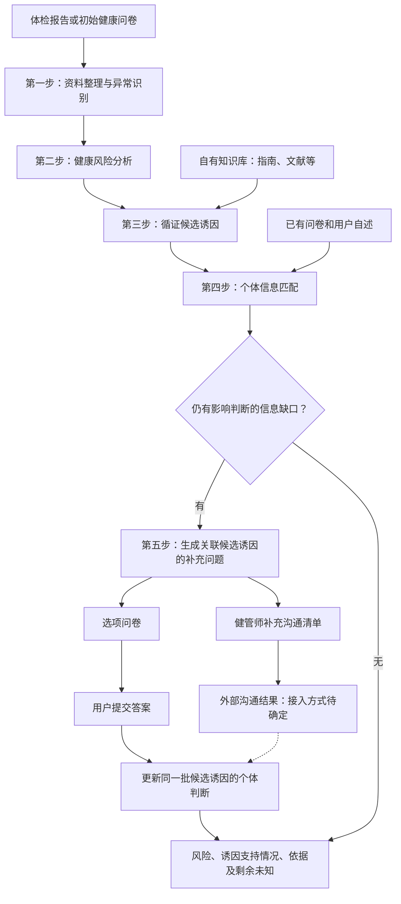

# 建档问卷循证诱因分析与补充问题设计

> 状态：生产初版开发中；保留医学调研与业务流程，本文第 5～7 节记录本期实现边界。未宣称已部署或完成真实 AION 联网验收。
>
> 更新日期：2026-11-07。当前实现核查基线：`feature/record-questionnaire` 开发工作区，AION 依赖固定为 `v0.6.0`。
>
> 需求依据：客户 2026-11-05 的五步流程，以及项目方对自有知识库检索、通过问卷回答核实候选诱因的补充。当前公开契约仍以 [API.md](../api/API.md) 为准。

## 1. 目标与业务边界

建档问卷需要形成“原始资料 → 健康风险 → 循证候选诱因 → 个体信息匹配 → 待确认信息 → 补充问题”的分析流程。用户提交补充答案后，必须将新信息用于更新候选诱因的判断，使结果能够说明该用户哪些因素得到支持、哪些不符合已有信息，以及哪些仍待确认。

客户提出的五步是必须落实的业务流程，不能仅在提示词中要求模型参考，也不能以当前已有的报告选题能力代替。逻辑步骤和中间结果必须可追溯；模型调用是否合并、如何编排属于实现选择，不改变五步的顺序和职责。

本期仅使用当前问卷关联的体检报告，以及该问卷本次提交的答案。自由文本答案属于本次自述；不自动读取其他问卷、健康画像、历史 Chat 或外部医患对话，不依赖尚未出具的菌群结果。健管师与用户的实际沟通仍由外部业务系统承担；本项目生成补充沟通清单，其对话接入不在本期范围内。

业务上的“找出真正的诱因”落实为逐步核实候选因素在该用户身上的存在情况、时间关系和适用条件，并结合医学依据给出个体判断。因素存在、与风险有关、已确立医学因果是不同层次；肯定选项不能自动转换为确定病因。系统应输出证据实际支持的程度，不强制将全部候选归为“是”或“否”。

术语、行业工具和表达约束的调研见 [建档问卷因素术语规范与工具调研](record-questionnaire-factor-terminology.md)。本文保留客户业务中的“候选诱因”称呼；初版将风险因素、诱发因素、加重因素及可能参与的因素作为受控关系，与个人证据支持程度分开，不输出确定个人病因。该分类是项目实现约定，不是医学标准编码。未知与冲突保留在数据及解释中，不建立人工审批流程，也不为每个因素添加“待审核／待确认”操作标签。

## 2. 必须实现的五步流程

| 步骤 | 输入 | 处理职责 | 阶段产物 |
| --- | --- | --- | --- |
| 第一步：读取资料并识别异常 | 本次体检报告，或已经填写的初始健康问卷，以及可用的个人陈述 | 识别异常检查结果、症状和健康背景，区分检查事实与用户自述，保留主体、时间及来源 | 可追溯的个人资料快照和待分析问题 |
| 第二步：综合分析健康风险 | 第一步资料 | 结合多项信息确定需要关注的风险，说明其个人资料依据，避免将每个异常值机械映射为一种疾病 | 风险条目及关联的个人证据 |
| 第三步：循证形成候选诱因 | 风险条目与适用的医学检索条件 | 调用项目已有自有知识库，检索支持风险与因素关联的资料；识别适用条件与需要核实的个人信息 | 风险对应的候选诱因、医学依据及核实条件 |
| 第四步：匹配已有个人信息 | 候选诱因、已经填写的问卷、用户已有自述及报告 | 逐项核对支持、反证、冲突和未知；确定哪些条件已有答案、哪些会影响判断但尚未明确 | 个体匹配状态和信息缺口 |
| 第五步：针对缺口生成补充问题 | 第四步的信息缺口 | 生成能核实候选诱因的具体问题，将适合选项回答的内容放入问卷，将需要开放沟通的细节交给健管师 | 补充问卷、健管师清单及问题到候选诱因的关联 |

初始问卷未包含检查数值时，只能将其中的症状、病史和行为作为自述信息，不把这些内容伪装为客观异常指标。没有既往问卷或对话时，第四步仍需根据现有资料识别未知条件，再由第五步收集；不得假设客户已经作答。



提交后的更新是这五步的结果消费环节：使用第五步获得的答案重新执行第四步的匹配职责。是否继续生成下一份补充卷属于轮次策略，不能从该流程图推断为已经允许无限追问或多次修改答案。

## 3. 自有知识库在当前项目中的状态

### 3.1 已有检索链路

项目已通过 EviMed AI 检索 API V2 接入医学知识服务。现有链路为：

```text
业务 Graph
  → KnowledgeGateway.retrieve(KnowledgeQuery)
  → EviMedKnowledgeGateway
  → utils/knowledge.py 中的 Knowledge HTTP 客户端
  → 自有知识服务
```

`agents/runtime/lifecycle.py` 在生产组装时创建并注入知识网关。`utils/knowledge.py` 仍是被实际使用的底层客户端，并非废弃代码。知识网关与模型网关独立：模型生成受控查询，程序执行检索，再把结果交给后续模型任务。

当前公开检索通道为 `guide`（指南）、`literature`（文献）、`instruction`（药品说明书）、`clinical_trial`（临床试验）。`KnowledgeQuery` 包含检索源、查询文本、条数和 `include_source_text`；查询文本最长 256 字符，条数允许 1～10，默认 3。指南、文献和说明书请求使用 `useLlm=False`；需要指南原文块时可启用 `include_source_text`。

### 3.2 已使用和未接入的业务

| 业务 | 当前源码状态 | 与本需求的关系 |
| --- | --- | --- |
| 普通 Chat `chat.reply` | 已接入按需检索，完整响应与 SSE 共用 | 可参考受控查询与本轮知识注入方式 |
| 旧逐题 Record `record.question` | 已接入按需检索 | 支撑表达和答疑，不等于新问卷诱因分析 |
| 旧 Record `record.plan` | 未接入该检索步骤 | 不应因旧 Record 有检索而认为其全部分析阶段均循证 |
| 画像 `profile.retrieve_evidence` | 已接入专科选题、原文引证和综合解释 | 可参考来源管理及引用校验，不宜直接当作问卷诱因引擎 |
| 新整卷因素链与 `questionnaire.report_plan` | 因素链先调用知识网关，无适用材料时通过 AION `v0.6.0` 联网，随后把候选及条件交给整卷规划 | 独立保存目标、材料、候选、条件和题目映射；搜索链路与完整病例医学效果分别验收 |
| 报告原文解读 | 保持忠实抽取职责 | 不把外部医学知识混入原报告事实 |

现有 Chat/旧 Record 的方式是固定 Graph 中“检索路由 → 受控检索 → 业务生成”。它具备模型参与的检索能力，但不是通用的自主工具循环，也没有现成的“列出诱因并根据问卷答案逐项更新”的工具。客户本次需求可以复用已有知识网关，无需为满足业务流程先重建通用 Agent 系统。

现有按需路由最多生成 2 条查询、取得 6 条去重资料；单条进入模型的摘要上限为 900 字符，总知识上下文上限为 6000 字符。该策略用于当前 Chat/旧 Record，不应直接作为新问卷多风险分析的完整检索预算。画像循证有独立流程和预算，也不能整段复制为问卷规则。

### 3.3 来源能力与使用限制

检索结果统一为 `KnowledgeDocument`，包含 `source`、`title`、`content`、可选 `url` 和 `metadata`。适配器保留上游提供的 ID、年份、期刊、发布机构、日期、作者、研究类型及知识库版本等元数据；`sourceTexts` 可保存文献摘要、指南正文或指南片段，AI 摘要不提升为原文证据。并非每条检索结果都具备全部字段或可用原文。

`useLlm=False` 不保证规范化的 `content` 就是原文：文献内容可优先取上游 `aiSummary`，指南可优先取 `summary`。用于支撑候选关联时，应单独检查 `sourceTexts` 及其来源。现有画像循证已实现原文引用校验，但证据等级仍为 `ungraded`，不能描述为已有自动证据分级或确定病因算法。

当前 `enabled` 反映配置条件，底层客户端主要检查 API key 是否非空，不代表服务已通过认证或实时可用。源码核查确认了生产接线；本次没有读取私有环境配置或请求知识服务，因此不能据此确认某个部署的实际启用和连通状态。

现有可选检索在未启用、没有查询或没有结果时可以返回空资料；异常和超时由当前业务路径处理，Chat/旧 Record 可以继续回答。新问卷第三步的循证是必经职责，不能直接沿用“检索失败仍视为完成循证”的含义。必须区分未配置、请求失败、未检出、资料不适用和已取得依据；没有足够依据时保留待确认状态，不伪造文献或将模型常识标为检索结果。

## 4. 候选诱因如何由问卷得到核实

### 4.1 分离两类证据

| 证据 | 回答的问题 | 允许来源 |
| --- | --- | --- |
| 医学知识依据 | 为什么该因素可能与该健康风险有关，适用于什么条件 | 自有知识库返回的可追溯指南、文献等内容 |
| 个体资料依据 | 该用户是否存在该因素，时间、频次、程度是否符合相关条件 | 体检报告、用户明确作答、可定位的用户自述或已接入的沟通记录 |

两类引用必须分别保存。报告来源 ID 不能冒充知识库引用；知识库说明某因素相关，也不能据此给该用户新增疾病、行为或用药事实。已有 AI 回复、风险文案和健管师待问清单不是用户自述来源。

### 4.2 必须建立的内部关联

以下是待实施的内部概念，不是当前公开接口新增字段：

| 概念 | 最少需要表达的内容 |
| --- | --- |
| 资料快照 | 主体、来源类型、原始定位、发生时间、获取时间及版本 |
| 风险条目 | 风险标识、简要判断及所依据的个人资料 |
| 候选诱因 | 诱因标识、关联风险、医学依据、适用条件、待核实事实 |
| 匹配结果 | 当前支持状态、支持与反证来源、冲突、剩余未知及更新版本 |
| 补充问题映射 | 题目 ID、要核实的信息项、关联诱因、回答如何影响核实条件 |
| 答案引用 | 已发布题目及选项映射、原始回答、规范化值、来源与提交版本 |

一个问题可以补齐多个候选诱因共同需要的信息；一个诱因也可能依赖多道问题。不能为了机械的一对一关联重复提问。关联关系在发布问卷时冻结，后续依据这份快照解释答案。

### 4.3 匹配与答案更新规则

初次匹配和提交后的更新使用相同规则，至少区分以下情况：

- **得到支持**：存在明确个人资料，且与候选的时间、范围和适用条件相符；记录支持了哪个条件，不能只保存一个结论标签。
- **存在反证或与现有资料不符**：有明确否认或不符合条件的个人证据；记录反证范围，不扩大为对全部相关风险的排除。
- **待确认**：未提及、未作答、回答不清楚或缺少必要条件；保持未知，不当作否认。
- **资料冲突**：同一条件的来源相互矛盾，或主体、时间无法一致解释；保留冲突，不用最后一条回答无条件覆盖。

因素存在性和诱因支持程度应分别表达。例如用户确认某行为存在，只完成了存在性核实；是否符合有关的时间关系、持续程度或其他适用条件仍需继续判断。没有医学依据支撑的关联，不因用户作出肯定回答就变为已确定诱因。

以下仅演示信息关联，不代表医学判断规则：

| 已建立的关联 | 用户回答 | 应发生的更新 |
| --- | --- | --- |
| 风险 R 的候选因素 F，需要确认行为 B 是否存在 | 明确“有” | 记录 B 存在，再检查 F 的其他条件；条件尚未齐全时仍待确认 |
| 同一候选需要确认近期是否有 B | 明确“近期没有” | 记录该时间范围的反证，不推断历史上从未发生 |
| 同一问题 | 空值或“不清楚” | 保持未知，不删除候选，不确认诱因 |
| 报告、自述与回答对同一事实不一致 | 存在冲突 | 保留各自时间和来源，进入冲突处理或补充沟通 |

### 4.4 提问必须能改变判断

问题生成要说明其内部验证目标：它补齐什么信息、关联哪项风险或候选诱因、不同回答会支持或削弱哪个条件。优先询问对判断有实际影响、现有资料尚未覆盖且用户能够回答的内容。已经有可靠答案的问题跳过，不能仅为了固定题量重新询问。

适合用短选项表达的存在性、类型、频次和范围放进问卷；需要描述症状经过、具体用药变化、检查时间或执行困难的内容进入健管师清单。同一信息项在两种渠道间去重，必要的不同细节可以互补。问题保持中性，不暗示用户已经具有某种诱因，也不诱导其选择支持模型假设的答案。

### 4.5 提交后必须产出更新结果

提交后不能止于保存答案或启动画像提取。必须让分析流程读取已提交快照，关联原候选诱因和医学依据，更新匹配状态，形成“风险、可能诱因、支持依据、反证、剩余未知”的版本化结果。复用已有资料时也应保留依据和版本，不依赖模型记住上一次分析。

用户原始答案和冻结问卷保持不可变；重新分析产生新的派生结果，不覆盖原始提交或幂等回执。重复提交不能重复产生互相冲突的评估。后续报告可以消费原始资料及该分析结果，但 AI 诱因判断不直接写成用户已确诊疾病或确定病因。

## 5. 生产初版的数据流

答前分析全量扫描本次可用报告的观测、影像发现与相关正常／阴性记录，分批建立具体目标和风险方向，不再用每份报告前 16 项代表完整因素分析。风险是推断层；报告原始记录及提取定位单独保存，不把解读文案标为原始报告。

每个目标先检索自有知识库，检查实际原文与适用范围。无适用材料时，使用统一 AION `v0.6.0` 网关的 `web_search=True` 与独立 `search_query`，映射 SDK 的 `search=True` 和检索词；模型任务正文单独传递。DeepSeek 检索词限 1～128 个字符，开启后先执行搜索及必要的网页获取，再调用模型。该回退不改变 Chat、Report 等已有业务默认关闭联网的设置。

SDK `search_trace.sources` 的实际来源与生成正文分别处理，来源 `excerpt` 映射为内部材料 `text`，保留 `excerpt_origin`；完整追踪包含 `query`、SDK 原始 `sources` 和 `operations`，完整调用和流式尾部均不能丢失。流水线将追踪及触发原因保存在内部 `factorPreparation.searchTraces`；公开结果结构不变，来源 passage 的 `locator.excerpt_origin` 保留摘录来源。当前 DeepSeek SDK 最多返回 5 条来源，每条最多 1200 字符摘录，并非完整网页或文献全文。正文自己生成的链接、引文不能充当检索证据。实际来源仍须检查医学适用性与引用支持，单次搜索成功不表示材料可靠或完整病例有效。无法获取依据时保留证据缺口，不编造循证结果。

候选因素包含目标引用、关系类型、医学依据和需要核对的个人条件。问卷规划读取这些候选，安排三个固定主题、七个生活细项和最多五道补充题；发布前将条件映射到实际通过校验的题目，不能按模型预想的题号保存。候选及医学依据、条件、题目映射与问卷 `ready` 同次冻结。题数不足以覆盖的条件仍为空缺，不当作不存在。

答案提交时，原始答案、规范化答案和独立因素任务意图一起可靠保存。任务按照已冻结候选重新匹配，只读取本次报告与真实作答。无报告、答前规划不可用或答案首次提出新问题时，允许在答后形成新目标与候选，但必须记录 `post_answer` 来源阶段，不反推为答前已经提出的假设。默认未知不能作为用户主动否认；答案证明行为存在也不能自动证明该行为导致异常。

结果独立保存并通过查询接口和 API Lab 展示：具体目标及报告记录、风险解读、初步候选及医学依据、实际回答如何改变条件、最终相关因素与解释。不会自动写入画像事实、Chat 上下文或最终 Report；这些功能继续读取现有报告及提交答案。没有有依据的因素时可以返回空列表及证据缺口，不为每项异常强行编排原因。

## 6. 实施职责与兼容要求

### 6.1 复用现有能力

沿用现有应用层、LLMGateway 和 KnowledgeGateway 分层。`QuestionnaireFactorPipeline` 显式编排目标识别、检索、候选和个人匹配；模型适配器仅执行明确阶段。应用服务负责归属、冻结快照、提交意图和派生结果，不将所有责任挤入原整卷规划提示词。没有新增另一套模型厂商直连客户端。

第三步对需要分析的风险执行明确的检索职责，可复用有效且有版本的检索结果。不能完全交给旧 Chat 的可选路由决定是否跳过循证。检索源、查询数、结果数、超时和原文长度需要按问卷场景设置受控预算；具体预算通过验收确定，不直接放大旧 Chat 的共享限制。

知识库结果需要检查内容是否支持当前风险与候选因素的关联，只有标题相似或只有 AI 摘要时不能冒充原始证据。优先使用与问题相符的指南和文献，其他通道按实际问题使用；原文缺失、适用人群不符和证据冲突应进入依据状态。引用存在性检查是必要条件，不替代关联和适用性判断。

### 6.2 保存与异常处理

保存五步的结构化产物和其版本，区分个人原始资料、知识库资料、模型分析与实际作答。分析说明只需保存可核查的结论、条件和证据对应，不依赖不可复现的自由文本叙述充当数据关系。

知识检索失败时，保留已取得的个人资料和明确的阶段状态；基础信息采集可以独立继续，但不能将该结果标为已完成循证诱因分析。返回怎样的任务状态、如何重试与展示，需在接口设计中明确。暂存或保存失败仍走真实错误处理，不能伪装成成功问卷。

答案原始快照、分析任务意图及结果版本具有一致性和补偿机制。因素任务独立于画像队列，具有领取租约、续租、过期接管、带令牌的结果写入及有限重试；首次提交回执不被任务进度改写。查询只读持久化结果，不触发重算，也不续期。提交成功即可进入 Chat，无需等待因素任务。草稿清理同时移除答前分析；提交后原资料和派生结果分别保留。

### 6.3 保持的既有边界

- 旧逐题 Record 与新整卷接口继续隔离，历史问答和已发布问卷不重写。
- 生成阶段不把新报告资料或 AI 分析提前发布为画像事实；答案摄取继续以提交快照和真实来源为依据。
- 默认未知、没有、不清楚与资料冲突保留各自语义；选项仍具体、简短，继续支持适用性过滤。
- 用户与会话归属、两小时待提交有效期、冻结选项、提交一次及幂等行为，在新契约明确变更前保持现状。
- 不新增单个 API 的环境开关；知识服务配置属于既有外部依赖配置，不能把依赖未配置等同于业务接口不存在。
- 后续 API Lab 展示风险、候选诱因依据、待核实条件及提交后的结果时，应区分分析与用户陈述；正式字段和布局在实现阶段同步确定。

## 7. 已确认的首期接口边界

首期采用独立只读结果接口，不改变问卷提交正文或原回执：`GET /api/v1/record/questionnaires/{questionnaireId}/factor-assessment?userId=…`。公开字段、任务状态及错误处理以 [API.md](../api/API.md) 为准。

| 事项 | 首期约定 |
| --- | --- |
| 资料范围 | 当前问卷报告和本次答案；不自动合并其他会话资料 |
| 用户自述来源 | 本次提交中的真实自由文本；不读取历史 Chat 或外部沟通 |
| 问卷规模 | 三个基础主题、七个相关生活细项、最多五道补充题 |
| 提交后分析 | 独立异步任务；独立 GET 查询，提交回执及 Chat 门禁保持不变 |
| 健管师沟通结果 | 暂不接收；仅输出原有参考清单 |
| 补充轮次 | 一次问卷、一次提交、版本化分析；不自动签发第二份问卷 |
| 分析消费 | 独立 GET 与 API Lab；本期不进入画像事实、Chat 或最终 Report |

当前公开 `answers` 结构、会话状态和问卷 Schema 不因这份设计自动变化。新增关联优先作为内部数据设计；确需公开字段时，在实现前按 [API 编辑规则](../api/API_EDITING_GUIDE.md) 明确契约并同步 API Lab。

## 8. 验收标准

| 场景 | 必须满足的结果 |
| --- | --- |
| 仅体检报告，或仅已填初始问卷 | 按真实来源执行五步；问卷自述不变成检查结果，缺失资料不被捏造 |
| 知识库成功、无结果、未配置、超时或返回不适用资料 | 分别记录结果；候选诱因引用真实依据，不伪装检索成功 |
| 一项风险有多个候选，一项信息关联多个候选 | 关联完整，避免只围绕最先想到的因素提问或重复采集 |
| 本次报告或答案已覆盖某条件 | 用真实来源匹配；不调用其他会话补齐，不伪造答前已知信息 |
| 用户肯定、否认、不清楚、留空或回答有冲突 | 正确更新存在性与支持状态；未知不等于否认，肯定不自动等于确定病因 |
| 第五步答案提交 | 能观察到原候选的更新结果和答案来源，而不只是提交成功或画像任务已入队 |
| 性别、主体和时间范围不同 | 不提不适用问题，不将亲属情况归给本人，不将历史否认扩大到全部时间 |
| 问卷与健管师清单 | 按待核实信息互补，明确适用条件；未接入的访谈结果保持未知 |
| 查询恢复、重复提交和异步失败 | 问卷与原答案不可变，回执稳定，分析版本可追溯，任务能够补偿 |
| 画像与下游报告 | 个人事实和分析结果分开消费，候选诱因或 AI 推论不直接成为肯定性疾病事实 |

离线验收应使用可控知识网关和模型替身验证五步产物、引用、问题映射及答案更新，再运行全仓离线 pytest 和相关静态检查。真实验收另用合成资料连接实际知识服务和模型，逐项检查检索相关性、原文支持、个体匹配、问题区分能力及提交后的更新结果。当前静态接线和既有离线通过记录不能代替这些验收。

## 9. 当前源码与参考文档

| 位置 | 关联设计与当前事实 |
| --- | --- |
| [因素术语规范与工具调研](record-questionnaire-factor-terminology.md) | 区分医学规范、行业公开做法与项目设计；初版使用关系和证据分层，不宣称已接入官方术语编码目录 |
| [知识库设计](agent-knowledge-retrieval.md) | Chat/旧 Record 按需检索与画像循证的范围和边界 |
| [知识类型](../../agents/knowledge/types.py)、[协议](../../agents/knowledge/protocol.py) | 查询参数、结果类型和可替换知识网关 |
| [EviMed 适配器](../../agents/knowledge/evimed_gateway.py)、[HTTP 客户端](../../utils/knowledge.py) | 四类检索通道、原文和元数据归一化 |
| [检索路由](../../agents/knowledge/routing.py)、[运行时组装](../../agents/runtime/lifecycle.py) | 受控检索预算与生产依赖注入 |
| [画像循证 Graph](../../agents/graphs/health_profile/graph.py)、[解释校验](../../agents/graphs/health_profile/interpretation.py) | 可参考的选题、检索与原文引用机制 |
| [问卷生产组装](../../adapters/questionnaire_factory.py)、[规划适配器](../../adapters/questionnaire_generation.py) | 新问卷当前只注入模型规划能力 |
| [生成器](../../modules/questionnaire/generation.py)、[规划提示词](../../prompts/questionnaire/report_plan.md) | 当前报告证据选题与配套输出 |
| [问卷 Handler](../../web/handlers/questionnaire.py)、[应用服务](../../modules/questionnaire/service.py) | 当前创建输入、提交和单卷生命周期 |
| [消费投影](../../modules/questionnaire/context.py)、[画像摄取](../../health_profile/questionnaire_ingestion.py) | 答案与报告来源边界，尚无诱因再评估 |
| [Report 组装](../../adapters/report/factory.py) | 已提交问卷投影的当前读取方式 |
| [问卷 Schema](../product/survey-system-schema.md)、[补充问题参考](../product/菌群检测后健康评估补充问题清单.docx) | 对外问卷形状与健管师信息需求参考 |

本次核查未调用模型、知识服务或数据库，未读取私有环境文件；真实部署配置、服务连通性及医学分析质量仍需在上述验收中确认。
