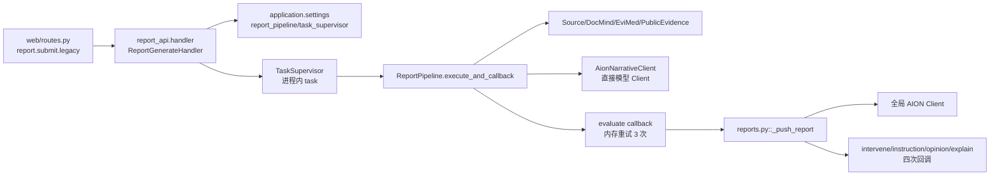
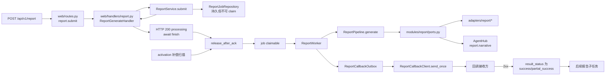
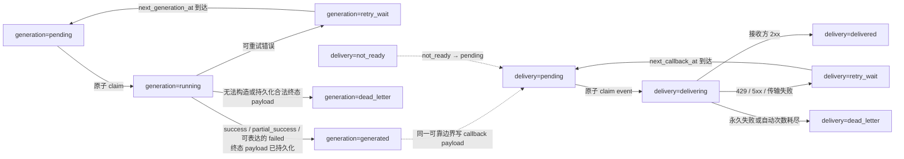

# Report API 端到端迁移实施手册

> 状态：历史迁移草案，执行基线已过期；不再作为当前任务的总交接入口
>
> 原始审计日期：2026-08-24；状态复核：2026-09-03，基线 `6625647`
>
> 初始审计基线：分支 `refactor/tornado-architecture`，HEAD `ef0497c30bfa12bc5d1d8acf3c3058f276cec0c1`，另包含尚未提交的 Tornado 架构改动；PR 0 必须记录最终基线 commit
>
> 历史适用范围：2026-08-24 时的 `report_api/` 整体迁移设想；下方第 1—21 节保留当时基线、目标和决策草案，不表示当前实现或当前批准范围
>
> 负责人：Report；共享文件由 Report 与 Web/Platform 负责人共同评审

## 当前阅读须知（优先于下方历史正文）

当前实现见 [架构文档状态与基线](README.md)、[API 合规指南](api-implementation-compliance.md)；模型及记忆接入以 [最终报告接入 Agent 中枢指南](report-agent-integration-guide.md) 为当前交接入口。原有节号保留供历史引用，链接到旧章节不表示该章可以直接实施。

截至 `6625647`，以下前提已经变化：

| 旧正文前提 | 当前事实及处理 |
|---|---|
| Handler、builder 和业务混在 `report_api/` | 旧包已删除；Handler 在 `web/handlers/report.py`，业务在 `modules/report/`，具体依赖在 `adapters/report/` |
| 路由名 `report.submit.legacy`，依赖来自 settings | 当前为 `report.submit`，通过 route kwargs 注入 Pipeline、TaskSupervisor 和 ReportTaskCoordinator |
| `evaluate` 总体 15 分钟 | 当前解析和生成硬上限为 30 分钟，后续四份报告不与它共享总时限 |
| evaluate 回调必须 `2xx` 后才能继续 | 当前回调失败只记录交付失败，不阻断成功/部分成功结果的后续四份报告生成和独立回调 |
| 重复受理语义尚无实现 | 已有进程内请求指纹、正在执行任务复用和短期结果重投；不是持久化幂等或跨进程恢复 |
| follow-up 失败整体中断、每次 callback 只尝试一次 | 当前已有分模块降级、重试、固定空报告与回调重放；旧失败矩阵必须重新刻画 |
| I-024 中空来源与永久回调错误的旧偏差尚待裁决 | 当前 API 不强制菌群来源必填；回调仅重试传输错误、429 和 5xx，普通 4xx/重定向不重试。不能再以原偏差阻塞 Agent 接入 |
| 测试位于 `tests/unit/report_api/` | 当前为 `tests/unit/report/`，另有 `tests/unit/server/test_report_architecture.py` |

ReportService、持久 ReportJob、独立 ReportWorker、callback outbox、WorkerRegistry 和本文多数目标 DTO 仍未实现。本文中的 REP-ADR-* 是当时的决策提案，不能视为已经批准、已存在的接口或本次 Agent 接入的前置条件。报告当前仍未持久化，但五类结果保存、报告查询与 Chat 追问已在最新主指南确认，待按其六步计划实施；不再要求为结果存储先重做本文的整套任务框架。任务恢复快照、重驱和部署范围仍另行评审。

后续如重启“任务可靠化”专项，可复用本文的问题清单与设计动机，但应重新建立当前基线、决策记录和增量计划；不要重新搬运已迁移目录，也不要照原 PR 0—8 顺序执行。历史正文中的“当前”“必须”“可直接执行”等表述均限于原草案语境。

---

## 1. 文档定位

本文是 `report_api` 业务迁移的总交接手册，供 Report 负责人据此启动 PR 0、形成 ADR、拆分实现 PR、部署和验收。它覆盖 HTTP 路由、Handler、应用服务、领域规则、Ports/Adapters、持久化任务、Worker、回调、AgentHub、资源生命周期、灰度切换、回滚和 legacy 删除。本文明确给出的兼容边界可以直接执行；标记为“决策门槛”的内容在批准前不能由实现者自行假定。

仓库此前已经存在 [最终报告接入 Agent 中枢指南](./report-agent-integration-guide.md)，但该文档只覆盖 LLM、Prompt、Graph、AgentHub 和 Narrative Adapter，是本文的 AI 子指南，不是完整的 `report_api` 迁移方案。Report 负责人不能只完成 Agent 接入便宣告业务迁移结束。

本文不直接改变 [当前 API 契约](../api/API.md)。任何请求字段、立即响应、HTTP 状态码、终态回调字段、回调类型或新增公开查询/重试接口的变化，都必须先按 [API 文档编辑手册](../api/API_EDITING_GUIDE.md)独立评审和版本化。

### 1.1 迁移目标

迁移完成后必须形成以下稳定调用链：

```text
web/routes.py
  -> web/handlers/report.py
  -> modules/report/application/ReportService.submit()
  -> ReportJobRepository.create_or_get(non-claimable)
  -> HTTP finish
  -> ReportService.release_after_ack()/超时补偿
  -> ReportWorker.claim()/renew()
  -> ReportPipeline.generate()
  -> modules/report/ports.py
  -> adapters/report/* 与 AgentHub
  -> 持久 callback outbox
  -> ReportCallbackClient
```

最终状态必须同时满足：

- `/api/v1/report` 的现有外部行为保持兼容；
- 已返回 `processing` 的任务在进程崩溃、`SIGKILL`、OOM 或宿主机故障后可恢复；
- Handler 只依赖 `ReportService`，不从 Tornado settings 查找 Pipeline 或任务管理器；
- 应用与领域层不创建 Mongo、HTTP、DocMind、EviMed、AION/OpenAI 等具体 Client；
- Report 的全部模型调用统一通过 AgentHub；
- Worker、租约、回调投递和资源所有权明确且可测试；
- `report.submit.legacy`、`report_pipeline` setting、Handler 内 builder、反射式资源探测和 Report 架构豁免全部删除。

### 1.2 非目标

本次架构迁移不得顺带：

- 改写最终报告的医学规则、证据筛选标准或患者展示文案；
- 把约 3.3 万行 `report_api` 一次性重写成一个大型 Agent Graph；
- 合并语义不同的 `/api/v1/interpret/health-report` 与 `/api/v1/report`；
- 强制 `/api/v1/report` 依赖已完成的 QA，除非先完成第 4.7 节所述 API 决策；
- 新增公开任务查询、重试或 redrive 路由；
- 在没有契约测试和接收方确认时删除 `report_api/reports.py` 的四类后续报告；
- 通过同时运行新旧两条生成链做灰度，因为这会产生重复模型调用和重复回调。

## 2. 权威文档与阅读顺序

Report 负责人开始编码前应按下表顺序阅读。发生冲突时，外部契约以 `API.md` 为准，当前事实以生产代码和自动化测试为准，目标边界以本文和应用架构为准；Wiki、TODO 和历史文档不能覆盖前述权威来源。

| 顺序 | 文档 | 级别 | 用途 |
| ---: | --- | --- | --- |
| 1 | [文档导航与维护状态](../README.md) | 必读 | 权威级别、当前/目标/历史文档边界 |
| 2 | [API.md 的“最终报告接口”](../api/API.md#最终报告接口) | 外部契约 | 请求、立即响应、时限、evaluate 回调、部分成功和错误语义的唯一当前依据 |
| 3 | 本文 | Report 交接草案 | PR 0 可执行内容、端到端目标、决策门槛、文件归属、可靠任务、切换和验收 |
| 4 | [Shulan 应用架构](./application-architecture.md) | 全局目标 | Tornado、模块分层、组合根、Report handoff 和最终验收 |
| 5 | [API 实现架构合规与迁移指南](./api-implementation-compliance.md) | 治理基线 | 24 条路由的合规矩阵、负责人边界和长期门禁 |
| 6 | [Tornado 安全停服与生产更新方案](./graceful-shutdown-and-deployment.md) | 可靠性基线 | ReportJob、租约、恢复、停服和真实进程验收 |
| 7 | [最终报告接入 Agent 中枢指南](./report-agent-integration-guide.md) | AI 子指南 | `report.narrative`、Graph、Prompt、Narrative Adapter 和并发身份隔离 |
| 8 | [API 文档编辑手册](../api/API_EDITING_GUIDE.md) | 条件必读 | 发生外部契约变化时的版本与历史维护规则 |
| 9 | [API 架构实施状态 Wiki](../../wiki/api-architecture.md) | 当前快照 | 快速了解 Report legacy 接线及其它负责人边界 |
| 10 | [Agent Core Wiki](../../wiki/agents.md) | 实现参考 | AgentHub、Gateway、Profile、资源和当前 Report 豁免 |
| 11 | [测试规范](../../tests/README.md)与[贡献指南](../../CONTRIBUTING.md) | 交付规范 | 测试分层、分支、提交、PR 和文档同步 |

以下内容不能作为当前迁移目标：`docs/api/history/` 中的历史快照、产品原始输入、已归档设计、旧 Agent capability 示例以及 `tests/api/scripts/legacy/` 中的历史脚本。

## 3. 业务术语与边界

### 3.1 三种容易混淆的“报告”

| 名称 | 当前入口 | 所有者 | 是否属于本文 |
| --- | --- | --- | --- |
| 体检报告结构化解读 | `/api/v1/interpret/health-report` | Analysis | 否；只作为可复用底层能力参考 |
| 最终评估报告 | `/api/v1/report`，回调 `type=evaluate` | Report | 是，本文主范围 |
| evaluate 获 `2xx` 且结果为 `success/partial_success` 后的四类报告 | `intervene`、`instruction`、`opinion`、`explain` 回调 | 当前由 `report_api/reports.py` 实现；`failed` 不触发 | 是，必须冻结、迁移或经业务确认废弃 |

Health Profile 对报告来源的摄取是另一条业务链。Report 生成代码不得因为复用解析器而直接写入画像；报告事实只能通过已有的、幂等且可审计的画像摄取边界进入健康画像。

### 3.2 外部状态与内部状态必须分开

正式 evaluate 终态回调的 `status` 只有（四类 follow-up 当前没有这个顶层字段）：

```text
success | partial_success | failed
```

内部可靠任务状态描述执行与投递过程，不得复用上面的业务状态。建议至少拆成：

```text
generation_state: pending | running | retry_wait | generated | dead_letter
delivery_state:   not_ready | pending | delivering | retry_wait | delivered | dead_letter
```

`processing` 是 HTTP 立即响应中的受理状态，也不是内部 Worker 状态。代码、数据库索引、日志和指标必须使用明确的字段名，避免把三套状态混为一谈。

## 4. 当前生产实现基线

### 4.1 规模

截至审计日期，`report_api/` 有 22 个 Python 文件、33,318 行；`tests/unit/report_api/` 有 7 个实际测试文件（另有 `__init__.py`）和约 500 个 test 定义。迁移必须采用兼容 re-export、行为刻画测试和小切片切换，禁止一次性目录搬运后再集中修错。

### 4.2 当前请求链



当前行为的关键时序是：Handler 校验请求，在返回 HTTP 200 之前把 `_run_background()` 登记到 `TaskSupervisor`；后台协程主动让出一次事件循环，确保 `processing` 响应先完成发送；随后完整生成和 evaluate 回调都在同一个进程内监督任务中执行。只有内部 payload 属于 `SuccessCallback`（其业务状态可以是 `success` 或 `partial_success`）且 evaluate 回调已经收到 `2xx` 时，才继续启动四类后续报告；`failed` 不触发。

### 4.3 当前组件与问题

| 当前位置 | 当前职责 | 迁移问题 |
| --- | --- | --- |
| `web/routes.py` | 集中注册 `/api/v1/report` | 名称仍为 `report.submit.legacy`，没有 route kwargs，是唯一无显式业务依赖的业务路由 |
| `report_api/handler.py:ReportGenerateHandler` | HTTP 解析、校验、调度、错误包络 | 从 settings 取 Pipeline 和 TaskSupervisor；Handler 知道后台执行方式 |
| `report_api/handler.py:build_report_pipeline()` | 读取环境配置、Mongo collection 和构造所有 Client | Web 文件承担组合根和基础设施创建；导入边界错误 |
| `report_api/pipeline.py` | 解析、证据、医学规则、模型叙事、deadline、回调和 follow-up 调度 | 用例过大；生成、投递和后续副作用无法独立恢复 |
| `report_api/schemas.py` | 入站 DTO、领域事实、审计、内部结果和固定回调 DTO | 五种所有权混在一个文件；机械拆分时容易改变 Pydantic 兼容语义 |
| `report_api/clients.py` | 来源下载、DocMind、EviMed 具体实现 | Protocol 与具体 HTTP/SDK 实现混合 |
| `report_api/public_evidence.py` | PubMed/PMC/Crossref HTTP、缓存与筛选 | 属于 Report 出站适配器，当前直接位于业务包 |
| `report_api/callback.py` | 患者可见性/医学发布策略、固定 DTO 序列化和 HTTP 发送 | 业务发布规则与外部传输混合；重试只在内存中，不能把整个文件误搬到 Adapter |
| `report_api/narrative.py` | 模型 Client、模型 DTO、校验、降级与大量确定性安全规则 | `AionNarrativeClient` 直接创建 AION Client；Prompt 在 Python 字符串中 |
| `report_api/reports.py` | 四类后续报告生成、产品目录、直接模型调用和回调 | import 时创建全局模型 Client；生产链真实存在但无契约测试；当前还会把四份完整健康报告写入 info 日志 |
| `bootstrap/container.py` | 保存 `report_pipeline: Any` 并发布兼容 setting | 不是类型化应用入口；扩大 settings Service Locator |
| `bootstrap/factory.py` | 调 legacy builder，并反射 Pipeline 直接成员登记资源 | 无法证明嵌套资源所有权；遗漏 `reports.py` 全局 Client |
| `runtime/application.py` | 进程级 Worker、排空和资源关闭 | 没有 ReportWorker；TaskSupervisor 不能替代持久 job |
| `tests/unit/architecture/test_web_architecture.py` | 路由和依赖门禁 | 明确豁免 `report.submit.legacy` 与无 kwargs |

### 4.4 当前可靠性边界

当前实现已经解决正常 `SIGTERM` 排空时的“受理后未追踪”竞态，但没有 `ReportJob`、Repository、唯一约束、原子领取、租约、续租、恢复、死信或 redrive。`request_uuid` 只是本次 HTTP 响应关联号，不是稳定 job ID 或幂等键。

因此以下场景仍会丢失已经返回 `processing` 的任务：

- `SIGKILL`；
- OOM；
- 宿主机或容器故障；
- Python 解释器崩溃；
- 回调发送失败后进程退出；
- evaluate 回调已成功，但创建四类后续报告前进程退出。

### 4.5 当前回调边界

主 evaluate 回调由 `CallbackClient` 最多执行 3 次内存退避重试。API 目标语义只允许对 `429`、`5xx` 和传输错误重试并拒绝重定向，但当前实现捕获全部 `httpx.HTTPError` 和重定向异常，因此普通 `4xx` 与 `3xx` 实际也会尝试至多 3 次。这是现行实现与 API 文字的偏差，不能被误写成已经合规。三次失败后异常越过 Pipeline，由 Handler 后台 catch 记录，既没有持久投递状态，也没有自动恢复。

当内部 payload 属于 `SuccessCallback`（`status` 为 `success` 或 `partial_success`）且 evaluate 回调已经收到 `2xx` 后，Pipeline 同步调用 `report_api.reports._push_report()`。`failed` evaluate 不进入该分支。当前 `_report()` 和四类生成使用普通 `asyncio.gather()`：共享前置或任一生成协程抛异常时，流程会在发送前整体中断，并非“任一生成失败、其它三类仍发送”。只有四个结果全部生成后，callback 发送阶段才把每项异常吞掉并隔离；每次发送只尝试一次，aiohttp 还沿用默认重定向行为。因此四次全部投递失败时，TaskSupervisor 仍可能把任务视为正常结束。

这四类后续回调是代码中的真实生产副作用，但当前 `API.md` 只把 `evaluate` 定义为 `/api/v1/report` 的正式类型。迁移前必须完成第 13 节的契约刻画与业务确认，不能把 `reports.py` 当成未使用代码删除。

### 4.6 当前资源所有权

组合根通过 `vars(report_pipeline)` 反射直接成员，并登记具有 `close()` 或 `aclose()` 的对象。当前主要覆盖 `EviMedClient` 和 `PublicEvidenceClient`，但不能覆盖嵌套对象、动态创建对象和 `reports.py` 的全局模型 Client，也无法形成类型化资源清单。

迁移目标不是增强反射，而是让 `ReportModule.resources` 显式列出由 Report 模块拥有的资源。借用的 `AgentHub`、AgentRuntime 和平台 Gateway 不属于 Report，不得由 Report 关闭。

### 4.7 当前文档冲突的裁决

下列规则在本次纯架构迁移中按“保持当前公开契约”处理：

| 冲突 | 本次裁决 | 后续变化条件 |
| --- | --- | --- |
| 历史协作方案曾要求 QA 未完成时拒绝，但当前代码只按 user/session 查找并会读取进行中会话，查询失败也不阻断 | 本次继续把任意已找到会话作为可选上下文，并在受理时冻结；不新增 completed 条件，当前 TODO 已将强门禁降为后续增强候选 | 产品与 API 版本评审通过后单独实施 |
| 目标 Service 有 `get/retry`，但 API 不提供查询或断点续传 | `get/retry/redrive` 仅作为内部应用/运维能力，不注册公开路由 | 新增公开接口需独立版本评审 |
| 旧设计曾建议对外增加 `callbackEventId`，当前固定回调没有该字段 | 内部统一保存 `callback_event_id`；回调 body 不新增字段 | 接收方需要消费事件 ID 时单独评审 API |
| API 只要求重试网络、429、5xx，但当前 CallbackClient 也重试普通 4xx 与重定向 | PR 0 固化 302、400、401、404、429、500 和传输错误的真实 attempt 数；standard 链按 API 决策实现 | 行为修正需 callback 接收方/API 负责人批准并进入 golden tests |
| 旧设计幂等键包含不存在的 `completionId/reportType` | 不采用该表达；使用第 10.3 节的决策门槛 | API 或业务唯一性语义确认后冻结索引 |
| API 写“报告不写入 MongoDB/Redis”，目标需要持久任务 | 本次不得持久化长期报告正文；允许在获批的可靠任务设施保存最小 job 元数据和有 TTL/加密保护的恢复数据 | 上线前由 API、安全和运维负责人确认文案及保留策略 |
| API 文档要求至少一个可解析来源，但当前 Handler/Schema 与测试允许空 `fileList/testData/hospitalData` 且无 `microbiomeData` 后返回 200 | PR 0 先把生产行为与 API 文案分别固化，不在架构搬迁中顺手改成同步 400 | REP-ADR-006 由 API 负责人裁决后才能修改校验阶段 |
| Agent 文档出现多个主报告 capability 名称 | 当前主叙事能力名称统一为 `report.narrative`；四类 follow-up 不得误用该能力，需按第 12.5、13.1 节单独决策 | 新增 follow-up capability 需根据真实模型与 Prompt 语义评审 |

以上裁决允许负责人立即完成 PR 0 和不依赖待决项的接口草案；Repository/Worker/follow-up/错误映射与部署必须先关闭第 15.1 节对应 ADR。任何幂等、存储、follow-up、callback、deadline 或 fleet 门槛未关闭时，都不得切换生产路由。

## 5. 必须冻结的外部契约

### 5.1 HTTP 请求与立即响应

当前公开入口保持：

```text
POST /api/v1/report
Content-Type: application/json
```

请求继续接受 `userId`、`sessionId`、可选受检者信息，以及 `fileList`、`testData`、`microbiomeData`、`hospitalData`。现有 `ReportRequest` 使用 `extra='allow'` 保持历史来源元数据兼容，迁移 DTO 时不得意外改成 `extra='forbid'`。

这里存在必须显式裁决的现状偏差：`API.md` 文字要求 `fileList`、`testData` 和 `microbiomeData` 至少一个包含可解析来源，但当前 Schema 没有这项跨字段同步校验，现有 Handler/Pipeline 测试还明确覆盖“来源为空仍返回 HTTP 200，随后以 `MICROBIOME_RESULT_PENDING` 的部分成功语义收口”。负责人不得在搬移 DTO 时自行补校验并把该行为改为同步 400。PR 0 必须建立 REP-ADR-006：由 API 负责人选择“修正文档以承认当前行为”或“批准 API 行为修复并同步调用方、错误契约和版本记录”；决策前生产切换被阻塞。

成功受理必须继续立即返回 HTTP 200，包络字段和语义不变：

```json
{
    "code": 200,
    "message": "报告生成任务已受理",
    "uuid": "HTTP请求关联ID",
    "timestamp": 1786093200,
    "elapsed_ms": 2.1,
    "data": {
        "userId": "user_report_001",
        "sessionId": "session-001",
        "status": "processing"
    }
}
```

持久化任务不能把完整生成过程重新放回 HTTP 请求协程。`ReportService.submit()` 只完成验证、持久化或返回既有 job，Handler 随即返回；实际 Pipeline 由 Worker 执行。

### 5.2 同步错误

当前 Report Handler 的真实同步错误主要是：

| 场景 | HTTP | 要求 |
| --- | ---: | --- |
| 非法 UTF-8、非法 JSON、非对象请求、Pydantic 校验失败 | 400 | 保持当前错误包络和字段路径消息 |
| 应用处于 draining，拒绝新业务 | 503 | 保持“暂不接收新的报告任务”语义 |
| 未知同步异常 | 500 | 不泄露堆栈、密钥、连接串或本地路径 |

当前 `write_error()` 虽列出 413、415、422，但 Report Handler 没有对应同步 raise 路径；文件类型、下载和解析失败发生在受理之后，通过终态回调表达。迁移不得仅因为错误映射器中存在这些数字便改变错误发生阶段。

持久化受理引入了两个当前不存在的同步条件，不能由实现者自行选择状态码：Repository/队列不可用时推荐评审 `503`，同一幂等键携带不同输入时推荐评审 `409`，但二者都会新增可观察的外部语义。PR 0 必须由 API 与调用方明确其 HTTP 状态、错误码、message 和调用方重试策略；在冻结前，`ReportSubmissionUnavailableError`、`ReportSubmissionConflictError` 只能作为内部类型，不能据此切换生产路由。

### 5.3 evaluate 终态回调

evaluate 回调必须继续满足：

- `type` 固定为 `evaluate`；
- `status` 为 `success`、`partial_success` 或 `failed`；
- 成功、部分成功和失败使用同一套固定字段；
- 空值仍返回 `null`、`[]`、`{}` 或完整固定子对象，不删除既有字段；
- `evidence.number` 与全部 `evidence_refs` 保持引用一致；
- 医学规则、证据门禁、患者可见内容和失败降级保持现有测试语义；
- 回调只接受任意 `2xx`，不接受重定向；
- `429`、`5xx` 和传输失败最多自动尝试 3 次；
- 重复发送必须使用完全相同的序列化 payload；
- 错误内容不得包含敏感信息。

完整字段不在本文复制，避免形成第二份漂移的 API 契约；以 `API.md` 的“最终报告接口”章节及固定回调 golden tests 为准。

### 5.4 deadline

报告处理当前正常目标为 15 分钟，配置硬上限为 300 至 1800 秒，最后最多 60 秒预留给 evaluate 回调。迁移后的 job 必须在受理时记录 `generation_deadline_at`，进程恢复和生成重试不得把同一次业务受理无限延长。

如果崩溃恢复时生成 deadline 已过：

- 已通过带 lease token 的 `save_checkpoint()` 持久化足够、版本兼容且通过完整性校验的结构化结果时，构造当前语义的 `partial_success`；
- 尚未形成可用来源结果时，构造 `REPORT_GENERATION_TIMEOUT` 的 `failed`；
- 随后进入同一个持久 callback outbox，而不是只记日志。

没有实现并批准加密 `generation_checkpoint` 前，崩溃恢复不得声称能保留进程内部分结果；只能安全重跑，或在生成期限耗尽时发送稳定 `failed`。主报告生成期限不应默认为持久 callback 的绝对丢弃期限：自动投递是否可在 `generation_deadline_at` 之后继续、最晚允许多久以及何时告警，由 REP-ADR-009 冻结为独立 `delivery_deadline_at`；人工 redrive 仅可在 payload 仍符合保留策略时审计执行。

### 5.5 兼容测试基线

迁移开始前必须把以下当前行为固化为 characterization tests：

- OPTIONS、CORS、非法 JSON、非对象 JSON、字段校验、HTTP 200 ack 和 draining 503；
- 缺失/错误 `Content-Type` 的当前行为，以及顶层和 `RemoteFileInput/TestDataInput/HospitalDataInput` 嵌套 `extra='allow'`；
- 当前 legacy Handler 先把任务登记到 `TaskSupervisor`，但 Pipeline 只有在 `await finish()` 完成后才启动；PR 0 只刻画这一现状，不预先构造尚不存在的持久 job/release/claim 对象；
- `ReportRequest` 对历史额外字段的兼容；
- evaluate 成功、部分成功、失败和 deadline 回调的固定 JSON；
- 回调 `302/400/401/404/429/5xx/timeout` 的真实 attempt 数，并分别记录当前实现与批准目标；
- `sessionId` 查询失败或不存在不阻断生成；
- 找到进行中的 QA session 时仍会作为可选上下文使用，不得在 Adapter 搬移时悄悄增加 `completed` 条件；
- 四类 follow-up 的输入、类型、并发、失败隔离和回调行为；特别覆盖 `success/partial_success + evaluate 2xx` 会触发、`failed` 不触发。
- follow-up 共享前置失败、单个生成失败会在发送前中断全部，只有发送阶段单项失败被隔离；当前 payload 无顶层 `status`，并刻画 aiohttp 重定向行为。

## 6. 目标架构

### 6.1 目标调用链



### 6.2 目标目录

```text
web/
├── handlers/
│   └── report.py
└── schemas/
    └── report.py

modules/report/
├── __init__.py
├── ports.py
├── domain/
│   ├── models.py
│   ├── errors.py
│   ├── parsing.py
│   ├── clinical.py
│   ├── evidence.py
│   ├── narrative_validation.py
│   └── health_assessment/
└── application/
    ├── commands.py
    ├── results.py
    ├── errors.py
    ├── service.py
    ├── pipeline.py
    ├── worker.py
    ├── callbacks.py
    └── followups.py

adapters/report/
├── job_repository.py              # REP-ADR-002 后按具体设施命名
├── qa_snapshot_reader.py
├── source_client.py
├── document_parser.py
├── docmind_client.py
├── evimed_client.py
├── public_evidence_client.py
├── callback_http.py
├── callback_schema.py
├── product_catalog.py
└── agent_narrative.py

agents/graphs/report/
├── __init__.py
├── graph.py
├── profile.py
└── registration.py

prompts/report/
└── narrative.txt

tools/report/
└── preview.py
```

目录名可以在 PR 评审中微调，但依赖方向不能改变。`job_repository.py` 只是决策前占位名，不能在 REP-ADR-002 前假定 MongoDB。迁移期间 `report_api/` 可以保留单向 re-export；`modules/report` 永远不得反向导入旧包。PR 1 如需桥接旧 Pipeline，唯一临时例外只能是 `adapters/report/legacy_pipeline.py -> report_api.pipeline`，必须有精确架构豁免、删除目标 PR 和证明无其它反向导入的测试。

### 6.3 层职责

| 层 | 允许职责 | 禁止职责 |
| --- | --- | --- |
| `web/routes.py` | 唯一路由注册、稳定名称、route kwargs | 构造 Service、Client、Worker |
| `web/handlers/report.py` | HTTP DTO、CORS、认证/准入、应用错误映射、立即响应 | settings 查找、Pipeline、数据库、可靠后台 task |
| `modules/report/application` | submit/get/retry 用例、job 编排、Pipeline、Worker、异常翻译 | Tornado、环境变量、具体 Mongo/HTTP/SDK |
| `modules/report/domain` | 纯解析规则、医学规则、确定性校验、领域模型 | 网络、数据库、模型 Client、全局状态 |
| `modules/report/ports.py` | 以 Report 业务语言定义出站依赖 | 暴露 `httpx`、Mongo collection、AION Client 等具体类型 |
| `adapters/report` | Mongo、来源 HTTP、DocMind、EviMed、PubMed、回调、Agent 适配 | Tornado 路由、业务流程决策 |
| `bootstrap/` | 读取配置、创建具体 Adapter、构造 ReportModule、登记资源 | 把业务依赖写回 settings |
| `runtime/` | Worker 注册、启动、停止领取、排空和资源关闭 | Report 医学规则或回调 payload 组装 |
| `agents/` | Report Graph、Profile、Gateway 调用和平台观测 | Report HTTP 或 job 状态机 |

### 6.4 ReportModule

Report 模块必须提供无 Tornado 副作用的构造结果：

```python
@dataclass(frozen=True, slots=True)
class ReportModule:
    service: ReportService
    worker: ReportWorker
    resources: tuple[AsyncCloseable | Closeable, ...]
```

推荐构造入口：

```python
def build_report_module(
        *,
        config: ReportConfig,
        job_repository: ReportJobRepository,
        qa_snapshot_reader: QASnapshotReader,
        source_client: ReportSourceClient,
        document_parser: DocumentParser,
        evidence_retriever: EvidenceRetriever,
        public_evidence_retriever: PublicEvidenceRetriever,
        narrative_client_factory: NarrativeClientFactory,
        callback_serializer: ReportCallbackSerializer,
        callback_destination_resolver: CallbackDestinationResolver,
        callback_client: ReportCallbackClient,
        followup_generator_factory: FollowupGeneratorFactory | None,
        product_catalog_client: ProductCatalogClient | None,
        clock: Clock,
) -> ReportModule: ...
```

`build_report_module()` 不得安装路由、写 settings、启动 Worker、访问网络或在 import 时创建 Client。具体 Adapter 可由 `bootstrap/factory.py` 创建后传入；构造结果只连接已经构造的对象并声明完整资源所有权。

`FollowupReportService` 是 `modules/report/application` 内部服务，不是出站 Port，也不由 bootstrap 直接注入。若 REP-ADR-003 决定保留，builder 使用注入的 `FollowupGeneratorFactory`、`ProductCatalogClient`、child job/outbox 能力和 callback 依赖构造它；若决定废弃，这两个可选依赖必须为 `None`，Worker 不注册 follow-up 分支。禁止用一个可选 service 参数掩盖哪些外部能力由谁拥有。

## 7. Web 与应用服务契约

### 7.1 Command、Result 与 Error

建议先建立稳定的应用契约，再移动现有 Pipeline：

```python
@dataclass(frozen=True, slots=True)
class ReportSubmissionData:
    user_id: str
    session_id: str
    request_payload: Mapping[str, JsonValue]  # 已知字段 + 全部获准嵌套 extra

@dataclass(frozen=True, slots=True)
class ReportSubmitCommand:
    request: ReportSubmissionData
    http_request_uuid: str

@dataclass(frozen=True, slots=True)
class ReportSubmissionResult:
    job_id: str
    user_id: str
    session_id: str
    acceptance_status: Literal['processing']
    created: bool

@dataclass(frozen=True, slots=True)
class ReportJobView:
    job_id: str
    generation_state: GenerationState
    delivery_state: DeliveryState
    result_status: ReportResultStatus | None
    generation_attempt: int
    delivery_window_attempt: int
    delivery_attempt_total: int
    created_at: datetime
    updated_at: datetime

class ReportApplicationError(RuntimeError): ...
class ReportValidationError(ReportApplicationError): ...
class ReportSubmissionUnavailableError(ReportApplicationError): ...
class ReportSubmissionConflictError(ReportApplicationError): ...
class ReportJobNotFoundError(ReportApplicationError): ...
class ReportRetryNotAllowedError(ReportApplicationError): ...
```

`ReportSubmissionData` 归 `modules/report/application` 所有；Web 层把保留 `extra='allow'` 的 Pydantic DTO 显式映射成一份完整 `request_payload`，应用层不得反向依赖 `web.schemas`。已知字段和 extra 发生 key 碰撞时，以 Pydantic 当前解析/序列化结果为唯一输入，不在应用层再次 merge。fingerprint 的精确规范化由 REP-ADR-001 冻结，不能漏掉 nested extras，也不能用默认 `repr()` 或不稳定 dict 顺序。`http_request_uuid` 对应当前响应 envelope 的随机 `uuid`，只追踪本次 HTTP 调用；若 REP-ADR-001 选择新增调用方幂等字段，则在内部命名为 `client_request_id`。二者与稳定 `job_id/submission_key` 必须分开，submission key 永远不能取随机 correlation UUID。

### 7.2 ReportService

```python
class ReportService(Protocol):
    async def submit(self, command: ReportSubmitCommand) -> ReportSubmissionResult: ...
    async def release_after_ack(
        self, job_id: str, http_request_uuid: str
    ) -> None: ...
    async def get(self, query: ReportJobQuery) -> ReportJobView: ...
    async def retry(self, command: ReportRetryCommand) -> ReportJobView: ...
```

本次公开 Handler 只调用受理所需的 `submit()` 与 `release_after_ack()`。`get()`、`retry()` 和 redrive 先供内部 Worker、CLI 或运维工具使用，不得未经 API 评审注册 Tornado 路由。

`submit()` 的事务边界是：

1. 接收已经通过 HTTP DTO 校验的 Command；
2. 生成或验证内部幂等标识；
3. 将恢复执行所需的 job 元数据和受控输入持久化，但先标记为不可 claim；
4. 确保受理补偿扫描能发现 job；
5. 返回 `ReportSubmissionResult`；
6. 只有第 3、4 步成功后 Handler 才能返回 `processing`；
7. Handler 完成 ack 发送后调用 `release_after_ack()`，原子设置 `released_at/claimable_at`，Worker 此后才可领取。

`submit()` 不执行来源下载、PDF/OCR、证据检索、模型调用或回调发送。

受理持久化必须有独立、较短且可测试的 timeout；超时或 Repository 不可用时不能返回 `processing`，具体 HTTP 映射由 REP-ADR-007 冻结。timeout 只限制受理事务，不复用 15 分钟 generation deadline。

不能用 sleep 或 Worker 轮询间隔维持 ack 顺序。job 必须同时保存 `activation_deadline_at`：如果进程在持久化后、ack 或 release 前崩溃，补偿扫描在该期限后幂等释放 job，避免永久卡住。健康路径必须保证 ack 已完成发送才 release；崩溃补偿路径可能执行一个调用方未观察到 ack 的已受理 job，调用方重试必须由同一幂等策略合并。

`release_after_ack()` 与补偿 release 必须复用同一原子操作：仅当 `released_at is null` 时设置首次 `released_at/claimable_at`。新建 job 和命中尚未 release 的 existing job可由本次 ack 后 release；命中已经 release、running 或终态的 existing job 时成功 no-op，不改写首次时间、不把状态退回 pending，返回语义由 REP-ADR-001 冻结。新的 HTTP `http_request_uuid` 只能追加到有界、脱敏的受理审计，不能成为 release owner。`claim_next()` 的过滤条件必须包含 `released_at != null && claimable_at <= now`。响应完成后的 release 基础设施异常不能再改写 HTTP 状态，只能记录脱敏错误并依赖补偿扫描。

### 7.3 Handler

目标 Handler 使用显式 route kwarg：

```python
class ReportGenerateHandler(BaseHandler):
    def initialize(self, service: ReportService) -> None:
        self.service = service

    async def post(self) -> None:
        request = parse_report_request(self.request.body)
        view = await self.service.submit(
            ReportSubmitCommand(
                request=to_report_submission_data(request),
                http_request_uuid=self.request_uuid,
            )
        )
        self.write_response(
            200,
            '报告生成任务已受理',
            {
                'userId': view.user_id,
                'sessionId': view.session_id,
                'status': 'processing',
            },
        )
        await self.finish()
        await self.service.release_after_ack(view.job_id, self.request_uuid)
```

示例只表达边界。`accepted_at`、generation deadline 和 activation deadline 均由 `ReportService` 使用注入的 `Clock` 生成，Handler 不调用全局时钟。实际实现应复用统一 BaseHandler、当前错误包络和生命周期准入，不复制一套新的日志、CORS 或 UUID 逻辑；响应完成后的 release 异常必须由统一日志和补偿扫描处理，不能尝试发送第二个 HTTP 包络。

### 7.4 路由

目标路由为：

```python
tornado.web.URLSpec(
    r'/api/v1/report',
    ReportGenerateHandler,
    {'service': container.report_service},
    name='report.submit',
)
```

路径和方法保持不变；`report.submit` 是内部稳定路由名。切换时必须删除 `report.submit.legacy` 和架构测试中的无 kwargs 豁免。

## 8. Report Ports 与 Adapter

### 8.1 必需端口

`modules/report/ports.py` 至少定义：

| Port | 业务语义 | 当前实现来源 |
| --- | --- | --- |
| `ReportJobRepository` | 创建、查询、原子领取、续租、完成、重试、死信、redrive | 尚不存在 |
| `QASnapshotReader` | 按用户/会话读取可选会话上下文并在受理时冻结；当前不要求 completed | `collection_sessions.find_one` closure |
| `ReportSourceClient` | 安全下载文件和测试平台数据 | `SourceClient` |
| `DocumentParser` | 从受控字节或来源提取 PDF/图片文本 | `parsing.py` 与 `DocMindTextClient` |
| `EvidenceRetriever` | Report 专用 EviMed 双通道检索 | `EviMedClient` |
| `PublicEvidenceRetriever` | PubMed/PMC/Crossref 公开证据 | `PublicEvidenceClient` |
| `NarrativeClientFactory` | 按本次报告身份创建无状态 Generator | 尚不存在 |
| `NarrativeGenerator` | 从受控 payload 返回结构化模型结果 | `NarrativeClient` |
| `FollowupGeneratorFactory` / `FollowupGenerator` | 若 REP-ADR-003 保留四类报告，按 child job 创建受控 Agent capability/task 适配器 | `reports.py` 的直接模型调用 |
| `ReportCallbackSerializer` | 已完成公开发布策略的 DTO 到规范化 JSON bytes；不包含医学可见性决策 | `FixedReportCallback` 与最终序列化部分 |
| `CallbackDestinationResolver` | 按 job 保存的 destination key/version 解析受控目标；必须兼容未过 retention 的旧版本 | 当前环境 callback URL 配置 |
| `ReportCallbackClient` | 每次调用只发送一次完全确定的回调 bytes；持久重试属于 Worker/outbox | `CallbackClient` 拆除内部循环后 |
| `ProductCatalogClient` | 后续报告所需产品目录 | `reports.py:fetch_catalog` |
| `Clock` | deadline、租约与可测试时间 | 当前直接使用系统时间 |

Port 方法参数和返回值只能使用 Report 自有 DTO、标准库类型或批准的共享契约，不得暴露 `httpx.Response`、Motor collection、AION Client、Tornado Handler 或环境变量。

`CallbackDestinationResolver` 由 bootstrap 注入版本化、不可变的目标注册表。只要 job/callback artifact 仍在 retention 内，其 `destination_config_version` 就必须可解析；版本缺失属于可观测的系统配置故障，应停止发送并进入人工处理/相应 delivery dead letter，绝不能静默回退到当前 URL、headers 或证书配置。

### 8.2 异常翻译

Adapter 的具体异常必须在应用边界翻译：

```text
Mongo/网络/SDK 异常
  -> Adapter 自有技术异常
  -> Report 应用异常或可分类 WorkerFailure
  -> HTTP 同步错误、业务失败回调或可重试 job 状态
```

建议的 Worker 错误分类：

| 分类 | 示例 | 处理 |
| --- | --- | --- |
| `invalid_input` | 已受理快照版本损坏 | 不重试，构造稳定 failed 回调 |
| `source_permanent` | 来源内容永久不支持 | 按现有 `SOURCE_PARSE_FAILED` 语义终结 |
| `dependency_transient` | 上游超时、429、5xx | 在 `generation_deadline_at` 和次数上限内进入 `retry_wait` |
| `model_degraded` | narrative 不可用但结构化内容存在 | 保持现有 partial_success/降级，不把 job 当技术失败无限重试 |
| `callback_delivery` | callback 3xx、普通 4xx、429、5xx 或传输错误 | 只影响 delivery，永不重新生成；重定向不算成功，具体 retry/permanent 分类与窗口次数由 REP-ADR-008 冻结（API 当前目标为 transport/429/5xx 可重试、总上限不超过三次） |
| `lease_lost` | owner/token CAS 失败 | 当前执行者停止提交副作用，由新 owner 恢复 |

### 8.3 资源契约

以下对象可能持有连接池，应由 Adapter 明确实现 `aclose()` 并进入 `ReportModule.resources`：

- EviMed HTTP Client；
- PublicEvidence HTTP Client；
- 长连接 callback/source Client（若迁移后改为共享）；
- ReportJob Repository 所拥有的专用连接（如果不是借用应用级数据库资源）；
- 产品目录 Client（若持有连接池）。

`AgentHub`、AgentRuntime、平台级 Mongo Client 等借用资源不进入 Report 的关闭列表。关闭顺序必须在 Worker 停止领取并完成/释放当前 job 之后。

## 9. Pipeline 拆分策略

### 9.1 先包住，再搬移

现有 Pipeline 包含大量已验证的医学规则和约 500 个单元测试。第一轮不要改写算法；先让现有 `ReportPipeline.generate()` 只依赖 Protocol，并由 ReportWorker 调用。目录移动和行为变化必须分开提交。

建议顺序：

1. 为现有依赖补 Protocol 与 Adapter 包装；
2. 保持 `report_api.pipeline.ReportPipeline` 的行为和测试导入；
3. 将 `execute_and_callback()` 中的 callback/follow-up 职责移到 Worker；
4. 将 `ReportPipeline.generate()` 迁入 `modules/report/application/pipeline.py`；
5. 旧路径单向 re-export 新实现；
6. 稳定后再按纯计算/出站 I/O 机械拆文件。

### 9.2 Pipeline 目标职责

目标 Pipeline 只负责一次报告生成：

```python
class ReportPipeline(Protocol):
    async def generate(
        self,
        command: GenerateReportCommand,
    ) -> ReportGenerationResult: ...
```

它可以继续包含：

- 会话上下文的可选读取；
- 来源解析与同一快照选择；
- 确定性健康评估；
- EviMed/PublicEvidence 检索和证据门禁；
- Agent narrative 调用、校验和结构化降级；
- 生成进度与 deadline partial payload。

它不得继续包含：

- Tornado Handler；
- job 创建、领取或租约；
- evaluate HTTP 回调发送；
- follow-up 子任务调度；
- 配置读取和具体 Client 创建。

### 9.3 纯规则与 I/O 分离

`clinical.py`、`condition_extraction.py`、`evidence.py`、`patient_context.py`、`health_assessment/` 和 narrative 中的确定性校验应逐步进入 `modules/report/domain/`。`parsing.py` 中的纯文本/表格规则可进入 domain，但 PyMuPDF、下载、图片、OCR 和 DocMind 交互必须进入 Adapter。

不得为了减少重复而直接合并 Analysis 的报告解析与 Report 的最终报告解析。只有在真实样本和契约测试证明语义一致后，才能抽取无业务语义的 MIME、下载上限、PDF 字节读取等底层工具。

## 10. 持久 ReportJob

### 10.1 建议数据模型

内部 job 至少包含：

| 字段 | 用途 |
| --- | --- |
| `job_id` | 服务端生成的稳定任务标识 |
| `schema_version` | job 文档结构版本 |
| `user_id/session_id` | 当前报告业务关联 |
| `submission_key` | 经评审冻结的业务幂等键 |
| `request_fingerprint` | 规范化受理输入的哈希 |
| `request_snapshot` 或 `request_reference` | 崩溃恢复所需的最小、受保护输入 |
| `qa_snapshot/qa_snapshot_ref/qa_snapshot_hash/version` | 受理时冻结的可选 QA 上下文或不可变引用；读取失败也要冻结为明确的 absent/unavailable 结果 |
| `pipeline_version/rule_version/graph_version/prompt_version` | 可复现与升级兼容 |
| `released_at/claimable_at/activation_deadline_at` | 保证健康路径 ack 完成后才允许 Worker claim，并可补偿未 release 的受理 |
| `generation_state/delivery_state` | 内部执行与投递状态 |
| `generation_attempt/max_generation_attempts/next_generation_at` | 有上限的生成重试 |
| `lease_owner/lease_token/lease_expires_at` | 原子领取与所有权 |
| `generation_deadline_at/callback_reserve` | 当前主报告 15/30 分钟语义与为 evaluate 留出的时间 |
| `delivery_deadline_at` | 持久 callback 自动投递的独立最晚时间；由 REP-ADR-009 冻结 |
| `generation_checkpoint/checkpoint_version` | 可选、加密且版本化的结构化进度；不存在时崩溃恢复不能承诺 partial result |
| `result_status` | `success/partial_success/failed`，与 job 状态分离 |
| `callback_event_id` | 内部稳定投递事件标识 |
| `callback_payload_bytes/payload_hash` 或加密引用 | 保存最终发送的不可变规范化 JSON bytes，而非待重新投影的 dict；只保留到批准期限 |
| `callback_destination_key/destination_config_version` | 恢复时继续投向同一批准目标；实际 URL/headers 的保存方式受安全策略控制 |
| `callback_content_type` | 冻结发送语义，避免版本升级后改变序列化或 header |
| `delivery_window_attempt/delivery_attempt_total/next_callback_at` | 当前自动投递窗口次数、生命周期总次数与下次时间；人工 redrive 只重置 window |
| `redrive_count` | 人工 callback redrive 次数，永不因新窗口清零 |
| `last_error_code/last_error_category` | 脱敏错误分类 |
| `created_at/updated_at/started_at/completed_at` | 审计时间 |

不得保存未经脱敏的第三方响应、Prompt、完整 URL 查询参数、密钥或堆栈。是否保存原始请求/回调 body、保存位置、加密方式和 TTL 必须通过第 10.4 节的数据决策门槛。

### 10.2 状态机



实现可以使用两个集合，或一个 job 文档中的两组状态与内嵌 outbox 字段；“ReportCallbackOutbox”是必须满足原子性与可恢复性的逻辑组件，不强制另建 Repository。无论采用哪种物理结构，都必须能表达“报告已生成、evaluate 回调尚未送达”，并保证写入 `generation=generated`、固定 callback payload 和 `delivery=not_ready -> pending` 位于同一可靠边界。不能因为 callback 失败便重新运行完整 Pipeline。

这里的 `generated` 表示“已经形成合法终态 callback payload”，不等于业务 `success`。可表达的永久业务失败、生成重试耗尽和 deadline 到期都必须构造稳定 `failed`（有结构化结果时按现有规则可为 `partial_success`），再进入 `generation=generated/delivery=pending`。`generation=dead_letter` 只保留给任务身份或 schema 严重损坏、无法构造或持久化任何合法终态 payload 等系统不变量破坏；它必须触发高优先级告警和人工处理，不能成为普通异常的静默终点。

四类 follow-up 使用各自的 child job 状态机，不能复用父 job 的 `generation_state/delivery_state` 字段；父 evaluate `delivered` 只在第 13.2 节的业务条件满足时幂等创建 child jobs。

### 10.3 幂等决策门槛

当前公开请求没有 `completionId`、`requestId` 或显式 `reportType`，也未规定同一 `sessionId` 是否永远只生成一份报告。因此生产切换前必须由 Report、产品/API 和调用方共同选择并记录以下一种方案：

| 方案 | 语义 | 优点 | 风险 |
| --- | --- | --- | --- |
| A. `userId + sessionId` | 同一会话只允许一个逻辑报告；相同输入返回既有 job，不同输入冲突 | 简单，适合 session 确实唯一代表报告 | 当前 API 未明确禁止同 session 重生成 |
| B. `userId + sessionId + canonicalRequestHash` | 完全相同请求幂等，不同内容创建新 job | 不需要新增字段 | 终态后再次提交相同请求是否重生成仍需 retention 规则 |
| C. 新增可选 `requestId` + 明确 fallback | 有字段时由调用方显式控制；无字段时必须同时选择 B、短窗防重或其它已批准规则 | 显式调用方语义最清晰 | 不能只定义有字段路径；属于外部契约变化，需版本和调用方升级 |
| D. QA `completionId` | 报告绑定不可变 QA 完成快照 | 适合未来 QA Outbox 编排 | 当前请求没有该字段，且 Report 目前不要求 QA 完成 |

本文不替负责人暗自选择。推荐先验证 `sessionId` 的真实业务唯一性；若无法证明，采用经 API 评审的可选 `requestId`，并同时冻结旧调用方不传该字段时的 fallback。任何方案都必须规定 submission key 的 retention：记录到期后相同请求是创建新报告、继续命中历史 job，还是要求调用方换 key。在决策前可以实现 Repository、状态机和索引脚本，但不得部署会改变重复提交行为的唯一约束。

冻结后必须测试：相同键相同输入、相同键不同输入、并发双提交、HTTP 响应丢失后的重试、终态后的再次提交、内部 retry 和 pipeline 版本升级。

REP-ADR-001 还必须冻结 `request_fingerprint_version` 与规范化算法。最低要求是：先按当前 Pydantic alias 生成包含显式 null 和全部获准 extra 的 JSON 值；对象 key 使用确定性顺序，数组保持调用方顺序（除非某字段经业务证明是集合），Unicode、数字、日期和 URL 不做未记录的“智能等价”改写；最终对 UTF-8 canonical JSON bytes 哈希。推荐采用有测试向量的 RFC 8785 或仓库内明确版本化的等价实现。顶层和嵌套 extras、不同 dict key 顺序、list 顺序、`1`/`1.0`、缺失/null、alias/field name 都必须有 golden vectors；算法升级不能让旧 job 的唯一索引失效。

### 10.4 数据保存与隐私决策门槛

可靠恢复至少需要可重建输入，而当前 API 又声明报告不写入 MongoDB、Redis 或项目目录。上线前必须形成明确决策记录，至少回答：

1. “不保存报告”是只禁止长期保存最终报告正文，还是也禁止保存临时 job 输入和 callback outbox？
2. 任务恢复使用加密请求快照，还是使用真正不可变且有权限控制的来源引用？
3. 如果只保存 URL，来源内容在重试时发生变化如何保证同一 job 可复现？
4. job、输入快照、生成 payload、callback outbox 和审计记录各自 TTL 是多少？
5. 哪些字段属于健康敏感数据，静态加密、传输加密、访问审计和删除流程是什么？
6. redrive 时是否允许读取已经超过普通 TTL 的历史 payload？
7. 可选 QA 上下文（包括当前可能读到的进行中会话）是在受理时保存加密快照、保存不可变版本引用，还是批准重试时读取实时会话？后者会导致同一 job 因会话变化而不可复现。

推荐边界是：不建立面向业务查询的长期报告库；在批准的可靠任务设施中保存最小 job 元数据，并对恢复所需输入、受理时可选 QA 上下文和待投递 callback payload 使用加密、严格权限和有限 TTL。QA 查询失败按当前契约不阻断受理，但必须冻结为明确的 `absent/unavailable` 快照结果；找到会话时冻结当时内容且不额外要求 completed，不能让后续 retry 偶然读到新会话并改变同一 job 内容。该边界确认后，应同步澄清 `API.md` 的注意事项，避免运维持久化与公开文案互相矛盾。

### 10.5 Repository 原子操作

`ReportJobRepository` 至少提供以下原子语义：

```text
create_or_get(command, idempotency)
release_after_ack(job_id, http_request_uuid, now)
release_expired_acceptance(job_id, activation_deadline, now)
claim_next(owner, now, lease_ttl)
renew_lease(job_id, owner, token, new_expiry)
save_checkpoint(job_id, owner, token, checkpoint, checkpoint_version)
save_generated_payload(job_id, owner, token, payload, event_id)
mark_generation_retry(job_id, owner, token, next_generation_at, error)
mark_generation_dead_letter(job_id, owner, token, error)
begin_callback_attempt(job_id, owner, now, lease_ttl)
mark_callback_delivered(job_id, owner, token, receipt)
mark_callback_retry(job_id, owner, token, next_callback_at, error)
mark_callback_dead_letter(job_id, owner, token, error)
create_followup_jobs_once(job_id, callback_event_id)
retry_generation(job_id, operator, reason)
redrive_callback(job_id, operator, reason)
redrive_followup(child_job_id, operator, reason)
```

所有从 `running/delivering` 写状态以及 `save_checkpoint()` 的操作必须同时比较 `job_id + lease_owner + lease_token`，避免过期 owner 覆盖新 owner。CAS 失败统一抛出 Report 自有 `LeaseLostError`，Worker 捕获后停止提交副作用；不得有的实现返回 `False`、有的静默忽略。`claim_next()` 必须是数据库级原子操作；先查询后更新不满足要求。

`begin_callback_attempt()` 必须在发送网络请求前原子完成 `pending/retry_wait -> delivering`、获取 delivery lease，并同时增加 `delivery_window_attempt` 与永不归零的 `delivery_attempt_total`；当前窗口达到自动上限时拒绝领取。若进程在发送后、记录 `2xx` 前崩溃，该 attempt 已经消耗；租约过期后只有当前窗口仍低于上限时才允许再次发送。这样每个自动窗口 HTTP 请求次数严格不超过 3，但无法消除“接收方已接受、本地未知”的不确定窗口；接收方仍须去重，达到上限后进入 dead letter 而不能偷偷发第四次。

### 10.6 租约与续期

- Worker 每次 claim 生成不可猜测的 `lease_token`；
- 续租周期应明显小于 TTL，例如 `min(30s, TTL/3)`；
- 长模型调用、文档解析和证据检索期间仍要续租；
- 续租失败后不得发送新的外部副作用；
- 进程崩溃后，新 Worker 只能领取已过期租约；
- 生成和 callback 使用独立租约或明确的阶段 token；
- 幂等不能替代续租，续租也不能替代 callback 去重。

### 10.7 deadline 与重试

生成重试必须同时受以下约束：

- `generation_attempt < max_generation_attempts`；
- `next_generation_at < generation_deadline_at - callback_reserve`；
- 分类为可重试错误；
- 仍能安全重放来源读取和模型调用；
- 不重复已经确认的外部副作用。

模型不可用但现有 Pipeline 能产生结构化 partial result 时，应优先保持现有降级语义，而不是跨 job 反复调用模型。生成错误已经可投影为稳定 `failed` 时直接保存终态 payload，不进入 generation dead letter。

Worker 必须先用 `CallbackDestinationResolver.resolve(destination_key, config_version)` 取得受控目标，再调用 `ReportCallbackClient.send_once(destination, payload_bytes)`；Adapter 不得偷偷读取“当前 URL”覆盖旧 job 目标。每次 `send_once` 只允许执行一次 HTTP attempt，不得保留 Adapter 内部三次循环。当前“每个自动投递窗口最多 3 次”的兼容语义由 delivery worker/outbox 持久化 `delivery_window_attempt/delivery_attempt_total/next_callback_at` 实现；否则 Adapter 三次乘 Worker 三次会形成最多九次且中间状态不可恢复。窗口内三次失败进入 delivery dead letter，人工 callback redrive 只重发已持久化的完全相同 bytes，不重新投影、不重新生成报告。

### 10.8 自动 retry 与人工 redrive 的唯一语义

禁止只提供一个含义模糊的 `redrive(job_id)`。内部命令、权限、审计和允许状态必须分开：

| 操作 | 允许来源 | 目标与计数 | deadline | 明确禁止 |
| --- | --- | --- | --- | --- |
| 自动 generation retry | `generation=retry_wait`，尚无 callback payload | 到时回到 `pending`；`generation_attempt` 累计，不重置 | 必须仍早于 `generation_deadline_at - callback_reserve` | 已产生 callback payload 后重跑 Pipeline |
| 人工 generation retry | 仅 `generation=dead_letter` 且故障已修复、`delivery=not_ready`、没有 callback payload | 新增 `manual_retry_count` 与 operator/reason；回到 `pending` | 默认不延长原期限；若过期应创建经批准的新业务受理，不能偷偷改时间 | 对已 delivered/已有 payload 的父 job 重生成 |
| 自动 callback retry | `delivery=retry_wait` | 到时回到 `pending`；`delivery_window_attempt` 累计至 3，`delivery_attempt_total` 同步累计 | 可超过 generation deadline，但必须受 REP-ADR-009 的 `delivery_deadline_at` 限制 | 调用 Pipeline、重新执行公开发布策略或重新序列化 |
| 人工 callback redrive | `delivery=dead_letter` 且固定 payload 仍在批准的 retention 内 | 回到 `pending`；`redrive_count + 1`，`delivery_window_attempt` 归零，`delivery_attempt_total` 永不归零；开启新的三次上限窗口 | 记录 operator/reason/时间；超出 retention 禁止 | 修改 event ID、payload bytes、result status 或清除 lifetime audit |
| 人工 follow-up redrive | 单个 child job 的 generation/delivery dead letter | 只恢复该 child，使用自己的计数和 deadline | 按 REP-ADR-003 的子任务策略 | 重跑父 evaluate 或取消其它 child |

`ReportService.retry()` 只是内部 facade；实现时必须接收区分上述操作的 typed command，不能根据当前状态猜测操作者意图。所有人工动作默认需要受控 CLI/运维入口、鉴权、审计记录和并发 CAS，不注册公开 Tornado 路由。

## 11. ReportWorker 与 Runtime

### 11.1 Worker 协议

Report 模块应暴露不依赖 Tornado 的 Worker：

```python
class ReportWorker(Protocol):
    async def drain_pending(self) -> None: ...
    def stop_accepting(self) -> None: ...
    async def wait_idle(self) -> None: ...
```

如果 Platform 先建立统一 `WorkerRegistry`，ReportWorker 直接注册；否则必须先用独立共享 PR 建立该平台能力。禁止在 Report Handler 或 `build_report_module()` 中启动无限循环，也禁止再向 `runtime/application.py` 硬编码一套只有 Report 能用的临时生命周期模型。

### 11.2 初期与长期部署

第一阶段可以让 ReportWorker 与 Tornado Web 位于同一进程，只要 job 已持久化且 Worker 遵守标准停止协议。长期目标是拆成独立进程：

```text
Web：校验 -> 持久化 job -> processing
Worker：claim -> generate -> callback -> terminal state
```

同进程阶段不得被误写成最终架构。任务中必须保存版本，确保新 Worker 能处理旧 job，或提供显式的版本路由/迁移。

### 11.3 停服顺序

```text
DRAINING
  -> HTTPServer.stop()
  -> 拒绝新的 submit
  -> Worker.stop_accepting()
  -> 等待已进入 Handler 的持久化事务完成
  -> 等待当前持有租约的 Worker 工作完成或安全释放
  -> 关闭 ReportModule.resources
  -> STOPPED
```

持久化后，正常停服可以自然完成当前工作；若平台停止上限到达而进程被强制结束，租约过期后由新 Worker 恢复。关闭资源前不得先关闭 job Repository、证据 Client 或 AgentRuntime。

### 11.4 并发与背压

ReportWorker 必须配置：

- 最大并发 job 数；
- 每个外部依赖的独立并发上限；
- claim batch 大小；
- lease TTL 与续期周期；
- generation/callback 重试策略；
- 全局和单用户公平性策略；
- 队列积压告警。

现有 narrative 内部的小信号量只能限制某一 Pipeline 内的模型修复请求，不能替代 Worker 级背压。`reports.py` 的 import-time 全局 Semaphore 也必须删除。

## 12. AgentHub 迁移

Agent 细节以 [最终报告接入 Agent 中枢指南](./report-agent-integration-guide.md)为准；本文只固定它与 Report 业务架构的连接点。

### 12.1 主 evaluate 叙事的稳定能力

第一阶段主 evaluate narrative 的唯一 capability 为：

```text
report.narrative
```

稳定 capability 常量必须从 `agents` 公共 facade 导出。Report 应用代码不得导入 `agents.graphs.report` 的 builder 或节点实现。这里的“唯一”只约束当前 `NarrativeClient.generate()` 主链，不表示产品导向的四类 follow-up 也能安全复用相同 Prompt/Profile。

### 12.2 最小依赖

`AgentNarrativeClientFactory` 只依赖最小 `AgentHub` 公共契约，不依赖整个 `AgentRuntime`。Factory 为每个 job 创建绑定不可变 `user_id/session_id/job_id` 的 Generator；共享 Pipeline 不得修改可变身份字段。

每个模型调用应使用可追踪但不含健康正文的 `request_id/run_id`，并保持 `ContextPolicy.STATELESS`、`checkpointed=False`。同一报告内部可以复用绑定 Generator，但不得复用跨报告对话上下文。

### 12.3 迁移范围

必须迁移两条直接模型路径，但不能把它们强行合并为同一语义：

1. `report_api/narrative.py:AionNarrativeClient`；
2. `report_api/reports.py` 的全局 `aion.deepseek.chat.Client` 和全部 `safe_complete_async()` 调用。

主 narrative 固定 Prompt 进入 `prompts/report/narrative.txt`；动态事实、证据、白名单和任务约束继续作为结构化 payload。follow-up Prompt 的归属按第 12.5 节决策。Report 生产代码不得读取 `LLM_PROVIDER`、`LLM_API_KEY` 或 `LLM_DEFAULT_MODEL`。

### 12.4 错误语义

主 `AgentNarrativeClient` 必须保留 `narrative.py` 当前 90 秒单次调用超时、代码围栏清理、严格 JSON 对象解析和 `NarrativeError` 语义。Agent/Gateway 的平台异常应在 Adapter 中翻译，不能让 Report 领域代码认识提供商异常类。该规则不能直接套到 `reports.py`：其 `_extract_json()` 当前对空/非法结果返回 `{}` 并由各 follow-up 自行降级，默认单次 timeout 为 1800 秒且 `safe_complete_async()` 最多调用三次。

### 12.5 follow-up Agent/Prompt 决策

当前两套模型策略具有相反约束：主 narrative 系统 Prompt 明确禁止给出具体益生菌、产品或剂量建议；`reports.py` 的生产 Prompt 面向临床/微生态产品干预，约有 15 个 raw 模型调用，并允许完全不同的超时、解析和降级。`system_prompt2` 当前未传给全局 Client，应在 characterization 后作为未使用内容单独确认，不能与生效 Prompt 一起机械迁移。

因此 REP-ADR-003 必须在 PR 5 前从以下方案中冻结一种：

| 方案 | 结构 | 适用条件 |
| --- | --- | --- |
| A. 四个稳定 capability（推荐起点） | `report.followup.intervene/instruction/opinion/explain`；每个 Graph 内按受控步骤调用多个 Prompt | 四类权限、输出、超时或演进速度不同，需最清晰隔离 |
| B. 一个受控 follow-up capability | `report.followup` + 枚举 `task_type`；注册层选择任务专属 Profile/Prompt/validator | 平台能证明请求不能注入任意 Prompt，且四类共享生命周期策略 |
| C. 业务确认废弃 | 不注册 follow-up capability，保留接收方确认与替代链记录 | 已证明四类无人消费或由外部系统接管 |

无论选择 A 或 B，都必须：

- 为每类/每步骤建立 typed input/output DTO，不把 raw prompt 暴露给 Web 或请求参数；
- 把固定 Prompt 放入 `prompts/report/followups/<type>/`，保留产品目录权限边界；
- 用任务专属 parser/validator 保持 `{}` 降级或经批准的新语义，不复用主 narrative 的严格异常规则；
- 分别配置 model、单次 timeout、步骤数、重试、child deadline 和并发；不能默认为主 narrative 的 90 秒；
- 全部调用仍经 AgentHub/LLMGateway，并使用 `STATELESS`、无跨报告上下文；
- 用 characterization/golden tests 证明调用次数、依赖顺序、Prompt 选择、失败传播和 callback body。

## 13. 回调与后续四报告

### 13.1 上线前契约门槛

Report 负责人必须先与产品、接收方和现有代码负责人确认：

- 四类回调是否仍被生产消费；
- 每一类的正式 `type`、字段、回调地址和成功码；
- 是否保持当前触发条件：evaluate HTTP 已获 `2xx`，且业务状态为 `success` 或 `partial_success`；
- 四类中单项失败是否重试，是否影响其它项；
- 重复回调的幂等键；
- 产品目录的来源、缓存、超时和失败降级；
- 每类 child job 的 deadline、最大 attempt、模型调用上限，以及它与父 `generation_deadline_at/delivery_deadline_at` 的关系；当前 follow-up 发生在 evaluate 之后，不能默认套用已经结束的父生成 deadline；
- 保留当前每次模型调用可达 1800 秒、最多三次的策略，还是批准新的有界策略；
- 使用受控 `task_type` 的统一 follow-up capability，还是四个独立 capability/Profile/Prompt；
- 四类报告是否继续属于 `/api/v1/report` 契约，还是独立下游业务。

在确认前必须补 characterization tests 捕获当前 `_push_report()` 行为。若业务决定废弃，需提供接收方确认、替代链和删除 PR；不能只根据正式 API 未描述便推断无人使用。

### 13.2 evaluate callback outbox

生成结果与 callback 投递应分开提交：

1. Pipeline 返回内部终态结果；
2. Worker 使用 `modules/report/application` 中的公开报告组装器执行患者可见性、疾病关注级别、医学解释、推荐检查和证据门禁等业务策略；
3. 注入的 `ReportCallbackSerializer` 只把已组装 DTO 序列化为固定 JSON bytes；
4. 在同一可靠边界保存 `result_status + callback_event_id + callback_payload_bytes + payload_hash + destination_key/config_version`；
5. delivery worker 通过 `begin_callback_attempt()` 在网络发送前持久增加 window/total attempt，用保存的 key/version 解析目标，再调用 `send_once(destination, payload_bytes)`；
6. `2xx` 后标记 delivered；
7. 只有 `delivery_state=delivered` 且 `result_status in {success, partial_success}` 时才幂等创建 follow-up 子任务；`failed` delivered 不创建；
8. 进程在任一步崩溃后均可从持久状态继续。

如果崩溃发生在“接收方已经 2xx、数据库尚未记录 delivered”的窗口，系统可能重复发送完全相同的 callback；这属于 at-least-once 投递，接收方继续按当前契约去重。内部 `callback_event_id` 用于本系统审计，不在未评审前加入回调 body。

### 13.3 follow-up 子任务

如果四类后续报告继续保留，推荐把它们建模为“evaluate 已收到 `2xx` 且父结果为 `success/partial_success`”后的四个幂等子任务，而不是同步 await：

```text
evaluate delivered AND result_status in {success, partial_success}
  -> followup:intervene
  -> followup:instruction
  -> followup:opinion
  -> followup:explain
```

每个子任务拥有独立状态、模型调用、callback event、重试和 dead letter；一个失败不得取消其它三个，也不得把已经成功或部分成功的 evaluate 逆转为 failed。`failed` evaluate 即使投递成功也不得创建子任务。创建四个子任务与标记符合条件的 evaluate delivered 应使用事务、Outbox 或可证明幂等的补偿扫描，覆盖崩溃窗口。

## 14. 当前文件到目标文件的迁移表

| 当前文件 | 目标归属 | 动作 | 删除条件 |
| --- | --- | --- | --- |
| `report_api/handler.py:ReportGenerateHandler` | `web/handlers/report.py` | 改为显式注入 `ReportService` | 路由切换、HTTP 契约测试通过 |
| `report_api/handler.py:build_report_pipeline` | `bootstrap/` + `build_report_module()` | 删除 Handler 内配置/Client 构造 | 新组合根通过测试且旧 builder 无调用方 |
| `report_api/pipeline.py` | `modules/report/application/pipeline.py` | 先移除 callback/follow-up，再机械搬移 | 旧测试改用新入口或旧路径 re-export |
| `report_api/schemas.py` 入站部分 | `web/schemas/report.py` | 保留 alias、extra 和校验行为 | golden request tests 通过 |
| `report_api/schemas.py` 领域部分 | `modules/report/domain/models.py` | 机械拆分 | 全部 Pydantic/规则测试通过 |
| `report_api/schemas.py` 固定回调 DTO | `adapters/report/callback_schema.py` | 只保留出站固定 DTO 与规范化 bytes 序列化 | fixed callback golden tests 通过 |
| `report_api/clinical.py` | `modules/report/domain/clinical.py` | 纯规则搬移 | 无 I/O/import 副作用 |
| `report_api/condition_extraction.py` | `modules/report/domain/condition_extraction.py` | 纯规则搬移 | 现有测试全通过 |
| `report_api/evidence.py` | `modules/report/domain/evidence.py` | 保留确定性筛选；I/O 另拆 Adapter | 依赖门禁通过 |
| `report_api/patient_context.py` | `modules/report/domain` 或 application mapper | 保持只处理已注入快照 | 不再访问数据库 |
| `report_api/health_assessment/` | `modules/report/domain/health_assessment/` | 原样迁移纯评分规则 | 无网络测试继续证明确定性 |
| `report_api/parsing.py` | domain parser + `adapters/report/document_parser.py` | 拆纯解析与 PyMuPDF/OCR/DocMind I/O | 真实样本和解析测试通过 |
| `report_api/clients.py:SourceClient` | `adapters/report/source_client.py` | 实现 `ReportSourceClient` | SSRF、大小、MIME 测试通过 |
| `report_api/clients.py:DocMindTextClient` | `adapters/report/docmind_client.py` | 实现 `DocumentParser` 子端口 | 超时/降级测试通过 |
| `report_api/clients.py:EviMedClient` | `adapters/report/evimed_client.py` | 实现 `EvidenceRetriever`、显式资源 | 资源关闭和检索测试通过 |
| `report_api/public_evidence.py` | `adapters/report/public_evidence_client.py` | 实现 PublicEvidence port | 缓存、并发、重试测试通过 |
| `report_api/callback.py` 医学发布/患者可见性规则 | `modules/report/application/publication.py` + `modules/report/domain` | 与固定 DTO 序列化拆开，保持业务规则 | 医学发布规则与固定 JSON golden tests 均通过 |
| `report_api/callback.py` 固定 DTO 序列化 | `adapters/report/callback_schema.py` | 实现 `ReportCallbackSerializer`，输出不可变 JSON bytes | bytes/hash 跨版本测试通过 |
| `report_api/callback.py` HTTP | `adapters/report/callback_http.py` | Adapter 每次只发一次；由持久 delivery 统一调度 | 端到端三次上限、redrive、重复投递测试通过，Adapter 无内部循环 |
| `report_api/narrative.py` 校验/降级 | `modules/report/domain` 或 application | 保持确定性安全规则 | 现有 narrative tests 通过 |
| `report_api/narrative.py:AionNarrativeClient` | `adapters/report/agent_narrative.py` | 替换为 AgentHub Adapter | 统一 AI 门禁无命中 |
| `report_api/reports.py` | `modules/report/application/followups.py` + adapters + Agent capability | 先冻结，再拆成独立子任务 | 接收方确认、替代链切换、契约测试通过 |
| `report_api/dev_preview.py` | `tools/report/preview.py` | 只依赖公开输出 DTO | 生产 builder 不导入工具 |
| `web/routes.py` | 原文件 | route name 改为 `report.submit`，传 service kwargs | 新旧链不能同时启用 |
| `bootstrap/container.py` | 原文件 | `report_pipeline` 改为类型化 `report_service/report_worker` | compatibility setting 删除 |
| `bootstrap/factory.py` | 原文件 | 构造 Adapter 和 ReportModule，逐项登记资源 | 反射式 `_register_owned_closeables` 不再服务 Report |
| `runtime/application.py` | 原文件/统一 WorkerRegistry | 注册、停止和排空 ReportWorker | Report 不再由 Handler 创建 task |
| `agents/runtime/application.py` | 原文件 | 注册 `report.narrative` | Graph/Profile 测试通过 |

迁移期间旧文件只能单向 re-export 新实现，并在文件头标记删除条件。任何新代码不得继续导入旧路径。

## 15. 分阶段实施与 PR 拆分

### 15.1 PR 0 必须建立的 ADR 决策登记

PR 0 在 `docs/architecture/decisions/report/` 创建下列记录。每份文件必须包含 `Status`、背景、候选方案、结论、兼容影响、数据/安全影响、批准人、批准日期、目标日期（`Target Date`）、替代方案和复审条件；表中“Accountable”只有一个，联合团队是审批者而不是模糊的共同主责。

| ID | 必须冻结的议题 | Accountable | 必需批准 | 阻塞 | 初始状态/结论链接 |
| --- | --- | --- | --- | --- | --- |
| REP-ADR-001 | submission key、`requestId` 缺失 fallback、canonical hash/version、冲突与终态重提、retention | API 负责人 | 产品、调用方、Report、数据平台 | PR 2 索引、PR 6 接线、生产切换 | Proposed；`decisions/report/REP-ADR-001-idempotency.md` |
| REP-ADR-002 | job 设施、加密、权限、TTL、输入/QA/checkpoint/callback bytes 保存与删除 | 数据平台负责人 | 安全、运维、Report、API | PR 2、PR 3、PR 8 | Proposed；`decisions/report/REP-ADR-002-storage-privacy.md` |
| REP-ADR-003 | 四类 follow-up 去留、正式契约、失败传播、child deadline/retry、capability/Profile/Prompt | 产品负责人 | 接收方、API、Report、Agent/安全 | PR 5、生产切换 | Proposed；`decisions/report/REP-ADR-003-followups.md` |
| REP-ADR-004 | WorkerRegistry、logical outbox 物理结构、事务/CAS、ack release 补偿、同进程或独立进程 | Platform 负责人 | Report、数据平台、运维 | PR 3、PR 6 | Proposed；`decisions/report/REP-ADR-004-worker-outbox.md` |
| REP-ADR-005 | fleet 级单链切换、Web writer/Worker claim 开关、mixed version、回退阈值与执行人 | Platform 负责人 | 运维、Report、API、发布负责人 | PR 7、生产发布 | Proposed；`decisions/report/REP-ADR-005-cutover-rollback.md` |
| REP-ADR-006 | 空菌群来源保持 200 + partial，还是批准同步 400/API 文案修复 | API 负责人 | 产品、调用方、Report | Handler 冻结、生产切换 | Proposed；`decisions/report/REP-ADR-006-empty-sources.md` |
| REP-ADR-007 | Repository unavailable、幂等输入冲突的 HTTP/status/error/message/重试语义 | API 负责人 | 调用方、Web、Report | 新 Handler、生产切换 | Proposed；`decisions/report/REP-ADR-007-submission-errors.md` |
| REP-ADR-008 | evaluate 对 3xx/普通 4xx/429/5xx/传输错误的重试分类、严格不超过三次的上限与接收方去重 | API 负责人 | callback 接收方、Report、运维 | PR 3、callback 切换 | Proposed；`decisions/report/REP-ADR-008-callback-retry.md` |
| REP-ADR-009 | generation deadline、自动 delivery deadline、late callback、人工 redrive 与 retention | API 负责人 | 产品、callback 接收方、Report、运维 | PR 3、生产切换 | Proposed；`decisions/report/REP-ADR-009-deadlines.md` |

QA 完成门禁不是待决 ADR：本次已经裁决为“QA 会话是可选上下文，不新增完成门禁”。未来若产品要改变，另开 API 变更，不得在 PR 0 重开该结论。

只有相关 ADR 从 `Proposed` 变为 `Accepted` 且链接到批准记录后，表中被阻塞 PR 才能冻结 schema、索引、状态码或生产开关。实现 PR 可以提前做不依赖结论的接口草案，但不能把草案当作已批准行为。

### 15.2 PR 0：契约刻画与决策记录

- 为 HTTP ack、evaluate 固定回调和四类 follow-up 补 characterization tests；
- 创建第 15.1 节九份 `Proposed` ADR，写清候选方案、唯一 owner、审批计划和阻塞项；能在 PR 0 内批准的记录结论，不能批准的保持 Proposed，QA 只记录已裁决的“可选上下文”；
- 记录最终 baseline commit、Python/依赖环境、全量与 Report 专项命令和测试数量；
- 删除 `reports.py` 四份完整报告的 info 日志（可作为更早的独立安全 hotfix），并用日志捕获测试证明不记录正文；
- 不改生产调用链。

验收：当前 Report 专项测试和全量测试行为不变；九份 ADR 均存在并有唯一 owner、必需批准人、目标日期和阻塞关系；空来源、callback 分类、follow-up、ack 时序等当前行为已由 characterization 固化。PR 0 不要求九份全部 Accepted，但任何被阻塞 PR 在冻结相关实现前必须取得对应 Accepted 记录。

### 15.3 PR 1：Report 公共契约与端口

- 新增 `modules/report` 的 Command/Result/Error、Ports 和 ReportModule 类型；
- 仅允许临时 `adapters/report/legacy_pipeline.py` 包装旧 Pipeline/Client，并为这一条 import 设置带删除 PR 的精确豁免；
- 保留旧 Handler 和路由；
- 增加依赖方向测试。

验收：新模块可无 Tornado、无环境变量、无网络地导入和构造。

### 15.4 PR 2：持久 Job Repository 与 ReportService

- 建立 job schema、索引、原子操作、幂等 submit 和内部 get/retry；
- 在测试中覆盖并发提交、状态机和数据版本；
- 暂不切生产路由。

验收：受理事务成功后补偿扫描必然可发现 job，但正常 Worker 在 ack finish 前不能 claim；release 后必然可领取，持久化失败时不得返回 processing。

### 15.5 PR 3：ReportWorker、租约与 callback outbox

- 建立 claim、续租、恢复、重试、dead letter、redrive；
- 把 Pipeline 生成与 callback 投递分开；
- 接入 WorkerRegistry 或先完成平台共享前置 PR；
- 覆盖所有崩溃窗口。

验收：强制中断测试后 job 可恢复，重复副作用受控。

### 15.6 PR 4：基础设施 Adapter 与显式资源

- 迁移 Source、DocMind、EviMed、PublicEvidence、callback 和 QA snapshot Adapter；
- `build_report_module()` 返回完整 resources；
- bootstrap 不再反射 Report Pipeline 成员。

验收：构造无副作用；资源逆序关闭、幂等关闭和多失败聚合通过。

### 15.7 PR 5：Agent narrative 与 follow-up 迁移

- 注册 `report.narrative`、Profile、Prompt 和 Graph；
- 使用 `AgentNarrativeClientFactory`；
- 迁移 `narrative.py` 与 `reports.py` 的所有直接 AION 调用；
- 将保留的四类 follow-up 建为持久子任务。

验收：Report 全部生产路径不再直接导入 AION/OpenAI；并发身份隔离和 follow-up 契约通过。

### 15.8 PR 6：Web 与组合根接线（默认关闭）

- 新建标准 Report Handler；
- AppContainer 暴露类型化 `report_service/report_worker`；
- standard Handler 使用 `report.submit` + service kwargs，并由测试/非生产入口验证；
- AppContainer 同时具备迁移期 legacy 与 standard 组合能力，但 production fleet 默认仍只启用 legacy writer；
- 增加彼此独立的 fleet 级 Web submission mode 与 Worker claim mode，禁止仅靠每进程环境变量宣称单链；
- 保留 `report_pipeline` setting 和 legacy TaskSupervisor 作为有删除日期的回退链，当前 PR 不删除。

验收：standard HTTP/callback golden tests完全一致；默认生产模式不变；全量测试通过；开关在 mixed-version 测试中 fail closed。

### 15.9 PR 7：部署前置与 fleet 级生产切换

- 先部署已批准的索引、权限、密钥、监控和兼容 Worker，保持 standard claim 关闭；
- 在测试/预发执行 Mongo/所选设施、真实进程 `SIGTERM/SIGKILL`、滚动升级和旧 job 版本测试；
- 按 REP-ADR-005 从 fleet 入口停止 legacy 受理、排空 legacy tasks、切换 standard writer，再启用 standard Worker claim；
- 保留 legacy 代码但不再接受生产请求，支持观察期内配置回退；
- 执行人、观察窗口、成功阈值和回退阈值必须记录在发布单。

验收：整个 fleet 任何时刻只有一个 submission writer；不存在客户端重试跨 legacy/standard 双受理；指标和回退演练通过。

### 15.10 PR 8：机械搬移、legacy 删除与最终收口

- 稳定观察后分批移动纯领域/解析/Schema 文件，旧路径先单向 re-export；
- 迁移全部调用方并删除旧 builder、旧 Handler、`report_pipeline` setting、全局 Client、反射探测和架构豁免；
- 移动 preview 工具并证明旧路径零调用；
- 更新 API、README、Wiki、TODO、ISSUE 和本文状态；
- 决定何时拆分独立 Worker 进程。

验收：全仓无新路径反向导入 `report_api`，静态门禁通过，第 18 节 Definition of Done 全部勾选。

## 16. 切换、灰度与回滚

### 16.1 fleet 级单链切换原则

单实例组合开关不能保证滚动发布时的单链：旧实例可能仍接收 legacy 请求，新实例已经写 standard job，客户端重试会生成两份报告。REP-ADR-005 必须选择 gateway/独立 deployment 原子流量切换、带版本 fencing 的共享配置，或一个新旧共用的受理幂等门；普通每进程环境变量不合格。

迁移期至少分开两个 fleet 级控制面：`submission_mode=legacy|standard|closed` 决定谁受理 Web 请求，`standard_worker_claim=disabled|enabled` 决定 durable Worker 是否领取。它们不承载密钥或模型配置。任意时刻只能有一个 submission writer：

```text
legacy:   Handler -> TaskSupervisor -> old Pipeline
standard: Handler -> ReportService -> durable job -> ReportWorker
```

推荐发布顺序：

1. 全 fleet 部署双模式代码，`submission_mode=legacy`、standard claim 关闭；
2. 部署索引/权限/监控，启动但不 claim 的兼容 Worker；
3. 从入口停止 Report 新流量或设为 `closed`，等待 legacy `TaskSupervisor` 报告任务排空；
4. 原子把入口切到只包含 standard Handler 的 deployment，确认 legacy 不再受理；
5. 设置 `submission_mode=standard`，再启用 standard claim；
6. 观察批准窗口后删除开关与 legacy。

如果方案能以共享 fencing token 证明步骤 3—5 无双写，可缩短 closed 窗口，但必须由混合版本/客户端重试测试证明。开关必须有删除日期、权限、审计和 fail-closed 行为；最终状态只保留 standard。

### 16.2 切换前检查

- 数据库/队列索引已部署且唯一性语义已验证；
- Worker 能读取当前 job schema 和前一版本 schema；
- 新 Worker 尚未 claim 时可以安全回滚 Web；
- old/new 不共享会导致重复 claim 的非租约队列；
- callback 接收方已确认重复投递策略；
- 监控可区分 generation、delivery 和 follow-up；
- 所有资源和 Agent capability 已在启动探测中可用。

### 16.3 回退与二进制回滚

必须区分三种操作：

- **配置回退（推荐）**：双模式二进制仍在；先关闭 standard submission，保持与已写 job 兼容的 standard Worker 前向运行，排查后再决定是否重开 legacy。准确名称是“Web submission 回退、Worker 前向兼容运行”，不是完整回滚。
- **Web 二进制回滚**：只有 Worker 已独立部署，或旧 Web 二进制不负责关闭/破坏 standard Worker 时才可执行；同进程阶段不能声称“回滚 Web 但保留 Worker”。
- **Worker 二进制回滚**：目标版本必须读取当前及前一 job schema；否则先停止 claim、等待租约完成/过期并保留 backlog，不能降级读取未知 job。

任何回退均遵循：保留已持久化 job，不删除、不改写、不重新 POST 给 legacy Handler；legacy Pipeline 通常不能接管 standard job。若恢复 legacy submission，必须先通过 fleet fencing 证明 standard writer 已关闭，并确保客户端对切换前后重试不会跨两条链双受理。

生产切换前必须演练每一种实际支持的操作，并记录执行人、触发阈值、兼容矩阵与预计恢复时间。没有旧 job 兼容策略时，不能把“切回旧路由”当成完整回滚方案。

## 17. 测试与验证矩阵

### 17.1 自动化分层

| 层 | 必测内容 |
| --- | --- |
| Web 契约 | OPTIONS/CORS、非法 JSON、Pydantic、200 ack、503 draining、包络与 route kwargs |
| 应用服务 | submit 成功/失败、幂等、内部 get/retry、异常翻译、无 I/O 单测 |
| Repository | 唯一约束、并发 create、原子 claim、token CAS、续租、过期恢复、版本迁移 |
| Worker | deadline、重试、dead letter、redrive、lease lost、崩溃恢复、背压 |
| Pipeline | 当前约 500 个 Report 测试保持；模型/证据/解析降级不变 |
| Callback | 固定 evaluate JSON、完全相同重投、429/5xx/redirect、三次上限、manual redrive |
| Follow-up | 四类型、输入为已接受 evaluate body、单项失败隔离、幂等子任务和回调 |
| Agent | Profile、Prompt、STATELESS、Graph、Factory 身份隔离、无直接 Client |
| Bootstrap | Adapter 单次构造、ReportModule、显式 resources、启动失败清理 |
| Runtime | Worker start/stop/idle、请求先于 Worker 排空、资源最后关闭 |
| 架构门禁 | 显式 Handler 注入、模块依赖、无 settings、无 direct AION、无 legacy route |

### 17.2 必测崩溃窗口

逐项模拟崩溃并验证恢复：

1. job 持久化后、HTTP 响应前；
2. HTTP 响应后、Worker claim 前；
3. claim 后、来源下载中；
4. 模型调用完成前；
5. 生成结果完成、callback payload 持久化前；
6. callback payload 持久化后、发送前；
7. 接收方已返回 2xx、本地尚未标记 delivered；
8. delivered 已记录、follow-up 子任务尚未创建；
9. 四个 follow-up 中部分完成；
10. redrive 与正常重试并发。

第 7 项允许完全相同的 callback 重复投递，但不得生成不同内容；第 8、9 项必须通过事务/Outbox或幂等补偿恢复。

### 17.3 静态检查

迁移完成后下列搜索在生产代码中不应命中直接模型入口或 legacy 接线：

```bash
rg -n "aion\.deepseek|OpenAI|chat\.Client|complete_async" report_api modules/report adapters/report
rg -n "LLM_API_KEY|LLM_PROVIDER|LLM_DEFAULT_MODEL" report_api modules/report adapters/report
rg -n "report_pipeline|report\.submit\.legacy" server.py web bootstrap runtime modules adapters
rg -n "application\.settings.*report|settings\[.*report" web report_api modules/report
```

允许项必须精确到测试替身或明确的 Agent 平台实现，不能用整个目录豁免。

### 17.4 测试命令

至少运行：

```bash
conda activate shulan

# PR 0 和兼容迁移期
python -m pytest -q tests/unit/report_api

# 新目录建立后
python -m pytest -q tests/unit/modules/report tests/unit/adapters/report
python -m pytest -q tests/unit/architecture tests/unit/bootstrap tests/unit/runtime tests/unit/web
python -m pytest -q
python scripts/format_markdown.py --check
```

建议新增位置：`tests/unit/modules/report/` 覆盖 Service/Pipeline/Worker/状态机，`tests/unit/adapters/report/` 覆盖 serializer、HTTP fake 和 SDK 异常翻译，`tests/unit/server/` 覆盖 Handler ack/release，`tests/unit/architecture/` 覆盖依赖门禁。真实 job 设施的唯一索引/TTL/原子 claim/事务、真实 callback receiver 和 Linux subprocess `SIGTERM/SIGKILL` 放入 `tests/api/` 的显式脚本/环境，不混入默认无网络单测，并在文件头写前置条件、副作用和清理方法。

PR 2/PR 6 建立持久 job 与标准 Handler 后，ack 测试必须用 response-finished、release 和 claim 三个可控 Event/Future 证明因果顺序，不用毫秒阈值或 sleep；并分别覆盖 `ReportSubmissionResult.created=True`、未 release existing、已 release/running/terminal existing。PR 0 仅用当前 Handler 的完成跟踪测试证明 legacy Pipeline 在 `finish()` 后启动。Worker 并发测试固定最大活跃数、lease owner/token 与 batch 上限；callback fake 保存每次原始 bytes，断言重复投递完全相同且每个自动窗口不超过三次。

## 18. Definition of Done

### 18.1 外部行为

- [ ] `/api/v1/report` 路径和方法不变；请求/同步错误默认保持当前语义，REP-ADR-006/007 若批准变化，已先版本化 API、确认调用方并同步 golden tests。
- [ ] HTTP 200 `processing` 响应字段和错误包络通过 golden tests。
- [ ] evaluate 的 success/partial_success/failed 固定 callback JSON 不变。
- [ ] 当前 15 分钟目标、30 分钟 generation 硬上限和 callback reserve 默认保持；REP-ADR-009 若批准 late delivery 等变化，已先更新 API/接收方约定和 golden tests。
- [ ] QA session 查询继续是可选上下文，找到进行中会话也保持当前读取语义；新增 completed 门禁必须独立批准。
- [ ] 四类 follow-up 已正式冻结并迁移，或有接收方确认的废弃记录。

### 18.2 架构

- [ ] 路由名称为 `report.submit`，并显式注入 `ReportService`。
- [ ] Handler 不读取业务 settings、不创建 Client、不创建可靠后台 task。
- [ ] `modules/report` 不依赖 Tornado、config、db、具体 Adapter 或模型 SDK。
- [ ] 具体基础设施位于 `adapters/report` 并由 bootstrap 注入。
- [ ] `build_report_module()` 无副作用并返回 service/worker/resources。
- [ ] `AppContainer.report_pipeline`、`report_pipeline` setting 和 legacy builder 已删除。
- [ ] Report 的反射式资源登记和架构豁免已删除。
- [ ] 旧 `report_api` 路径仅有明确期限的单向 re-export，或已经删除。

### 18.3 可靠性

- [ ] 新建/未 release job 在返回 processing 前已持久化但不可 claim；补偿扫描可发现，ack finish 后 release 才可首次领取；已 release 的幂等命中不回退状态。
- [ ] 幂等键、输入冲突和终态重提语义已经评审并测试。
- [ ] claim、租约、续租、过期恢复、重试、dead letter 和 redrive 完整。
- [ ] generation 与 callback delivery 状态分离。
- [ ] callback 重试不重新运行 Pipeline，redrive 重发完全相同 payload bytes。
- [ ] 只有 evaluate delivered 且结果为 success/partial_success 时创建 follow-up；failed 不创建，且两者之间无丢失窗口。
- [ ] `SIGTERM` 自然排空，`SIGKILL` 后新实例能够恢复。
- [ ] 旧 job schema 能被新 Worker 处理或已安全迁移。

### 18.4 Agent 与资源

- [ ] 主 evaluate narrative 通过 `report.narrative`；保留的 follow-up 使用 REP-ADR-003 批准的受控 capability/task，全部模型调用均经 AgentHub。
- [ ] Report 生产代码不读取模型密钥或创建提供商 Client。
- [ ] Narrative Factory 在并发 job 间不串用身份或上下文。
- [ ] 固定 Prompt 位于 `prompts/report/`。
- [ ] 所有 Report 自有长连接资源显式登记并逆序关闭。
- [ ] Report 不关闭借用的 AgentRuntime/AgentHub 或平台共享资源。

### 18.5 质量与交付

- [ ] 当前 Report 单测、架构门禁和全量测试通过。
- [ ] 崩溃窗口、重复副作用、Linux 信号、滚动升级和回滚演练通过。
- [ ] 日志、指标和错误不包含健康正文、Prompt、密钥或完整来源 URL。
- [ ] `API.md`、README、Wiki、TODO、ISSUE、文档导航和本文状态已同步。
- [ ] PR 描述列出契约、数据迁移、索引、开关、回滚和未完成事项。

## 19. 可观测性与运维

至少提供以下不含敏感正文的指标或等价观测：

```text
report_submission_unreleased_jobs
report_submission_activation_expired_total
report_generation_jobs{state="pending|running|retry_wait|generated|dead_letter"}
report_delivery_jobs{state="not_ready|pending|delivering|retry_wait|delivered|dead_letter"}
report_generation_dead_letter_total
report_job_lease_lost_total
report_job_recovered_total
report_generation_duration_seconds
report_generation_result_total{status}
report_callback_attempt_total{result}
report_callback_dead_letter_total
report_followup_jobs{type,phase,state}
report_worker_active
report_worker_claim_latency_seconds
```

结构化日志至少携带 `job_id`、内部 `callback_event_id`、pipeline 版本、阶段、attempt 和脱敏错误分类。不得记录报告正文、完整请求、Prompt、证据全文、API Key、Mongo/Redis 连接串或带查询参数的完整 URL。

告警至少覆盖：未 release 受理超过 activation deadline、generation/delivery 分阶段队列积压、各阶段最老 pending 年龄、running/delivering 超过 lease、续租失败、generation/callback dead letter、follow-up 大量失败、Worker 无心跳和 job schema 不兼容。

## 20. 所有权与协作边界

| 工作 | 主责 | 必需评审 |
| --- | --- | --- |
| ReportService、领域、Pipeline、Ports、Worker、Report 测试 | Report 负责人 | Web/Platform、医学业务负责人 |
| `web/handlers/report.py` 与错误包络 | Web 负责人 | Report、API 负责人 |
| `web/routes.py`、AppContainer、bootstrap、runtime、WorkerRegistry | Platform 负责人 | Report、运维 |
| Agent public capability、Graph 注册、Gateway 接线 | Agent 负责人 | Platform、Report、安全 |
| job 存储、索引、加密、TTL、迁移 | 数据平台负责人 | Report、安全、运维 |
| evaluate/follow-up 回调契约 | API 负责人 | 产品、Report、接收方 |
| Linux 信号、部署、滚动升级与回退 | 运维负责人 | Platform、Report、发布负责人 |

共享文件不得由 Report 负责人长期保留临时业务逻辑。Report PR 修改 `web/routes.py`、`bootstrap/`、`runtime/`、`agents` 公共 facade 或 API 文档时，应在 PR 中请求对应负责人评审。

## 21. PR 1 内部契约草案

本节用于减少负责人在 PR 1 中自行发明类型。它是待评审的内部起点，不覆盖第 15.1 节 ADR；类型名可小幅调整，但所有权、错误方向和不可变语义不得倒退。

### 21.1 应用 DTO

```python
JsonScalar = None | bool | int | float | str
JsonValue = JsonScalar | tuple['JsonValue', ...] | Mapping[str, 'JsonValue']

@dataclass(frozen=True, slots=True)
class ReportSubmissionData:
    user_id: str
    session_id: str
    request_payload: Mapping[str, JsonValue]

@dataclass(frozen=True, slots=True)
class ReportGenerationIdentity:
    job_id: str
    user_id: str
    session_id: str
    pipeline_version: str
    generation_attempt: int

@dataclass(frozen=True, slots=True)
class ReportGenerationResult:
    result_status: Literal['success', 'partial_success', 'failed']
    report: ReportContentData | None
    partial_reasons: tuple[str, ...]
    error_code: str | None
    public_message: str | None
    audit: ReportAuditData

@dataclass(frozen=True, slots=True)
class SerializedCallback:
    payload_bytes: bytes
    payload_sha256: str
    content_type: Literal['application/json']

@dataclass(frozen=True, slots=True)
class CallbackArtifact:
    event_id: str
    serialized: SerializedCallback
    destination_key: str
    destination_config_version: str
```

`ReportContentData/ReportAuditData` 从当前 schema 机械迁移并保留字段语义，不能重新设计医学内容。Pipeline 对正常业务终态、可降级异常、永久来源失败和 deadline 耗尽返回 `ReportGenerationResult`；只有仍可自动 retry 的依赖错误、lease lost、取消或系统不变量破坏才抛类型化异常。可表达的异常必须返回 `failed/partial_success`，不能抛出后静默进入 generation dead letter。

### 21.2 出站 Port 最小签名

```python
class QASnapshotReader(Protocol):
    async def read_optional(
        self, user_id: str, session_id: str
    ) -> QAContextSnapshot | QAContextUnavailable | None: ...

class ReportSourceClient(Protocol):
    async def fetch(self, source: SourceReference) -> DownloadedSource: ...

class DocumentParser(Protocol):
    async def parse(self, source: DownloadedSource) -> ParsedDocument: ...

class EvidenceRetriever(Protocol):
    async def search(self, query: EvidenceQuery) -> EvidenceSearchResult: ...

class PublicEvidenceRetriever(Protocol):
    async def search(self, query: PublicEvidenceQuery) -> PublicEvidenceResult: ...

class NarrativeClientFactory(Protocol):
    def create(self, identity: ReportGenerationIdentity) -> NarrativeGenerator: ...

class NarrativeGenerator(Protocol):
    async def generate(
        self,
        payload: Mapping[str, JsonValue],
        *,
        step_id: str,
        attempt_id: str,
    ) -> Mapping[str, JsonValue]: ...

class ReportCallbackSerializer(Protocol):
    def serialize(self, payload: PublicEvaluateCallback) -> SerializedCallback: ...

class CallbackDestinationResolver(Protocol):
    def resolve(
        self, destination_key: str, config_version: str
    ) -> CallbackDestination: ...

class ReportCallbackClient(Protocol):
    async def send_once(
        self, destination: CallbackDestination, payload_bytes: bytes
    ) -> CallbackReceipt: ...
```

每个方法只使用 Report 自有/批准共享 DTO。`fetch/parse/search/generate/send_once` 的单次 timeout 由注入配置或 Profile 管理，不在 Port 内读取环境变量；具体 SDK 异常在 Adapter 边界翻译为 `SourcePermanentError`、`DependencyTransientError`、`NarrativeError`、`CallbackTransportError` 等 Report 自有错误。`ReportCallbackClient` 不返回 `httpx.Response`，`QASnapshotReader` 不返回 Mongo 文档，Agent Adapter 不暴露 `AgentResult`。

若 REP-ADR-003 保留 follow-up，另外定义 `FollowupGeneratorFactory.create(child_identity, followup_type)` 和 task-specific Generator DTO；不能让主 `NarrativeGenerator` 接受任意 Prompt 字符串。

### 21.3 Repository、序列化与配置约束

Repository 原子方法以第 10.5 节为准。所有 lease CAS 失败统一抛 `LeaseLostError`；create-or-get 返回 `{job, created}`；release、follow-up create-once 和已完成状态写入均须幂等。serializer 不认识 event/destination，application/outbox assembler 把 `SerializedCallback + event_id + destination key/version` 组成 `CallbackArtifact`；callback 保存的是 `CallbackArtifact.serialized.payload_bytes`，redrive 不重新运行公开发布策略或 serializer，内部 event ID 也不会因此误入外部 body。

`ReportConfig` 至少类型化包含：activation grace、generation target/hard deadline、callback reserve、generation attempts/backoff、lease TTL/renew interval、delivery attempts/backoff/deadline、Worker 并发/batch、checkpoint 开关/版本、retention、callback destination key/version，以及 REP-ADR-003 保留时的 child job 策略。bootstrap 是唯一环境变量读取者；默认值和范围必须在 ADR/部署文档冻结并做非法配置启动失败测试。

PR 1 测试至少证明：DTO 不依赖 Web/Tornado；nested extras 可无损映射；Port 模块无具体 SDK import；Adapter 错误全部翻译；callback bytes/hash 确定；CAS 失败语义唯一；同一 job/step 的 Agent request ID 稳定而每个 attempt run ID 唯一。

## 22. 负责人交付模板

每个 Report 迁移 PR 描述至少包含：

```text
目标切片：
当前调用链：
目标调用链：
外部契约是否变化：否 / 是（关联 API 评审）
持久数据或索引变化：
幂等与重复副作用处理：
资源所有权与关闭顺序：
兼容入口及删除条件：
切换开关：
回滚方式：
已运行测试：
真实环境验证：
剩余风险：
关联 TODO / ISSUE：
```

如果某一项不适用，应说明原因，不能省略。

## 23. 完成后的文档收口

Report 迁移完成后同步执行：

1. 将本文状态改为“已实施”，记录切换提交和验证日期；
2. 更新 `docs/README.md` 的实施状态；
3. 将 `wiki/api-architecture.md` 中 Report 从 Legacy 改为合规，并写明真实调用链；
4. 更新 `wiki/agents.md`，删除 Report 临时豁免和旧 capability 示例；
5. 更新 `README.md` 的目录树、运行时和 Report 说明；
6. 勾选 `TODO.md` 中完成项，删除或改写已失效的 QA/Report 假设；
7. 更新 `ISSUE.md` 中 I-003、I-019、I-020、I-021 等状态；
8. 如外部契约变化，按 API 编辑手册更新当前版与新的历史快照；
9. 删除 legacy bridge 后收紧架构测试，不保留“临时但无删除条件”的目录级豁免。

只有上述代码、测试、部署和文档条件全部完成，`report_api` 迁移才算结束；单独完成目录移动、Handler 搬移、AgentHub 接入或正常 `SIGTERM` 排空都不构成完整交付。
