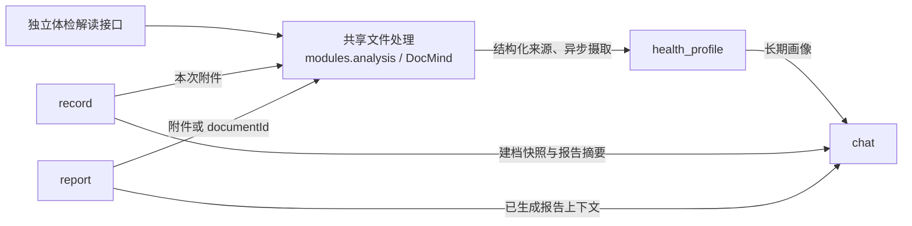
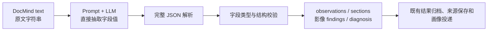

# 上传文件统一解析、内容复用与画像留痕交接指南

> 状态：Analysis、Record 和 Report 已接入共享文件处理。当前结构化解读版本为 analysis-health-report-v12：DocMind 原文字符串直接输入 LLM，由模型输出字段值 JSON，程序解析 JSON 并校验字段，结构化报告结果供画像摄取。
>
> 更新日期：2026-10-30。本轮替换结构化抽取实现，基于 `refactor/file_analysis@cd9d2c3`。已检查本地离线回归和测试脚本；未调用真实 LLM、DocMind 或业务数据库，真实抽取完整度与耗时仍需用更新后的代码和 Prompt 实测。下文模块接线与持久化规则保留各自验证边界。
>
> 当前外部契约以 [API.md](../api/API.md) 为准。实现状态与实际部署状态应分别核查；本文测试覆盖不等同于生产服务验收。

## 1. 当前实现与协作边界

第一阶段审计清点项目原有 60 份 Markdown，确认 Analysis 与 Record 已共享 `HealthReportProcessingService`，Report 当时有独立本地提取与 DocMind 备用路径。当前 Report 已通过 `adapters/report/document_source.py` 接入同一服务，本地表格和临床提取作为 `report_source` 输出格式保留。

第二阶段进一步支持内容去重、主动引用、跨实例执行协调和恢复。生产 `bootstrap/factory.py:build_container` 同时注入共享文件索引、下载器和留痕存储；Analysis、Record 与 Report 均使用这一工厂。没有配置索引的旧服务显式构造仍保留兼容路径，仅适用于旧嵌入方/兼容测试；自行组合新服务必须同时提供 `document_index` 和 `document_downloader`，不能把旧构造当作已开启跨接口去重。

| 入口 | 当前文件行为 | 画像行为 |
|---|---|---|
| 体检解读 `/api/v1/interpret/health-report` | URL 自动去重，或传 documentId 引用；公开 processing 质量摘要及 unresolvedItems；内容不可用返回 200 说明 | 仅可信临床结果保存为规范来源并投递 health_report 任务 |
| 建档创建 `/api/v1/qa/create` | 同一共享入口；持久化 documents、解析快照和 documentProcessing | 可用文件结果摄取；完成问答后的 record 来源独立摄取 |
| 最终报告 `/api/v1/report` | 共享文件处理后使用 report_source 专用提取；质量不足时保守投影 | 基础可信结果可摄取；任一基础文件 partial/unavailable 时扩展只归档，不发布扩展画像来源 |

共享工厂提供输出格式注册和扩展结果存储，生产组合根已注入 Report 专用提取器及 Adapter。Report 支持 URL 和 documentId 文件引用。最终报告任务缓存协议仍保留原有行为，其 URL 内容替换限制见第 5.4 节。

### 1.1 模块关系与工作流

下图保留文件处理与业务消费的关系。箭头表示能力调用或结果流向；命中归档时不必再次识别文件，画像摄取也不代表每次读取都会重新投递。



这是模块化单体中的共享能力，不是四个服务分别通过 HTTP 调用一套 OCR 接口。组合根将同一套共享文件处理工厂注入 Analysis、Record、Report；工厂可以创建不同服务实例，跨请求与跨实例复用依赖持久化文件索引和归档。图中的 DocMind 表示共享层的默认直接文本抽取能力，Report 仍存在第 1.3 节列出的本地提取调用，不能据此认定所有文件读取均已只使用 DocMind。

| 模块 | 是否直接处理上传文件 | 与其他模块的关系 | 源码入口 |
|---|---|---|---|
| Analysis / 独立体检解读 | 是；公开 `process`，内部 `process_document`，共享层负责下载、引用、DocMind、归档与恢复 | 将文本交给后续结构化解读，再按质量保存健康报告来源 | [共享服务](../../modules/analysis/application/service.py)、[组合根](../../bootstrap/factory.py) |
| record / 建档 | 是；仅处理创建请求中明确提供的 `fileList`，调用共享 `process_document` | 会话保存 `documents`、`parsedHealthReports`、`documentProcessing` 及创建时的 `healthProfileContext`；完成问答后另行投递 record 来源 | [Record 应用服务](../../modules/record/application/service.py) |
| report / 最终报告 | 是；通过 Adapter 调用共享 `process_document`，选择 `report_source` 输出格式 | 专用提取器读取共享文本与归档字节，再与建档资料、受控画像组合生成报告；产物独立存储 | [Report 文件 Adapter](../../adapters/report/document_source.py)、[报告流水线](../../modules/report/pipeline.py) |
| health_profile / 健康画像 | 否；不下载附件、不调用 DocMind 或本地 OCR | 接收规范来源、原始指标及异步摄取任务，将可采用事实纳入长期画像并供业务读取 | [来源保存](../../health_profile/report_source.py)、[报告摄取](../../health_profile/report_ingestion.py)、[任务路由](../../health_profile/application.py) |
| chat / 聊天 | 否；本模块没有附件直接文本抽取链路 | 继承建档快照、读取长期画像，并按轮次读取已生成 Report 上下文；聊天文本可独立投递 chat 画像来源 | [Chat 应用服务](../../modules/chat/application/service.py)、[报告上下文 Adapter](../../adapters/report/chat_context.py) |

### 1.2 从文件到业务结果的处理顺序

1. **确定本次输入。** Analysis、Record、Report 接受各自契约规定的文件输入。Report 显式提供的非空来源优先；从建档会话补齐时优先使用已保存的 `documentId`，旧会话才使用 URL。Record 不会自动选择历史上传文件代替本次附件。
2. **取得稳定文件身份。** URL 路径完整下载并校验原始字节，再计算 SHA-256、按用户和主体查索引；`documentId` 路径先检查归属并读取归档。复用、并发协调和恢复规则见第 2、7 节。Report 在此步骤之前还可能命中自身的请求缓存，限制见第 5.4 节。
3. **直接抽取文件文本。** 新文件由共享层将同一份原始字节提交 Aliyun DocMind，保存 `taskId`，轮询结果并归档完整响应，再从布局结果取得文本。已完成文件复用归档；已知 `taskId` 的中断任务查询原任务。此步骤结束的是“文件变成文本”，尚未完成临床信息结构化或画像摄取。
4. **结构化解读并保存来源。** 文本进入 Analysis 的结构化解读和质量判断；可采用的原始报告结果保存为规范健康报告来源、保留原始指标，并投递 `health_report` 画像任务。文件调用的 `source_type=analysis/record/report` 记录使用入口，不等于画像任务类型；完成建档后的问答快照走 `record`，聊天消息走 `chat`。
5. **取得共享与专用输出。** 共享层返回 `ProcessedHealthReport`。Report 额外运行已注册的 `report_source` 提取器，读取基础文件快照及经过摘要校验的原始字节，再按扩展质量决定是否发布扩展来源。专用扩展不另行提交 OCR，但 PDF 本地文本/表格读取仍存在，详见第 1.3、9 节。最终生成的 Report 正文和产物不会自动变成健康事实。
6. **业务消费快照与画像。** Record 固定创建时的解析结果与画像快照，Chat 继承这些资料并读取画像/报告上下文，Report 在本次流水线读取画像后再处理文件。因此“文件已解析”不等于“画像事实已准备好”，同一请求也不能假定立即读到刚投递的摄取结果。

共享文件阶段见 [文件准备与 DocMind 调用](../../modules/analysis/application/documents.py)、[内容复用与恢复](../../modules/analysis/application/document_reuse.py) 和 [输出格式协调](../../modules/analysis/application/output_profiles.py)。画像队列处理的是结构化来源，`health_profile` 不承担第二次文件解析。

### 1.3 直接文本抽取的当前边界

以下按生产工厂和可达调用链区分正在使用的能力与兼容代码；保留函数定义并不等于默认入口会调用它。

| 路径 | 当前可达性 | 直接文本抽取行为 | 源码依据 |
|---|---|---|---|
| Analysis、Record、Report 的共享文件基础处理 | 默认生产接线 | Aliyun DocMind 提交/查询；从响应 `layouts` 中拼接文本 | [DocMind Adapter](../../adapters/analysis/docmind.py)、[共享文件阶段](../../modules/analysis/application/documents.py) |
| Report 的 `extract_intrinsic_report_source` | 默认 `report_source` 路径；单份 PDF 且有归档字节时调用 | `_extract_pdf(..., ocr=False)` 使用 PyMuPDF `page.get_text()` 并恢复原生表格；会再次读取 PDF 文本，不只是保留的旧函数 | [专用提取器](../../modules/report/document_source.py)、[本地 PDF 实现](../../modules/report/parsing.py) |
| Report 的 `_original_tables` | 共享结果为 `partial` 时用于原始表格校核；PDF 分支可达 | 校验归档所有权与字节摘要后调用同一 `_extract_pdf(..., ocr=False)`；未启用 Tesseract | [Report 文件 Adapter](../../adapters/report/document_source.py) |
| Report 的旧 `parse_request_source` 本地文件分支 | 默认生产工厂已注入 `document_source`；只有未注入该依赖的兼容调用才进入 | PDF 默认允许 PyMuPDF/Tesseract OCR，图片也保留本地 OCR；不是共享链路失败后的自动兜底 | [兼容分支及 `_extract_pdf` / `_extract_image`](../../modules/report/parsing.py)、[生产 Report 工厂](../../adapters/report/factory.py) |
| 肠道屏障 gut_barrier | 当前独立生产来源链路，不属于上述四模块的统一入口 | PDF 先用 PyMuPDF `page.get_text(sort=True)`；按扫描页/图片提示决定是否调用 DocMind 补充识别。只复用 DocMind client，未复用完整共享文件处理服务 | [来源下载与逐页解析](../../adapters/gut_barrier/sources.py)、[生产工厂](../../adapters/gut_barrier/factory.py) |

外部依赖资料还列有独立文档抽取辅助服务 `/documents/extract`，见 [供应方原始文档](../integrations/evimed/语音与文档解析API.md)。本仓库这几个模块的生产接线没有调用该接口；也不能根据这份接口资料推断外部服务内部使用的提取引擎。

维护要求：新增或调整业务附件的直接文本抽取应复用共享文件处理与 DocMind，不另建模块内解析链路。上表中的 Report 本地 PDF 读取和肠道屏障独立链路是当前仍需收口的实现差异；本次文档核查没有修改或停用这些调用，不能将“已接入共享服务”解释为“已完全移除本地提取”。

## 2. 身份、结果和使用记录

文件唯一身份为 `(userId, subjectId, SHA-256(完整原始字节))`。同一用户不同主体也不共享；URL、文件名、会话、入口和业务报告 ID 均不进入内容身份。索引同时检查字节长度。同 URL 替换内容产生新文件，不同 URL 的相同字节复用既有文件。不进行跨格式、重新压缩、重新拍照或语义近似去重。

下列引用必须区分：

| 引用 | 含义 |
|---|---|
| documentId | 稳定文件身份；后续各入口引用同一值 |
| traceId | 本次调用或使用的留痕；缓存命中也有新记录 |
| canonicalReportId | 此文件唯一的健康报告来源，画像任务引用它 |
| reportId | 调用方的业务报告引用；允许映射到同一 canonicalReportId |
| finalReportId | 最终报告生成批次，由 Report 管理，不能用作文件身份 |

首个文件 ID 采用首个尝试的 ID，但后续绝不能依赖 `documentId == traceId`。恢复可能将后续阶段归档到新的 trace；真正的归档位置由文件索引的 `payloadRefs` 指定。第一阶段的原有文档和引用不批量改写。

客户端直接传 documentId 时，服务校验用户和主体后读取已保存快照。URL 方式先完整下载、校验实际类型、计算摘要，然后查索引；不会因为 URL 相同就跳过内容校验。提交 DocMind 的必须是计算摘要时的同一份 bytes，不能再让 SDK 重新读取 URL。

下载器最多读取 50 MiB，整体下载预算 60 秒，拒绝重定向、非完整响应及压缩传输，固定经过校验的公网地址并保留 Host/TLS SNI。Record 保留每次最多五个附件、最多两个并发处理及原有公开 pdf/image 类别。

## 3. 共享调用契约

现有入口：

- `process(**kwargs) -> dict`：体检解读公开结果，新文件结果带 documentId。
- `process_document(**kwargs) -> ProcessedHealthReport`：内部调用，同时取得完整文本及引用。
- `read_document_payload(document_id, *, user_id, subject_id=None, name='original_file')`：内部按归属校验读取归档，供 Report 本地提取使用；不是公开 HTTP 下载接口。

| 参数 | 约定 |
|---|---|
| user_id | 必填非空用户 ID |
| file_id / document_id / content + file_name | URL、已存引用、直接文件字节三种来源；引用不能混用其他来源。URL 可带服务端已下载的 content |
| file_type | URL 方式的声明格式；Record 仅传 pdf/image；引用方式不传 |
| content / file_name | content 为非空 bytes，校验格式、摘要和大小；无 URL 时 file_name 必填，仅内部使用，不新增 HTTP multipart 协议 |
| output_profile | 默认 health_report；report_source 需注册专用提取器，见第 9 节 |
| report_type_hint | 可选内部类型提示，未提供时保留 AI 自动判断；不要求前端新增参数 |
| subject_id | 缺省绑定用户本人；引用不能跨主体读取 |
| report_id | 可选业务幂等引用；通常让共享服务选择，禁止在各入口再次按 URL 派生 |
| source_type | analysis / record / report，仅记录入口，不改变画像任务的来源类型 |
| source_id | 本次使用的业务来源，如 sessionId 或 finalReportId |
| session_id | 本次业务会话 |
| file_index | 原始附件序号，从 0 开始 |

`ProcessedHealthReport` 包含 `report、text、document_id、trace_id、source_revision、ingestion_status、ingestion_job_id、reused、archive_trace_id、file_name、resolved_file_type`。实际格式可能为 pdf/jpg/jpeg/png/bmp/gif。完整文本、原始 URL、布局、模型输出和存储元数据只能用于内部处理，不整体序列化进 HTTP 回调。

完整结果复用已保存版本。索引记录 `parserVersion` 和 `interpretationVersion`，不按短期 TTL 失效。后续显式文件请求可恢复当前版本尚未完成的部分；同一请求中的相同文件只结算一次，Report 已读文件的组合阶段使用 `resume_incomplete=False`，避免重复恢复。没有公开强制重解析或批量升级接口，已保存 QA 快照不随恢复更新。

### 3.1 结构化解读：原文输入，模型输出字段 JSON

结构化解读的生产入口为 `HealthReportInterpreter.analyze(content)`，其中 content 是当前文件 DocMind 响应的 `text` 字符串。Prompt 位于 [health_report.txt](../../prompts/analysis/health_report.txt)。程序不预先识别医院、报告模板、表头或列角色；字段的语义关系交给 LLM 理解。



输入与输出的边界：

- 原文不改写为单元格协议，不注入 sourceId、cellId、字符范围或排除标签。DocMind 完整响应及布局继续归档，但本结构化步骤只使用 text，不读取布局决定哪些结果可接受。
- 在首次模型请求前用 AION 的 DeepSeek 离线 tokenizer 估算原文 token 数。单片原文上限为 102,400 token，已知模型窗口较小时另扣除提示词、纠正提示、1,024 token 消息余量和预留输出。预算内整份发送，超出时尽量均衡分片，优先选附近段落或换行，超长单行可按字符边界切开。每片重新计数，按顺序拼回与原文逐字符一致。分片方案在调用前固定。离线估算与供应商计费可能不同，跨片归属仍需依据模型输出和合并规则。
- 模型直接输出 itemName、resultValue、unit、referenceRange、observedAt 等字段值，正常、异常、定量、定性结果均应提取。参考值和科普内容如何区别、不同版式怎样理解，写在 Prompt 中，由模型完成。
- 模型无法确定的可选字段填 null；日期或单位缺失不导致整条已有结果被拒绝。原文缺少名称或结果的项目由模型放入 unresolvedItems。
- 同一文件的多个独立报告可通过 sections 表达；影像所见和诊断放 expansion。服务端保留现有平铺 observations 及 lab/microbiome expansion 兼容输出。

例如，模型可以直接返回：

```json
{
    "reportType": "lab",
    "title": "检验报告",
    "reportTime": null,
    "aiSummary": null,
    "status": "pending",
    "observations": [
        {
            "itemName": "指标甲",
            "resultValue": "<0.01",
            "unit": null,
            "referenceRange": null,
            "observedAt": null,
            "flag": null,
            "kind": "measurement"
        }
    ],
    "unresolvedItems": []
}
```

### 3.2 程序校验与失败边界

[analysis_validation.py](../../modules/analysis/application/analysis_validation.py) 只验证 JSON 契约：对象和数组结构、reportType/status/kind 枚举、名称和结果的基本类型，以及可选文本字段为字符串或 null。resultValue 可以是非空字符串或有限数值；0、比较符、百分号、定性结果及原始精度保留。校验失败统一记录 invalid_json_schema，并包含字段 path 和 expected。

不再做原文逐字匹配、候选行覆盖检查、表头判断、单元格坐标绑定或日期来源检查。模型不需要重复生成原文引用。JSON 合法且字段结构正确时，结果不会因为缺少上述引用信息而触发额外调用。

完整 JSON 回复可解析，完整 JSON 代码块也兼容。仅允许对字符串内未转义的制表符、换行和回车做有界本地转义修复；不补括号、不截取局部对象、不将被截断的 JSON 当成功。

完整 JSON 的字段结构不正确时，可在原分片上纠正一次。模型拒绝输入、调用超时、JSON 无法解析或输出截断时直接结算该片，不重新分片。单次输出仍使用 max_tokens=102400。单次调用上限 90 秒，模型阶段总预算 240 秒；并发仍使用每个事件循环共享的 4 路限制。

现有质量与 HTTP 契约继续保留：可用字段结果正常返回；格式纠正后仍有错误时，保留已通过字段校验的部分并明确记录问题。公开展示只有标题、日期或 unresolvedItems 时为 partial；没有可用信息时为 unavailable。已有明确项目名但缺值的记录放入 unresolvedItems。有其它可用结果且各片处理正常时保持 complete，待确认项不触发重试、不计入已确认画像事实。模型调用或整份分析超时且没有可用结果时返回 502，已有可用结果时返回 partial，必要归档或存储失败仍阻止成功发布。

这里的校验通过只说明字段 JSON 符合契约，不证明模型没有遗漏或误读。真实抽取效果必须对照原文检查，不以单元测试数或 complete 标记代替质量验收。

### 3.3 归档、版本和下游接口

共享文件下载、DocMind、索引去重、所有权检查、结果存储及画像投递接口沿用既有流程。原始字节、完整 DocMind 响应、原文、模型输入和完整回复、字段校验结果及解释结果继续留痕。通过结构校验的报告结果供展示、归档及画像摄取。原始指标可在指标索引查询，画像事实仍由现有日期、主体和事实策略决定。带旧原文核验名单的归档报告再次请求时，系统通过补充版本投递先前被过滤的指标。

当前版本为 analysis-health-report-v12，processingMode=llm_json，validationMode=json_schema。旧的 source-refs-v1/v2 不再用于新的结构化抽取。未完成文件恢复必须满足当前解读版本和检查点身份，不能把旧版引用协议的成功分段当成本版成功结果。原始文件与 DocMind 结果可以复用；历史完整报告仍按快照读取，不自动批量重解析。

仅当新旧结果两侧都能唯一匹配同一物理记录时，才在保存阶段沿用既有来源标识，避免把同一旧记录重复入库。这是结果保存兼容，不是 LLM 输出的原文引用校验，也不会因此拒绝字段 JSON。不同业务模块的专用加工及画像 Worker 在此步骤之后执行，见第 4～9 节。

analysis_metrics 保存 plannedCalls、modelCalls、outputRecoveryCalls、jsonSyntaxRecoveries、reusedParts、queueWaitMs、modelElapsedMs、completionTokens、elapsedMs、firstPassSuccess，以及当前处理与校验模式。jsonSyntaxRecoveries 只计本地转义，不是模型调用；transportRetries 不可观测时保持 null，不解释为零重试。

### 3.4 测试脚本与本轮验证

根目录脚本使用同一生产实现：

```bash
python temp_test_document_structure.py --live --env-file .env
python temp_test_document_quality.py
```

结构化脚本复用最近的 DocMind 归档，不重新提交 OCR，也不写业务数据库；只有显式 --live 才调用模型。质量脚本只回放模型回复的 JSON 解析和字段结构校验，不调用模型。文件路径均相对于项目根目录，使用 `/`。同步代码时须同时更新 application 模块、Prompt 及临时脚本；私有配置由运行者自行提供。

新 structure/summary.json 应显示 interpreterVersion=analysis-health-report-v12、processingMode=llm_json、validationMode=json_schema。prepared_text.txt 应与 DocMind text 一致；prepared_input.json 的 modelInputs 是原文或其大小分段。trace/analysis_input*.json 和 analysis_output*.json 可对照实际输入、完整回复及校验结果；structured_result.json 是最终兼容业务输出。quality 的 valid 表示本次回复的 JSON 契约通过；最终文档结果仍应查看 structured_result.json。

新版用例位于 [test_direct_json_analysis.py](../../tests/unit/services/analysis/test_direct_json_analysis.py)，覆盖原文直传、预算内普通报告只调用一次、未知布局不受规则拦截、可选字段缺失、JSON 类型校验、有限格式纠正与版本恢复。既有文件索引、归档、来源、Report 和公开接口回归继续检查。旧引用协议的测试已从当前实现移除；不能用旧版归档中的指针式模型回复评价新 Prompt 的字段抽取能力。

本轮离线验证不调用真实模型、DocMind 或业务数据库。用户需对同一真实报告重新运行新版脚本，核对模型返回字段的数量与内容，再比较耗时和警告；当前不能承诺真实模型的完整率或速度已经达到目标。

## 4. Record 的快照和公开引用

旧版离线回归、受控模型实测和未覆盖范围见 [文件解读恢复与质量验证](analysis-recovery-validation-2026-09-16.md)。[旧版首轮稳定性验证](analysis-first-pass-validation-2026-09-16.md) 仅保留为 v5 修复方向的历史记录。

Record 调用共享入口时不再自行按 URL 构造新的报告 ID。相同内容即使由不同 URL 传入，也只向问答上下文放入一份结构化内容，并保留首次出现的顺序。

会话 `documents` 按原始文件序号保存实际采用报告的 `fileIndex、documentId、reportId、reused`；`parsedHealthReports` 保存当时采用的可信结构化快照；`healthData.fileList` 保留原始请求。`documentProcessing` 为每个输入记录 complete/partial/unavailable、可展示说明、恢复可能及可取得的 documentId/sourceRevision。先保存有绝对两小时期限的 Redis 创建记录，再逐个保存附件结算结果；明确的内容、OCR 或模型解读失败结算为 unavailable，仍可生成首题，即使全部附件不可用也继续使用用户资料。权限归属、数据库保存和提交状态不确定等错误继续阻断或恢复。已结算附件在首题恢复时不重跑，已保存文件来源不回滚删除。创建记录恢复、接口状态及运维入口见 [创建故障恢复指南](qa-creation-recovery.md)。

进入活动问答后，创建幂等返回、状态查询及历史查询都返回 documents 和 documentProcessing；准备阶段使用独立的 processing/failed 状态结构。完成建档持久化至 MongoDB、之后转换为 Chat 时也保留这些字段。当前问答始终使用创建时的版本，不随文件后续恢复更新。历史会话没有引用或质量信息时对应返回空数组，不按历史 URL 伪造文件身份。

## 5. Report 共享接线与质量边界

### 5.1 接线位置与请求身份

先形成有效文件列表，包括请求显式文件及会话回退文件，再调用共享服务。显式非空文件列表优先；需要会话补充附件时，优先使用持久化 documents 的 documentId，历史会话没有引用才回退至原始 URL。

Report 通过文件来源端口和 `adapters/report/document_source.py` 包装共享服务，组合根注入与 Analysis/Record 相同的工厂。每次执行绑定不可变 userId/sessionId/finalReportId，请求身份不写入共享 Pipeline 实例。不要重新构造缺少 document_index 的旧处理服务。

底层调用同时指定 Report 输出格式；生产入口通过 Adapter 执行并检查返回质量：

```python
async def ingest_report_file(processor, request, item, final_report_id, index, downloaded=None):
    common = {
        'user_id': request.user_id,
        'source_type': 'report',
        'source_id': final_report_id,
        'session_id': request.session_id,
        'file_index': index,
        'output_profile': 'report_source',
    }
    if item.get('documentId'):
        return await processor.process_document(document_id=item['documentId'], **common)
    return await processor.process_document(
        file_id=item['url'],
        file_type=item['fileType'],
        content=None if downloaded is None else downloaded.content,
        **common,
    )
```

此处 item 是已经校验的字典形式，当前 Report 输入模型已支持 documentId。文件身份按共享层内容摘要确定，不使用 URL 或 finalReportId 派生去重身份。

主动引用时不要先下载旧 URL。Report 若需要原始文件继续提取表格，可调用 `read_document_payload(outcome.document_id, user_id=..., subject_id=outcome.report['subjectId'])`，返回的 original_file payload 为 `{'content': bytes}`，文件名及具体格式从 outcome 获取。

### 5.2 覆盖每份文件并保留 Report 专用加工

共享处理覆盖各输入文件，并先于“选择最新报告”等业务筛选；未被本次最终产物选中的旧文件、辅助检查仍有归档和使用记录。画像只摄取已通过校验的来源结果。

DocMind 文本使用 outcome.text，不再次提交 SDK。表格关系、混合 PDF、临床规则、连续截图重建仍由 Report 专用提取器处理。与请求无关的提取结果按 documentId 和提取器版本缓存；请求主体、问答上下文、最新快照选择及最终叙事不混入此类缓存。共享层的 document_extractions 支持单文件和组合文件版本缓存。

任一基础文件为 partial/unavailable 时，扩展结果仍归档，但不发布或摄取扩展来源；返回 source_revision=null、ingestion_status=not_submitted、ingestion_job_id=null。Adapter 将最弱质量传入 parsed.source_errors，使既有 Report Pipeline 返回 partial_success。

partial 输入的扩展事实还必须与基础可信 observations 按项目名或明确双语别名、实际值、单位及日期归属唯一匹配。比较符和百分号不丢失；重复候选不能唯一归属时舍弃。输出元数据使用基础已确认值；原文 sourceSummary、未验证 enterotype、panelCounts 和其他未匹配项目不进入报告事实或摘要上下文。只有中文名无法证明拉丁菌名、基础缺少单位而扩展给出百分比等情况也会舍弃，因此不保证保留全部 Report 指标；没有可靠可用项目时返回 pending 并走既有降级。

新 v6 unavailable 或版本不明的失败文件不能通过原文回退重新提取已隔离内容。仅明确 pre-v6 归档保留历史回退；历史回退结果与 partial 文件组合时不重新提取整组原文，避免再次引入隔离事实。

### 5.3 批次引用与画像时序

批次内部保存各原始文件的 fileIndex/documentId/traceId/reportId/canonicalReportId/ingestionStatus/jobId 及质量引用；查询响应外层 documents 返回这些元数据，医疗正文不含归档内容。组合调用的 groupProcessing/groupProcessingStatus 表示整组最弱质量，不能由第一份完整文件覆盖后续 partial 文件。

当前报告直接使用共享返回的文本和结构化结果，不等待后台画像 Worker。queued 只表示投递完成；Worker completed 也可能产生零条合格事实。当前 Pipeline 先固定读取旧画像快照，可以保持这一行为。

上传报告继续走 health_report 来源。五类 AI 生成产物仍进入现有 report_artifacts/report_batches，不当成原始检测事实写入画像，不增加 sourceType=report 的画像分支，也不直接写 facts。

共享文件质量不足时遵循 Report 原有来源隔离和 partial_success 规则。能够生成最终报告不代表每份文件均解析完整或已同步画像；质量标记和摄取状态分别记录。

### 5.4 暂缓的 Report 任务缓存问题

当前生产 Report 受理由持久化批次按规范化请求指纹复用运行任务或完成后 900 秒内的结果；显式旧 Pipeline 构造仍使用 ReportTaskCoordinator。请求复用发生在下载前，可能绕过同 URL 内容替换检查。该协议限制仍保留，不能把共享层内容检查当成每次 Report 请求都会重新下载的承诺。

共享层的同 URL 替换测试不能替代 Report 端到端验收；任务缓存仍可能直接返回既有批次，不能声明所有实际 Report 请求都经过内容识别。

## 6. 数据库数据链与恢复

新增配置 `SHULAN_MONGODB_COLL_DOCUMENT_INDEX`，默认集合 document_index。其余归档沿用 document_traces 和 document_trace_chunks；不连接或迁移生产库，本次索引在真实应用首次写入时创建。

| 文件索引字段 | 含义 |
|---|---|
| _id / documentId | 稳定文件引用 |
| userId / subjectId / contentSha256 / byteSize | 归属、内容身份及字节大小；前三者唯一索引 |
| fileType / fileName / firstFileUrl | 首次来源的元数据；后续 URL 记录在各自 trace |
| canonicalReportId / sourceFingerprint | 唯一健康报告来源及内容指纹 |
| parserVersion / interpretationVersion | 首次处理版本 |
| payloadRefs | 各阶段完整 payload 实际所在的 traceId |
| submissionStarted / taskId | SDK 提交边界及远端任务引用 |
| status / leaseToken / leaseExpiresAt | 协调状态及执行权 |
| createdAt / updatedAt / errorType | 时间及最近失败信息 |

document_traces 记录每次入口、会话、批次、文件序号、URL、内容摘要、复用原因及阶段轨迹。等待超时或取消与后台执行状态分别记录。归档分块仍采用 BSON、1 MiB 分块和 SHA-256 完整性校验，所有分块成功后才发布 payload 清单。只有完整数据可以进入索引 payloadRefs。模型 reasoning 不作为患者来源归档。

health_reports 新增 canonicalReportId。重复内容的其他 reportId 保存映射并关联同一画像任务，不能自行重复投递。追溯路线：

规范来源 ID 始终由服务端独立生成，调用方显式 reportId 只作为别名。这样两个不同文件竞争同一业务 reportId 时，只会发生别名冲突，不会污染任一文件的稳定身份。

```text
画像事实 sources[].sourceId / sourceRevision / pointer
    → health_reports 中的 canonicalReportId 对应记录
    → documentId → document_index
    → payloadRefs 中的 traceId → document_traces.payloads
    → document_trace_chunks：原始字节、完整 SDK 返回、模型输入输出、结构化结果

本次 sessionId / finalReportId
    → document_traces.source
    → 本次使用的 documentId / reportId / canonicalReportId
```

第一阶段旧记录继续按旧 documentId 直接追溯归档，不强制走新索引。缺少可信原始字节/摘要的历史来源不会凭 URL 加入自动去重。既有显式 reportId 仍读取首次快照；新的无 reportId URL 调用会完整校验并在必要时首次重新解析。没有历史全量回填，也不把旧 trace ID 自动暴露为可用的新引用。

## 7. 并发与故障规则

执行权由 MongoDB 原子条件更新协调，不依赖进程内锁。租约默认 120 秒，每 30 秒续期，所有阶段发布都校验令牌与到期时间；旧执行者不得覆盖新执行者结果。生产任务登记到 TaskSupervisor，单个 HTTP 等待者取消不会取消文件处理。等待预算为 300 秒，超时返回可重试错误，后台任务继续运行。

| 情况 | 行为 |
|---|---|
| 内容已完成 | 读归档、补偿必要的画像投递，新增本次使用 trace |
| 其他进程处理中 | 等待同一任务，不重复提交；失败传递给等待者，不由等待者连续自动重跑 |
| DocMind 成功，模型失败 | 后续请求复用 DocMind 原文，只重试模型 |
| 结构化结果完整，报告保存失败 | 后续请求复用已归档解释，只重试保存 |
| taskId 已保存，查询失败/进程退出 | 持新租约查询原任务，不重新提交 |
| 开始提交但缺少可靠 taskId | 标记 submission_unknown；等待 300 秒后每份文件最多一次受控自动重提，等待中或额度耗尽返回 409 并记录 warning |
| DocMind 明确失败或响应结构无效 | 归档响应及失败状态，不自动新建远端任务 |
| DocMind 明确成功但正文为空 | 归档并结算为 completed，processing 为 unavailable、不可重试；不发布临床来源或画像任务，不重复 OCR |
| 分块或索引发布失败 | 不标记可复用成功；保留已写入证据 |
| 画像队列故障 | 来源保持 pending，既有补偿扫描器补投，不重解析 |
| 旧执行者失去租约 | 不得发布新的索引引用或完成状态 |
| 文档引用不存在/跨用户或主体 | 按不可访问处理，不回退下载 |

没有提供人工恢复管理 HTTP 接口。处理 submission_unknown 时需先根据 trace 和供应商任务核查实际提交状态，恢复已有 taskId 的关联应走另行审核的运维操作；不能为了重试直接删除索引。供应商没有幂等提交保证时，无法承诺所有远端成功而本地未确认的窗口均实现绝对一次调用。

故障排查时先区分首次失败和后续拒绝重提：`文档处理失败` 日志记录 document_id、trace_id、stage、status、task_id、异常原因及代码位置；`文档提交状态待核查` 表示本次读取到了既有 submission_unknown 状态，不代表本次又提交了一次。用 document_id 查询 document_index，再从 document_traces 的 documentId、source.sessionId、source.fileIndex 和时间范围定位最早的 submitting 阶段，结合 upstreamErrorType 与供应商任务记录核查。提交超时、进程中断和 taskId 持久化失败都可能留下这个状态，单独一条“待核查”日志不足以区分。文件身份按用户、主体和内容摘要匹配，换 sessionId 不会清除此状态或重置恢复额度。经过等待后的自动重提通过 Mongo 原子认领，保留原 trace 和恢复记录；耗尽时使用独立运维入口核查。

HTTP 异常、建档 SSE 和受监督后台任务的捕获边界输出单行异常摘要（error_type、message、error_at，以及存在时的 error_chain、root_message、root_at），不附带 Python traceback。首次调用解析服务失败仍归类为上游故障（502 / error）；已有 submission_unknown 状态拒绝重提时使用独立的 DocumentSubmissionConflictError，建档和报告解读返回 409，文档、建档及 HTTP 日志均为 warning。接管过期租约时发现 submissionStarted 但缺少 taskId，执行器只落盘待核查状态，再由等待者按冲突处理，不报告为新的后台任务故障。

生产 DocMind Adapter 关闭 SDK 自动重试，并将每次结果轮询限定为 180 秒预算，单次连接/读取限定 10/30 秒；查询超时保留任务 ID，HTTP 等待预算不是供应商任务取消。强制进程退出后只能依据已持久化检查点恢复。跨集合不使用事务：分块未引用、供应商结果未确认等边界如实留痕，不声称 exactly-once。

共享文件恢复由后续显式文件请求触发；建档创建通过持久化创建任务、Redis 会话锁和文件检查点恢复，runtime 每 15 秒触发创建恢复扫描。Analysis/Report 不扫描全部未完成文档；Report 批次恢复也不重新解析文件或调用模型。画像 pending 来源扫描器只补投画像任务。

## 8. 验证与后续验收

新增自动化测试覆盖三种入口标签的共同文件链路、不同 URL 同字节、同 URL 换内容、主动引用、用户/主体隔离、不同业务 reportId 的统一画像来源、多服务实例共享 Mongo Adapter、续租及失效令牌、等待超时/取消、阶段恢复、完整归档发布、HTTP 参数/错误响应及建档快照持久化。网络下载通过 MockTransport 验证完整字节、大小限制、DNS 固定、TLS 名称、重定向、非完整响应和整体超时。

测试使用无网络替身及 Mongo 原子操作的内存集合模型，不等同于真实 MongoDB 多进程或供应商联调。所有 Python 验证使用 shulan Conda 环境和隔离配置，不读取真实 .env。

2026-09-08 第二阶段历史验证：全量 1359 项测试通过，其中第二阶段新增 37 项；相关 Python 文件 Ruff 检查通过，15 个相关文件格式检查通过。10 份当前修改的 Markdown 格式检查通过，101 个 JSON 块合法，112 个本地链接无缺失。API v0.17.0 完整快照与当前 API 文档一致；Report 保护范围代码与本阶段开始时一致。未进行真实服务调用、生产数据库迁移或 Git 提交。

当前 Report 离线回归覆盖主动引用、会话回退、表格/临床/连续图片、批次 documents、最弱质量传播、partial 可信投影、v6 unavailable 禁止原文回退及同请求避免重复恢复。真实供应商质量、MongoDB 多进程恢复和任务缓存处理后的同 URL 内容替换仍需分别验收；本次结构化实现的验证边界见第 3.4 节。


## 9. 全文整合后的输出格式与 Report 接线步骤

### 9.1 组装并注册专用提取器

`modules.analysis.application.output_profiles.DocumentOutputProfiles` 是显式注册表。默认 `health_report` 已可使用；`report_source` 未注册时在处理文件前报参数错误，不能把空对象当作 Report 接线成功。

```python
from bootstrap.factory import build_container
from modules.analysis.application.output_profiles import DocumentOutputProfiles
from modules.report.document_source import EXTRACTOR_VERSION
from modules.report.document_source import extract_intrinsic_report_source

profiles = DocumentOutputProfiles()
profiles.register_report_source(
    extract_intrinsic_report_source,
    version=EXTRACTOR_VERSION,
    needs_bytes=True,
)
# 在应用唯一组装位置传入；生产已有 Report 专用提取器和默认注册。
container = build_container(agent_runtime, document_output_profiles=profiles)
```

生产 Adapter 会校验提取器身份和版本；示例直接导入 `EXTRACTOR_VERSION`，避免复制旧版本号导致注册冲突。

提取器的签名为 `async def extract_intrinsic_report_source(snapshots: tuple[DocumentSnapshot, ...]) -> dict`，也支持同步纯函数。每份快照仅含 `document_id、report、text、file_name、file_type、content_sha256、content`。`report` 是通用结果，已移除请求用户/主体和业务报告 ID；`needs_bytes=True` 时从已有归档读取字节并核对摘要，不再下载 URL。

`modules/report/document_source.py` 保留本地表格、临床原始数据和连续截图处理，提供不依赖 `ReportRequest` 的纯文件提取。回调不覆盖请求用户姓名/年龄、不读会话问答、不选择最新报告或生成最终叙事；这些动作在共享调用返回后进行。Analysis 不导入 Report 模块。

扩展结构包括 `subject、sample、metrics、taxa、diseaseResults、panelCounts、enterotype、sourceSummary、supplementaryHospitalData`。`sourceType/sourceName/sourceChecksum` 由共享层按真实文件覆盖；组合文件的 sourceChecksum 为 null，`sourceDocuments` 分别列出每份文件及摘要。原始扩展归档与可采用事实应区分，partial 时还经过第 5.2 节的可信投影；不能把生成的医疗报告正文回写为源文件结果。

**Pydantic 注意：** `ParsedMicrobiomeReport.supplementary_hospital_data` 声明了序列化排除。回调显式将它序列化为 `supplementaryHospitalData` 放入返回 dict，不能只调用默认 `model_dump()`。

### 9.2 在 Report 使用共享输出

```python
outcome = await processor.process_document(
    user_id=request.user_id,
    document_id=item['documentId'],
    output_profile='report_source',
    source_type='report',
    source_id=final_report_id,
    session_id=request.session_id,
    file_index=index,
)
source_data = outcome.structured_data
```

URL 方式改传 `file_id` 和 `file_type`；已下载文件可同时传 content。不要给引用附加 URL/file_type。当前 Report Adapter/Factory 已注入共享工厂并采用以上入口。

连续截图或依赖顺序的文件组使用：

```python
outcome = await processor.process_documents(
    [{'documentId': first_id}, {'documentId': second_id}],
    user_id=request.user_id,
    output_profile='report_source',
    source_id=final_report_id,
    session_id=request.session_id,
    resume_incomplete=False,  # 同一请求中各文件已经 read/结算，组合不再次恢复。
)
```

files 也支持 URL/fileType 或内部 content/fileName。每个输入留下使用记录，完全相同文件仅向提取器提供首次出现的快照。组合结果按有序 documentId 列表缓存；变更顺序产生新扩展结果，不重复 DocMind。全部基础结果完整时，组合来源的补充项关联整组 documentIds，摄取版本挂在首份文件的 canonicalReportId 下，不能误称单个文件支持了该组合结论。任一基础结果 partial/unavailable 时，缓存命中也不得发布扩展来源。

### 9.3 结果引用、版本及失败恢复

`outcome.report` 继续是原来的通用体检结果，不改为 Report 私有结构。新增内部字段：

| 字段 | 含义 |
|---|---|
| structured_data / output_profile | 选定输出格式的数据及名称 |
| content_sha256 / canonical_report_id | 文件摘要与规范来源 |
| extraction_id / output_trace_id / output_reused | 扩展结果 ID、本次扩展使用留痕、是否等待或读取已有扩展 |
| source_revision | 已发布扩展对应的不可变摄取来源版本；质量不足未发布时为 null |
| documents | 组合调用的完整输入引用，含 fileIndex/documentId/reportId/reused |

原始文件索引仍只按用户、主体、真实字节摘要去重。`document_extractions` 则按有序文件引用、输出格式、提取器版本、类型提示取得唯一结果和独立租约。指定 hint 的通用结果作为扩展版本保存，不替换默认自动判断快照。首次显式 hint 可增加一次 AI 提取，普通无 hint 调用不会增加这一工作量。

缓存键不含 URL、会话、接口和业务报告 ID；修改提取算法时更新提取器版本，不覆盖成功版本。`source_revision=1` 继续读 health_reports 原记录；补充版本读 health_report_revisions 的精确快照。扩展版本号是由结果键确定的安全整数、不透明标识，不用于排序，也不保证连续。版本冲突必须报错，不能指向其他快照。

画像来源行通过稳定原始指标身份分配给一个来源版本，后续格式/版本重复发现的相同指标不会再次投递为新事实。完整扩展输出仍单独归档，新增单位、日期、值或实际不同来源内容不静默合并。画像队列故障只补投来源；扩展失败也不会把已成功的原文及通用结果改成失败。

### 9.4 持久化集合及查询

新增可选集合配置（默认值与集合名相同）：

- `SHULAN_MONGODB_COLL_DOCUMENT_EXTRACTIONS=document_extractions`：扩展结果身份、租约及归档引用。
- `SHULAN_MONGODB_COLL_HEALTH_REPORT_REVISIONS=health_report_revisions`：不可变来源版本及画像投递状态。
- `SHULAN_MONGODB_COLL_DOCUMENT_OBSERVATIONS=document_observations`：所有原报告指标，含日期未知项目及来源版本归属。

原始文件、DocMind 完整响应、逐段 AI 输入输出与结果沿用 document_trace_chunks 分块归档。扩展回调原始输出、规范输出和摄取来源分别为 output_raw、output_result、source_result。扩展 trace 的 inputTraceIds 关联本次各文件使用记录，从而追溯 URL、入口、会话和批次。

`/api/v1/health-profile/get` 新增 `documentObservations` 第一页；全量分页使用 `/api/v1/health-profile/document-observations/list`。该视图表示原报告资料，不代表已确认事实；factGroups、indicatorGroups 和趋势继续遵守原有规则。日期缺失为 dateStatus=unknown、observedAt=null，不能用上传日期代替。详细参数见 API.md。

### 9.5 联合验收边界

共享层自动化覆盖完整原文区间、多日期与混合类型、失败段恢复、局部结果归档、字节直传、输出缓存、来源版本及补投、无日期查询、画像记忆和跨文件上下文。Report 当前专用提取器有文本/表格/临床/连续截图等离线回归，但不能据此推断所有真实报告版式均可完整识别；partial 可信投影尤其可能有意舍弃无法唯一匹配的指标。

Report 请求 JSON 缓存仍未调整：同 URL 的内容被替换后，请求仍可能在进入共享内容检查之前命中旧批次，具体条件见第 5.4 节。未完成该调整前，只承诺实际进入共享层后的内容检查，不标记 Report 端到端该场景通过。真实 MongoDB、多进程、DocMind 和模型质量须使用合成测试用户另行联调；离线替身测试不替代这些验证。
