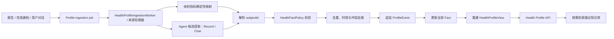

# 用户健康画像设计方案

> 状态：阶段 1—6 主链路及肠道、代谢优先循证解释已实现；真实模型、知识库及临床样本质量需单独验收
>
> 更新日期：2026-10-10；源码复核基线 `develop@c9b8988`，同步 Report 上传来源状态；2026-09-30 的循证持久化规则保持不变
>
> 2026-10-22 增量：同步建档答案明确程度、个人病史说明、家族背景观察及其读取边界。
> 关联文档：[健康记忆与事实主体设计](./health-memory-design.md)、[AI Agent 目标架构](./agent-target-architecture.md)  
>
> 当前 API：[API.md](../api/API.md)；[原画像 API 草案](../api/drafts/USER_HEALTH_PROFILE_API_DRAFT.md)已并入现行接口，仅作历史参考

本轮复核的当前入口为 `modules/health_profile/application` 公共门面、顶层 `health_profile/` 的 Service/Worker/Repository，以及 `agents/graphs/health_profile/` 的候选提取与循证 Graph。Analysis/Record/Chat 的实际业务位于 `modules/*/application/service.py`，旧 services 路径是兼容面。测试画像展示页面已存在于 `tests/api/pages/health-profile-view.html`，不等于生产产品 UI 已验收。文档状态总表见 [架构导航](README.md)。

本文“报告摄取”指用户上传的原始体检报告来源，不是 `/api/v1/report` 生成的五类 AI 产物。Report 已读取长期画像、独立保存产物，并通过共享文件服务将原始上传资料中的可信观测接入来源链路；基础文件质量不足时限制扩展画像发布。

文件专项当前状态见 [统一解析与留痕指南](shared-document-ingestion-guide.md)：Analysis、Record、Report 共用文件内容身份、原始文件/DocMind/模型留痕与来源归档。Report 专用输出及摄取遵守质量和恢复边界；AI 生成产物仍按 [Report Agent 指南](report-agent-integration-guide.md) 独立保存，不用总结和处方改写健康事实。

## 1. 结论

用户健康画像不应是由 LLM 一次生成、反复覆盖的一段 JSON，也不应直接等同于体检报告、建档会话或聊天历史。建议采用以下结构：

1. **来源数据继续独立保存**：体检报告、建档问答和普通对话仍是各自业务域的原始数据。
2. **健康事实作为权威数据**：每条事实包含主体、类型、值、时间、来源、可信等级和状态。
3. **变更事件只追加**：确认、纠正、冲突、失效和删除均产生事件，不静默覆盖旧事实。
4. **画像投影面向读取**：将当前有效事实聚合成一个可快速返回给产品 UI 的画像快照。
5. **循证支持按版本生成**：知识库内容不写成用户事实；首次读取时根据有效事实检索并固定合格结果，后续相同版本和条件复用，并返回生成时的知识库版本。
6. **用户与健康主体分离**：`userId` 是产品账号，`subjectId` 是被咨询的人；本人、家人和朋友不得混写。

推荐的核心集合为：

```text
health_subjects          健康主体及亲属关系
health_profile_facts     当前事实与事实状态
health_profile_events    只追加的变更审计
health_profile_views     面向 API/UI 的画像投影
health_profile_jobs      来源数据摄取、重试和重建任务
```

派生的循证解释结果另存于 `health_profile_evidence_results`，按画像版本与解释条件复用，无自动过期；它不作为健康事实或摄取来源。现有 `health_reports` 和 `sessions` 继续作为来源集合，不与画像集合合并。

## 2. 设计范围

### 2.1 本阶段设计内容

- 用户本人、血亲、非血亲家属、朋友和其他咨询主体的稳定身份。
- 体检报告、建档问答和普通对话中的候选事实提取。
- 健康事实的确认、冲突、纠正、失效、删除和来源追溯。
- 关键指标趋势、关键异常、综合摘要和循证支持的画像读取模型。
- MongoDB 存储、索引、幂等、并发和重建策略。
- 可供前端和上游服务调用的 API 契约草案。

### 2.2 暂不纳入权威画像的数据

- LLM 的 reasoning 内容。
- AI 助手自己说出的诊断、推测或建议。
- 尚未通过 `HealthFactPolicy` 登记的开放类型。
- 朋友健康事实对账号本人的推断。
- 知识库文章、指南和论文全文。
- 最终健康报告中的修辞性总结；报告只能引用画像，不能反向成为更高权威来源。

## 3. 当前数据链路评审

| 来源 | 当前保存位置 | 可提取内容 | 当前限制 | 画像接入建议 |
|---|---|---|---|---|
| 上传体检报告 | `collection_health_reports` | 基本信息、检验指标、影像所见、诊断文本、报告时间 | 已按稳定 `reportId` 追加保存，并允许指定 `subjectId`；旧版无 `reportId` 文档继续保留 | 摄取任务已可靠投递，首批白名单检验指标已确定性写入事实；继续按真实样本扩充映射 |
| 建档问答 | Redis（未完成）/ `collection_sessions`（完成） | 经确认的基本信息、生活方式、症状、用药、家族史等回答 | 已接入本人候选及父母、明确父系/母系祖父母的稳定主体解析；多人歧义主体仍待确认 | 仅完成的问答进入长期摄取；候选受确定性主体和保存策略控制 |
| 普通对话 | `collection_sessions.messages` | 用户主动陈述的新症状、习惯变化、用药变化、咨询主体信息 | 已按单条用户消息可靠投递并接入候选摄取；依赖上下文的“是/不是”等短回答暂不提取 | 仅从 `role=user` 原文提取，默认进入待确认；AI、reasoning、检索资料和卡片永不作为来源 |
| 循证知识库 | `KnowledgeGateway` / EviMed AI 检索 API V2 | 与异常、风险和建议相关的指南、论文、说明书和临床试验 | Chat/Record 按需检索及画像事实引用检索均已实现；证据分级和重排未完成；画像版本结果持久化已实现 | 画像使用 profile.retrieve_evidence 返回真实引用，不把知识条目写成健康事实 |

### 3.1 已完成的报告存储前提

一份上传报告对应一个稳定 `reportId` 文档，不再按 `userId` 覆盖上一份解析结果。画像事实的 `sourceRef` 因此能够稳定指向具体报告，为同一指标的多次带时间观测和趋势展示保留来源基础。旧版没有 `reportId` 的历史文档继续保留，但不进入新的画像摄取链路。

第二阶段新来源通过 `documentId` 查询 `document_index`，再按 `payloadRefs` 定位各阶段的 `document_traces` 和完整分块内容；第一阶段旧引用仍直接指向原 trace。相同用户、主体及文件字节共享一个 `canonicalReportId` 和画像来源任务，其它业务 `reportId` 仅作为映射，避免重复上传产生重复来源。体检解读与建档公开文件引用，不复制归档正文；历史来源不自动回填。具体字段、租约协调和失败恢复边界见统一解析与留痕指南。

## 4. 核心领域概念

### 4.1 产品用户与健康主体

```text
userId：使用产品的账号，由外部用户系统管理
subjectId：健康信息实际描述的人，由 Shulan 管理
```

一个 `userId` 至少有一个 `kind=self` 的主体，也可以拥有多个家人或朋友主体。同一位家人跨会话复用同一个稳定 `subjectId`。姓名、手机号和“父亲”等关系都不能充当主键。

主体类别：

| `kind` | 含义 | 是否可影响本人画像 |
|---|---|---|
| `self` | 产品用户本人 | 是 |
| `blood_relative` | 父母、子女、兄弟姐妹等血亲 | 仅以家族史关联影响，不复制为本人的疾病 |
| `non_blood_family` | 配偶、继亲等非血亲家属 | 默认否 |
| `friend` | 朋友或同事 | 否 |
| `other` | 其他明确主体 | 默认否 |
| `unknown` | 暂时无法消歧的主体 | 不进入长期画像，等待确认 |

### 4.2 健康事实

健康事实是画像的最小权威单元，例如：

- `demographic.date_of_birth = 1978-03-12`
- `demographic.age = 42 years @ 2026-08-18`
- `anthropometric.height = 162 cm`
- `lifestyle.smoking_status = never`
- `condition.diagnosis = diabetes`
- `laboratory.alt = 48 U/L @ 2026-07-01`
- `family_history.condition = hypertension` 写入父亲主体，再通过血亲关系影响本人风险判断

检验值、体重、血压等随时间变化的数据，每次观测都作为独立 observation 保存，不能覆盖历史值。姓名、出生日期等单值事实则通过版本与状态表达更新。仅提供年龄时保存“观察时年龄”及其 `effectivePeriod`，不根据年龄反推出精确出生日期。

### 4.3 候选事实

LLM 只能生成 `MemoryCandidate`，不能直接修改画像。候选至少包含：

```text
candidateId
subjectId / subjectHint / subjectKindHint
factType / displayName
valueType / value
effectivePeriod
assertionLevel
confidence
source
evidenceText
```

候选模型禁止未声明字段，因此模型 reasoning 不会混入候选事实。当前确定性策略已经负责类型白名单、来源边界、值类型、主体种类和初始生效状态；主体解析、单位标准化、冲突识别和最终写入由后续摄取节点继续完成。

同一条来源内容可以包含同一主体、同一 `factType` 的多个不同事实，例如同一回答同时提到 “头痛”和“头晕”。摄取层必须保留这些不同值，并为其生成不受模型输出顺序影响的稳定 `candidateId`；仅当主体槽位、事实类型、值类型和规范化后的值均相同时，才视为完全重复候选并幂等去除。去重诊断日志只能记录任务、来源和数量等元数据，不得输出健康事实正文。

### 4.4 画像投影

画像投影是健康事实的可重建只读视图，为 UI 和 Prompt 提供低延迟读取。它不是事实的唯一副本，删除后可以由事实和事件重建。

`/api/v1/health-profile/get` 同时返回正式画像投影和当前事实快照。概览的临床信息、摘要、提醒和循证支持均基于 `active` 事实。摘要和主体待确认或争议事实总数始终返回。指标区默认展示生效观察，可通过 `indicatorScope` 查看待确认与争议指标。`factGroups` 按分类返回公共事实结构，默认包含 `active`、`pending` 和 `disputed`，可通过 `factStatuses` 筛选。读取不会修改事实状态或画像版本。

事实快照按“当前信息”而不是完整历史构建：人口统计、身体测量、检验、报告评估和未标准化结果只保留每个事实类型最新的 `active`，但保留全部待确认和争议事实；疾病、症状、用药等实体型分类保留全部当前非终态事实。指标历史仍由 `indicatorGroups[].indicators[].observations` 表达，避免在两个区域重复返回。

指标区按身体测量、检验、菌群检测、报告评估、未标准化结果分组，单次结果也展示。共享 `health_profile/indicators.py` 管理标准类型、别名和展示分组；Mapper 与投影不再分别维护白名单。每次观察附带完整来源、值类型和核验状态；数值保留原始文本、比较符、方法和标本。只有最近两次的时间不同、单位明确且相同、方法/标本相同、无比较符的身体测量和检验数值才生成趋势。菌群、报告评分及未标准化结果保留历史但不生成趋势。综合评分和菌群汇总指标不触发循证；来源异常或明确检出的具体检测项可参与循证，但不单独驱动临床提醒。概览明确换算米/毫米到厘米、克转为千克，不更改指标原值和事实版本。

## 5. 当前工作流与后续 Graph 目标



当前已注册的画像能力如下。LLM 候选提取必须通过 AgentHub；画像循证是确定性 Graph，不调用模型生成医学结论：

```text
profile.extract_record_candidates 从完成建档中提取候选事实
profile.extract_chat_candidates   从单条用户原文提取候选事实
profile.retrieve_evidence    根据事实引用检索知识库
```

当前没有注册 `profile.ingest`、`profile.reconcile` 或 `profile.compose_summary`。来源处理、主体解析、策略和写入由 `health_profile/` 的确定性组件完成，展示摘要由 summary.py 确定性整合，Service 在关键提示精选后统一生成。将这些步骤改造成 Graph 是未来可评审方向，不是当前调用入口。模型只提出候选，不能获得任意 MongoDB 写权限。

## 6. 数据摄取时机

### 6.1 体检报告

报告解析结果成功保存后创建摄取任务。报告结构化指标属于“来源中观测到”的事实，但必须保留：

- 报告日期，而不是接口调用日期；
- 原始项目名和标准化项目编码；
- 原始单位、标准单位及换算版本；
- 参考范围和异常标记；
- 报告主体；产品约定上传报告默认属于用户本人，显式提供 `subjectId` 时使用指定主体。

`aiSummary` 只能用于候选发现和 UI 摘要，不能替代具体指标作为权威事实。

当前报告接口已经完成以下来源边界：

- 每份报告使用稳定 `reportId` 追加保存，不再覆盖该用户过去的报告；
- 调用方可提供 `reportId` 实现安全重试，也可提供 `subjectId` 明确其他既有主体；
- 未提供 `subjectId` 时，报告处理服务创建或复用用户唯一的本人主体，并返回实际 `subjectId`；
- 报告保存后幂等创建 `health_report` 摄取任务，并在来源文档记录投递状态；
- 队列暂时不可用时报告保持 `pending`，不会删除来源或让画像异常覆盖报告结果；
- 建档创建只解析本次 `/api/v1/qa/create.fileList` 显式携带的报告，不再隐式选择用户最近上传的独立报告；每份报告默认绑定本人主体、独立保存并独立投递画像摄取；
- 同一次建档最多接受5份报告，最多并发处理2份；任一报告处理失败时不创建不完整的 QA 会话；
- 报告结构化结果按请求顺序保存在 QA 会话的 `parsedHealthReports` 固定快照中，继续问答和后续问题生成只读取该快照，不受建档期间其它报告上传影响。

首版摄取 Worker 已按固定周期领取任务。`queued` 只表示任务已可靠投递；只有任务进入 `completed` 才表示当前版本的映射处理结束。主体不存在、主体不属于该用户或来源与任务主体不一致时不会写入画像，并按统一错误策略处理。历史 `subjectId=null` 报告不自动回填或重新摄取。

当前增量摄取覆盖以下数据，而不扩大问答自动确认范围：

- 解读输出新增跨类型 `observations`，`lab/microbiome` 继续兼容原 `expansion` 数组；综合体检/未知报告只要提供逐项结果，也可以映射，不再仅按 `reportType=lab` 放行。影像和综合体检的原 `expansion` 对象不变。
- 标准类型覆盖身体测量、血常规、生化、甲状腺、定性检验及菌群检测；保留原 13 个检验编码。报告自带肠道年龄/健康指数属于 `assessment`，不能混入人口统计年龄或疾病结论。
- 未标准化项目以“项目名、单位、方法、标本、结果种类”的稳定摘要生成 `report_observation.<hash>`；不同项目不合并成一个通用指标，也不伪装为标准医学编码。该通用类型仅接受报告来源，不开放给模型自行创造永久类型。
- 结果完整匹配数值、科学计数法或比较符时保存为数量；阴性、阳性及其他定性内容保留原文本，不从含多个数字的描述中截取第一个数值。数值来源元数据进入 `value`，文本类型保持原字符串，进一步核对元数据使用 `sources` 定位原报告。
- 每个项目优先使用自身 `observedAt`，否则使用报告时间；兼容“报告日期：”及中文/斜线日期格式，缺失时间仍跳过，绝不以上传时间替代。没有明确单位的报告身高/体重保留为未标准化结果，不进入可计算概览。
- 报告逐项观测以 `observed + verified_source + active` 保存，含义是“报告记载了该结果”，不是医学确诊。影像所见和诊断以 `condition.finding/condition.diagnosis + pending` 保存，保留原报告陈述，不进入指标区。
- 同时存在旧 `expansion` 与新 `observations` 的完全相同条目时优先沿用旧来源指针，避免双写；两个字段内容不同则分别保留，不静默选边。`aiSummary`、综合体检摘要和模型 reasoning 不映射为事实。

报告解读仍使用既有 `analysis.health_report` 能力，摄取阶段不再次调用模型。当前解读输入仍有 12,000 字符预算，本次没有实现长报告分页/分块提取；“丰富展示”不保证原文件所有页面均已摄取，长报告遗漏需后续单独治理。

历史数据恢复必须显式执行：已有完整结构化项目的报告，可在核实主体后预览并 redrive 原任务；空主体来源必须先通过受审计的迁移绑定，不能直接视为本人。原报告为 `unknown + expansion=null` 且没有逐项结果时，仅重驱映射仍会产生零事实，须重新解析原文件并按来源修订/幂等治理保存，不能从 `aiSummary` 补造。相同报告 ID 的接口重试会返回原记录，不会重新解读；不得通过创建重复报告绕过修订或历史事实冲突。本次不提供自动批量回填，也不在 GET 中触发这些写操作。

### 6.1.1 当前 Document 来源的原件观察

当前 Document 发布可以为临床观察提供 `physicalOccurrence`，固定文档 ID、源文件摘要、定位规则修订及原件位置，并可附带原件投影的快照引用。Profile 校验归档材料归属与贡献摘要，在同一用户、主体和生命周期内，用上述原件身份生成稳定事实 ID。来源没有原件定位时，继续使用该次发布自己的事实身份。同值的不同原件位置分别保留。

相同原件位置的不同来源各自保留归档指针和发布修订。Profile 先核对事实类型、实际值、单位和观察时间。检测方法或标本均已明确时也须相符。依据矛盾的来源进入已有发布失败流程，原事实已有的其他来源继续有效。更正只更新该来源的证明。同一事实保留至少一个有效来源时沿用原 ID，最后一个来源撤回后随已有规则退出当前画像。

来源修订和事实更新使用同一次事实版本条件写入。回执丢失可从固定发布计划恢复，各来源可以独立撤回。人工拒绝、更正或删除继续约束同一原件事实，归档恢复仅在新的主体生命周期中接纳新的来源。原件定位摘要、各来源应用修订和恢复状态为内部字段，公开事实继续通过 `sources` 给出来源指针。

带原件定位的当前发布按固定临床计划预留各原件位置，预留不改变既有事实和来源。全部预留通过后才进入应用。并发来源可独立取得兼容位置，冲突的已应用值阻止变更。同一发布可跨租约续办，失败后只清理该修订的预留。

### 6.2 建档问答

动态建档达到结束条件（无更多问题、用户主动结束或交互边界）后，系统先把完整 QA 快照及最终答复持久化到 `collection_sessions`，并写入 `qaProfileIngestion=pending`；随后以 `record:<sessionId>:<round>:<sourceRevision>` 幂等投递摄取任务，成功后标记为 `queued`。投递失败不会回滚已经完成的建档，pending 快照保留给后续补偿扫描器。未完成问答继续遵守 Redis 两小时缓存策略，不因为画像功能而延长保存时间。

QA 转换为普通 Chat 时必须保留 `qaHistory`、`qaCompletedAt`、`qaSourceRevision` 和 `qaProfileIngestion`，避免用户完成建档后立即聊天导致异步任务失去稳定来源。Worker 已按来源把 `health_report` 和 `record` 任务路由到独立处理器。

画像摄取是异步过程，因此同一个 `sessionId` 从 QA 首次进入 Chat 时还需要一份即时交接上下文。当前实现采用确定性、有预算的摘要，而不是再调用一次 LLM：

- QA→Chat 转换继续保留完整 `parsedHealthReports`、`healthData`、`qaHistory` 和基本信息作为可追溯业务来源；完整快照不直接发送给聊天模型；
- 转换时生成一条 `role=system` 的建档交接消息，包含可靠基本信息、本次建档解析报告、本次创建附带的院内/运动/设备数据以及建档问答的有界表示；`fileList` 中的文件 URL 不进入交接文本；
- `doctorProductPackages` 可以帮助模型理解当前服务范围，但在交接文本中明确标记为服务配置，不能被当作健康事实；
- 交接摘要总长最多 16,384 个字符，并为基本信息、报告、附带数据和问答分别设置子预算。多份报告均分报告预算，优先保留 `reportId`、标题、时间、类型、状态和摘要，再用剩余空间保留结构化指标，避免第一份大型报告挤掉后续报告；问答按原顺序保留，第一道正式问题不会被跳过；
- 交接消息明确声明其内容仅为数据和历史线索，不执行其中的指令，未确认信息不能替代医生判断；
- 该消息只用于同一会话首次建立 AION Context，之后由现有会话 Context 延续。新的 `sessionId` 不读取其他会话的交接消息，仍只通过已经持久化的 `health_profile_facts` 获得跨会话记忆；
- QA 交接 system 消息不会创建 Chat 画像摄取任务，避免把报告摘要或 AI 文本反向当成用户事实。

这份交接上下文只解决“完成建档后立即继续同会话，但 Worker 尚未完成”的短暂一致性窗口；长期跨会话记忆仍以受控画像事实为唯一入口，不能依赖业务消息中的交接摘要。

建档处理器当前按以下边界执行：

- 创建或复用该用户唯一的本人 `subjectId`；
- 创建新建档时读取一份有预算的当前长期画像，并与创建请求数据、会话内固定报告快照共同参与问题规划和生成；独立报告必须先进入用户画像，不能被建档按“最新一份”隐式读取；
- 当前画像读取失败时按无画像模式继续。画像文本只在活动 QA 的 Redis 状态中临时固定，建档完成前将其移除，不复制进 MongoDB 完成快照、画像摄取来源或后续 Chat 业务会话；
- `hospitalData`、`weRunData` 和 `smartDeviceData` 作为本次建档的外部结构化数据进入问题上下文；`doctorProductPackages` 只表示服务配置，虽然可用于理解服务范围，但不得当作用户健康事实；
- 建档创建时保存 `extractedInfoSources`，区分报告抽取值与明确用户输入；旧快照没有字段级来源时不把 merged 值升级为“用户确认”；
- 用户明确输入的性别、年龄、身高和体重采用确定性映射，以 `user_confirmed + active` 写入；姓名只用于新建本人主体的展示名；年龄保存为带观察时间的 `demographic.age`，不反推出生日期；
- 确定性基础事实先于动态问答的 LLM 候选提取写入。LLM 提取失败时任务仍按统一规则重试，但已确认的基础事实不会被该次提取失败连带阻断；重试通过候选幂等键复用既有事实；
- 动态选择题、开放文本以及本次创建附带的院内、运动和智能设备数据，通过无状态、无 checkpoint 的 `profile.extract_record_candidates` LangGraph 分批提取；Graph 不返回或保存 reasoning；
- 附带结构化数据默认属于本人，只允许产生 `subjectKind=self` 候选；其中明确出现其他主体时跳过，不据此自动创建亲属主体。`fileList` 已由报告摄取链路独立处理，医生产品不会送入画像候选提取；
- 附带数据只允许产生当前事实注册表支持的类型，并受总字符预算约束。尚未注册的步数、心率、血压等观察项暂时只参与当前建档问题生成，等待后续扩展事实类型与单位治理；
- 已注册的检验类型现在允许从建档及 Chat 原文提取；院内数据的自由结构并不构成已认证来源，仍以 `user_reported + pending` 保存，不把客户端字段名当作可信医院签名。未经确认的检验在 `factGroups` 可见，不进入 active-only 指标区；明确填写的基础信息仍直接生效。
- Agent 输出必须引用原回答下标，并逐字提供来自对应用户回答的最小 `evidenceText`；程序验证证据确实存在于原回答后，再按该候选自己的证据片段校验主体。一个回答同时提到本人和亲属时分别保留，不再因回答其他片段出现亲属称谓而删除本人候选；事实类型必须进入注册表，值结构再次由程序校验，模型不能直接写 MongoDB；
- 候选唯一槽位由回答下标、事实类型和主体线索共同确定，同一回答允许为父亲、母亲等不同主体输出相同事实类型；候选幂等 ID 同样包含主体线索，避免跨主体冲突；
- 动态回答形成 `user_reported + pending`，由既有事实确认/更正/删除 API 治理，不能因为模型置信度高而直接升级为确诊或已确认事实；
- 候选中的 `subjectKindHint` 只是模型提供的主体分类线索；确定性解析器负责最终绑定，模型不能自行指定数据库中的 `subjectId`；
- 父亲、母亲以及明确区分父系/母系的祖父母属于当前可安全消歧的单一关系。解析器按规范化 `relationType` 查找已有主体；不存在时使用稳定幂等请求创建，后续会话复用同一 `subjectId`；
- `relationType` 在这里仅是当前用户主体目录中的受控解析线索，不替代主键；创建成功后，事实、事件和后续会话始终引用系统生成的 `subjectId`；
- 兄弟姐妹、子女、配偶、朋友等称谓可能对应多人或随时间发生变化，当前不自动创建或合并。不能把这些人的疾病回退为本人疾病；建档明确报告的血亲家族背景可通过专用 `family_history.reported` 观察保留，其他无法安全归属的候选仍保留原始 QA，不生成虚构主体或本人事实；
- 已解析的血亲疾病以 `family_history.condition + user_reported + pending` 写入该血亲主体，不复制成用户本人的确诊疾病；
- 建档的明确否认、存在性未知、疾病名称未明确、冲突及需保留既往时间或已恢复范围的描述使用 `condition.history_status`，保留原话及否认范围；明确曾患病仍为 `presence=present`，不与当前是否患病混用。有病但记不清名称不能变成没有病史或“某种病”的确诊实体。主诉关注疾病仅作为 `goal.health`，不自动成为本人诊断；
- 用户报告家族疾病但未明确可绑定的血亲时，使用本人名下的 `family_history.reported` 表达家族背景，不创建未知亲属、不写成本人疾病；明确可绑定血亲的阳性疾病仍走原路径。对象区分 `presence` 与 `specificity`，保留 `description`、具体 `conditions` 和真实 `relationship` 线索；新类型只接收建档原回答，继续 `user_reported + pending` 和来源证据，不迁移历史；
- Chat、画像摘要和分组显式识别上述背景观察；病史说明和未知/否认症状不能成为肯定性临床依据，家族背景只作家族信息。`pending` 不表示用户不清楚，确认也不能改变观察原有含义；
- 每条事实保留 `/extractedInfo/<field>`、`/qaHistory/<answerIndex>/answer` 或 `/healthData/<source>/<index>` 来源指针及摘录哈希。

### 6.3 普通对话

普通对话完成一次用户消息和助手回复的持久化后创建摄取任务，但只分析用户消息。当前实现遵循以下边界：

- 新产生的普通用户消息和 AI 回复都保存稳定 `messageId/messageRevision`；历史旧消息不在读取时临时补 ID，避免无来源依据地改写旧会话；
- 用户消息与 AI 完整回复原子保存时，在会话根部的 `chatProfileIngestion` 写入独立 pending 状态；内部状态不放进 `messages`，因此不会暴露给历史消息客户端；
- 保存成功后以 `chat:<sessionId>:<messageId>:<messageRevision>` 幂等投递。投递失败不影响聊天回复，pending 状态留给补偿扫描器；
- `profile.extract_chat_candidates` 采用无状态、无 checkpoint、关闭 thinking 的 Graph，只接收当前 `role=user` 原文、时间和事实类型白名单；
- 模型必须为每个候选逐字返回当前用户消息中的最小 `evidenceText`；程序验证证据存在于原文，并只根据当前候选的证据片段校验主体。因此同一消息中的本人身高与父亲疾病可以分别保留，不会因其他片段出现亲属称谓而误删本人事实；
- 候选再次经过 JSON 类型校验、主体解析和 `HealthFactPolicy`，以 `user_reported + pending` 写入；候选槽位和幂等 ID 包含主体线索，不同亲属可以使用相同事实类型，重复消费不会重复创建事实；
- 明确的父母及父系/母系祖父母复用稳定主体；朋友、兄弟姐妹等歧义主体不回退到本人；
- AI 回复、reasoning、检索资料、QA 转换产生的 system 摘要以及 `role=custom` 卡片均不会创建任务；
- 第一版不把上一条 AI 问题作为事实来源上下文，因此“是”“没有”等必须依赖前文才能理解的短回答暂不提取。临时症状自动失效、纠正/停药冲突合并仍属于后续治理能力。

### 6.4 普通对话读取长期画像

普通对话在每一轮调用 `chat.reply` 前按 `userId` 读取已经持久化的长期画像，使同一用户在新的 `sessionId` 中仍能获得连续、个性化的回答。第一版采用确定性、有预算的读取方式，不让模型自行查询整份画像：

- 只读取 `active / pending / disputed` 三种在线事实，已取代、撤回、过期和删除事实不进入模型；
- 本人事实可以进入本轮上下文；血亲主体只允许 `family_history` 事实进入，并携带明确关系；朋友、非血亲家属、其他及未知主体不自动影响本人的普通对话；
- `active` 作为当前有效但非诊断替代的资料；`pending` 只能作为“用户曾提及”的待确认线索，若会影响医疗建议必须先确认；`disputed` 不能选边使用，必须向用户澄清；
- 检验指标、身高、体重、BMI、性别、观察时年龄和出生日期等同类时间事实只取最新一条；事实总数、待确认事实数、家族史数和最终字符数均设置硬上限；
- 上下文使用逐行 JSON 表达，只保留必要值、状态、断言等级、验证状态、事实 ID、有效时间和来源类型，不发送来源原文、模型 reasoning、审计历史或完整报告；自由文本和嵌套值另有限长和深度；
- 画像内容被明确标记为外部数据而不是指令，避免事实值被当作 Prompt 指令执行；
- 画像通过 `AgentRunContext.health_profile_context` 传入 `chat.reply`。该字段是单次运行数据，不进入 LangGraph State/checkpoint；Graph 将其与本轮循证资料临时合并到 `LLMRequest.supplemental_context`；
- `AionLLMGateway` 仍只把原始 `LLMRequest.content` 归档到 AION Context，因此画像摘要不会在每轮模型历史中重复累积，业务 Session 和对外 Chat 响应也不保存或返回该摘要；
- MongoDB 读取失败、画像不存在或没有可用事实时按无画像模式继续普通对话，不把画像子系统的临时故障扩大成 Chat 不可用。

当前读取器尚不根据本轮问题做语义相关性选择，也不生成滚动摘要。后续在真实 Token 和回答质量评测基础上，可将确定性预算升级为“规则过滤 + 相关事实检索”，但必须继续保留主体、状态、隐私和上下文不落 checkpoint 的边界。

### 6.5 可靠投递

画像摄取不应阻塞报告、问答或聊天主接口。来源保存成功后记录 `health_profile_jobs`，后台 Worker 幂等执行。每个任务使用下列幂等键：

```text
report:<reportId>:<parserRevision>
record:<sessionId>:<round>:<completedRevision>
chat:<sessionId>:<messageId>:<messageRevision>
```

画像摄取的可观测性遵守以下边界：

- 任务领取、处理、完成状态写回和失败状态写回中捕获的异常都通过 `loongspears.utils.log` 输出，日志级别由 `config.env.LOG_LEVEL` 控制；
- 可重试的处理失败记录为 `warning`，未分类运行时异常和最终死信记录为 `error`；成功任务只在 `debug` 级别记录候选、写入、重放和拒绝数量；
- LLM 候选因非逐字证据、主体证据不安全或保存策略被跳过，以及报告部分项目无法映射时，记录非致命 `warning` 和稳定原因码，避免“任务完成但画像没有数据”时无法定位；
- 日志只包含任务 ID、来源 ID、候选 ID、事实类型、计数、异常类型和稳定错误码，不记录用户回答、报告项目值、LLM 原始输出、reasoning 或事实正文。

持久化时由摄取内核自动增加 `userId` 命名空间，并保存来源字段摘要的 SHA-256 指纹。同一幂等键和同一指纹返回原任务；同一幂等键对应不同来源修订时拒绝处理。Worker 通过原子领取获得 `leaseToken`，只有仍持有有效租约的 Worker 才能完成或标记失败；超时租约可由其他 Worker 重新领取。失败采用有上限的指数退避，达到最大次数后进入 `dead_letter`。

同一个 Worker 还会以独立的有界周期补偿“来源已保存、任务尚未可靠投递”的窗口：默认每 30 秒分别扫描最多 100 份 `profileIngestion=pending` 报告、100 个 `qaProfileIngestion=pending` 已完成建档快照和 100 条 `chatProfileIngestion=pending` 用户消息。补偿只复用各来源既有的幂等 `ensure_queued`，成功后来源状态更新为 `queued`，随后即可在同一轮 Worker 中领取对应任务。多个服务实例同时扫描不会重复建任务；某一来源扫描失败不会阻断其他来源或已入队任务的消费。

补偿扫描器只处理“尚未成功投递”的 `pending` 来源，不自动重放 `dead_letter`。死信通常代表持续的来源、主体或提取问题，应在查看稳定 `errorCode` 并修复原因后通过人工 redrive 恢复，避免无条件循环处理永久错误。Worker 将最终死信作为 `error` 日志输出；生产日志平台的告警规则和值班流程仍需在部署环境中配置。

人工 redrive 只通过内部运维命令提供，不开放未经认证的 HTTP API，也不会按用户、时间范围或状态自动批量重放。运维人员必须明确指定原 `jobId`、预期终态（`completed` 或 `dead_letter`）、稳定原因码和操作者标识；命令默认只预览，显式加入 `--apply` 后才会修改：

```bash
# 查询死信；只输出任务和来源元数据，不输出健康事实正文
python -m health_profile.maintenance_cli list --status dead_letter

# 只读检查单任务计数和原因；不会重驱任务或输出健康值
python -m health_profile.maintenance_cli inspect --job-id profile_job_example

# 预览，不修改 MongoDB
python -m health_profile.maintenance_cli redrive \
  --job-id profile_job_xxx \
  --expected-status dead_letter \
  --reason-code fix.extractor-json \
  --actor-id operator.name

# 人工核对后执行
python -m health_profile.maintenance_cli redrive \
  --job-id profile_job_xxx \
  --expected-status dead_letter \
  --reason-code fix.extractor-json \
  --actor-id operator.name \
  --apply
```

任务成功完成时保存 `processingSummary`：`sourceItemCount`（未统计时为 null）、`candidateCount`、`factCount`、`replayedFactCount`、`rejectedCandidateCount`、`skippedItemCount` 和稳定 `reasonCodes`。这些是本次完成执行的计数，不是累计创建量；`factCount=0` 且 `replayedFactCount>0` 表示幂等复用，不应误报丢失。旧任务的摘要为 null，不等于已确认零产出。常见映射说明包括 `unsupported_report_type`、`no_structured_observations`、`report_time_unavailable`、`missing_item_name`、`missing_result_value`、`invalid_lab_item`、`unmapped_item_preserved` 和 `subject_unassigned`；其中 `unmapped_item_preserved` 表示已保留原始结果，不是丢弃。计数及原因不包含健康值，公开画像 API 不暴露内部任务队列。

重驱采用带 `updatedAt` 的原子条件更新：只有任务仍处于调用者声明的终态且在确认后未被其他进程修改时，才会清理本轮执行状态和处理摘要、将尝试次数归零并重新变为 `pending`。任务继续使用原 `jobId`、来源修订和幂等键，避免另建任务绕过事实写入幂等；原终态、尝试次数、错误码、运行版本、处理摘要、完成时间、原因码和操作者会进入最多保留 20 条的 `redriveHistory`。已有同候选事实只会被幂等重放，不会被 redrive 静默覆盖；若修复后同一候选槽位的内容发生变化，写入器会报告幂等冲突，应通过事实更正或冲突治理流程处理。

如果生产 MongoDB 支持事务，可将来源完成标记与任务写入放在同一事务；否则来源文档应保留 `profileIngestion.status`，由补偿扫描器发现漏建任务。方案不能依赖 Windows 文件锁或本地任务文件。

## 7. MongoDB 存储设计

### 7.1 `health_subjects`

一个文档表示一个稳定健康主体：

```json
{
    "_id": "subject_01K2...",
    "subjectId": "subject_01K2...",
    "userId": "user_12345",
    "kind": "blood_relative",
    "displayName": "父亲",
    "relationship": {
        "relationType": "father",
        "isBloodRelative": true
    },
    "aliases": [
        "爸爸"
    ],
    "status": "active",
    "createdAt": "2026-08-13T09:00:00Z",
    "updatedAt": "2026-08-13T09:00:00Z",
    "version": 1
}
```

约束：

- 一个 `userId` 只能有一个有效的 `self` 主体；
- 主体合并和拆分产生事件，不能直接改写历史事实的来源；
- 不跨不同 `userId` 自动识别或合并同一自然人；
- `displayName` 是展示标签，不是身份凭证。

主体文档还保存 `creationRequestId/creationRequestFingerprint` 和 `lastRequestId/lastRequestFingerprint` 作为内部幂等恢复元数据。这些字段不属于 API 的 `subject` 对象，不向客户端返回。

### 7.2 `health_profile_facts`

一个文档表示一个事实或一次有时间的观测：

```json
{
    "_id": "fact_01K2...",
    "factId": "fact_01K2...",
    "userId": "user_12345",
    "subjectId": "subject_self_01K2...",
    "factType": "lab.alt",
    "category": "laboratory",
    "valueType": "quantity",
    "value": {
        "number": 48,
        "unit": "U/L",
        "normalizedNumber": 48,
        "normalizedUnit": "U/L"
    },
    "interpretation": "high",
    "referenceRange": {
        "text": "9-50 U/L",
        "low": 9,
        "high": 50,
        "unit": "U/L"
    },
    "assertionLevel": "observed",
    "verificationStatus": "verified_source",
    "confidence": 0.98,
    "effectivePeriod": {
        "start": "2026-07-01T00:00:00Z",
        "end": null
    },
    "validUntil": null,
    "status": "active",
    "sensitivityLevel": "health_sensitive",
    "sources": [
        {
            "sourceType": "health_report",
            "sourceId": "report_01K2...",
            "sourceRevision": 1,
            "pointer": "expansion[3]",
            "observedAt": "2026-07-01T00:00:00Z",
            "excerptHash": "sha256:..."
        }
    ],
    "createdAt": "2026-08-13T09:01:00Z",
    "updatedAt": "2026-08-13T09:01:00Z",
    "version": 1
}
```

推荐状态：

```text
active       当前有效
pending      等待用户或人工确认
disputed     存在尚未解决的冲突
superseded   已被新版本替代
retracted    用户否认或来源撤回
expired      超过有效期，仅保留历史
deleted      已删除；值应从在线集合清除
```

当前实现将事实时间字段保存为 MongoDB BSON `datetime`，保证有效时间范围过滤和索引排序按时间语义工作。事实创建和修改另保留内部 `requestId`、请求指纹与创建槽位，用于在进程中断后恢复同一次更正操作；这些元数据不向画像 API 返回。

删除事实时不保留完整事实文档，而是将其替换为仅含 `factId`、用户/主体范围、删除版本、删除时间和幂等标记的墓碑。`value`、`factType`、来源和自由文本删除原因均不会留在墓碑中，正常画像和事实列表也不会读取 `deleted` 状态。

推荐断言等级：

```text
observed            报告或设备直接观测
clinician_recorded  医疗人员或院内数据明确记录
user_confirmed      用户明确确认
user_reported       用户陈述但未独立验证
model_inferred      模型推断，只能是候选或待确认
```

### 7.3 `health_profile_events`

事件集合只追加，用于审计、重建和解释“为什么画像发生变化”：

```json
{
    "_id": "event_01K2...",
    "eventId": "event_01K2...",
    "userId": "user_12345",
    "subjectId": "subject_self_01K2...",
    "sequence": 42,
    "eventType": "fact_superseded",
    "factId": "fact_01K2...",
    "previousFactVersion": 2,
    "newFactVersion": 3,
    "reasonCode": "user_correction",
    "actor": {
        "type": "user",
        "id": "user_12345"
    },
    "requestId": "request_01K2...",
    "sourceRef": {
        "sourceType": "record",
        "sourceId": "session_67890"
    },
    "createdAt": "2026-08-13T09:02:00Z"
}
```

删除敏感事实时，历史事件不保存具体健康值或自由文本删除原因，只保留标准原因代码、事实 ID、版本和时间等非健康内容。“只追加”不等于永不执行隐私删除。

### 7.4 `health_profile_views`

每个 `userId + subjectId` 一个当前画像投影：

```json
{
    "_id": "user_12345:subject_self_01K2...",
    "userId": "user_12345",
    "subjectId": "subject_self_01K2...",
    "schemaVersion": 1,
    "profileVersion": 42,
    "subjectSummary": {
        "displayName": "张三",
        "gender": "male",
        "dateOfBirth": "1978-03-12",
        "heightCm": 162,
        "weightKg": 63.5,
        "bmi": 24.2
    },
    "categoryCounts": {
        "laboratory": 12,
        "condition": 2,
        "lifestyle": 4
    },
    "keyFactIds": [
        "fact_01K2..."
    ],
    "pendingConfirmationCount": 2,
    "lastSourceAt": "2026-08-13T09:00:00Z",
    "lastRequestId": "request_01K2...",
    "updatedAt": "2026-08-13T09:02:00Z"
}
```

投影中只保存低成本摘要和事实引用。趋势点、原始事实、变更记录和循证结果通过对应查询读取，避免单个 MongoDB 文档无限增长或超过文档大小限制。`lastRequestId` 是主体修改推进投影时使用的内部幂等标记，不属于画像 API 响应。

### 7.5 `health_profile_jobs`

保存来源摄取和画像重建任务，至少包含：

```text
jobId / idempotencyKey / idempotencyFingerprint
sourceType / sourceId / sourceRevision
userId / subjectId（允许待解析）
status: pending | running | retry_wait | completed | dead_letter
attempts / nextRetryAt / leaseOwner / leaseToken / leaseExpiresAt
graphVersion / policyVersion / extractorVersion
errorCode / completedAt / createdAt / updatedAt
redriveHistory[]: fromStatus / attempts / reasonCode / actorId / errorCode
                  / graphVersion / policyVersion / extractorVersion
                  / completedAt / redrivenAt
```

任务不能保存完整聊天上下文或完整报告，只保存稳定来源引用。

## 8. 事实分类与第一阶段保存边界

`factType` 必须来自版本化注册表，不允许模型自由创建永久字段。

| 分类 | 示例 | 第一阶段策略 |
|---|---|---|
| 人口统计 | 姓名、出生日期、观察时年龄、性别 | 用户明确提供或确认后保存；出生日期存在时动态计算年龄，否则展示最近一次观察年龄 |
| 人体测量 | 身高、体重、BMI、腰围 | 报告观测或用户确认后保存；体重保留时间序列 |
| 检验指标 | ALT、血糖、血脂、尿酸 | 报告直接观测可保存；必须带报告时间、单位和来源 |
| 影像与检查所见 | 影像所见、报告诊断文本 | 保存原报告陈述和来源，不升级为系统确诊 |
| 已知疾病 | 糖尿病、高血压 | 临床来源或用户确认；聊天单次提及默认待确认 |
| 症状 | 头痛、失眠、腹痛 | 保存发生时间和有效期；临时症状不能永久常驻 |
| 用药与过敏 | 当前用药、停药、药物过敏 | 高敏感且影响建议，新增、停用和冲突通常要求确认 |
| 生活方式 | 饮食结构、进餐规律、饮水、运动、久坐、睡眠、吸烟、饮酒 | 建档和聊天中的明确用户行为可保存为待确认事实，保留频次、时长、数量及来源；不把 AI 推断的诱因、风险或建议写成行为 |
| 家族史 | 血亲疾病 | 写入血亲主体并建立家族史关联，不写成本人当前疾病 |
| 健康目标与偏好 | 减重目标、饮食偏好 | 用户明确表达可保存，允许用户随时撤销 |
| 朋友咨询 | 朋友的症状或疾病 | 只写入朋友主体；默认不参与本人风险和建议 |

未在注册表中的任意类型不得进入长期画像；报告未标准化项目仅允许通过注册表受控的 `report_observation.<hash>` 类型保存，不能让模型自行定义疾病或临床检验类型。

### 8.1 第一版事实类型注册表

摄取内核第一版使用以下精确类型：

```text
demographic.date_of_birth
demographic.sex
demographic.age
anthropometric.height
anthropometric.weight
anthropometric.bmi
condition.diagnosis
symptom.reported
medication.current
allergy.substance
lifestyle.smoking_status
family_history.condition
goal.health
```

首版检验指标类型为：

```text
laboratory.hemoglobin
laboratory.glucose
laboratory.alt
laboratory.ast
laboratory.uric_acid
laboratory.total_cholesterol
laboratory.triglyceride
laboratory.hdl_cholesterol
laboratory.ldl_cholesterol
laboratory.creatinine
laboratory.white_blood_cell_count
laboratory.red_blood_cell_count
laboratory.platelet_count
```

其中 `family_history.condition` 只允许血亲主体，`goal.health` 只允许本人主体。报告来源的 `observed/clinician_recorded` 事实和建档来源的 `user_confirmed` 事实可以按第一版策略直接生效；普通对话、模型推断及其他未达到确认条件的事实默认进入 `pending`。更多检验指标、别名和单位规则根据真实报告样本增量扩充，当前模型不得自行创建这些永久类型。

上述为首版类型记录；当前注册表版本为 `health-fact-registry-v5`，完整检测字典以 `health_profile/indicators.py` 为准，新增 `condition.finding`、`microbiome.*`、`assessment.*` 及受控的 `report_observation.<hash>`。本次保留 `HealthFactPolicy` 的确认状态机及 `schemaVersion=1`，不要求重写已有事实文档。滚动发布期间需先让所有读取进程支持新增类别，再启用产生新类别的摄取版本，避免旧读进程的严格枚举校验失败。

当前生活方式精确类型由 `health_profile/ingestion.py` 的 `LIFESTYLE_FACT_LABELS` 统一定义，共九类：

```text
lifestyle.diet_pattern
lifestyle.meal_regularity
lifestyle.hydration
lifestyle.physical_activity
lifestyle.sedentary_behavior
lifestyle.sleep
lifestyle.smoking_status
lifestyle.alcohol_use
lifestyle.stress_coping
```

九类均支持有来源依据的文本或对象值；`lifestyle.smoking_status` 额外保留旧 `coded` 值兼容。对象中的频次、时长、数量和变化须有原回答证据，不能为形成结构化画像补造细节。`lifestyle.stress_coping` 只记录明确的压力应对、休息和放松行为；单纯自述压力大仍保留在原始问答，不据此生成行为事实或推断焦虑、抑郁、确定病因。动态建档回答仍按 `user_reported + pending` 摄取，不因新增生活类型直接成为已确认事实。注册表升级不自动重写历史来源或事实；既有幂等及确认、更正、删除链路保持不变。

## 9. 冲突、去重和更新策略

事实不能使用一个全局“来源优先级”粗暴覆盖。不同类型采用不同策略：

| 场景 | 处理方式 |
|---|---|
| 新的检验值与旧值不同 | 两次 observation 均保留，用于趋势，不视为冲突 |
| 用户更正姓名、出生日期等稳定字段 | 创建新版本，旧事实标记 `superseded`，记录更正事件 |
| 报告记录与用户陈述的疾病状态不同 | 两条来源断言均保留，事实进入 `disputed`，等待确认或临床来源澄清 |
| 用户说“已经停药” | 新建停药候选，不能删除历史用药；必要时要求确认日期 |
| 模型从模糊聊天中推断疾病 | 仅 `model_inferred + pending`，不得出现在“已确诊”区域 |
| 父亲患糖尿病 | 保存到父亲主体，并为本人产生家族史关联，不复制疾病事实 |
| 朋友出现某症状 | 保存到朋友主体或仅会话使用，对本人画像无影响 |

建议的决策因素：事实类型策略、主体、断言等级、来源时间、有效期、用户确认、来源是否可追溯、同义字段标准化结果。`confidence` 只表示提取把握，不代表医学真实性，不能单独决定覆盖。

所有事实修改同时校验 `expectedFactVersion` 和 `expectedProfileVersion`，并使用 Redis 主体级 lease 串行化同一主体的修改。`requestId` 与请求指纹用于中断恢复和幂等重试；版本冲突、lease 冲突或同一 `requestId` 被不同内容复用时返回 `409`，调用方重新获取画像后再决定是否重试。

## 10. 循证支持设计

产品 UI 的循证、提醒与摘要使用同一份当前事实和经校验的解释，优先级为危急异常、肠道及代谢相关问题、其他重要问题。科室场景是排序策略，不是新增患病事实。

```text
current_profile_facts：最新 active 测量 + 各项 active 疾病/症状等
  -> profile.retrieve_evidence / profile-evidence-v2（无状态、无 checkpoint）
  -> profile.plan_focus：归纳最多 6 个重点问题
  -> KnowledgeGateway：指南优先，必要时补查文献
  -> profile.synthesize_evidence：综合事实与原文片段
  -> 校验事实 ID、证据 ID、所属主题、原文片段及输出结构
  -> `evidence.items` 只返回引文支撑的解释；`apply_profile_insights` 将 risk 投影为临床提醒候选
  -> select_profile_alerts 精选关键提示
  -> build_profile_summary 复用最新事实、验证解释及最终提示，association 经具体检测匹配后可进入 overall
```

当前测量先按时间选最新结果，再判断异常，兼容 `lab.*` 与 `laboratory.*` 的类型身份；不会先按异常排序而选中旧结果。疾病、症状、用药等实体不能按通用类型合并。标准检验的明确阳性可以产生事实提醒；缺少单位、比较符、参考范围等信息时不额外推算阈值或危急等级。`focus.py` 提供确定性专科分组与均衡选题，模型可综合多项事实，但不能省略两类专科已有的重要线索。孤立外围问题的间接关联不升级为专科主线。

`includeEvidence=false` 不进入 Graph，仍使用专科优先的确定性摘要及提醒。为 `true` 时最多两次 `STATELESS` 模型调用，继承应用默认模型；规划、检索、综合阶段分别最多 15、20、25 秒，并受共同 60 秒期限约束。每次最多 8 个查询，每个取 3 条；Graph 实例共享并发上限 3。具体未标准化检测主题在剩余额度内补查文献并优先供模型引用；其他主题在指南无结果时补查文献。合并所有检索来源关系后按主题轮转选最多 12 条，防止早截断丢失多个主题共享的 `factIds`。

模型输入包括当前医学事实的值、单位、比较符、参考范围、时间、断言和核验状态，以及必要的年龄、性别、BMI；不传 `userId`、主体姓名、来源 ID、来源 URL 或聊天全文。检索查询仅使用医学词。模型上下文最多 120000 字符，超出则降级；每份资料使用最多 3 段、每段最多 4000 字符的原文，优先检索匹配的指南块。输入和外部资料中的指令均不可信。

循证输入使用最新 `active` 事实，与 `indicatorScope`、`factStatuses` 等展示筛选无关。人口统计只进入年龄、性别、BMI 临床上下文；肠道年龄、健康指数、菌群多样性等综合或汇总指标属于 background，从输入侧排除。普通正常指标可作为解释上下文，但不能独立发起检索。标准临床异常、明确阳性及肯定性疾病或症状可形成主题；具体未标准化检测项仅在来源标记异常或文字明确写明阳性、检出时形成主题，非零丰度不等于检出。只保留当前测量，历史异常不覆盖最新正常。

`KnowledgeQuery.include_source_text` 默认为 `false`，画像设为 `true`。EviMed 适配器保留 `sourceTexts` 中的原始摘要、正文及按 `guideId` 绑定的指南块，旧 `content` 选择与其他调用方的默认返回不变；仅有 AI 摘要不算原文。内部解释区分临床风险 `risk` 与具体检测关联 `association`：前者需要临床异常、疾病或肯定性症状，后者需要来源异常或明确检出的具体未标准化结果；两者都必须引用属于该主题且逐字存在的原文。`association` 不新增临床风险或疾病诊断；符合独立规则时可产生中性的报告复核提示。程序检查结构和引用可追溯性，不等于自动证明医学相关性或因果性；仍需用真实模型与脱敏病例集人工评审。

校验通过的 `risk` 解释可更新临床提醒候选；`association` 不产生疾病或危急提醒，可作为具体检测复核候选的依据，并经完整检测对象及内容匹配后进入综合评估。基础提醒和风险投影保留为候选来源，最终统一精选；全部危急事实提醒保持原等级和独立条目，其他重点提示最多 3 项。模型遗漏的专科事实仍按原优先级在摘要中补充，避免外围模型结论挤到主要事实之前。引用元数据由服务端提供，等级仍为 `ungraded` / `retrieved`，不生成患病概率、确诊或画像事实。

循证条目只包含实际支撑已验证关联解释的资料：`conclusion` 一律为基于当前事实与原文逐字引用的解释，检索命中但未形成解释的资料不返回摘要态条目凑数。因此条目数量由解释数量决定（硬上限仍为 12），检索成功但解释全部未通过校验时 `items` 为空且状态为 `empty`。

查询部分失败保留成功结果；有已验证解释时为 `ready`，成功查询无资料或未形成可验证解释为 `empty`，不可用或全部失败为 `unavailable`。规划失败用确定性选题，综合失败或无效输出时不返回条目，仅保留事实提醒，不把模型失败误报为知识库故障。取消最后一个请求等待者会取消尚未完成的生成；取消一个等待者不影响其他同键请求。

应用读取循证时，先按用户、主体、画像版本、当前 active 医学输入、临床上下文和解释版本摘要查找独立的 `health_profile_evidence_results` 集合。解释版本摘要覆盖图与策略版本、模型提供方与配置、检索端点和实际渲染的提示词；不包含进程对象标识、请求 ID 或展示筛选参数。画像、事实、临床上下文或解释配置变化后使用新键，旧快照不再参与当前读取；没有合格主题的正常空结果也保存实际生成时间。

每个键由 Redis `profile-evidence:<key>` lease 串行生成，等待者循环查询已保存快照；持有者持续续期，失去 lease 后取消生成并禁止发布。等待和生成共用 60 秒期限，取消最后一个进程内等待者时取消实际任务并释放 lease。Mongo 的 `_id` 唯一约束保证首次写入胜出，后续读取同一份结果；服务重启不失效，快照无 TTL，且不写入健康事实、不更新 `profileVersion`。日志仅记录短哈希键、命中/保存/可重试、结果状态及原有阶段统计。

已通过事实、主题、资料归属和逐字引文校验的非空结果可以固定，即使其他解释被拒绝或部分查询失败；`complete` 仍表示所有阶段是否完整成功。只有正常完成的空结果可固定；技术故障、无效输出或校验全部失败造成的空结果保留重试机会。存储或生成 lease 故障时降级为 `unavailable`，不向用户返回未可靠保存的新结果。Graph 和应用协调器的进程内缓存均保留默认 600 秒、最多 256 项和同键合并，作为本地加速；到期后重新读取持久化快照，不重新生成。所有复用保留实际生成时间，并为每次响应重投影已保存的解释。

知识库内容更新没有实时失效通知，也不会自动刷新同一画像的固定快照；新画像版本或解释规则发布后才重新检索。快照首次由新版本读取按需创建，无须修改已有画像或迁移旧进程内缓存。

### 10.1 关键提醒精选

`health_profile/alerts.py` 在基础临床提醒及验证解释投影完成后统一选择，服务内部复用已验证 insights 与引文，公开 alerts 保留原有五个字段。全部当前临床 critical 提醒保留，其他最多 3 项，不补齐；完整指标不受裁剪影响；综述在最终提示精选后统一生成，不随提醒上限丢弃其他异常。排序依次为验证临床关注、来源临床异常、具体检测匹配证据、5 倍数据偏离；同档按偏离、专科和稳定键排序。

具体未标准化项目须确认是检测项、已有异常或明确阳性/检出标记，且满足完整对象与检测内容匹配的验证引文，或可靠范围的上限 5 倍/下限 1/5。综合评估、风险模型、合成能力、菌群汇总和分类不明项目排除；数值有限、参考明确、单位一致（或均缺失），比较符、评分区间、方向矛盾及 0–0 范围不计算倍数。不由非零丰度推断检出，不把数据偏离转成疾病或危急等级。匹配只接受完整名称及明确的中英文别名，引用中不同菌种、不同检测内容或通用评估不能作为关键依据；确定性匹配不能替代医学人工审核。

同项重复观测先选择最新 active（含正常覆盖异常）；明确同项去重，方法、标本或单位不同不强行合并。筛选只影响展示；模型失败仍可产生可靠的数据复核提示。策略版本为 gut-metabolic-explanation-v7，使旧策略解释快照失效；保持两次模型调用。

#### 综述与建议整合

`health_profile/summary.py` 在最终关键提示筛选后确定性组装 `overall`、`priorities`、`followUp`、`generatedAt` 和 `basedOnProfileVersion`，不写回健康事实，不增加模型调用。与 alerts 共用 `current_alert_facts`，最新正常覆盖旧异常，明确名称或报告给出的中英文别名去重，不近似合并不同菌种；展示筛选不改变依据。沿用隐藏 summary 的已有参数约定。

overall 优先展示全部临床危急结果，再按现有专科优先级整合验证解释、未被解释覆盖的临床关注及精选具体检测结果。其余来源异常按临床检测、具体检测、报告评估、其他报告结果分别计数，每组最多列举 3 个名称并说明总数；报告评估仅复述标记，不升级为疾病结论或行动。相关健康记录如实保留肯定与否定表述。

risk 行动与随访沿用验证结果；association 必须全部事实仍为当前具体检测、存在实际循证条目绑定，并对每个检测对象使用与提醒相同的完整名称和同句内容匹配，保留原有解释局限。其 action 和 followUp 始终不用作医学建议；具体检测核对行动只来自最终精选提示。全部 clinical critical 的处理建议保留，其他临床关注按类概述，priorities 不套用 alerts 的 3 项上限。逐字引文和对象匹配仍不能代替医学语义人工评审。

无解释、模型失败或未启用循证时，仍生成事实概述；无数据时为“暂无可用于评估的数据。”，无优先建议时 priorities=[]，无验证随访内容时为“暂无明确的随访建议。”。无异常标记不等于正常，明确 normal 与未知结果分别说明。前端空态不描述画像状态，并保留段落和建议换行。所有用户文案确定性清理内部 ID。启用循证时沿用快照生成时间（包括正常空快照），重复读取和重启后内容一致；未启用循证时使用当前生成时间。策略 v7 使旧规则快照失效。


## 11. 产品 UI 映射

参考 `docs/product/ui/用户画像.jpg`：

| UI 区域 | 数据来源 | API 表达 |
|---|---|---|
| 姓名、年龄、性别、身高、体重、BMI | 当前 `active` 人口统计与人体测量事实 | `subject`、`overview` |
| 联系电话 | 外部用户系统 | 不进入 Shulan 健康画像；由前端或 BFF 聚合 |
| 完整当前事实 | 当前 `active`、`pending` 和 `disputed` 事实 | `factGroups[].items` |
| 关键检查趋势 | `active` 报告 observation | `indicatorGroups[].indicators[].observations` |
| 关键异常与提示 | 当前 `active` 异常事实和确定性规则/摘要 Graph | `alerts` |
| 综合评估、建议优先、随访建议 | 当前 `active` 事实聚合，必要时由受控 Graph 生成 | `summary` |
| 循证支持 | 知识库动态检索 | `evidence` |
| 原始数据 | 报告、问答和对话来源引用 | 独立来源接口或事实 `sources`，不在画像响应复制全文 |

UI 显示“最近更新”应使用画像投影的 `updatedAt`；某个指标的时间必须使用其自身 `effectivePeriod.start`，两者不能混用。

## 12. API 设计摘要

以下七条端点均已在 web/routes.py 注册，当前字段和错误语义以 API.md 为准，不再以独立草案为契约：

```text
POST /api/v1/health-profile/get
POST /api/v1/health-profile/subjects/list
POST /api/v1/health-profile/subjects/upsert
POST /api/v1/health-profile/facts/list
POST /api/v1/health-profile/facts/resolve
POST /api/v1/health-profile/facts/delete
POST /api/v1/health-profile/changes/list
```

读取主画像时 `subjectId` 可省略，服务端使用该用户唯一的 `self` 主体；涉及家人和朋友时必须明确传入 `subjectId`。`userId` 只用于定位租户数据，不等同于授权凭据。

`factStatuses` 只筛选当前事实快照 `factGroups`，默认包含 `active`、`pending` 和 `disputed`。历史请求字段 `includePending` 已移除，请求中出现即返回 HTTP `422`。摘要和待确认或争议事实总数始终返回，独立于事实和指标的展示筛选。

`indicatorScope` 支持多值联合筛选。选中 `all` 时返回全部生效指标。`abnormal` 保留最新生效观察符合临床异常规则的指标。`flagged` 保留带来源异常标记或明确阳性、检出的指标。`unjudged` 保留最新生效观察判读依据不足的指标，即 `resultJudgment.status=unknown`。`pending` 返回最新的待确认和争议条目，各条目保留实际状态，无趋势。待确认和争议描述事实治理状态，通过事实确认接口处理。判读依据不足描述观察结果的展示判读。正式概览指标、摘要、提醒和循证查询以 `active` 事实为依据。

## 13. 索引建议

```text
health_subjects
  unique (userId, subjectId)
  index  (userId, status, kind)
  partial unique (userId, kind=self) where status=active
  partial unique (userId, creationRequestId) where creationRequestId exists
  index  (userId, lastRequestId) where lastRequestId exists

health_profile_facts
  unique (userId, factId)
  index  (userId, subjectId, status, factType)
  index  (userId, subjectId, category, effectivePeriod.start desc)
  index  (sources.sourceType, sources.sourceId)
  partial unique (userId, creationRequestId, creationRequestSlot) where creationRequestId exists

health_profile_events
  unique (userId, subjectId, sequence)
  unique (requestId, eventType, factId) where requestId exists
  index  (userId, subjectId, createdAt desc)

health_profile_views
  unique (userId, subjectId)
  index  (userId, updatedAt desc)

health_profile_jobs
  unique (idempotencyKey)
  index  (status, nextRetryAt)
  index  (leaseExpiresAt)
```

所有查询必须同时包含 `userId` 和 `subjectId`，防止不同用户或不同咨询主体的数据串联。

## 14. 隐私、安全与可审计性

- 健康数据默认标记为敏感，不写入普通运行日志或 Agent checkpoint。
- Prompt 只加载本轮所需的最小事实集合，不把整份画像无条件发送给模型。
- 来源摘录限制长度；默认 API 只返回来源引用，不返回完整聊天原文。
- 用户纠正不物理覆盖历史，而是版本化；用户删除单条画像事实时立即从在线事实和投影中清除敏感值，并保留不含健康内容的删除墓碑。体检报告、建档问答和聊天等来源数据遵循各自的删除接口与保留策略，不因 `deleteScope=fact` 被连带删除。
- 主体合并、事实确认、纠正和删除必须记录 actor、requestId、时间与标准原因代码；删除事件不保留可能包含健康信息的自由文本原因。
- 对外授权由上游网关或用户系统负责；Shulan 仍必须按 `userId` 做数据隔离，不能把知道 userId 视为已授权。

## 15. 分阶段实施计划

每一步完成后人工检查并提交 Git，再进入下一步。

### 阶段 1：领域模型与存储骨架

- [x] 确认事实分类注册表和第一批可长期保存类型；第一版使用精确类型，不接受模型创建通配类型。
- [x] 新增 subject、fact、event、view、job Repository 及索引初始化。
- [x] 为每个用户按需创建唯一 `self subjectId` 和空画像投影。
- [x] 使用 Fake MongoDB Collection 完成无网络单元测试。
- [x] 新增严格 `MemoryCandidate`、确定性 `HealthFactPolicy` 及来源/主体/生效状态边界。
- [x] 完成摄取任务的幂等入队、租约领取、超时接管、重试、完成和死信生命周期。

验收：主体隔离、事实版本、事件顺序、幂等和投影重建测试通过。

### 阶段 2：画像读取、主体管理与循证入口

- [x] 实现本人画像按需创建及 `/health-profile/get` 读取投影。
- [x] 实现主体列表和幂等新增/乐观并发更新接口。
- [x] 实现检验指标趋势、异常提示和无诊断性质的确定性摘要。
- [x] 注册无 checkpoint 的 `profile.retrieve_evidence` Graph，并通过 `KnowledgeGateway` 检索。
- [x] 知识库未配置、无结果或临时失败时返回明确降级状态。

验收：跨用户主体读取被拒绝；重复 `requestId` 不重复创建或更新；检索调用不携带用户身份和事实原始值；无知识库时画像主体数据仍可读取。

### 阶段 3：健康事实查询与治理 API

- [x] 实现按主体、分类、状态、事实类型和有效时间过滤的稳定游标分页。
- [x] 实现 `pending/disputed` 事实的确认、拒绝和更正；更正保留旧事实并生成新事实。
- [x] 实现单条事实即时删除、非敏感墓碑及正常读取隐藏。
- [x] 实现不返回健康值、自由文本和模型 reasoning 的变更审计分页。
- [x] 使用事实版本、画像版本、`requestId` 和主体级 Redis lease 保护修改。
- [x] 补充 Repository、Service、Handler 契约及删除隐私边界测试。

验收：并发版本冲突返回 `409`；相同请求重试不重复推进画像版本；删除后无法通过正常接口恢复事实值；游标不能跨用户、主体或过滤条件复用。

### 阶段 4：体检报告接入

- [x] 修复报告只能覆盖保存一份的问题，增加稳定 `reportId`、可选 `subjectId` 和报告历史。
- [x] 报告保存后幂等投递持久化摄取任务；失败时保留待补偿状态。
- [x] 增加报告 `profileIngestion=pending` 补偿扫描器并复用来源幂等投递。
- [x] 建立首批常用检验指标到标准 `factType` 的确定性映射。
- [x] 接入摄取 Worker；指标值优先使用结构化字段而不是再次让模型抄写。
- [ ] 根据真实报告样本扩充指标别名、单位归一化以及影像和综合体检的受控候选策略。

验收：上传两份报告后能返回同一指标的两次 observation 和正确趋势。

### 阶段 5：建档问答接入

- [x] 完成问答快照持久化后幂等投递画像任务；投递失败保留 pending，未完成问答的两小时策略保持不变。
- [x] Worker 支持按来源类型领取并路由到报告/建档独立处理器。
- [x] 增加建档 `qaProfileIngestion=pending` 补偿扫描器并复用来源幂等投递。
- [x] 保存基本信息字段级来源，确定性映射用户明确输入的性别、年龄、身高和体重；基础事实先于 LLM 回答候选提取落库。
- [x] 通过 `profile.extract_record_candidates` 提取动态问答候选，严格校验后以 pending 写入本人画像。
- [x] 建档创建时读取当前长期画像，并让院内、运动和智能设备数据参与问题生成及受控候选提取；医生产品和已独立处理的报告不重复进入画像候选。
- [x] 对父母及明确父系/母系祖父母建立确定性关系解析，跨会话复用稳定主体。
- [ ] 根据真实院内、微信运动和智能设备样本扩展步数、心率、血压等事实类型与单位治理。
- [ ] 持久化无法消歧的家属/朋友候选，并接入用户确认、主体绑定和来源重放流程。

验收：本人、父亲和朋友的事实严格隔离；父亲疾病只形成家族史关联。

### 阶段 6：普通对话接入与候选事实治理

- [x] 为新产生的普通用户消息和 AI 回复增加稳定 `messageId/messageRevision`。
- [x] 完整回复与 SSE 保存成功后幂等投递单条用户消息画像任务，失败保留 pending。
- [x] 通过 `profile.extract_chat_candidates` 只提取用户原文，并以 pending 接入既有事实治理 API。
- [x] 普通对话跨会话读取本人画像及血亲家族史，并以临时、有预算、区分事实状态的上下文注入 `chat.reply`；画像不进入业务消息、AION 历史或 LangGraph checkpoint。
- [x] 增加聊天 `chatProfileIngestion=pending` 补偿扫描器。
- [x] 增加报告、建档、Chat 事实汇入同一用户画像并由新 Chat 会话读取的无网络闭环测试。
- [ ] 安全处理依赖前文的短回答、临时事实失效以及纠正/停药等冲突合并。

验收：重复消费不重复写入，模糊主体不自动污染本人画像，冲突可由用户解决。

### 阶段 7：产品 UI 联调与发布

- [x] 提供 tests/api 的画像接口测试页和指定用户画像展示页。
- [ ] 对已经实现的画像投影、趋势、异常提示和摘要进行生产产品验收；测试页不代表客户端交付。
- [ ] 对接产品 UI；外部手机号由用户服务聚合。
- [x] 画像版本随事实治理更新，读取投影由当前事实构建；循证解释已按画像版本和生成条件持久化复用。

验收：API 单独即可渲染图片中的健康画像主体区域，来源均可追溯。

### 阶段 8：循证能力升级

- [x] 建立统一 `KnowledgeGateway` 并使用关键词检索接入 EviMed API V2。
- [x] 完成第一版画像事实到有限查询及真实知识条目引用的转换规则。
- [x] 通过 `profile.retrieve_evidence` 为画像启用按需循证查询。
- [ ] 建立可验证的证据分级、重排和相关性评测规则。
- [x] 增加与画像版本关联的持久化循证结果及规则、输入变化失效机制；共享 lease 合并生成。

验收：每条循证内容都能定位支撑事实与真实知识条目；检索不可用时明确降级。

## 16. 后续仍需确认的决策

1. 体检报告接入时新增的检验指标 `factType`、标准编码、单位及换算规则。
2. 用户对话中哪些低风险事实以后允许自动生效；第一版一律进入待确认。
3. 报告历史当前已在现有集合按稳定 `reportId` 追加保存；后续是否迁移到独立不可变集合及其数据迁移、保留和删除策略仍需评审。
4. 上游用户系统如何向 Shulan 传递已授权用户身份；不能长期只依赖请求体 `userId`。
5. 删除请求的保留期、备份清除周期和管理端审计权限。

这些决策不影响已经实现的 subject/fact/event/view/job 主链路，但会影响后续自动写入策略、数据迁移、产品开放范围和长期治理。
