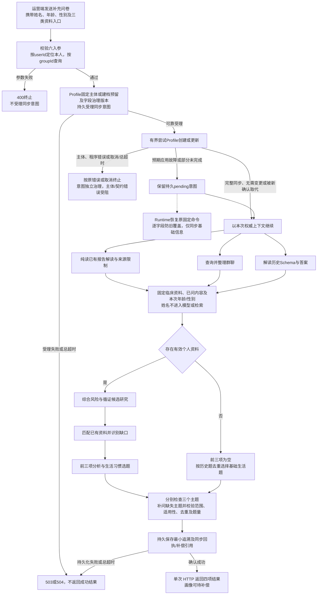

# 健康分析生成接口需求

- 状态：六入参和四项输出已接入真实 Profile 公共确认端口，统一集成候选含请求内同步及 Runtime 补偿。真实在线依赖、效果与部署待验收。
- 更新日期：2026-11-18。
- 本次修订：补充问卷发布前审核题干及选项，发现问题时改写并复审。
- 核对基线：`develop@c0b75ac`，迭代分支 `refactor/health-analysis-questionnaire`。原离线交付和前置依赖见 [I-047](../../ISSUE.md#i-047-健康分析b0前置交接与公共纯读依赖)。
- 配套文档：[健康分析生成接口实现计划](../architecture/health-analysis-implementation-plan.md)。
- 业务依据：[项目流程图](项目流程图.png)、[11月合作方接口文档](<问卷和报告接口文档/树兰-灵犀接口文档（11 月份）.md>)。
- 对外契约见 [API.md](../api/API.md#生成健康分析)。必要确认受理或追溯无法可靠保存时返回 503，耗尽请求总期限时返回 504。跨模块交付见 [I-048](../../ISSUE.md#i-048-双来源基础信息与共享profile交接)。

## 1 业务目标与职责

健康分析生成属于流程图第二部分“检测过程中的信息收集”。运营人员在运营端执行“发送补充问卷”时，运营端请求本接口。接口利用已经取得的用户资料，形成综合健康评价、建议补充的检查项目、健管师深入沟通问题和新的补充问卷，供运营端后续使用。

本功能承接并改造项目现有整份问卷的报告分析、风险识别、循证因素研究、信息缺口规划和问卷生成能力。这是同一业务能力的演进，不另外保留一套内容相同、规则各自变化的新问卷产品。

健康分析与 Record 是两个独立业务部分。Record 继续承担原有逐题建档及其会话流程；健康分析拥有独立入口、应用服务、分析规则和执行身份，不以 Record 会话、建档完成状态或提交接口作为前置条件。公共画像、知识库、模型网关和只读工具可以复用。

本接口只生成并返回四项数据。补充问卷的发放、客户端填写及答案回传由外部业务系统负责，本接口不承担问卷提交、填写进度、草稿过期、自动发送、Chat 转换或最终报告触发。

新增基础信息属于用户明确确认的输入，通过Profile公共命令更新该userId的本人画像；该写入与AI分析结论分开。画像同步暂时失败时，本次分析仍使用上传值，更新由已可靠受理的补偿机制完成，不增加面向客户端的分析任务或第五项业务输出。

## 2 已确认的业务决策

| 编号 | 已确认需求 | 业务含义 |
|---|---|---|
| HA-001 | 将现有整卷问卷能力改造为健康分析生成。 | 继承原问卷中仍适用的内容与循证要求，不只更换接口名称。 |
| HA-002 | 与 Record 完全区分。 | 不借用 Record 的业务生命周期、会话状态或完成门禁。 |
| HA-003 | 运营端“发送补充问卷”触发请求。 | 每次显式请求分析当次取得的资料，不自动循环发卷。 |
| HA-004 | 请求携带必填的 `userId`、`name`、`age`、`gender`、`groupId`、`surveyList`。 | `name/age/gender` 为用户确认的基础信息；`surveyList` 每项包含问卷 `schema` 与该问卷的 `answer`。 |
| HA-005 | 按用户读取已上传体检报告的解读数据。 | 用户未上传或没有可用解读时，该来源为空。 |
| HA-006 | 按群组使用现有聊天记录查询工具。 | 取得用户与工作人员的实际沟通资料，保留来源和身份。 |
| HA-007 | 合并已有问卷答案参与分析。 | 正确解读每份问卷中的题干、选项与答案，不只读取答案代码。 |
| HA-008 | 有什么资料就使用什么资料。 | 在参数和资料归属校验通过后，三类临床来源相互独立；查询失败按空处理。基础信息同步失败另走可靠补偿，不丢弃本次权威输入；主体归属、取消、程序及持久受理或追溯交付错误不降为空来源。 |
| HA-009 | 三类来源均无可用于个体分析的资料时，综合健康评价、检查建议和健管师问题清单为空。 | 问卷按已回答主题及生活题去重生成。三类资料全空且无历史题时，返回三个基础主题和十道生活习惯题。 |
| HA-010 | 单次 HTTP 请求等待四项结果。 | 同步完成分析并一次返回，不采用新任务轮询、SSE 或结果回调。 |
| HA-011 | 综合健康评价整合摘要、风险和因素分析建议。 | 不将报告摘要、风险列表和因素结果相互割裂地输出。 |
| HA-012 | 补充材料指进一步建议完成的检查项目清单。 | 不是泛化的资料上传提示，也不扩展为治疗或购药方案。 |
| HA-013 | 健管师问题清单用于详细开放沟通。 | 采集具体经过、时间、变化和执行困难等不适合短选项的内容。 |
| HA-014 | 补充问卷面向可以选项化回答的问题。 | 新生成卷使用单选和多选；详细描述需求放入健管师清单。 |
| HA-015 | 生活习惯题与已有问卷、已有资料及本卷其他题目去重。 | 历史题未答仍参与生活题去重；基础主题按 HA-019 分别判断是否补问。 |
| HA-016 | 健管师清单允许与问卷主题相关并深入展开。 | 两类问题可以互补，不能用跨列表主题排斥误删有价值的详细问题。 |
| HA-017 | 生成内容尽可能寻找自有循证知识库依据。 | 继承明确检索、材料适用性、引用校验和个人匹配职责。 |
| HA-018 | 问卷的回答由前端客户端实现。 | 新接口只输出四项内容，不增加本项目内的新提交与答后查询流程。 |
| HA-019 | 分别判断主诉或健康目标、个人疾病史、血亲家族史是否已回答。 | 任一可用来源明确回答有、没有、不清楚或记不清时跳过对应主题；仅对缺失主题按原顺序补问。 |
| HA-020 | 按本次上传年龄和性别执行适用性判定，保留性/性征相关内容限制。 | 男性不问本人子宫、宫颈相关问题，女性不问本人前列腺、睾丸相关问题；有明确依据的年龄限制执行过滤，不用好发年龄冒充排除依据。 |
| HA-021 | 每份新问卷目标为 10～20 题，去重优先。 | 实际保留的基础主题计入总数，上限20题。生活题不足10题时按总题数判断；合格题确实不足时允许少发。基础主题都已回答且生活题已覆盖时返回无新题。 |
| HA-022 | 按合法userId定位本人资料，按groupId查询群聊。 | 不新增登录、用户群组关系证明或访问控制提供方；仍检查资料及固定主体的归属、生命周期和版本，不跨用户或亲属复用引用。 |
| HA-023 | 每份成功结果具有已持久保存的最小追溯记录。 | 四项结果、实际采用的基础信息及临床资料、同步回执或补偿引用、医学依据和问题关联在成功前保存；必要持久化失败明确报错。 |
| HA-024 | 用户上传的姓名、年龄、性别是本次权威基础信息。 | 三项必填，不从画像、报告、聊天、问卷或姓名推断缺失值；仅有基础信息仍进入HA-009，不据此生成前三项临床分析。 |
| HA-025 | 核对并同步本人画像基础信息，失败时可靠补偿。 | 一致时不制造重复事实，差异或缺失时以上传值更新；首次由Profile显式创建本人基础画像。同步失败不阻断分析，补偿须持久受理，旧确认版本不得覆盖新信息。 |
| HA-026 | 新问卷须通过发布审核。 | 同一次审核检查实际待发整卷和每题的题干及选项。根据问题原因删除或改写，发布最终合格卷。用户可以留空，历史问卷按原题及选项解码。 |

后续章节细化上述业务决策。当前 API 与实现使用原路由、包络、四项类型、空值和平铺答案。新增的三项基础信息通过统一集成候选的 Profile 公开端口受理及应用。

## 3 此前问卷需求的继承与调整

### 3.1 继续继承的要求

| 原有能力或要求 | 新健康分析中的要求 | 主要依据 |
|---|---|---|
| 资料整理、风险分析、循证候选、个体匹配、缺口问题的五步流程 | 保留完整职责和可追溯的中间关系，三类资料共同参与。 | [五步循证设计](../architecture/record-questionnaire-evidence-workflow.md) |
| 使用全量可用报告证据，而非只取前几个异常 | 分批整理已保存的正常、异常、阴性、影像和相关背景，保留覆盖范围。 | [现有问卷实现](../../wiki/record-questionnaire.md) |
| 五类24个生活细项 | 作为可复用的采集目录，结合已有答案和真实缺口选题。 | [本域生成政策](../../modules/questionnaire/generation_policy.py) |
| 主诉或健康目标、个人病史、血亲家族史 | 依次补问三个主题中尚未回答的项，按资料规划生活习惯题。 | [功能演变](record-questionnaire-evolution.md) |
| 题目与选项具体、中性、可直接回答 | 保留短选项、明确含义、无泛化占位和无虚构输入能力的要求；沿用现有允许不回答的政策。 | [规划提示词](../../prompts/questionnaire/report_plan.md) |
| 问卷与健管师清单共同规划 | 同时考虑两类渠道，按信息维度和回答深度分工。 | [现有生成逻辑](../../modules/questionnaire/generation.py) |
| 未回答、未知、明确否认和冲突分开处理 | 跨问卷、报告与聊天合并时仍保留这些语义。 | [此前需求对照](record-questionnaire-requirements-analysis.md) |
| 医学依据与个人资料依据分离 | 候选因素必须同时说明医学关系和该用户的实际支持程度。 | [循证与匹配要求](../architecture/record-questionnaire-evidence-workflow.md) |
| 来源、原文、条件和适用范围校验 | 不以模型生成的链接、引用标签或相似标题代替真实材料。 | [现有因素分析](../../modules/questionnaire/factors.py) |
| 局部不合格内容过滤 | 保留其他合格评价、建议和问题，不因单条无效强行回退整份基础卷。 | [问卷生成与降级](../../wiki/record-questionnaire.md) |
| 年龄、性别、特殊阶段及主体适用性 | 本次上传年龄、性别用于当前本人适用性；特殊阶段、历史和亲属按各自明确资料处理，不由姓名或性别推断。 | [规划与表达约束](../../prompts/questionnaire/report_plan.md)及HA-020、HA-024 |
| AI分析不自动变成患者事实 | 风险、因素、建议和新问题不自动写成事实；用户明确确认的三项基础信息走独立Profile写入命令。 | [画像公共契约](../../wiki/profile-public-contracts.md)及HA-025 |

### 3.2 按本次需求调整的规则

| 此前问卷规则 | 本次处理 |
|---|---|
| 仅接收当前问卷上传的文件 | 改为读取用户已有画像关联报告、外部群聊及多份传入问卷。 |
| 固定3道背景题、7道生活题、最多5道报告补充题 | 根据实际回答补齐三个基础主题，按可用资料规划生活习惯题。总题量目标 10～20，去重优先。 |
| 无报告时补齐默认10道基础题 | 有其他个人资料时照常分析。无有效资料时前三项为空，按缺失主题及生活题去重生成问卷。 |
| 当前问卷没有答案时先生成，提交后再分析因素 | 将请求已携带的答案在本次同步分析中用于个体匹配。 |
| 问卷和访谈共用已占用信息目标去重 | 改为分别判断采集内容和深度，允许同主题的深入访谈。 |
| 只比较信息目标枚举及题干原文 | 增加全部已有问卷与新卷之间的语义重复检查。 |
| 性别主要从报告或画像取得 | 改为本次必填上传值优先；画像用于核对和同步，报告、答案、聊天不覆盖本次确认值，参数缺失或非法直接报错。 |
| 健康分析只读画像 | 报告读取仍纯读；新增用户确认基础信息的显式写入及可靠补偿，不把AI推断升级为画像事实。 |
| 新答案只能由本项目提交接口进入 | 外部系统在后续显式请求中传入更新后的问卷列表和答案。 |

### 3.3 不进入新业务的旧生命周期

新健康分析不使用旧问卷的 `sessionId` 占用、`ready` 后两小时有效期、一次性提交、提交指纹、答后异步因素任务、因素结果 GET、Chat 放行或问卷来源画像投递作为运行前提。已接收的历史任务、旧提交回执及下游兼容仍须由原链路维护，不能因新需求而直接删除。

旧 Record 的逐题承接、末尾答疑、题数计数和完成规则继续归 Record 管理。它们不转化为新健康分析的产品要求。

## 4 权威基础信息与三类临床资料

### 4.1 用户确认的基础信息

请求顶层必填 `name`、`age`、`gender`，与 `userId/groupId/surveyList` 一起构成六个业务入参。来源为合作方提交 `c5c8501` 所列字段及用户明确的准确性声明。`name` 为去首尾无意义空白后的非空字符串；`age` 为0～150周岁整数，数值0合法，布尔值、字符串和小数不代替整数；`gender` 仅为“男”或“女”。缺失、null、空值或非法类型/枚举均为参数错误，不通过读取画像补齐。

本次确认值优先于画像既有值以及报告、聊天、问卷中对姓名、当前年龄和性别的描述。以请求 `userId` 和本人范围定位画像，不按姓名匹配、搜索其他用户或重新归属报告；姓名不同不改变主体归属，也不成为拒绝合法更新的理由。保留旧资料及其时间和来源，不能为消除差异改写原报告或历史答案。报告中的历史年龄不自动等同当前年龄冲突。

年龄和性别是分析与问题适用性的明确上下文，可引用本次请求字段及确认时间；姓名仅用于画像核对、更新和受控追溯，不进入医学检索、模型分析正文或普通日志。不凭姓名猜性别，不因年龄和性别推断孕哺、精确生日或其他未上传信息。已知的三项信息不重复采集。

基础信息单独保存为权威上下文，不作为第四类临床资料，也不单独使 `hasPersonalData` 为真。即使三项齐全，三类来源均无可用于个体分析的资料时，前三项仍为空，按 HA-009 生成缺失主题与生活题；问卷按本次年龄和性别检查适用性。

### 4.2 请求携带的问卷列表

每项 `surveyList` 中，`schema` 是该份已发问卷的定义，`answer` 是对应的实际回答。问卷顺序、页面、题目名称和选项映射必须按各自问卷解释；两份问卷可以有相同题目 `name`，不能相互覆盖或串用选项。

已有问卷可包含附件协议的 `text`、`radiogroup` 和 `checkbox` 三种题型。新生成的补充卷只使用单选和多选，详细自由描述进入健管师清单。底层协议支持文本题，不代表本次新卷必须生成文本题。

所有已有问卷题目都进入“已问内容”集合，包括未作答的题目。只有真实有效的回答才进入个人资料集合；题干、预设选项和问卷说明不是用户已经具有的健康情况。

答案解读继承以下规则：

- 文本保留原意，去除首尾无意义空白；不能删除否定、条件或时间限制。
- 单选答案按本题 `choices.value` 映射到对应文本；不能让模型猜代码的含义。
- 多选去重并保留声明顺序；普通答案必须属于本题选项。
- `["none"]` 表示在本题范围内明确“以上均无”，属于有效回答；不能外推到所有疾病或全部时间。
- 未作答、空文本、空数组和“不清楚”分别保留状态，不加工成“没有”。真实回答“不清楚”保留为已收集的未知状态，不是空文本，也不构成肯定或否认。
- 输入含相互矛盾的选择或多来源冲突时，保留原始来源并校验，不静默改写成自洽结论。
- 病史名称不明确时保持不明确；家族病史不转成本人确诊；咨询某种疾病不代表患有该疾病。
- 外部问卷的必填字段未回答时，可作为部分资料分析；本接口不是原问卷提交校验器，不替客户端拒绝一份尚未填完的问卷。
- 非法选项值、题型和结构仍须明确报参数错误，不能假装为正常缺资料。

`answer` 的包裹层存在原始资料冲突，统一建议见第12节；不得在实现中靠任意字段名猜测其形状。

### 4.3 用户已有的体检报告解读

接口根据 `userId` 取得该用户本人的已有报告解读。资料读取应覆盖已经保存且归属该本人主体的检查结果、单位、参考范围、日期、影像所见、原报告诊断、处理质量和相关来源信息。

读取已有解读不等于只读取已经进入画像的有效事实。无明确日期、尚未进入事实投影或仍待核实的已保存项目，可以作为带有限制的来源资料；不能因为可见而变成已核验结论。报告的简短 `aiSummary` 可供参考，不能替代完整结构化结果或本次综合分析。

用户未上传、没有可读解读或该来源查询失败时，体检来源按空处理，继续利用其余资料。已有多份报告时保留各自日期与来源，不无条件只取最新一份，也不把不同日期的真实项目按名称和值合成一条。

读取遵守用户、本人主体、固定解析版本和来源生命周期。撤回、退休、缺档或无法证明归属的资料不能从其他旧索引回退取得。新接口不要求重传 `fileList`，不为本次健康分析重新下载、OCR、解析或发布报告。

完整资料同时包括已保存的原解读和当前可用的来源贡献，二者保留各自固定身份、版本、生命周期和对应关系。原解读为空但仍有合法可用贡献时，不能将体检来源整体判空。某轮原解读缺档而另有仍有效的既有贡献时，按各自真实身份和限制使用，不能将其伪装成缺档轮次的结果；已撤回或退休资料仍不可回退复活。重叠镜像只计算一次，不同日期的真实独立记录继续保留。

### 4.4 用户与工作人员的群聊

接口按 `groupId` 调用现有群聊查询工具，处理实际取得的记录。消息按服务端消息ID去重、按实际时间整理，保留原始记录定位和撤回状态。

- 用户对自身情况的陈述可以作为自述资料。
- 工作人员的问句、医学建议、假设和 AI 回复不能直接当作用户实际情况。
- 工作人员转述的资料需要保留“转述”身份和支持程度，不能改为用户直接作答。
- 家属或其他群成员的信息保留其主体；无法确认发信人归属时，不默认视为用户本人。
- 撤回内容、系统通知和与健康无关的闲聊不作为个人健康证据。
- 图片和文件消息保留已发送材料的线索；本期不因群聊出现 URL 而自动重新解析附件。已有报告解读仍从画像关联资料取得。
- 查询工具只保证本次上游响应，不能据 `chatLogsNum` 推断取得了全部历史。材料不足时不将“本次未见”改成“从未发生”。

发送人映射和上游是否支持完整分页属于接入依赖，需由接口提供方确认；不能用模型猜测身份或杜撰分页参数。

群聊按第4.6节的合法groupId直接查询。查询服务失败可按空来源继续；发送人归属不明时排除其患者自述身份，并保留覆盖限制，不把未知发送人的内容归给本人。

### 4.5 资料合并与有效性

临床资料保留来源种类、实际内容、主体、发生时间、获取时间及原始定位。不同临床来源相互支持时可以建立关联，不能解释的冲突保持显式状态；本次基础信息的当前取值按第4.1节定优先级，不让模型重新投票选择性别或年龄。

健康目标、明确否认、数值0和阴性结果都是有意义的资料。用户明确回答“不清楚”或“记不清”时，保留原始回答及未知状态，对应的基础主题视为已回答。只有真实未知、待核实观察、系统通知或不可读附件线索时，前三项为空。缺失、null、空文本和空数组视为未答。

分别判断资料能否用于个体分析、三个基础主题是否已回答以及生活题是否已覆盖。合法历史 Schema 即使 `answer={}` 也参与生活题去重，基础主题根据实际回答单独判断。填写姓名、年龄和性别或创建基础画像均不会增加临床资料。没有可用于个体分析的资料时，按 HA-009 生成问卷。

### 4.6 API参数与资料归属

本项目按既有API边界提供后端服务：合法的 `userId` 用于定位该用户的本人画像和资料，`groupId` 直接用于群聊查询。请求无需额外的调用方登录、网关身份、用户与群组关系证明或新增访问控制服务；缺少这些未约定的依赖不是503原因。

参数校验后，Profile和Document仍按固定userId与本人subjectId核对资料归属；跨用户、亲属或错误主体的引用不能读取、更新或重新绑定。群聊发送人映射只用于识别患者陈述，不作为额外接口门禁；映射未知时保留覆盖限制。后续恢复继续校验固定主体、生命周期、命令状态和版本，不要求凭据续期或重新取得外部证明。

### 4.7 本人画像核对、更新与补偿

Profile通过显式公共命令核对本次基础信息与该userId的本人画像：一致时不制造重复事实，但仍登记本次确认的来源、时间及治理版本；姓名、当前年龄、性别不同或缺失时，以上传值更新当前有效表示并保留来源、确认时间和变更记录。不存在本人画像时，由该命令通过固定建档预留创建基础画像；报告reader不得因此隐式创建主体或承担写入。只有这三项用户确认信息进入该命令，AI风险、因素、建议和新问题继续禁止自动转为事实。

年龄记录必须有确认时间，不由整数年龄反推出生日。报告年龄只表示报告观察时点的年龄。本次明确确认独立保存“确认周岁＋确认时间”：只有已有生日具有独立可信来源，并且在该确认时点计算的周岁与上传值相符时，画像实时年龄才按该生日计算；不使用本次整数年龄反向制造或提升生日可信度。生日缺失、来源不可信或不相符时，保留最近有效确认时点的年龄并明确标注，不自动逐年增长。冲突生日保留原来源并标记待核实，不能遮盖确认年龄。原报告中的日期、年龄和性别不回写；历史和亲属资料按各自主体及时间保留。

画像实时读取按Profile统一日期基准的asOf计算可信生日年龄，生日是否相符则始终按原confirmedAt判断，不能用迟到补偿执行日。固定分析和历史快照沿各自固定时点保存结果、依据及版本，重放不随今天日期改变。当生日依据撤回、删除或不再可信时，仅回退到仍有效且未被治理屏障排除的最近确认年龄，不能恢复已失效来源。没有独立可信生日时，概览和当前值消费者均表达确认时点年龄及确认时间；本次健康分析始终采用请求快照，不因画像跨生日或后续更新改变当次年龄。

目标Profile公共契约共用ageBasis语义：reported_at_report表示报告时点年龄，confirmed_at_time表示用户确认时点年龄，dob_derived表示独立可信生日派生年龄，并提供确认时间、计算时点和依据引用供当前值消费者一致使用。该元数据不增加健康分析的第五项业务输出；代码阶段按提供方新版本实现，不原地修改历史快照。

同步意图先可靠受理，再有界尝试应用到Profile。应用失败、暂不可用或部分更新尚未完成时，当次分析继续使用固定上传值，未完成部分由Runtime管理的持久补偿队列重试。回执区分已同步、无需变更、待补偿和已被新版本取代，部分成功不伪装成三项全部同步；仅在目标版本的三项当前有效信息均已完成后确认同步成功。

可补偿的是已可靠受理操作的预期依赖故障、局部应用超时或暂时并发竞争。主体归属或绑定错误、取消、程序错误和总期限耗尽不被宽泛捕获为pending成功；相应失败继续按主体冲突、内部异常或总超时处理。

确定的主体拒绝或程序契约错误将意图置为受阻、需处理，不能自动重试绕过校验；重驱仍复核固定用户与主体归属、生命周期、字段治理版本及命令取消状态，不引入登录或证明续期。请求取消或总超时不等于撤回此前已可靠受理的合法确认；显式取消持久命令则须阻止其后续投递，二者与受阻状态分别治理。

每份同步意图固定操作标识、内容校验值、userId、subjectId、主体生命周期版本、确认时间、规范化三项值及Profile提供的字段治理版本。首次没有本人主体时，Profile先提供绑定唯一subjectId和生命周期的稳定建档预留，所有本人创建入口共用；回执丢失、恢复或重驱只能找回原操作及预留，不能重新查找“当前本人”后改绑。原主体失效或生命周期变化时，旧命令受阻，不能创建替代主体继续执行。

Profile统一维护姓名、年龄、性别的字段治理屏障；健康分析本域的confirmVersion只用于投递关联，不能代替该屏障。既有主体编辑、事实确认/更正/删除及新显式确认共同参与同一治理协议。后来的人工更正或删除推进相应字段版本，使此前已受理旧确认对该字段失效；旧来源恢复和自动摄取也不能重领新版本覆盖当前确认。删除不等于永久禁止未来输入：后续明确的新HTTP请求可作为新的用户确认按公共规则有意改值，同一操作的重试和重驱不能获得这种新资格。未受影响字段可继续按原版本完成。

相同值也必须由Profile持久登记本次确认来源、时间与字段治理版本，并推进防旧覆盖水位，才可返回“无需变更”。当前年龄恰与生日推算相等时，同样保留独立的用户年龄确认依据，不能依附生日来源而在其失效后丢失。复用等价事实或补充确认来源时不重复建事实，也不把报告自动来源或模型置信度伪装成用户确认。

字段更新与其发布回执使用Profile公共写计划和CAS：恢复逐字段复核原操作、固定主体及治理版本，已完成字段幂等返回，版本落后字段标记被取代，未完成且仍有效字段继续。部分完成不表示三项均已同步；其他入口的治理不能被补偿方重读最新版本后重新解释为旧操作的新确认。失败记录可查、可退避重试和重驱，补偿只更新基础信息，不重新分析、不发卷、不触发Report。

HTTP 200表示本次四项结果及追溯已完成，且必要同步意图已可靠保存；画像本身允许处于待补偿状态，不承诺返回时立刻读到新画像。意图无法可靠受理或成功前追溯无法持久确认时，返回503；总期限耗尽返回504。已经可靠受理的用户确认更新不因随后分析失败、响应丢失或断开而回滚，补偿可继续，但不得覆盖较新确认或复活已失效主体。

## 5 分析流程

有有效个人资料时，五步职责继续作为新接口的业务核心。它们可以按预算合并部分模型调用，但不能只用一个四字段提示词替代来源整理、循证检索、个体匹配和程序校验。无个人资料时进入基础问卷分支，不运行个体风险或因素推断。

| 步骤 | 输入与工作 | 必须形成的关系 |
|---|---|---|
| 资料整理与问题识别 | 整理三类资料、历史题及本次年龄和性别，确定可用于个体分析的资料和三个基础主题的覆盖情况。 | 资料到报告、消息或答案的定位；基础信息到请求字段和确认版本的定位。 |
| 综合风险分析 | 有临床资料时，结合本次年龄/性别和多项资料说明关注方向及限制。 | 风险到实际个人证据的对应，不将人口学信息或每项异常机械等同疾病。 |
| 循证候选研究 | 优先查询自有知识库，检查原始材料、年龄/性别范围、主体及时间条件。 | 风险、候选、医学关系、适用依据与待核实条件，不编造年龄阈值。 |
| 已有信息匹配 | 当前年龄/性别只取本次确认值，其他条件使用报告、聊天和答案核对。 | 支持、反证、未知、冲突及信息缺口；已有明确基础信息不重复询问。 |
| 补充内容规划 | 生成有依据的前三项，补充尚未回答的基础主题与适用生活习惯题。无有效资料时仅生成问卷。 | 两类问题分工、历史生活题去重、适用性及整卷10～20题目标。 |

后续运营再次请求时，应携带当时准确的三项基础信息及可用问卷列表和答案，接口固定新的确认版本，重新读取可用群聊和报告并更新判断。每次分析使用自己的基础信息快照，不因并发的后续画像更新改换本次年龄或性别。接口不自动等待新卷作答或签发下一轮；客户端应传入需要排除的全部历史问卷，不能保证排除未知问卷。

## 6 四项输出的内容要求

### 6.1 综合健康评价

`healthReview` 应形成可读的综合说明，覆盖已有资料概况、主要健康目标、需要关注的风险、相关因素支持情况、反证与剩余不确定性，以及适当的后续方向。

评价不能只拼接现有摘要函数选出的前几个异常项，也不能简单复制报告原有 `aiSummary`。应考虑与当前目标有关的正常、阴性、否认及多份报告的时间差异。只获得部分资料时，结论范围限定于已取得的内容。

风险关注、因素存在、因素可能相关和已确立因果是不同判断。用户肯定某项行为不能自动成为确定病因，原报告已有诊断也不能改写为本接口新作出的确诊。无充分依据时表达未知和限制，不强行给每个风险安排一个原因。

有资料但没有需要新增的检查或沟通问题时，相应项可以为空。新卷补齐未回答主题及合格生活习惯题，按历史生活题去重及整卷10～20题目标生成。合格题不足时可少发，三个主题均已回答且生活题已覆盖时返回空卷。

### 6.2 补充检查项目

`suggestedMaterials` 是建议进一步完成的检查项目清单。每项至少表达检查名称、建议目的或理由，以及适用条件；必要时提示与医生讨论是否适合。

生成时检查现有报告、问卷及群聊是否已提供足够相关结果。已完成且足以回答当前问题的检查不重复建议；如因时间或结果变化需要复查，应说明实际原因，不能只因为“曾经异常”机械重复。

不同说法但目的相同的检查建议应合并，优先对当前判断有价值的项目。没有依据时返回空，不用通用体检套餐补齐，也不扩展为药物、治疗、产品或服务购买清单。

### 6.3 健管师深入问题

`advancedQuestions` 是供工作人员沟通的问题清单，优先收集症状经过、具体时间和数值、用药名称与变化、治疗反馈、生活场景及实际执行困难。

问题应可直接用于沟通，说明希望了解的内容及其用途，不把模型候选当成用户已经存在的事实。适用前提尚不明确时使用条件表达；已有明确答案时直接利用，不再重复询问同一细节。

健管师清单可以与问卷涉及同一主题，但须新增内容或深度。它不受“问卷已经出现此主题，所以访谈全部删除”的限制；自身仍应去重。

### 6.4 新的补充问卷

`advancedSurveySchema` 沿用约定的 `title / description / pages / elements / choices` 结构，题目名称在新卷内唯一，选项值在题内唯一并保持稳定。

独立判断主诉或健康目标、个人疾病史、血亲家族史是否已回答，将缺失项按此顺序放在生活习惯题之前。问卷、可归属本人的群聊陈述或可靠报告内容能够明确对应主题时，肯定、否认以及明确的“不清楚”“记不清”均可覆盖。同一主题存在不同明确回答时，保留冲突和各自来源，跳过该基础题。

只有历史题目或答案留空时补问。仅有检测结果、待核实观察、工作人员的推测或归属不明的陈述时，主题仍待补充。本人明确陈述的血亲疾病可覆盖家族史，保留血亲主体。

三类资料全空且没有历史题时，返回三个基础主题与十道基础生活习惯题，共十三题。综合评价、检查建议和健管师清单为空。仅有“不清楚”等真实未知回答时同样只生成问卷，并跳过对应的基础主题。

每份问卷总题数目标为 10～20，实际保留的基础主题计入总数。生活习惯题的上限为20减去基础主题题数。相关生活习惯优先，必要时从未问过的通用生活目录补充。通用题使用基础采集目的。

去重优先于 10 题下限。合格生活习惯题不足时可少发，缺失的基础主题仍优先返回。三个主题均已回答且生活题已覆盖时返回约定空值。题数按范围、适用性和去重校验后的实际题目计算，健管师清单单独计数。

没有合格新问题时不能用无题页面、`pages: []` 或虚构通用题制造“有效问卷”。空卷仅使用约定空值，具体编码建议见第12节。

少题或空卷须以第7.4节的候选处理和覆盖记录为依据。空卷仅表示当前政策版本支持的候选范围内没有可发布新题，不表示所有可能的健康信息均已收集；模型本轮少生成或覆盖流程未完成不能证明候选耗尽。

## 7 问卷内容与问题分工

### 7.1 可复用的采集目录

以下原有24生活细项继续作为内容资产，而非每次必问清单：

| 类别 | 可复用细项 |
|---|---|
| 饮食与饮水 | 食物搭配、主食份量、甜食甜饮、咸味加工食品、进餐规律、夜宵、饮品种类、饮水量。 |
| 作息与睡眠 | 睡起时间、睡眠时长、工作日与休息日差异、睡前习惯。 |
| 运动与日常活动 | 活动类型、运动频次、单次时长、连续久坐、起身活动频次。 |
| 烟草与饮酒 | 吸烟情况、二手烟接触、饮酒频次、单次饮酒量。 |
| 压力与放松 | 放松方式、日常休息安排、忙碌时的休息节奏。 |

主诉或目标、个人史及血亲家族史按缺失情况依次补问。此前报告深入信息目录继续作为分析和健管师开放沟通的内容资产，生活题沿用生活习惯题目录：

| 深入信息方向 | 需要区分的内容与渠道 |
|---|---|
| 手术与重大治疗 | 分析已有资料；确有沟通价值时由健管师了解发生情况、时间、治疗过程和前后变化，不放入生活卷。 |
| 用药、补充产品与治疗反馈 | 分析已有资料；健管师可了解名称、目的、时间和效果变化，不在生活卷增加用药或治疗存在性题。 |
| 饮食改变、近期感染、接触史和食物耐受 | 日常饮食行为按生活目录采集；感染、临床接触或耐受细节用于分析和开放清单，不将待问条件当成已经存在。 |
| 排便变化和其他症状 | 区分已有记录的时间和程度；需要详细核实时进入健管师清单，不扩展为生活卷中的症状筛查。 |
| 体重变化、警示症状和活动受限 | 用于有依据的分析或健管师沟通，不对每个人逐项筛查，不加入生活卷或完整基础卷凑题。 |
| 检查与复查跟进 | 已有结果直接利用；需了解的检查细节交由健管师，不作为生活习惯题。 |
| 支持条件与执行困难 | 了解可获得的帮助、实际生活场景及依从困难，主要由健管师清单承载。 |

这些方向继承[此前规划提示词](../../prompts/questionnaire/report_plan.md)已整理的信息目标，保留分析与开放沟通价值。问卷的选题范围为尚未回答的三个基础主题及生活习惯题。

继承相关性优先和避免连续重复同类内容的原则；不足目标题量时可从未问过的合格通用生活项补充，仍以去重优先，不强制达到10题。已有控制题库可以复用，但题干、选项和说明必须重新检查是否适合新接口；例如暗示“也可以描述实际容量”的题干不应原样放入只交付选项的新卷。

### 7.2 题型和选项

- 可选项新题使用 `radiogroup` 或 `checkbox`；不能把 Record 内部 `radio` 类型直接输出为附件协议。
- 一题围绕一个明确采集目标，优先询问存在性、类型、频次和适当范围。
- `title` 写实际问题，`description` 写必要的简短说明或条件；不把流程介绍写成题目。
- 选项具体、独立、简短，能够区分后续判断条件，不使用“某种疾病”“其他疾病”等泛化占位。
- 不把多个独立答案、解释或示例拼成一个按钮；合法数量范围、分数和单位应正常保留。
- 不出现“其他请填写”“点击后输入”“上传报告”等客户端未约定能力，也不以“拒答”“跳过”代替实际答案。
- 保留具有实际含义的明确否认，例如“从不吸烟”或互斥项“以上均无”。新卷各题均可留空。特定选项的限制按确认的规则执行，历史中的明确未知仍按原义处理。
- 新题选项数量和长度可继承当前合理的发布校验；问卷总题数目标已明确为10～20，并遵守去重优先的不足10题例外。
- 详细文字、精确经过及复杂多条件回答进入健管师清单，不为维持选择题而制造冗长选项。

### 7.3 语义去重与互补

去重范围包括全部传入旧问卷、新补充卷自身、已明确回答的个人信息及健管师清单自身。已有题未作答也不能换一种措辞放入新卷；问卷 `name` 相同与否不能替代语义判断。

| 场景 | 处理要求 |
|---|---|
| 旧题“每周运动几天”，新题“您一周有几天锻炼” | 采集同一信息，删除新题。 |
| 旧生活题未答，新题只更换名称或选项顺序 | 生活题仍视为已问；未答基础主题按第6.4节补问。 |
| 问卷已询问“是否用药” | 新卷不再询问同一存在性；健管师可以深入询问药名、时间和变化。 |
| 群聊已经明确说明某条件 | 利用已有资料，避免新增同一采集题。 |
| 多个候选因素共同缺少一个条件 | 尽量用一题采集并关联多个候选，不按候选重复生成。 |
| 通过更换信息目标标签或时间修饰词制造新题 | 不自动视为新内容，须判断是否采集真正不同的信息。 |
| 已有答案互相冲突 | 保留冲突，可由健管师核实具体情况，不用一份重复选择题掩盖冲突。 |

问卷与健管师清单不共用一个简单的“主题已占用”集合。应比较实际内容、个人已有信息和回答深度，使选择题负责可编码条件、开放问题负责细节。

### 7.4 候选范围、覆盖与补题终止

以现有24细项作为版本化生活信息目标目录，允许的细分目标及范围显式列入同一政策版本。目录用于覆盖检查，实际题目按相关性和已有资料选择。模型改写题干不自动产生新目标。三个基础主题独立于生活信息目标目录。

逐目标保留可问、历史题已覆盖、已有个人资料覆盖、不适用、判断不确定等处理状态及依据。覆盖比较包含题干、说明、选项、主体、时间范围和回答粒度；允许一道旧题覆盖多个目标，不能仅凭名称或facet标签判断重复。

信息目标状态与生成题目的发布校验状态分别记录。某道题选项非法、措辞不合格或无法可靠判重，不代表它对应的信息目标不适用或已经覆盖；目标仍可问时，尝试其他合格题、目录模板或有界补题。

先生成相关性较高的合格问题。基础主题和生活题通过发布校验后总数不足10题时，从尚未处理的合格通用生活目标中有界补题。达到10～20题即可结束；正常返回少于10题或空卷时，须记录本期候选范围的处理覆盖及未发布原因，明确保留尚未生成的可问目标。

单条不合格或无法可靠判重的问题可局部过滤并保留理由，不因此放弃其他合格内容；判断不确定本身不能充当候选耗尽证据。已有10～20道通过全部发布校验的合格题时，未选目标的局部不确定不阻断成功。只有未决目标导致少题或空卷所需的整体覆盖结论无法成立，或不足10题时仍有明确可问目标却无法形成合法题目，才按生成失败处理；总执行预算到期则按超时处理，不伪装成正常少题、空卷或基础卷。候选数量、补题轮次和语义纠正次数在实施计划中设定有界预算。

## 8 循证与个人匹配

### 8.1 医学依据

对需要解释的健康风险和候选因素，优先使用项目现有知识库查询指南、文献等材料。保留实际取得的来源、版本、原文片段、引用及适用范围；只取得摘要时不能假装拥有全文依据。

知识库未配置、失败、无结果、材料不适用和取得有效依据需要分别保留内部状态。既有联网补检索能力可以作为受控的实现延续，但不得将模型自己生成的链接或引文当作检索结果，也不能因此修改其他业务的联网默认行为。

知识不足时保留已有个人资料和中性的补充采集内容，对没有依据的因素与检查建议保守处理。引用存在性检查不能替代材料是否支持关系、是否适用于该用户的判断。不将检索排名或模型信心包装成医学证据等级、疾病概率或确定因果。

### 8.2 个体匹配

医学依据说明一般关联，个人资料说明该用户是否满足条件。两者分别引用，至少保留以下状态：

| 状态 | 需要表达的含义 |
|---|---|
| 支持 | 有明确个人资料满足某项条件，仍须检查其他必要条件。 |
| 反证或不符合 | 实际资料否认某条件或与适用范围不符，不能扩大为排除全部风险。 |
| 未知 | 未提及、未作答、不清楚或缺少时间、程度等必要信息。 |
| 冲突 | 不同来源无法通过时间、主体或范围解释其矛盾，保留各方来源。 |

沿用风险因素、诱发因素、加重因素和可能参与因素等受控关系含义。确认因素存在不等于确定其导致某项异常；不为每个候选添加本次未要求的人工审批流程。

### 8.3 表达与来源

本次 `gender` 为新增本人问题的性别依据，画像缺失、冲突、读取或同步失败均不改变该依据；必填性别缺失或非法在参数阶段报错，不能降为忽略分流。男性不生成本人子宫、宫颈相关问题，女性不生成本人前列腺、睾丸相关问题。范围覆盖题干、说明、全部选项、noneText及健管师开放正文，不只检查题名。既有生活题范围及普遍避免主动性/性征相关问题的限制继续保留，不借此扩展疾病筛查题库。

年龄适用性统一使用本次周岁及确认时点。只有医学材料或版本化规则明确给出适用年龄范围时才硬性排除，边界须可核对；“常见于”“风险较高”等好发年龄只用于相关性排序，不等于其他年龄不可能患病。月龄、孕周等更精细条件未知时不得由周岁补猜，也不由性别推断孕哺状态。

适用性贯穿资料整理、循证候选、个人条件匹配、规划及发布校验，并约束新增检查建议的适用条件。不能据此删除原始报告、历史问题、真实答案或否定已有诊断；历史病史按发生时点处理，家族或其他成员按其主体处理，不机械套用患者当前年龄和性别。问题措辞不合格与目标确实不适用分别记录，少题和空卷仍须具有覆盖依据。

用户可见文案自然、中性、可理解，避免机械重复报告和内部推理流程。正常评价及问卷正文不夹入“模型失败、解析降级、后台处理中”等实现提示。需要说明资料限制时，表达结论覆盖范围，不伪造“完整病史已核实”。

四项业务内容之外的阶段状态、引用映射和覆盖记录留在内部追溯，不擅自增加 `factorAssessment`、`processing`、`provenance` 等公开业务字段。

## 9 缺资料与异常

### 9.1 三类来源的可用组合

有有效个人资料时按五步流程分析并规划生活习惯题。每份问卷独立判断三个基础主题并补问缺失项，生活题按历史去重。前三项按实际依据生成。

| 体检解读 | 群聊 | 问卷有效答案 | 结果要求 |
|---|---|---|---|
| 有 | 有 | 有 | 三类共同参与，保留来源与冲突。 |
| 有 | 有 | 无 | 使用报告和群聊，全部历史题仍参与生活题去重。 |
| 有 | 无 | 有 | 使用报告和答案。 |
| 无 | 有 | 有 | 使用自述与答案，不伪造客观检查。 |
| 有 | 无 | 无 | 根据报告分析并规划生活习惯题，补问报告未回答的基础主题。 |
| 无 | 有 | 无 | 根据实际沟通分析并规划生活习惯题，补问群聊未回答的基础主题。 |
| 无 | 无 | 有 | 根据真实答案分析，不将自述写成检测值。 |
| 无 | 无 | 无 | 前三项为空，按第9.2节生成基础问卷。 |

在参数和资料归属校验通过后，单个资料查询来源失败时继续使用其他已经取得的可用资料。全部资料查询来源故障而没有有效个人资料时，也进入第9.2节，不能直接推导为无问卷。内部保留缺失、故障及历史题覆盖的区别；主体归属、取消、程序和追溯交付错误不进入该降级分支。

### 9.2 HA-009基础问卷分支

| 资料与历史 | 前三项 | 问卷 |
|---|---|---|
| 三类资料全空且没有历史题 | 综合评价、检查建议、健管师清单均为空。 | 返回三个基础主题加十道生活习惯题，共十三题。 |
| 有合法历史题，但答案全部未答或仅为“不清楚” | 前三项为空。 | 补问尚未回答的基础主题，生活题依全部历史题去重。 |
| 去重后合格题总数不足十道 | 前三项为空。 | 返回缺失基础主题及剩余合格生活题，两个范围均无可发布题时返回空卷。 |

合法历史 Schema 即使 `answer={}` 仍参与生活题去重。明确回答“不清楚”的基础主题视为已回答；系统默认未知和未作答按缺失处理。非法 Schema 返回参数错误。

无个人资料时不调用个体风险、健康评价和因素推断去填充前三项，也不为虚构风险执行医学检索。基础题库、问卷规划和语义去重可按实现需要执行；有历史Schema时尤其不能继续断言全部模型调用必须为0。基础题的依据是通用采集目录，不伪造患者异常或个体化循证结论。

仅在去重等发布校验后确实没有新题时，问卷才为空；不能再以“没有个人资料”直接返回四项全空。

### 9.3 不同异常的边界

资料来源获取失败按空处理，不等于非法请求、跨用户或主体引用、模型整体失败、程序错误和最小追溯记录保存失败均伪装成空成功。按所属边界识别错误，不能只依据上游HTTP状态码决定降级；取消继续传播，参数、主体、生成及交付错误按正式契约处理，建议方案见配套计划。

知识库故障不等于患者资料为空。仍可利用已有资料生成受限内容及合格生活题，不将未取得医学依据的推断标为已完成循证。单条候选或问题校验失败时局部过滤；基础卷只在HA-009的明确业务分支生成，不用它掩盖模型或程序整体错误。

### 9.4 同步容量、并发与执行期限

单次同步执行有明确的输入容量、候选数量、检索批次、补题次数和总执行期限。参数及归属校验、排队、同步意图持久受理、有界画像应用、来源读取、检索、生成、纠正及追溯提交共同消耗该期限；不能在超时或取消之后继续启动请求内调用或后台签发问卷。已可靠受理的基础信息补偿具有独立投递生命周期，由Runtime接管，不延长本次HTTP分析期限。新域仍对多个请求共享并发额度。

在B0以代表性合成资料前置验证同步可行性，记录材料规模、模型调用数量、排队时间、总耗时和P95统计口径，再确定容量与预算；B3复核实际实现，B5验证代理与运营端完整等待链路。全量资料、长历史问卷、冲突资料和容量边界均应进入样例，超限与内部覆盖限制明确表达，不静默丢掉关键材料。问卷10～20题及去重优先规则保持不变。

## 10 业务隔离、可追溯与历史兼容

### 10.1 业务隔离

新接口不创建Record会话，不占用旧门禁，不等待问卷提交、不修改Chat状态、不触发Report。Profile写入仅限第4.7节用户明确确认的基础信息及其同步治理记录；分析内容、新题目和候选因素不自动回写画像事实。后台补偿不得扩大为问卷生成或其他业务流程。

### 10.2 成功结果的最小追溯

同一次请求的来源资料与中间关系应可追溯。每次执行以内部运行身份关联通用响应的 `uuid`，在四项内容完成校验后、成功响应前持久保存最小追溯记录；正常个体分析、两类基础卷和正常耗尽空卷均遵守该要求。内部运行身份不增加 `data` 字段，不转化为客户端草稿、提交或结果轮询产品。

记录保存本次基础信息、字段来源、确认时间和版本、画像差异与同步回执或可靠补偿引用，报告固定引用及校验值，聊天和答案的必要快照，实际医学片段，执行/政策/提示词版本，最终四项及过滤、覆盖和绑定关系。姓名仅在必要受控存储中保留；补偿投递进度另行维护，不回写已冻结的分析记录。仅保存可变ID、摘要或发布前关联不足以追溯，不要求全量群聊或模型思维链。

最小记录保存受总执行期限约束，有限重试后仍未确认持久成功则返回明确交付错误；总期限耗尽返回超时，不返回200或伪装成无资料。失败请求的诊断记录可尽力保存，但记录失败不改写原有主体、生成或超时错误。普通访问日志失败与上述成功交付前置条件分别处理。

成功记录已保存但响应丢失时，客户端重试仍按新请求执行；内部记录幂等不等于跨请求结果复用，不承诺首期具有客户端强幂等。

### 10.3 历史兼容

现有 Questionnaire 中尚未完成的生成、待提交问卷、已接收答案、来源投递和因素任务继续按原固定执行版本处理。历史读取、Chat 和 Report 已提交问卷上下文、原回执及画像来源不能因为新入口上线而被覆盖或删除。旧入口停止受理和最终退役的时点单独确定。

### 10.4 普通日志边界

普通日志仅记录关联标识、数量、大小、阶段、状态、错误类别与耗时；姓名、基础信息值、画像差异值、请求答案及四项正文不进入日志。请求开始、参数错误、异常摘要、非法JSON、大正文回退及补偿重试日志均受此限制。医学检索不包含姓名或完整确认载荷，模型分析只接收必要年龄/性别上下文；受控追溯与普通日志分别验证。

## 11 验收标准

| 编号 | 对应范围 | 必须满足的场景与结果 |
|---|---|---|
| AC-01 | HA-001、HA-002 | 新功能拥有独立入口和规则；Record 请求、会话、逐题策略及完成语义不变。 |
| AC-02 | HA-003、HA-010 | 运营请求后等待分析，一次 HTTP 返回四项业务字段，无新任务ID、轮询或回调。 |
| AC-03 | HA-004、HA-007 | 多份问卷按各自 Schema 解码；跨卷同名题不串题；text、单选和多选输入正确。 |
| AC-04 | HA-005、HA-025 | 报告reader纯读完整解读及有效贡献，不下载、解析、创建主体或发布来源；本人基础画像仅由独立确认命令创建，不能藏在读取路径。 |
| AC-05 | HA-005 | 仅存在未核实、无日期或未进入有效事实的已保存解读时，仍按来源状态正确使用。 |
| AC-06 | HA-005 | 跨用户、退休、撤回、缺档和读取中生命周期变化不会泄漏或复活旧资料。 |
| AC-07 | HA-006 | 群聊乱序、重复、撤回、系统消息及未知发送人处理正确，不把建议当用户陈述。 |
| AC-08 | HA-007、HA-019 | 未答、未知、none、明确否认、数值0和阴性均保留实际语义。真实“不清楚”可覆盖对应主题，单独出现时前三项为空；默认未知按未答处理。 |
| AC-09 | HA-008 | 第9节七种有资料组合均能利用可用来源，不因缺报告而放弃其他资料。 |
| AC-10 | HA-008 | 单源资料查询超时或失败按空处理；部分已取得资料可用，其余来源继续分析。主体归属、取消、程序和追溯交付错误不被吞成空来源。 |
| AC-11 | HA-009 | 无有效个人资料且存在历史问卷时，前三项为空，补问缺失基础主题并按历史去重选择生活题。 |
| AC-12 | HA-009、HA-019、HA-024 | 三类资料全空且无历史题时，前三项为空，生成三道基础题和十道生活题；基础信息齐全或已新建基础画像仍适用。 |
| AC-13 | HA-011 | 评价综合风险、因素支持、正常与反证，不只是拼接前几个异常项目。 |
| AC-14 | HA-012 | 检查清单有目的与依据，无重复套餐、虚构结果或药物/产品推荐。 |
| AC-15 | HA-013、HA-016 | 健管师问题能围绕已问主题深入细节，不被简单跨列表主题去重误删。 |
| AC-16 | HA-014 | 新卷为合法可选项Schema，无text新题、内部radio类型或虚构输入入口。 |
| AC-17 | HA-015、HA-019 | 旧题未答、换题名、换措辞或换选项顺序时仍参与生活题去重。未答基础主题可再次补问。 |
| AC-18 | HA-015 | 新卷自身、多个候选共用缺口及已回答聊天信息不产生重复采集。 |
| AC-19 | HA-014、HA-015、HA-021 | 新卷目标10～20题。实际基础题计入总数，合格生活题不足时允许只返回缺失基础主题，最多20题。 |
| AC-20 | HA-017、HA-023 | 五步职责和候选到个人条件、医学引用及最终新问题的关联可按本次uuid查到已持久保存的记录，不以普通日志或调用过保存接口代替。 |
| AC-21 | HA-017 | 知识库成功、未启用、无结果、失败和不适用材料分别处理，不伪造原文或引文。 |
| AC-22 | HA-017 | 支持、反证、未知、冲突及时间范围正确；因素存在不自动证明因果。 |
| AC-23 | 内容适用性、HA-020、HA-024 | 当前年龄/性别只用本次确认值，画像冲突或同步失败也不改取旧值；特殊阶段、历史及家族主体正确，不能从姓名补猜或用当前年龄否定历史病史。 |
| AC-24 | 内容表达、HA-026 | 题干、说明和选项具体自然，数量单位合法，客户端能力不被虚构。初稿含不适用题、含义不清的题干或答非所问的选项时，根据审核结果删除或修正并按影响范围复审。问卷须通过发布审核，改写次数用尽仍未通过返回 502，执行期限耗尽返回 504。 |
| AC-25 | HA-018 | 新接口不接收新卷提交，不自动发卷、转换Chat或触发Report。 |
| AC-26 | 历史兼容 | 原问卷任务、提交、回执、Chat/Report读取及后台来源/因素恢复保持原版本。 |
| AC-27 | 同步可靠性 | 排队、读取、生成、纠正和最小追溯提交均受总预算约束；超时和取消后不启动后续调用，不返回未校验结果或在后台自动签发新卷。 |
| AC-28 | 正式契约 | 空值、类型、包裹层、路由和错误语义统一后，在API、前端示例及测试中一致。 |
| AC-29 | HA-019 | 报告、本人群聊和历史答案可分别覆盖三个主题。只有两个已回答时只补问缺失项。明确未知和否认可覆盖，冲突保留，未答、待核实或归属不明不能单独覆盖。 |
| AC-30 | HA-020 | 问卷和健管师清单检查题干、说明、选项、noneText和正文；男性无本人子宫/宫颈题，女性无本人前列腺/睾丸题，保留性/性征内容限制及生活卷范围。 |
| AC-31 | HA-015、HA-021 | 三道基础题加七道合格生活题已达到十题，未选生活目标的局部不确定不阻断。本期覆盖成立时允许返回剩余题，基础主题和生活题均无可发布项时返回空卷。模型漏生成及整体覆盖失败仍走原错误语义。 |
| AC-32 | HA-022、HA-025 | 合法userId定位本人，groupId直接查询；无需新增登录、用户群组证明或访问控制提供方，不因未配置这些依赖返回503。跨用户/亲属/错误主体引用仍拒绝，发送人未知按资料覆盖限制处理。 |
| AC-33 | HA-023、HA-025 | 所有200分支的最小追溯及必要同步意图先持久确认；画像可待补偿，意图或追溯保存失败不成功。失败诊断不覆盖原错误，响应丢失重试不被误称强幂等。 |
| AC-34 | 普通日志边界 | 用合成姓名、基础信息及健康哨兵检查成功、400、上游、非法JSON、大正文和补偿日志；无字段值、差异值、答案或响应正文，保留必要关联和错误元数据。 |
| AC-35 | 同步可靠性 | 多个HTTP请求合计在途调用不超过新域共享上限，等待槽位超时后不再启动调用，取消释放槽位，候选和检索扇出受控；多实例额度的部署核算明确。 |
| AC-36 | HA-005 | 原解读为空但有效贡献非空时仍可用；混合贡献、镜像重叠和不同日期记录正确归一，原解读缺档与旧有效贡献各保留真实身份，不复活撤回或退休资料。 |
| AC-37 | 同步可行性 | B0前置样例验证、B3实现复测和B5完整等待链分别记录输入规模、调用数、排队及总耗时、P95样本口径和超限行为；未取得证据前不承诺容量或时限。 |
| AC-38 | HA-004、HA-024 | 六个顶层入参及类型正确；姓名空白、三项缺失/null、年龄负值/151/小数/布尔/字符串、非法性别报参数错误，年龄0及150合法；不读取画像补齐参数。 |
| AC-39 | HA-024、HA-025 | 画像一致不重复建事实；姓名/年龄/性别差异或缺失以上传值更新。画像生日推算年龄冲突时保留来源及待核实状态，概览返回上传年龄，不反推生日，不改原报告。 |
| AC-40 | HA-025 | 首次无本人画像时由Profile显式创建；同用户本人范围唯一，不能按姓名匹配其他用户，不能经补偿复活失效主体或改写亲属信息。 |
| AC-41 | HA-023、HA-025 | 画像应用失败或部分更新仍可返回分析结果，但未完成意图须持久受理且可重试/重驱；意图持久化失败503、总超时504，不能用内存任务冒充补偿。 |
| AC-42 | HA-025 | 同操作幂等、并发和乱序补偿不使旧确认覆盖较新值；分析固定自身确认快照。后续生成失败/断开不回滚已受理更新，补偿不运行模型、查询临床资料或发卷。 |
| AC-43 | HA-009、HA-024 | 仅有姓名、年龄和性别时前三项均为空。问卷补问缺失主题及未覆盖生活题，按本次年龄和性别完成适用性校验。 |
| AC-44 | HA-020 | 明确年龄范围的内外及端点判定正确；好发年龄不冒充硬排除，周岁不推断月龄/孕周。规则带主体、时间及依据，历史病史和亲属不套用患者当前年龄，不适用与候选生成失败分开。 |
| AC-45 | HA-023、HA-024、HA-025 | 受控记录能关联确认字段、时间、版本、画像差异及同步回执/补偿引用；姓名不进入模型正文、医学查询或普通日志，后续补偿不改写原分析追溯。 |
| AC-46 | HA-025 | 健康分析与既有主体编辑、事实确认/更正/删除共用Profile字段屏障；之后人工治理使旧意图相应字段失效，显式新HTTP确认仍可按规则改值，旧来源恢复不伪造新确认。 |
| AC-47 | HA-024、HA-025 | 值一致仍登记确认来源/时间并推进字段水位；较新无需变更完成后旧不同值不能回写；生日撤回不会丢失与其原计算值相同的独立年龄确认，无重复事实。 |
| AC-48 | HA-025 | 固定subjectId、生命周期及首次建档预留；并发首次创建唯一，登记/创建ACK丢失可找回原回执，归档或重启不改绑当前本人，旧主体失效后命令受阻。 |
| AC-49 | HA-023、HA-025 | 字段写计划、CAS、回执及进度可恢复；先改一字段后中断，再遇其他入口治理时，仅仍有效字段继续，已完成不重复，失效字段被取代，不把部分成功报三项完整同步。 |
| AC-50 | HA-024、HA-025 | 独立可信且在确认时点相符的生日支持实时年龄；其他情况保留并标注确认时点年龄。跨生日/跨年、年龄0、生日冲突/撤回、不可信同值生日及固定快照重放的依据一致，不从整数年龄推生日。 |

## 12 已有接口基线、本次增量与真实接入待办

下表记录统一集成候选的实现和真实接入边界。原三入参版本的验收记录仅适用于当时提交。

| 事项 | 当前实现 | 后续接入与变更约束 |
|---|---|---|
| 路由 | `POST /api/v1/health-analysis`，独立于 `/record`。 | 运营端实际接入与发布切换待验收。 |
| 响应包络 | 沿用项目通用HTTP包络，`data` 内只有四个约定字段。 | 合作方若要求裸对象，须另行变更当前API并同步客户端。 |
| 前三项类型 | 按合作方示例实现为字符串；检查与健管师清单以编号文本承载。 | 改为结构化数组时须同步合作方、API与客户端。 |
| 空值 | 前三项无内容时为空字符串。基础主题均已回答且生活题已覆盖时，问卷为 `null`。 | HA-009 判断有效个人资料，HA-019 分别判断三个主题。 |
| `surveyList[].answer` | 已实现平铺答案映射对象，与新附件示例一致。 | 外部原始说明的包装冲突仍需对接方澄清；本接口不在运行时猜测包裹层。 |
| 基础信息入参 | 必填 name、age、gender，与原三项组成六入参。 | 缺省时返回参数错误，调用方应按当前 API 和模拟客户端填写。 |
| 数据来源及适用性 | 已实现本域输入优先及临床资料隔离，所有模型阶段携带固定年龄/性别；明确医学年龄范围逐候选程序比较，真实质量待验收。 | 不编年龄阈值、不重复问基础信息、不删除历史；旧性别分流和离线结果不代表已完成此增量。 |
| 画像同步与补偿 | 通过真实 Profile 公共端口可靠受理并有界应用，由 Runtime 定时补偿已受理的原命令。 | 200 可对应尚待应用的画像确认，必要受理失败返回 503。真实数据库异常和多实例可靠性另行验收。 |
| 清单与输入容量 | 问卷10～20题及去重优先例外已实现，并设置有界开发期容量和执行保护，具体值见API与计划第10节。 | 实际容量、期限和多实例额度须经真实测量定版，问卷题数不是待确认事项。 |
| API定位与既有门禁修正 | 按userId定位本人、groupId查询群聊；原代码额外增加的AccessAuthorizer/VerifiedAccessScope门禁已移除，发送人映射使用独立只读端口。 | 不引入替代身份系统；保留资料归属、固定主体、生命周期和版本检查，不因未配置额外访问控制返回503。 |
| 候选范围与耗尽 | 已冻结24个生活目标初版，执行逐项目标覆盖和有界补题；空卷限于当前政策范围无可发布新题。 | 新增细分须升级目录版本；真实语义质量与执行预算继续验收，不把漏生成当成耗尽。 |
| 最小追溯记录 | 原结果持久确认已有；确认基础信息与同步回执已进入不可变追溯，补偿只重放Profile原命令，不更新分析快照。 | 成功前同时确认必要同步意图，冻结trace不随投递进度改写；存储访问、保留清理及真实容量继续交接。 |
| 旧接口切换 | 新业务接入新入口，旧任务和历史消费保持兼容。 | 旧创建入口停用和最终退役时间。 |

统一集成候选同步业务规则、请求示例、异常和验收矩阵。真实模型质量、同步存储可靠性、容量及部署仍待实际环境验收。

## 13 本轮实现边界与交接

健康分析与所需的共享提供方在 `feature/basic-info-integration` 汇总，供用户审核后合入 develop。交接与验证记录见 [I-048](../../ISSUE.md#i-048-双来源基础信息与共享profile交接)。

合成专项覆盖严格参数、固定当次值、无临床资料、受理回执丢失、应用失败及超时、固定命令、定时补偿、乱序治理和冻结追溯。实际 Profile 与 Document 工厂组合使用合成 BSON 集合，跨 HTTP 查询验证当前画像更新。真实模型、数据库和部署另行验收。
