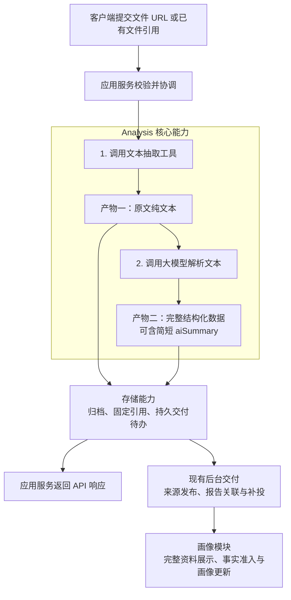

# 体检报告 AI 解读改造需求

- 状态：需求已验收，2026-11-11 已获明确代码实施授权；按 ISSUE I-046 的模块范围推进，尚未部署。
- 更新日期：2026-11-11。
- 核对基线：`develop@db6d459703b8d4048f94525cfc971bfda010f91a`。
- 配套文档：[体检报告 AI 解读实现与计划](../architecture/health-report-interpretation-implementation-plan.md)。
- 当前对外契约：[API 文档](../api/API.md)。本文描述目标需求，不表示目标能力或接口选项已经发布。

## 1. 目标与职责

Analysis 的核心任务只有两项：

1. 解析上传文件，取得文件原文纯文本。
2. 通过大模型解析文本，取得完整结构化数据。

简短 `aiSummary` 属于第二项的可选输出，不增加独立深度分析任务。Analysis 拥有完成这两项工作所需的提示词、模型调用、抽取校验、分段和纠正逻辑；文本抽取通过现有工具完成。

两项处理完成后，由应用服务调用存储能力保存产物，再通过已有交付机制对接用户画像。存储负责可靠保存和读取，画像负责资料展示、事实准入和画像更新；它们各自维护自己的规则。持久化、来源发布和画像应用不是 Analysis 智能体的额外模型任务。

每个智能体、工具和模块只负责自己的本质工作。依赖方的特殊需求由依赖方自行处理，不要求 Analysis 为 Report、Record 等消费者增加专用抽取、提示词、输出加工或额外模型调用。各消费者通过公共契约使用通用解析结果，并自行完成本域所需的投影、上下文和业务判断。

整个项目统一使用当前 Analysis 实现。本期覆盖这两项核心能力及其必要的存储、交付和画像支持，不增加自主工具循环或新的主 Agent。

## 2. 已确认需求

| 编号 | 需求 | 验收关注点 |
|---|---|---|
| HR-001 | Analysis 负责文件到文本、文本到结构化数据两项核心能力。 | 职责独立，消费者特殊需求不进入通用解析流程。 |
| HR-002 | 输出原文纯文本、完整结构化结果，由存储能力可靠保存两份产物。 | 两份内容可按用户、主体和固定报告引用追溯。 |
| HR-003 | 尽可能完整抽取原文中的实际结果和报告内容，不只抽异常项。 | 正常、异常、定量、定性、影像和待核实内容均覆盖。 |
| HR-004 | 结构化结果允许包含简单的 `aiSummary`。 | 只概括可确认信息，不新增独立深度分析阶段。 |
| HR-005 | 允许按需要多次调用模型完成抽取。 | 分段、格式纠正和异常恢复受预算、超时及执行身份约束。 |
| HR-006 | 应用服务在必要持久化完成后响应，不等待后续来源发布和画像应用。 | 结果、固定引用及可恢复待办成立后即可返回。 |
| HR-007 | 存储能力维持当前数据库留存内容。 | 不删减原文件、解析记录、快照、模型留痕或画像记录。 |
| HR-008 | 画像模块在显式完整视图中展示所有已保存的解析项目。 | 无日期、缺结果、未标准化和待核实内容均可查。 |
| HR-009 | 画像模块区分资料完整性、核验状态和事实可用性。 | 完整展示不等于全部成为有效事实。 |
| HR-010 | 资料查询不驱动处理，遵守主体隔离、来源生命周期和历史归档边界。 | 不因读取而调用模型、恢复解析或绕过撤回。 |
| HR-011 | 保留文件复用、业务引用、幂等和受控恢复语义。 | 同次执行不重复处理或摄取，后续恢复不串用其他轮次。 |
| HR-012 | 按职责分批交付，公开契约和验证同步完成。 | 提供方与消费者各自完成所属工作，文档不冒充上线事实。 |

## 3. 业务流程

### 3.1 输入与两份产物

独立接口继续接收 `fileId` 文件 URL，或同用户、同健康主体的 `documentId` 引用；用户、主体及 `reportId` 的既有校验、默认本人绑定和冲突规则继续适用。本期不增加 multipart 上传路由。Analysis 通过现有 DocMind 文本抽取工具取得文本，不在本期更换供应方。

产物一是文本抽取工具实际取得的纯文本，不是模型重写后的报告。原文件二进制、布局和解析响应仍由现有存储能力留存。OCR 未识别出的原文不能由模型补造。

产物二是完整结构化结果，包括报告类型、标题、时间、逐项结果、报告专用内容、混合子报告、待核实项目、处理质量及可选的简短 `aiSummary`。摘要是这份结果的一个字段，不构成第三份独立业务产物。HTTP 响应继续以结构化结果为主，不直接展开全文、原文件或模型原始输出。

### 3.2 抽取内容

- 提取正常与异常、数值与定性项目，保留原始精度、比较符、科学计数法、百分号、单位及参考范围；数值 0、阴性和未检出均是有效结果。
- 保留项目可以明确归属的检查或采样时间、方法、标本，以及原报告自带的评分和评估。
- 保留原报告已有的影像所见和诊断。它们属于来源陈述，不是本服务新增的诊断。
- 对多个类型、日期和独立子报告保留各自归属；顶层兼容项目和子报告中的同一物理记录不能重复展示。
- 日期、单位和参考范围缺失不导致已有项目和结果消失；缺少项目名或结果的内容进入待核实项目，保留可读字段、缺失字段和原因。
- 不把参考值、科普内容、参考人群或假设场景的数值当作本人的检测结果，不从摘要反推检测值。

### 3.3 简短摘要

`aiSummary` 不再被强制固定为 `null`。模型可以在抽取时一并给出简短概述，不单独执行面向整份报告的深度分析任务。概述只基于原报告及最终保留的可确认结果，不新增病因推断、疾病确诊、治疗或用药方案。

部分可用时，摘要应说明其依据有限；不能因为已读部分正常就断言整份报告正常。仅有待核实信息或没有可用结果时，可以为 `null`。摘要及原报告诊断都不自动成为新的有效健康事实。

分段合并、字段纠正和原件核对后，摘要须与最终保留内容一致。程序生成的简单概述同样遵守这一要求，不能继续包含已被剔除项目的结论。Report 等消费者需要更深入的分析或特定表达时，由消费者自行完成。

### 3.4 调用次数与失败

不以模型调用次数等于 1 为验收条件。长文本可以分段，字段格式不合约定时可以纠正，技术故障可以按既有受控策略恢复；不为满足某个消费者额外执行专用抽取。

全文覆盖、分段身份、调用预算、超时和恢复检查点应可追溯。已有归档和成功分段按同次执行的固定身份复用，后台交付和资料查询不重新运行 OCR 或模型。

保留 `complete / partial / unavailable` 内容质量与技术错误的区分。有可用内容时如实返回部分结果和限制；没有可用内容时不据此断言原报告没有检测结果。技术故障和必要持久化失败继续按实际错误处理，不以空成功结果掩盖失败。

## 4. 应用编排、存储与后台交付

### 4.1 响应前必须成立

1. 存储能力已可靠保存本次原文和结构化结果，必要归档失败时不能声称成功。
2. 本次原文件、结果轮次和不可变归档引用已经固定；后续请求不能覆盖已受理执行的读取依据。
3. 后台交付意图及读取固定资料所需的引用已经持久保存，重启后仍能继续。

应用服务根据存储回执确认上述条件，然后返回结构化结果；模型输出不能代替存储成功回执。“抽取完成后立即返回”表示不等待后续来源发布、补投、报告关联和画像应用。后台可在持久就绪后独立推进，不强制等待 HTTP 发送结束。

### 4.2 后台继续完成

文档来源交付负责读取固定归档、发布来源、关联报告引用及失败补投；画像模块负责接收资料、映射事实和更新投影。两者复用现有持久账本和 Worker，不为交付再次运行模型。

解析完成、资料已归档、来源已接收、画像已应用是不同状态。HTTP 200 或 `processing.status=complete` 不表示画像已应用。来源标识和任务引用仅返回已经取得的真实回执，尚未产生时保留缺失或空值。

## 5. 画像完整性与使用规则

### 5.1 显式完整视图

画像模块复用现有画像详情及原报告指标列表入口，增加显式完整视图，默认保留现有展示范围。完整视图来自已保存解析资料，不另建健康事实真值，也不要求 Analysis 按画像展示格式重新抽取。其他消费者自行选择和加工其所需资料。

| 内容 | 完整视图要求 | 有效事实使用要求 |
|---|---|---|
| 有明确日期和结果的检测项 | 保留项目、原值、单位、时间和来源。 | 按画像规则决定是否生效。 |
| 有结果但无可靠日期 | 仍显示原结果，标记日期未知。 | 不补造日期，不用于需要明确日期的趋势。 |
| 有项目名但缺结果 | 仍显示该项目，标记缺失字段和原因。 | 不生成虚构数值。 |
| 原报告所见或诊断 | 保留来源叙述及其核验状态。 | 不自动升级为本服务确诊。 |
| 未标准化项目或报告评分 | 保留原项目和评估属性。 | 不强行映射成标准检验或个人基本信息。 |
| 只有标题、日期或待核实项的报告 | 返回文档级信息和实际可读内容。 | 不因没有临床来源而隐藏整份资料。 |

完整的含义是呈现已保存的解析内容，不保证 OCR 和模型没有遗漏原文件。没有任何项目的文件应有文档级记录，不能伪造检测项充数。同文件的新一轮解析保存成功后，即使仍有较早的生效来源，完整视图也须能读取新固定结果，不等待来源发布或画像应用，不把较早结果的核验状态移到新结果。

### 5.2 可靠性标识与事实准入

画像模块区分抽取完整性、日期是否确定、来源处理状态、已有事实的核验状态及事实使用条件。允许使用已有状态和缺失原因表达不确定性，不新增未经计算的可靠性分数；`verified_source` 不等于医生复核，固定 `confidence` 不等于逐条 OCR 正确率。

完整展示不放宽有效事实、趋势、概览及自动判断的准入规则。未核实项目和摘要不会因为可见而自动成为有效事实；消费者需要如何使用资料，由各自业务规则决定。

### 5.3 生命周期与历史

只查询当前用户拥有的主体资料。来源替换、退休或撤回后，展示遵守有效贡献和生命周期，不回退旧观察或旧归档泄露原值。

历史报告只复用现存且能证明归属和执行身份的归档。缺全文、缺结构化输出或无法证明固定引用时，返回文档级缺档状态，不重新下载、运行模型或补摘要。资料读取不驱动解析、发布和恢复；保留当前 API 已约定的默认本人空画像初始化行为。

## 6. 数据留存与幂等

存储能力继续保留原件、URL 及文件元信息、原文、DocMind 布局与完整响应、结构化结果、摘要、待核实项、处理质量、快照、模型输入输出、分段纠正和统计记录。交付记录、失败恢复状态、画像事实及变更记录由所属模块保留。

文件内容复用、`documentId` 引用、`reportId` 冲突检查和主体隔离继续适用。同次已受理执行的重放使用固定结果；`reportId` 是业务引用，不阻止再次解释时按现有规则恢复 partial/unavailable。同文件不同报告 ID 不重复摄取相同来源。

本期允许增加必要的归档绑定、就绪字段、索引和公共契约，不删减既有留存，不自动重算历史、补摘要或迁入历史来源。

## 7. 验收标准

| 编号 | 对应需求 | 通过条件 |
|---|---|---|
| AC-01 | HR-001、HR-012 | Analysis 完成两项核心能力，存储和画像各自承担所属职责；消费者专用加工不进入 Analysis。 |
| AC-02 | HR-002、HR-007 | 可从固定引用读取本次原文和结构化结果，原件及既有附加留存仍存在。 |
| AC-03 | HR-003 | 各报告类型和混合子报告覆盖正常、异常、定性、比较符及原报告叙述，无重复兼容展示。 |
| AC-04 | HR-004 | 摘要简短、有来源，不进行独立深度分析；部分结果不被描述成全报告正常。 |
| AC-05 | HR-005 | 长文本、格式纠正和受控恢复可以多次调用，调用记录与固定结果一致。 |
| AC-06 | HR-006 | 来源发布或画像应用被阻塞时，已完成必要持久化的解析请求仍能返回。 |
| AC-07 | HR-006、HR-011 | 响应前保存失败不声称成功；响应后重启、取消或回执丢失仍能恢复交付且不重跑模型。 |
| AC-08 | HR-008、HR-009 | 完整视图可查询无日期、缺结果、影像、评分和未标准化项目，并有相应状态或缺失原因。 |
| AC-09 | HR-008 | 仅待核实项、仅元数据的已归档报告也有文档级可见记录，不依赖临床来源发布成功。 |
| AC-10 | HR-009 | 画像完整展示不放宽事实准入，不伪造日期、数值、事实状态或可靠性评分。 |
| AC-11 | HR-010 | 主体隔离、分页、来源替换和撤回有效；资料读取不运行模型、解析、发布或恢复。 |
| AC-12 | HR-010、HR-011 | 历史有档则复用，缺档如实说明；恢复使用已受理执行的固定资料，不重新解释历史结果。 |
| AC-13 | HR-011 | 相同文件的并发请求和不同报告 ID 最终正确关联，不重复写事实或丢失别名。 |
| AC-14 | HR-012 | 正式来源查询缺口修复并通过默认装配验证；调用方适配由调用方完成，契约、文档和检查记录与实现一致。 |

## 8. 实施边界与依据

后续按配套[实现与计划](../architecture/health-report-interpretation-implementation-plan.md)分职责推进。[I-043 原报告指标查询缺口](../../ISSUE.md#i-043-新来源发布后公开原报告指标查询为空)由资料读取、画像查询和组合根共同验收；[I-044 并发报告别名问题](../../ISSUE.md#i-044-同一新文档并发首次发布导致报告别名缺失)由来源交付和别名存储验收。它们不属于模型自行解决的问题，也未因本文修订而关闭。
