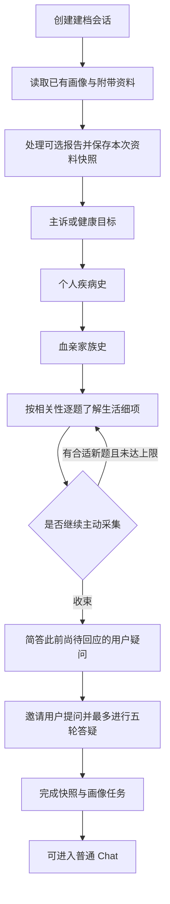

# Record 建档问卷功能演变说明

- 状态：历史与当前实现核查记录，不是新问卷协议的实施方案。
- 更新日期：2026-11-04。
- 历史比较：`b13e8afd03b9129d1db6d9f3adb55516ed8e4891` → `618e3d44d93f3d09e5d0a24a0e57bb21864ed56c`。
- 当前核查基线：`develop@717d76f`。本次仅核对 Git、源码与文档，未运行模型、业务服务或业务测试。

## 1. 文档目的与术语

本文记录 Record 在指定提交区间内实际完成的功能变化，并说明这些变化与 2026-11-04 新问卷需求的关系。新的需求理解、差距和字段映射见 [建档问卷需求与 Schema 对照报告](record-questionnaire-requirements-analysis.md)。

从本次需求讨论起，产品名称统一为“建档问卷”；此前的“建档问答”指同一 Record 功能。名称变化本身不代表接口、状态机和提交方式已经变更。当前代码仍使用 `record`、`qaFlow` 和 `/api/v1/qa/*` 等名称，本文保留这些准确的技术标识。

| 名称 | 本文含义 |
| --- | --- |
| 建档问卷 / Record | 获取主诉、个人疾病史、血亲家族史及生活背景的信息采集功能 |
| 当前逐题建档 | 服务端返回一道题，用户回答后再生成下一题的现行实现 |
| 当前 `intake` | 主动了解主诉、疾病史、家族史和生活习惯的阶段 |
| 当前 `supplement` / `qa` | 邀请用户提出问题及回答用户疑问的阶段；不能直接等同于新需求中的“补充问卷” |
| 新需求的补充问卷 | 根据已有资料继续向用户采集风险及可能诱因相关信息的问卷能力，具体流程尚未定稿 |

## 2. 指定区间之前已经具备的能力

基线 `b13e8af` 为 2026-10-21 的测试目录重组提交。该时点 Record 已经是有状态的 AI 建档流程，以下能力不能计作本次区间首次新增。

| 能力 | `b13e8af` 已有实现 |
| --- | --- |
| 可选报告与已有资料 | 创建时可结合上传报告、已有画像及请求附带健康资料建立上下文 |
| 两阶段模型职责 | `record.plan` 理解患者情况，`record.question` 生成正式表达；应用层推进流程 |
| 多关注点 | 已有多困扰归属和用户明确优先关注的处理 |
| 独立承接 | 已有 `assistantMessage`，与实际问题 `question` 分开展示 |
| 问题数量 | 约 5 次为软目标，主动建档最多 10 次；全程实质交互上限 20 次，不是统一 4～6 题 |
| 答疑 | 已有直接答复及针对疑问的澄清分支；尚未建立本轮独立的最多 5 轮 QA 计数规则 |
| 交互与恢复 | 已有普通提交、SSE、会话租约、答案回执、重复提交处理及缺失回复恢复 |
| 生成容错 | 已有共享生成时间预算、校验、修复和保守兜底 |
| 数据落地 | 完成时保存快照，投递画像任务，保留失败补偿，并支持完成后转入 Chat |

这里的旧策略与后来保留兼容的“显式短策略 4～6 题”不是同一个基线。当前代码对无策略标记的真实旧会话保留 10 题上限，对已有明确短策略快照的会话继续尊重其原预算。

## 3. 指定区间的主要提交

终点 `618e3d4` 是 2026-10-28 的 `!122` 合并提交，合入 `refactor/record-intake-quality`。该区间的主要 Record 变更由以下五个提交组成。

| 提交 | 日期 | 主要变化 |
| --- | --- | --- |
| `9cbf9ce` | 2026-10-21 | API 调试页面按问答分组展示历史，改善回答格式与流程观察体验 |
| `6462fd4` | 2026-10-22 | 固定前三个主题；新会话扩展为 10～15 题；建立五类 24 个生活细项及去重、相关性与大类交错规则；完善前置简答与五轮 QA、旧会话预算及画像校验 |
| `13a4fbb` | 2026-10-22 | 全量题目采用具体短选项；完善主诉多选的具体候选及互斥状态语义；区分存在性与内容明确程度；补充个人病史状态、家族背景观察，并接通画像、Chat 和风险依据筛选 |
| `f992196` | 2026-10-28 | 围绕真实主诉与报告关注点调整承接；取消提问理由拼接并减少机械套话；统一隔离内部处理提示；简化时间及饮水量区间；补充历史与恢复兼容 |
| `66c0ab9` | 2026-10-28 | 生活行为先恢复完整原文证据再校验；修复主体、否认、条件、数量和时间范围；识别并列疾病共享断言；提取器升级至 `v11` |

这些提交将信息采集的内容和可靠性做了系统扩展，但没有新增一次交付整份 `pages/elements` 问卷的协议。

## 4. 区间结束后的实际功能形态

### 4.1 主流程

图示为正常完成路径。用户明确要求结束以及既有容错规则可以提前收束。报告生成仍由独立 Report 功能负责，Record 完成不表示最终综合报告已经生成。

### 4.2 内容、数量与选题

- 前三个题位依次覆盖主诉、个人疾病史、血亲家族史。主题已经明确时，当前实现仍保留对应题位，改为询问补充或更正。
- 新会话正常采集 10～15 题，包含前三题；生活部分通常为 7～12 题，尽量充分了解至 15 题。题库中的 24 个细项不等于每份问卷必须问 24 题。
- 一次自由回答提前覆盖多个细项时，同时记录覆盖情况。已经了解、已问、不明确或不适用的细项按规则排除，不靠重复确认凑数。
- 相关性优先；同等相关时，先避开上一题的大类，再优先询问次数较少的大类。正常生成和兜底沿用同一规则。
- 当前扩展范围仍受生活细项约束，不主动展开症状细节、疾病诊断或个体病因追问；用户自发提供这些内容时可以理解与记录。
- 提问与答疑独立计数。前置简答不占后续五轮额度；同轮多个实际问题逐项回应但只算一轮；连续两次没有实际问题或用户明确结束时收束。新策略总实质交互保护为 25 次。

| 大类 | 当前可独立了解的细项 |
| --- | --- |
| 饮食与饮水 | 食物搭配、主食份量、甜食甜饮、咸味加工食品、进餐规律、夜宵、饮品种类、饮水量 |
| 作息与睡眠 | 睡起时间、睡眠时长、工作日与休息日差异、睡前习惯 |
| 运动与日常活动 | 活动类型、运动频次、单次时长、连续久坐、起身活动频次 |
| 烟草与饮酒 | 吸烟情况、二手烟接触、饮酒频次、单次饮酒量 |
| 压力与放松 | 放松方式、日常休息安排、忙碌时的休息节奏 |

### 4.3 题目、选项与用户表达

全部新问题提供具体、独立、简短的 `radio` 或 `checkbox` 选项。主诉最多 12 项，选项覆盖具体症状和健康目标；选择“控制血糖”作为健康目标不代表用户确诊糖尿病。历史 `text` 题继续兼容，但当前新题生成规则不发布纯文本题。

选项不再使用“某个不适”“某种疾病”、长括号说明或拼接不同答案的标签。时间和饮水量范围采用“30至60分钟”“500至1000毫升”等表述，单边范围仍保留“不足”“及以上”和单位。

文字及语音转写通过 `other` 等既有输入提交。非空 `other` 优先于 `answer`，两者不自动合并。用户只说“身体不舒服”时记录有不适但具体内容未明确；“不知道”“没有”及未提供信息分别保留，不能互相替代，也不因此追加澄清题。

### 4.4 承接与答复

在已有自然承接基础上，`assistantMessage` 取消生成问题时的提问关联理由拼接，并加强真实关注引用与简短交流约束，进一步减少复述和套话。个人史主要承接主诉；家族史保持宽泛，不被单个指标缩小范围。生活题可依靠前文自然延续，不要求每轮点名同一关注点。

正式前置简答与 QA 直接展示答复，不另加病史复述。资料少时给一般解释，不以“信息不足、无法判断”代替回答；已答疑问只有在用户本轮主动重问时才重新回应。

“尚未完成可靠分析”“原文已保留”等内部处理提示从正常生成、修复、兜底及对外展示出口隔离。普通响应、SSE、恢复、重放、历史和 Chat 交接使用相应规则；内部失败标记与待答状态继续保存，不能把隐藏提示解释为分析成功。

### 4.5 画像与证据

原有画像链路继续承载具体疾病、症状、健康目标和生活行为；新增或完善 `condition.history_status` 和 `family_history.reported` 等背景观察，保留疾病名称不明确、存在性未知和亲属未明确等情况。

24 个生活采集细项归入饮食、进餐规律、饮水、运动、久坐、睡眠、吸烟、饮酒、压力应对这 9 类生活方式事实，不是一项细项对应一种画像事实类型。

生活行为以原始回答的字符串值恢复证据范围，保留主体、否认、条件、时间以及相邻数量说明。结构化值不受支持时回退为已验证范围内的原文；主体或多处引用范围无法确定时跳过候选。并列疾病共用其原文肯定、否认或未知谓语，同时防止亲属切换、咨询、筛查或治疗陈述被误写成本人确诊。

用户答案候选沿用 `USER_REPORTED` 和待确认治理；问卷提交完成与事实确认、画像任务完成是不同状态。模型生成的承接、科普、建议和关注引用不作为用户疾病或病因证据。单纯压力感受也不会自动生成“压力应对行为”。

### 4.6 恢复、完成与兼容

当前仍通过 `create → answer → status/history` 等逐题接口运行。一个答案只推进当前题；问题 ID、已发布题目、答案指纹、原始回答及创建时资料快照保持兼容。历史 AI 正文中的内部提示只在展示副本中清理。

活动会话主要保存在 Redis，最近一次成功保存后有效期为两小时；纯查询不续期。完成后保存 MongoDB 快照并投递画像任务。`/api/v1/qa/complete` 用于幂等获取已完成结果，不是任意时刻提交半份问卷的接口。现有恢复能力不等于已经提供适合健康管理人员跨天跟进的长期问卷草稿。

## 5. 从区间终点到当前代码的核查

在 `618e3d4..717d76f` 内，Record 核心目录、Record 提示词、Handler、`record_ingestion.py`、`record_observations.py` 和 `record_source.py` 没有直接差异。此后的共享报告解析、文件处理及画像摄取变更会影响提供给 Record 的资料内容，但不能据此认定 Record 已改为分页问卷或增加了新的问卷选题策略。

下游消费另有扩展：2026-10-31 的 `b8ab597` 为 Report 补齐新版 Record 病史状态、家族背景和生活方式的画像适配。当前请求与报告来源仍优先，历史画像只补缺失背景。这说明 Record 采集结果已被其他功能复用，不表示 Record 自身负责生成最终报告。

截至当前核查基线，以下能力仍不能算已完成：

1. 一次生成并返回整份、可冻结版本的 `pages/elements` 问卷。
2. 按新 Schema 接收 `answers` 整卷结果、必填/选填规则和稳定选项编码。
3. 独立的初始问卷/补充问卷业务类型及按报告可用性切换的整卷策略。
4. 新报告或新 Chat 自述触发已发布问卷重新生成、版本升级或追加补充任务。
5. 取消前置简答、答疑邀请和五轮 QA 的问卷提交路径。
6. 健康管理人员发放、催填、跨天保存、复核及汇总状态的完整工作流。

上述第 1～6 项是与新描述对照得到的待确认或待设计范围，并非本轮已经确定实施的任务。新 Schema 的姓名、性别和生活习惯示例仅用于说明协议，不自动成为新的必问题库。

当前 [ISSUE.md](../../ISSUE.md) 中 I-028（有效疑问被无效建档事实阻断）与 I-029（真实措辞验收）仍标为 Open。若新产品取消前台答疑或承接，需重新评估这些问题的适用范围，不能因为产品改名就把它们视为已经修复。

## 6. 核查依据

| 依据 | 主要内容与定位 |
| --- | --- |
| Git `b13e8af..618e3d4` | 五个功能提交及 `!122` 合并；使用 `git log`、`git show` 与路径差异核对，不由当前文件反推历史 |
| [当前 API](../api/API.md) | 482 行起的建档接口；969 行起的响应字段；1287 行起的单题提交；1193 行的完成语义；1799 行的活动会话有效期 |
| [interview.py](../../modules/record/application/interview.py) | 题数策略、三个固定主题、旧预算兼容及生活选题规则 |
| [lifestyle.py](../../modules/record/application/lifestyle.py) | 24 个生活细项、题干与受控选项 |
| [flow.py](../../modules/record/application/flow.py) | `GeneratedQuestion`、`validate_new_question`、`advance_flow`、`apply_presentation` |
| [service.py](../../modules/record/application/service.py) | `_save_session`、`_submitTurn`、`_patientContext`、`_presentationContext`、`getHistory` |
| [record_ingestion.py](../../health_profile/record_ingestion.py)、[record_observations.py](../../health_profile/record_observations.py) | 提取器 v11、生活证据范围及疾病断言治理 |
| [record_source.py](../../health_profile/record_source.py) | 完成快照、画像摄取任务与失败补偿 |
| [Report 画像适配](../../modules/report/profile_snapshot.py)、[Report 上下文](../../modules/report/patient_context.py) | `b8ab597` 增加新版 Record 画像消费；历史画像作为最低优先级背景 |
| [动态建档 Wiki](../../wiki/record-dynamic-flow.md) | 当前流程、计数、表达、恢复及验收方法的补充说明 |
| [需求方 Schema](../survey-system-schema.md) | v1.0.0，2026-11-03；作为本次差距分析的输入，不覆盖当前 API 契约 |

本文只记录已核对的实现事实及其边界，不将历史离线测试数字作为本次运行结果，也不代表新问卷流程已完成产品验收。
