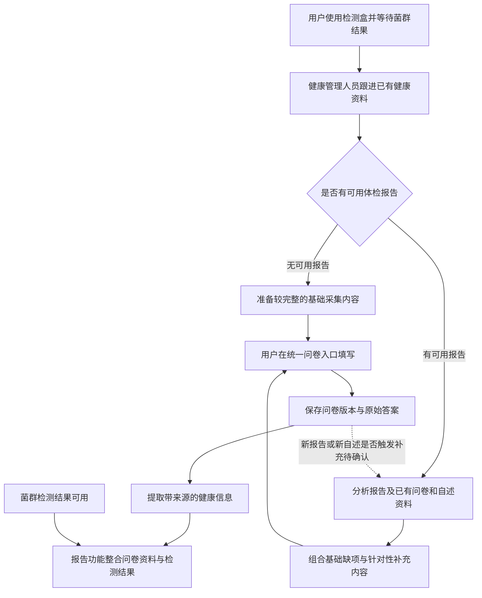

# 建档问卷需求理解、功能差距与 Schema 对照报告

- 状态：需求分析与建议稿，供需求方确认；尚未批准为实施方案，不代表接口已变更。
- 更新日期：2026-11-04。
- 当前实现基线：`develop@717d76f`；历史演变范围：`b13e8af` → `618e3d4`。
- 输入资料：[需求方问卷 Schema](../survey-system-schema.md)，v1.0.0，2026-11-03；本次对话中提供的 2026-11-04 11:35、11:57、11:59 需求反馈。
- 核查方式：读取原始需求、Git 历史、当前源码及 API；本次不实施代码或接口修改，不运行真实业务或模型验收。

## 1. 对三个问题的直接结论

**需求方想法：** 信息采集仍是 Record 的核心，但用户侧更倾向于填写问卷，由 AI 在后台根据已有资料决定问什么。基础采集和针对性补充是两个能力层次；最新反馈希望用户不要被迫填写两份割裂的问卷。有报告时生成更有针对性的内容，无报告时由健康管理人员跟进较完整的基础采集。是否一次生成全卷、允许分阶段追加，以及是否彻底取消末尾答疑，需要明确确认。

**与当前实现的差距：** 主诉、病史、家族史、生活习惯的采集内容，以及报告、画像、来源校验和事实记录能力有较多重合。主要差距在用户交互与业务生命周期：当前是逐题生成并附带答疑的会话，新描述倾向于可填写的问卷；当前扩展只在受控生活细项中选择，而更深入的风险和诱因信息可能要求扩充采集范围。这是有现成基础的功能调整，不能仅改名称或几个字段就完成，也没有证据支持推倒整个系统重建。

**Schema 能否对应：** 题干、单选、多选和简单文本能够建立映射；新问卷的 `pages`、稳定选项 `value`、`isRequired`、整卷 `answers` 及业务实例/版本绑定需要额外设计。题目展示格式可以适配，完整的问卷生成、提交和画像来源契约尚不能直接套用现有接口。

历史上已完成的工作详见 [Record 建档问卷功能演变说明](record-questionnaire-evolution.md)。本文中的“问卷”是新的产品称谓，当前接口和源码名称仍按事实保留。

## 2. 如何理解需求方的描述

### 2.1 按时间区分共识与尚未统一的部分

| 反馈时间 | 明确表达 | 本报告的理解 | 仍未确定 |
| --- | --- | --- | --- |
| 11:35 | 不再设置 AI 问答环节；有内容相对固定的初始问卷和 AI 生成的补充问卷 | AI 继续承担资料分析和问卷生成；用户不必以与 AI 对话的形式完成采集 | “不再问答”是否同时取消前置简答、末尾五轮答疑及所有承接展示；是否必须一次交付全卷 |
| 11:57 | 不希望用户分开做两份；上传报告后生成一份，其中包含疾病史、家族史等 | 基础信息和针对性问题可以在同一份用户问卷中组合 | “两类问卷”是否只保留为内部策略，还是业务上仍有两个可分别发放的实例 |
| 11:59 | 等待检测盒结果期间索取既有体检报告；无报告做较完整的基础问卷，由健康管理人员跟进；有报告则生成更深入问卷或补充其他数据；菌群结果出来后综合形成报告 | 按资料可用性选择采集路径，最终交给报告功能整合 | 问卷发放时机、管理人员审核职责、报告晚到时是否追加采集、重复建档规则 |

后两段倾向于统一用户填写体验，但不能据此宣布第一段的“两类问卷”已经被正式取消。建议把“基础采集 / 针对性补充”作为内部内容模块，把“用户收到几份问卷、何时收到”作为另外一项业务决策。

“相对固定”也需要具体化：可以是固定题库和采集目标，也可以要求题干、选项、顺序完全固定。当前 Record 只固定前三个主题及受控生活细项，不保证所有用户收到完全相同的基础问卷。

### 2.2 可以兼容两种表述的建议流程

以下是供确认的建议图，不是需求方已定稿流程，也不是当前代码流程。



“有报告”建议按存在可用且可信的内容判断，而非只看是否上传过文件。当前系统已有 `partial/unavailable` 等处理状态，可以作为该策略的输入；这项产品分流规则尚未实现为两套问卷方案。

已知信息是否跳过、预填后让用户确认，或仍保留少量核对题，需要需求方确定。当前前三个主题已知时仍问补充，不能直接解释为新方案已经能够完整消除基础重复题。

“识别诱因”在信息采集层可理解为获取可能相关的行为、暴露、时间及背景线索。问卷的选题理由、AI 推测与用户实际陈述应继续区分；推测不应自动写成用户确定病因。最终评估和综合报告如何使用资料，由相应功能负责。

### 2.3 三个容易混淆的概念

1. **AI 生成问卷与前台 AI 对话不同。** 可以继续使用 AI 分析资料、组合题目和理解自由文本，同时取消用户逐轮等待 AI 承接或答疑的交互形式。
2. **当前 `phase=supplement` 与补充问卷不同。** 前者主要邀请用户向 AI 提问，后者是系统继续向用户收集信息，信息流向不同。
3. **Schema 与业务流程不同。** 新 Schema 定义问卷和答案形状，允许一页一题或多页多题，但没有规定生成时机、分阶段发布、编辑、保存、补充触发和后续报告流程。

## 3. 当前能力与目标的差距

下面的程度表示功能语义差距，不是工期或改造比例估算。

| 维度 | 当前 Record | 新描述对应目标 | 判断 |
| --- | --- | --- | --- |
| 主诉、个人史、家族史 | 前三个题位固定，内容已知时询问补充 | 基础采集内容 | 重合较多；题库固定程度和已知信息处理方式待定 |
| 生活习惯 | 五大类 24 个细项，按相关性选择，正常总题数 10～15 | 基础或深入问卷中的相关生活因素 | 可复用；新需求没有确认继续使用原题数上限 |
| 报告个性化 | 创建时解析请求指定报告，每轮使用其快照选题 | 有报告时生成更深入问卷 | 有基础；尚无独立的整卷生成策略及资料可用性分流 |
| 无报告路径 | 沿同一套动态采集规则继续，仍使用新会话 10～15 题策略 | 较完整基础问卷，健康管理人员跟进 | 部分重合；没有专门的更完整基础模板或管理工作流 |
| 深入风险/诱因信息 | 生活阶段限定于受控生活细项，不主动追问疾病或症状细节 | 围绕用户疾病风险及可能诱因补充信息 | 需要确认新采集范围；若包含病程、症状时间关系、用药或暴露等，当前题库不足。这些只是范围示例，不是本报告新定的必问题 |
| 利用既往初始问卷 | 本会话历史直接参与；既往完成问卷可经画像间接参与 | 根据已填初始问卷生成补充内容 | 有基础；没有按指定既往问卷实例及版本直接绑定全部答案的公开契约 |
| 利用 Chat 自述 | Chat 自述经异步画像摄取后，可进入后续建档创建时的画像快照 | 自述参与个性化生成 | 部分支持；并非直接读取完整 Chat 历史，也不保证刚发出的自述已完成画像摄取 |
| 用户交互 | 一题一答，返回 `assistantMessage + question`；存在前置简答及后续 QA | 用户填写问卷，AI 在后台生成内容 | 明显差异；若确认整卷或分段表单，需调整生成和提交编排 |
| 问卷交付 | 没有 `title/pages/elements` 整卷返回结构 | 新 Schema 问卷 JSON | 缺少整卷资源及发布快照；单题封装只能解决局部展示 |
| 保存与修改 | 当前题推进、最近答案幂等；已答旧题不能按普通表单任意改写；活动会话自最近一次成功保存起保留两小时，纯查询不续期 | 可能需要多页保存、回看更改及跨天跟进 | 生命周期差距较大，但这些要求尚未由 Schema 明文规定，需要确认 |
| 数据落地 | 保存原始回答、题目与来源，完成后异步提取画像 | 保存问卷结果供其他功能使用 | 可复用治理原则和消费路径；编码答案及整卷来源需要适配 |
| 最终报告 | Record 完成后可进入 Chat，最终报告另行受理 | 菌群结果与其他资料汇总生成报告 | 职责相容；资料齐备判断及触发责任仍需明确，不能认为问卷完成会自动生成最终报告 |

当前创建时会冻结 `healthProfileContext` 与本次报告快照；后续 Chat、画像或文件内容更新不会自动改变该会话已经采用的资料。若新流程要求“报告一到就更新正在填写的问卷”，必须先确定版本和用户已填答案如何处理。

**整体评估：** 内容资产和证据治理复用程度较高；交付协议、问卷生命周期及面向风险补缺的规则需要设计。只做名称调整属于小改；完整采用新问卷协议并实现上述业务目标属于中等以上的功能改造。由于题库、生成时机和保存规则尚未确定，本报告不提供未经拆解的工期数字。

## 4. 新 Schema 与当前字段的对应关系

### 4.1 新 Schema 已规定什么

需求方文档定义根 `title/description/pages`、页面 `name/elements`、题目 `type/name/title/description/isRequired`，以及选项 `value/text`。支持 `text`、`radiogroup`、`checkbox` 三种题型；结果根对象只包含 `answers`，键为题目 `name`。

它没有定义 HTTP 地址、用户身份、问卷实例、发布版本、报告引用、生成状态、草稿、提交幂等、更正或画像处理状态。这里的“没有定义”是协议范围的说明，不能直接当成协议缺陷；这些信息可以由业务接口或资源上下文另行承载。

示例中的姓名、性别、“不便透露”等仅展示题型能力，不能自动成为新的基础问卷必问题或推翻现行按钮规范。Schema 也未规定固定题数、评分模型、条件显示、文件上传题或生成风险结论的方法。

### 4.2 问卷定义映射

| 新字段 | 当前最接近的内容 | 能否对应及注意事项 |
| --- | --- | --- |
| 根 `title` | 无整卷标题 | 需要补充问卷级展示信息；不能用某一题的 `question` 替代 |
| 根 `description` | 无整卷说明 | 需要另定；逐轮 `assistantMessage` 不等于整卷说明 |
| `pages` | 无整卷页面数组 | 当前只有下一题；可包装成一页一题，但不因此获得完整问卷生成能力 |
| `pages[].name` | 无页面 ID | 需要页面标识；不能映成 `sessionId`、`round` 或 `phase` |
| `pages[].elements` | 单个当前题目 | 单题可以转换为一个 element；整卷集合与发布顺序需另行生成、保存 |
| `elements[].name` | `questionId` | 当前为发布题目实例生成 `q_<uuid>`。该值在新协议语法上可用作 `name`，但应保留绑定；若要跨问卷分析，建议另有稳定语义键，不把随机实例 ID 当业务题目分类 |
| `elements[].title` | `question` | 题干可对应；当前末尾文字/语音输入提示要与新页面真实能力一致 |
| `elements[].description` | 无独立字段 | 可用作题目补充说明；不能机械复制依赖上一轮回答的 `assistantMessage` |
| `type=radiogroup` | `questionType=radio` | 需要枚举转换 |
| `type=checkbox` | `questionType=checkbox` | 题型直接对应；答案编码和互斥规则另行处理 |
| `type=text` | 历史 `questionType=text` | 新协议单题结果为字符串；旧题可能是多字段模板对象，需拆题或保留旧结构。当前新题发布规则禁止纯文本题，需要调整才能生成新协议文本题 |
| `choices[].text` | `options[]` 字符串 | 展示内容可对应；新协议 `text` 可省略，省略时显示 `value` |
| `choices[].value` | 当前选项标签兼作提交值 | 当前没有独立编码。中文标签作 `value` 符合新协议，但长期建议把稳定值和可修改文案分开 |
| `isRequired` | 当前题提交要求非空 | 没有按题必填/选填属性；新协议默认 `false`，不能在转换时无意把所有题都变为选填或擅自全部必填 |
| `showNoneItem` | 普通选项中的“没有”等 | 没有对应公开互斥属性；需确认某个明确否认是否等同本题“以上均无” |
| `noneText` / `noneValue` | 否认标签 / 无独立保留编码 | 新协议无项值固定 `none`；标签可以映射，语义必须按题目范围核对 |

题目 `name` 要在整份问卷内唯一，包括跨页面；选项 `value` 只要求同题内唯一。发布后的对应关系需要固定。Schema 建议使用 `snake_case` 和稳定英文值，但没有强制必须英文，也没有要求所有问卷共享同一题名。

### 4.3 提交结果映射

| 新结果 | 现行提交 | 处理要求 |
| --- | --- | --- |
| `answers[name] = "value"`，单选 | `questionId` 加 `answer=["选项标签"]` | 值按已发布 choices 解码；字符串转换为现行约定的单元素数组 |
| `answers[name] = ["value1", "value2"]`，多选 | `questionId` 加标签数组 | 逐项解码；不能把编码字符串直接当作中文疾病或行为原话 |
| `answers[name] = "自由文本"`，文本 | `answer` 字符串，或 `other` | 简单文本可对应；旧对象型文本答案不能无损压成一个字符串 |
| 缺少题目键、空白文本或空数组 | 现行当前题非空才能正常推进 | 均表示未作答；仅选填题可从最终结果省略，必填题不能据此通过提交校验。需要整卷校验和跳过语义，不能转成“没有” |
| `answers[name] = ["none"]` | 例如 `answer=["没有"]` | 仅在该题启用无项且语义一致时转换；属于明确作答，不是空值 |
| 选择题另有自由补充 | 当前非空 `other` 覆盖 `answer` | 新协议没有 `other` 字段；需明确采用独立 text 题还是扩展协议，以及选择与补充是共存还是覆盖 |

当前存储也有名为 `answers` 的字典，但其键是当前发布的 `questionId`，且通过逐题接口更新。字段同名不能证明它已支持新协议的整卷结果。把整个 `answers` 放入旧接口 `answer`，即使通过一般对象类型检查，也会被当作当前一题的回答，只推进一次。

### 4.4 业务字段与状态不能丢失

| 当前数据/机制 | 在新协议中的位置与待定事项 |
| --- | --- |
| `userId/sessionId` | 新问卷 JSON 与结果 JSON 都没有这些字段；需由业务资源、请求路径或另定传输上下文绑定身份和问卷实例 |
| `questionId` 与题目快照 | 保留题名到具体发布题目的对应关系；只有题名不足以证明用户看到哪一版题目和选项 |
| `round`、`qaFlow.version`、`interviewPolicy` | 分别用于当前会话和流程策略，不能直接当作新问卷发布版本 |
| `documents/documentProcessing`、报告来源版本 | 在业务上下文保留问卷采用的报告与处理状态；不应混进用户 `answers` |
| `assistantMessage/reasoning` | 新协议无同义字段；是否展示承接需产品确认。AI 正文、推理和生成依据都不是用户答案 |
| `phase`、`status`、`endReason` | 当前采集/答疑/完成状态，不能直接替代问卷草稿、发布、提交、作废、更正等状态 |
| `progress` | 当前采集阶段最多 50%，补充邀请 60%，答疑按轮数递增；不能用作新表单“已答题/总题数”的进度 |
| `history`、`answeredAt`、`completedAt` | 当前为逐题事件与会话完成时间；整卷是否允许修改、如何记录提交历史与时间需新约定 |
| 答案指纹和回执 | 当前支持最近同题同答案重放；新协议先 trim、去重和按选项顺序排序，需确定规范化与幂等计算顺序 |
| 画像任务及来源 | 当前完成快照后异步摄取；新协议提交成功不等于画像生成成功，更不等于事实已确认 |

当前公开历史只含已回答题目的题干、题型和回答等，没有完整选项定义；不能仅用历史接口无损重建带 `choices.value/text` 的问卷。恢复与解码应依赖保存的发布快照。

新协议明确结果根对象只含 `answers`。若需要问卷 ID、版本或用户身份，应先确定外围业务契约；本文不把额外字段直接加进示例并称其为现成规范。

## 5. 一组可对应的示例

以下是展示映射的合成示例，不是实际会话，也不规定该题必须询问。题干按“天”表示频次，与当前生活细项一致；所有数值均为示例标识。

当前单题的相关字段可以是：

```json
{
    "questionId": "q_example_exercise",
    "question": "您平时一周大约有几天安排运动？",
    "questionType": "radio",
    "options": [
        "没有运动",
        "每周1～2天",
        "每周3～4天",
        "每周5～7天",
        "不清楚"
    ]
}
```

按新 Schema 可组织为：

```json
{
    "title": "健康背景问卷",
    "description": "示例：了解日常活动",
    "pages": [
        {
            "name": "daily_activity",
            "elements": [
                {
                    "type": "radiogroup",
                    "name": "exercise_frequency",
                    "title": "您平时一周大约有几天安排运动？",
                    "isRequired": true,
                    "choices": [
                        {
                            "value": "no_exercise",
                            "text": "没有运动"
                        },
                        {
                            "value": "days_1_2",
                            "text": "每周1～2天"
                        },
                        {
                            "value": "days_3_4",
                            "text": "每周3～4天"
                        },
                        {
                            "value": "days_5_7",
                            "text": "每周5～7天"
                        },
                        {
                            "value": "unknown",
                            "text": "不清楚"
                        }
                    ]
                }
            ]
        }
    ]
}
```

此处 `isRequired=true` 只是示例选择；正式每题是否必填需要确认。单选的“没有运动”使用普通选项值，不挪用多选无项规则。

对应的新结果为：

```json
{
    "answers": {
        "exercise_frequency": "days_1_2"
    }
}
```

如果这道题恰好仍是现行会话的当前待答题，兼容层保存了题名到问题 ID 的绑定，且按该发布快照解码，才可以转换为旧接口的一次请求：

```json
{
    "userId": "example_user",
    "sessionId": "example_session",
    "questionId": "q_example_exercise",
    "answer": [
        "每周1～2天"
    ]
}
```

这只说明单题格式能够对应。不能用假答案反复调用旧接口来“预生成”全卷，也不能把多个预先编好的题 ID 循环提交到只接受当前题 ID 的会话。

## 6. 迁移时必须保留的数据语义

### 6.1 明确否认、未知与未作答

| 表达 | 应保留的含义 |
| --- | --- |
| 缺少 `answers.medical_history` | 本卷包含该题时表示未作答，本卷未包含该题时表示未采集；不能推断为无病史，部分提交规则仍待约定 |
| 病史题选择 `["none"]` | 在该题明确约定范围内选择“以上均无”，不能扩展为不存在所有疾病 |
| 选择 `["unknown"]` | 用户不知道；`unknown` 是自定义普通选项值，不是 Schema 内置状态 |
| “有病史但忘了病名” | 存在性肯定、疾病名称未明确，保留原文，不猜病名 |
| 主诉题回答“想了解糖尿病” | 关注该疾病，不能单独作为本人确诊依据 |
| 家族史选择糖尿病 | 家族背景，不能自动写成本人或某个未说明亲属患病 |
| 现有邀请题选择“没有了” | 结束交互的意图，不是疾病或生活行为的否认 |

新 Schema 只明确规定 `none` 的互斥机制，没有定义“unknown 与具体疾病互斥”等通用规则。如果业务需要保留“不清楚”等状态按钮，必须另定其校验和冲突处理；不能把它当普通多选项后默认所有组合都合理，也不能静默删除相互冲突的原始选择。

### 6.2 自由文本与语音输入

现有 `other` 是当前题的替代回答，非空时覆盖按钮答案。新 Schema 没有同等语义字段；普通 `text` 题能承载语音转写文字，但没有声明音频上传、选择题内嵌输入、条件显示或自动联动能力。

建议先确认是否继续支持“选择已有项并同时补充未列出的内容”。如果支持，可在当前 Schema 范围内设置明确关联的可选文本题，并约定合并与冲突语义；如需条件显示或内嵌输入，则另行扩展规范。无论采用哪种形式，都应保留用户文字原文，不把模糊数量加工成精确数值。

### 6.3 编码答案与画像证据

当前画像提取主要读取 `qaHistory[].question/answer/intakeDimension/answeredAt`，来源指针为 `/qaHistory/{index}/answer`；候选证据需要在允许的原文范围中核实。新结果只给 `days_1_2`、`diabetes` 等代码时，现有提取逻辑不能无条件把这些代码解释成中文用户原话。

建议保存“原始提交代码＋发布版本＋题干和选项快照＋题目语义绑定”，再通过确定的映射建立语义投影。该投影必须能追溯到用户实际选择与对应版本；不能由模型临时补中文名称后冒称原始陈述。新的问卷来源如何适配现有摄取入口、是否建立新的来源指针，需要在技术方案阶段决定。

原始答案、模型推断、用户事实和报告结论应继续分开保存。问卷完成不等于用户疾病被确认；既有 `USER_REPORTED`、待确认、主体隔离、来源校验和失败补偿原则可以延续。

### 6.4 提交规范化与幂等

新协议要求文本去首尾空白、多选去重并按 `choices` 顺序返回。现有指纹基于实际有效回答的字符串或 JSON 序列化，数组顺序、重复项和文本空白可能改变指纹。整卷提交需要先确定规范化、原始输入留存、幂等键及更正版本规则，不能对旧回执事后改写。

若用户提交后可以改答案，需区分“同一次提交重试”和“用户提交新版本”。现有 `round=1`、流程版本以及当前固定的 `qaSourceRevision=1` 都不是可直接复用的问卷版本系统。

## 7. 建议的改造边界

本节仅描述后续方案划分，不是本轮开发计划或新公开接口。

| 可继续复用的基础 | 需要调整或补充的能力 |
| --- | --- |
| 报告解析、可用性标记及来源版本 | 根据资料可用性组合基础与针对性采集内容 |
| 共享画像、主诉和已知信息分析 | 明确使用哪些历史问卷、Chat 来源及资料时间范围 |
| 具体选项、24个生活细项及去重原则 | 基础模板固定程度、新深入问题范围、题数和必填规则 |
| 生成校验、局部修复、保守回退 | 从单题表达结构调整为问卷定义或分段问卷生成 |
| 原始回答、来源、主体及语义治理 | 稳定选项代码、发布快照、整卷答案解码和画像来源适配 |
| 现有幂等与恢复的设计经验 | 问卷实例、草稿、发布/提交/更正版本及批量提交一致性 |
| Chat 与 Report 的资料消费能力 | 问卷完成后的业务触发、健康管理人员跟进及资料齐备状态 |

建议保留现有模块边界，在 Record 内补足问卷资源与生命周期编排，并以适配层连接问卷 JSON、答案和画像；在流程确认前没有必要先替换整个 AI 或画像架构。若最终仍保留逐题填写，可以复用更多当前执行链；若确定一次生成全卷，不能再把后续题目生成依赖于尚未产生的当前卷答案，应基于已有资料生成，或明确采用分段追加机制。

新旧交互是否并行、是否新增接口、路径是否继续使用 `/qa/*`，均应在正式契约中决定。当前 API 文档保持现行事实，本报告不提前把目标结构写成已实现接口。

## 8. 建议需求方优先确认的决策

| 优先级 | 待确认问题 | 建议讨论起点 | 对实现的影响 |
| --- | --- | --- | --- |
| 1 | “不再 AI 问答”具体取消哪些环节？ | 问卷负责采集；末尾开放答疑转入独立 Chat，承接是否展示单独决定 | 决定原 `supplement/qa`、结束语及 `assistantMessage` 的去留 |
| 1 | 用户收到一份整卷、分段问卷，还是两份有明确关系的问卷？ | 内部保留基础和针对性两层，优先提供统一填写入口 | 决定是否一次生成全卷，以及问卷实例关系 |
| 1 | 无报告、有报告、报告晚到分别何时生成和发布？ | 采用可用资料快照；资料变化触发新版本或明确补充任务，不静默改正在填写的题目 | 决定发布、重新生成和答案继承 |
| 1 | 深入问卷允许了解哪些风险与诱因信息？ | 由需求方列出采集目标、允许的问题类别及停止条件 | 决定24生活细项之外的范围，避免继续沿旧边界实现却不满足新目标 |
| 1 | 基础问卷固定到什么程度，是否继续限制10～15题？ | 分别定义基础模板、已知信息处理、题数/用时和必填范围 | 决定是否保留原固定题位和预算 |
| 1 | 选择答案与文字补充如何共存？ | 明确是否保留自由输入、未知状态、互斥和冲突处理 | 决定是否扩展Schema，避免丢失当前自由回答能力 |
| 2 | 健康管理人员是否审核、代填、修改或仅催填？ | 先定义角色、操作和来源标记 | 决定权限、长期草稿、修改记录和责任归属 |
| 2 | 使用哪一次初始问卷、哪些Chat自述？ | 按明确实例和资料时间范围绑定；画像作为受控补充 | 决定资料新旧冲突、遗漏及可追溯性 |
| 2 | 谁在菌群结果与问卷齐备后触发最终报告？ | 由业务编排判断资料状态，Record提供结果及摄取状态 | 避免把问卷结束、画像成功和报告生成混为一个状态 |

在这些问题明确前，可以完成数据映射和方案评审；不宜直接把现有 QA 邀请换成“补充问卷”，或将新 Schema 的示例题当作正式产品题库。

## 9. 后续验收应覆盖的业务情形

以下用于需求确认和后续实施验收，本次未执行：

1. 无体检报告：生成确定范围的基础问卷，允许已约定的选填、保存和继续填写。
2. 有可信报告：组合基础缺项与相关深入内容，已知信息不产生无价值重复。
3. 只有部分可用报告：只以可用资料选题，保留采用的来源状态及版本。
4. 报告晚到或Chat出现新资料：遵循已确认的追加/新版本规则，已填答案可追溯。
5. 未作答、明确无、不清楚、矛盾选择分别处理，家族疾病不转成本人确诊。
6. 选择项外的文字和语音转写能按约定保存，既保留原文，也保留主体、条件、数量及时间。
7. 新 Schema 问卷可被渲染，结果值可按发布快照解码，跨页题名不重复，必填与无项规则一致。
8. 整卷提交重试不重复产生事实；用户修改答案按新版本处理；画像任务失败不伪装为成功。
9. 若取消前台答疑，正常提交不再等待“没有了”或消耗五轮 QA；完成后的 Chat 与报告流程按新业务约定运行。

## 10. 源码与协议依据

| 依据 | 定位与支持的结论 |
| --- | --- |
| [需求方 Schema](../survey-system-schema.md) | 55 行起的根/页面/题目/选项；179 行起的多选无项；302 行起的结果结构 |
| [当前 API](../api/API.md) | 482 行起的逐题流程；969 行起的响应字段；1013 行起的题型；1287 行起的单题答案与 `other`；1193 行及1799行的完成和有效期 |
| [flow.py](../../modules/record/application/flow.py) | `GeneratedQuestion`、`TurnPresentation`、`validate_new_question`：单题结构及新题型限制；`advance_flow`：生活采集到QA的推进；`answer_text`：当前指纹序列化 |
| [interview.py](../../modules/record/application/interview.py) | `new_policy`、`fixed_target`、`lifestyle_targets`：固定主题、题数、去重和生活范围；进度计算 |
| [service.py](../../modules/record/application/service.py) | 509 行起创建时画像快照；584 行附近首次生成；696 行起 `_submitTurn`；886 行起 `_patientContext`；1561 行起历史；1762 行起画像读取 |
| [factory.py](../../bootstrap/factory.py)、[memory.py](../../health_profile/memory.py)、[chat_ingestion.py](../../health_profile/chat_ingestion.py) | 共享画像提供器、画像筛选与Chat用户陈述来源，说明Chat对Record的间接资料路径 |
| [record_source.py](../../health_profile/record_source.py) | `prepare_completed_snapshot`、任务投递及幂等：完成快照与异步画像不是同一状态 |
| [record_ingestion.py](../../health_profile/record_ingestion.py) | `_sanitized_answers`、候选来源指针、原文证据校验，说明编码答案不能直接无条件替代现有原文 |
| [功能演变说明](record-questionnaire-evolution.md) | 指定提交区间的已实现内容与尚未完成边界 |

本报告据此提出可验证的对应关系和待确认决策；最终需求流程图、题库及业务接口仍需另行确认。
