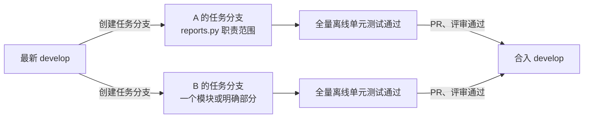

# Report Git 提交流程

**统一流程：`develop → 各自任务分支 → PR → develop`。** `xxx` 表示各自的任务分支，两人不要共用同一条任务分支。所有分支均遵循 [贡献指南](../CONTRIBUTING.md) 的模块范围、全量测试和 PR 审核要求。

## 1. 分工与流程图



- **开发者 A**：负责 `modules/report/reports.py`，需要其他模块或文件的实现支持时，在根目录 [ISSUE.md](../ISSUE.md) 说明需求并通知 B 或对应负责人，由其另建分支负责。
- **开发者 B**：按约定负责其他 Report 相关部分；每个分支仅实现一个模块或边界明确的一部分，不在一条分支中同时推进多个模块。需要修改 `reports.py` 时，先与 A 确认归属和修改范围。
- 两人需要修改同一文件时，先沟通修改范围和先后顺序，避免互相覆盖。跨模块依赖须在 `ISSUE.md` 记录所需支持、负责人、接口及验收条件，并在 PR 中关联交接状态。
- 依赖其他任务的变更时，先由对方通过独立 PR 合入 `develop`，再同步基线、联调和全量测试，不通过共享任务分支混合双方实现。

## 2. 在自己的 xxx 分支开发、提交

开始开发前，获取最新 `origin/develop`，各自从该基线创建任务分支；不再从 Report 中转分支创建新任务。

操作前确认工作区和暂存区干净；已有他人未提交改动时应保留并使用独立 worktree。以下以 A 的任务分支 `fix/report-followup` 为例，B 使用自己的分支名：

```bash
git status --short
git fetch origin
git switch --no-track -c fix/report-followup origin/develop

# 完成修改后，执行约定的代码检查和全量离线单元测试
conda activate shulan
python -m pytest tests/unit

# 全部检查通过后，只提交自己负责的文件
git add modules/report/reports.py
git diff --cached
git commit -m "fix(report): 修复报告生成逻辑"
git push -u origin fix/report-followup
```

A 只暂存自己负责的文件；B 按当前分支约定的范围逐个 `git add`，不要使用 `git add .`。针对性测试不能替代 `tests/unit/` 全量离线单元测试；测试失败或尚未执行时不得提交 PR。

## 3. 通过 PR 合入 develop

1. 在 Gitee 发起 `xxx → develop` 的 PR，说明本分支的模块范围、全量测试命令、通过结果及对应提交；有跨模块依赖时附 `ISSUE.md` 条目和依赖 PR。
2. 由另一人及相关模块负责人评审，核对贡献指南的全部强制要求；依赖未交接完成、修改超出范围或全量测试未通过等不符合项均拒绝合并，补齐后重新审核。
3. 如评审修改、依赖合入或基线同步改变待合并版本，重新运行全量离线单元测试并更新 PR 记录；由有权限的维护者审核通过后合入 `develop`。

**只向自己的任务分支直接 push，不直接 push 到 `develop`。** 任务分支合并并完成交接后可以删除；不再采用共享 Report 分支中转的两级 PR 流程。

其他 Git 与检查要求见 [贡献指南](../CONTRIBUTING.md)。本文说明协作约定，不代表已配置仓库权限。
