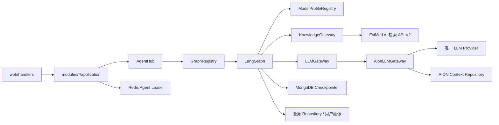
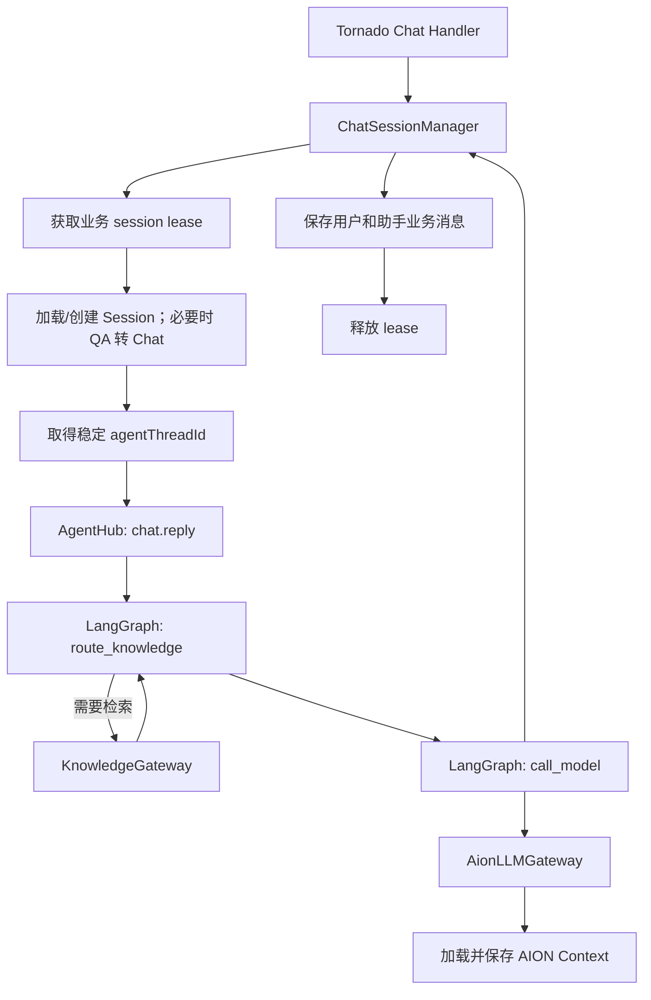

# Shulan Agent Core Wiki

> 文档状态：Agent 实现说明；Report 与架构状态复核：2026-10-10，基线 `develop@c9b8988`；本轮未重跑业务测试或真实环境验收；Python 3.12，开发/测试使用 `conda activate shulan`，生产目标为 Linux

全部本地 Tornado 路由的实现合规状态、非 Agent 架构边界和负责人迁移入口见 [API 架构实施状态](./api-architecture.md)。

Analysis、Record、Report 的文件入口，以及 health_profile、Chat 的结果消费关系，见 [上传文件统一解析指南](../docs/architecture/shared-document-ingestion-guide.md) 第 1 节。该节保留可编辑 Mermaid 工作流图，并按 2026-10-29 的源码核查区分 DocMind、仍可达的 Report 本地 PDF 提取和旧 OCR 兼容路径。

## 1. 当前结论

`agents/` 公共基础设施及 Chat、Record、Analysis、Report 模型入口已接入生产组装。Chat/Record 支持受控知识检索；完成建档与普通聊天通过无状态候选提取形成受控画像来源。Report 读取画像、独立保存产物，并通过只读检索支持 Chat 追问。I-036 已提供可注入的版本端口与受控工具运行器，生产 Graph 按域分批注册；整条业务主 Agent 接线和工具循环的业务启用仍待各域迁移，详见 [版本端口与工具运行](agent-tool-runtime.md)。歧义主体治理与高级上下文仍待建设。

更准确地说：

- AgentHub、Graph 注册、运行上下文、LLM 抽象、AION 适配、模型上下文持久化、MongoDB checkpoint、Redis lease 和应用级运行时容器已经具备。
- 进程入口创建共享 AgentRuntime，bootstrap 注入 Chat、Record、Analysis 和 Report；ApplicationBundle/ResourceRegistry 管理其生命周期。
- Analysis、Chat、Record 已定义模块自有 ports；DocMind、MongoDB/Redis Session、PromptManager 和 Chat Outbox 由 `adapters/` 实现并在组合根注入。
- `ApplicationBundle` 与 `AppContainer` 共享 `ResourceRegistry`，支持同步/异步资源逆序关闭和关闭失败聚合；独立 WorkerRegistry 尚未建立。
- `chat.reply` 同时支持完整输出和 SSE；`chat.suggestions` 已迁移为无状态能力。
- `record.plan`、`record.question` 分别接管患者情况分析与结构化回应生成；动态建档边界由应用层裁定。
- `chat.reply` 和 `record.question` 使用无状态路由判断是否检索指南、文献、说明书或临床试验；检索失败时降级到原模型流程。
- `analysis.health_report` 已接管体检报告文本的结构化 LLM 解读；DocMind 文档解析通过 Analysis 自有端口和 `adapters/analysis/docmind.py` 注入应用服务。
- `profile.extract_record_candidates` 以无状态 Graph 从完成建档回答提取候选；模型不能直接写画像，事实注册表、主体边界和生效状态由确定性策略控制。
- `profile.extract_chat_candidates` 只读取已经保存的单条用户消息；AI 回复、reasoning、检索资料、system 摘要和 custom 卡片不会成为画像来源。
- Chat 与 Record 对同一业务会话使用共享 Redis lease；SSE 客户端断开后，服务端仍消费完整模型输出并保存业务历史。
- 统一 AI 静态测试扫描 adapters、agents、modules、兼容 services 和 server.py；唯一模型 SDK 接入点为 AionLLMGateway。Web 门禁检查集中路由、显式注入和依赖方向。
- Report 三项 Graph 已注册，主叙事/follow-up 经 AgentHub；受控画像、五类产物/查询及 Chat 报告上下文已接线。持久受理、生成中断恢复和回调 Worker 由应用运行时调度，独立 Worker 进程仍待建设。
- 模型—工具—模型循环已有可选平台适配，业务尚未默认启用；歧义健康主体治理和上下文压缩仍属于后续能力。

因此，当前阶段可以概括为：

```text
Agent 公共底座：第一版完成
Chat / Record / Analysis 模型入口：已切换生产调用链
Report 模型入口、画像读取与 Chat 报告上下文：已接线；真实环境待验收
高级 Agent 能力：受控知识检索第一版完成
```

## 2. 设计目标

Shulan 将 LangGraph 作为唯一的 AI 工作流编排中枢，但不会把所有业务代码都放进 LangGraph。

最终调用方向为：

```text
Tornado Handler
  -> modules/*/application 应用服务
  -> AgentHub
  -> 已注册的 LangGraph
  -> LLMGateway
  -> AionLLMGateway
  -> AION
  -> 当前配置的唯一 LLM Provider
```

基本原则：

1. Handler 只处理 HTTP、参数解析、状态码和 SSE 写出。
2. `modules/*/application` 处理应用用例和非 AI 业务协调，不直接创建模型 Client；`services/` 只保留旧导入兼容别名。
3. 所有 LLM 调用通过 `AgentHub` 和已注册 Graph 发起。
4. Graph 负责确定性的业务工作流、节点状态、分支、恢复和事件。
5. AION 负责不同模型提供商的调用差异以及模型对话 Context。
6. 同一部署始终只启用一个 LLM Provider；更换厂商时不重写 Graph。
7. 采用“确定性工作流 + 局部受控 Agent”，不构建可以任意行动的万能 Agent。

## 3. 总体架构



这里存在三条相互独立但需要协同的数据链：

- 业务链：用户可见会话、报告、画像等权威业务数据。
- 模型链：AION 为模型保存和恢复的多轮对话 Context。
- 执行链：LangGraph 为工作流保存的 checkpoint 和节点状态。

任何一条链都不能替代另外两条。

## 4. 目录结构与职责

当前实际目录如下：

```text
agents/
├── __init__.py                 # Agent Core 的公共导入入口
├── contracts.py                # AgentRequest、AgentResult、AgentEvent
├── errors.py                   # Agent 领域异常
├── hub.py                      # 业务层调用所有 Graph 的统一入口
├── graphs/
│   ├── chat/
│   │   ├── graph.py            # chat.reply 完整与流式 Graph
│   │   ├── suggestions_graph.py# chat.suggestions 无状态 Graph
│   │   ├── profile.py          # 两项 Chat ModelProfile
│   │   └── registration.py     # 注册两项 Chat 能力
│   ├── record/
│   │   ├── graph.py            # record.plan/question 完整与流式模型图
│   │   ├── profile.py          # 建档 Prompt 与 ModelProfile
│   │   └── registration.py     # 注册两项 Record 能力
│   ├── analysis/
│   │   ├── graph.py            # analysis.health_report 无状态图
│   │   ├── profile.py          # 体检报告解读 ModelProfile
│   │   └── registration.py     # 注册 Analysis 能力
│   ├── health_profile/
│   │   ├── graph.py            # profile.retrieve_evidence 专科循证解释图
│   │   ├── focus.py            # 专科排序与重点覆盖
│   │   ├── interpretation.py   # 选题、检索、引用校验和有界缓存
│   │   ├── record_extraction.py# 建档候选事实无状态提取图
│   │   ├── profile.py          # 画像候选提取、选题和综合解释 ModelProfile
│   │   └── registration.py     # 注册画像候选提取与循证能力
│   ├── report/                # 主叙事、follow-up、只读报告检索及注册
│   └── validation/
│       └── graph.py            # 隔离验证 Gateway 的教学/测试 Graph
├── llm/
│   ├── protocol.py             # LLMGateway 协议
│   ├── types.py                # LLMRequest、Result、Chunk、Usage
│   ├── profiles.py             # ModelProfile 及注册表
│   └── aion_gateway.py         # 唯一 AION Chat Client 适配入口
├── knowledge/
│   ├── types.py                # 查询、条目和路由计划类型
│   ├── protocol.py             # KnowledgeGateway 协议
│   ├── evimed_gateway.py       # EviMed 响应归一适配
│   ├── routing.py              # 受控路由、检索和限额
│   └── profile.py              # knowledge.route Profile
├── persistence/
│   ├── checkpoint.py           # 官方 MongoDBSaver 构造
│   ├── llm_context.py          # AION Context Repository 协议
│   ├── mongodb_llm_context.py  # MongoDB Context Repository
│   └── locks.py                # Redis 分布式会话 lease
├── runtime/
│   ├── context.py              # 单次运行的 AgentRunContext
│   ├── registry.py             # capability 到 compiled Graph 的映射
│   ├── container.py            # AgentRuntime 依赖容器
│   ├── lifecycle.py            # Runtime 基础设施创建与关闭
│   └── application.py          # 读取应用配置并注册生产 Graph
└── testing/
    ├── fake_llm.py             # 无网络 FakeLLMGateway
    ├── fake_knowledge.py       # 无网络 FakeKnowledgeGateway
    └── memory_context.py       # 内存 Context Repository
```

Agent Core 的当前应用接线位于以下模块：

```text
bootstrap/factory.py                    # 组装应用服务并注入共享 AgentRuntime
runtime/application.py                  # ApplicationBundle、Worker 与安全排空
runtime/resources.py                    # 同步/异步资源逆序关闭与失败聚合
web/routes.py                           # 集中路由和应用服务显式注入
web/handlers/{analysis,record,chat}.py  # Tornado HTTP/SSE 适配
modules/analysis/application/service.py # analysis.health_report 使用方
modules/record/application/service.py   # record.* 使用方
modules/chat/application/service.py     # chat.* 使用方
modules/{analysis,record,chat}/ports.py # 三个模块自有出站端口
adapters/{analysis,persistence,record}/ # DocMind、Session、Prompt 适配器
adapters/messaging/chat_outbox.py       # Chat Outbox 适配器
services/{analysis,record,chat}.py      # 仅保留弃用导入兼容，不是实现所有者
server.py                               # 历史启动与测试导入兼容门面
```

全部 Handler（含 Report 查询与肠道屏障）位于 `web/handlers/`，31 个路由模式、32 个 HTTP 方法入口由 `web/routes.py` 集中注册。Report 生产路径显式注入持久化服务；Health/生命周期仍有 settings 兼容边界，不能把路由集中等同于分层治理全部完成。

### 4.1 `validation/` 与 `chat/` 的区别

`graphs/validation` 是隔离验证设施，不是生产业务代码。它用于验证：

- AgentHub 能否调用真实 LangGraph。
- LLMGateway 完整输出和流式输出协议是否成立。
- AION Adapter 是否能被 Fake Client 无网络测试。

`graphs/chat`、`graphs/record`、`graphs/analysis` 和 `graphs/health_profile` 是生产 Graph。当前采用“应用服务管理权威业务数据、Graph 管理模型任务”的边界：业务 Session 加载、QA→Chat 转换和消息落库位于 `modules/*/application`；所有模型调用、模型 Profile、上下文策略和标准流式事件由 Graph 管理。

## 5. Agent Core 公共契约

### 5.1 AgentRequest

`AgentRequest` 是业务层传给 Graph 的统一输入包装：

```python
AgentRequest({
    'agent_thread_id': 'opaque-agent-thread-id',
    'user_message': '我最近睡眠不好',
    'thinking': True,
})
```

它会复制调用方传入的 Mapping，避免 Graph 直接修改调用方对象。

### 5.2 AgentRunContext

`AgentRunContext` 保存单次执行所需的身份信息：

```text
user_id       业务用户标识
session_id    业务会话标识
subject_id    本次咨询涉及的健康主体，可选
request_id    一次客户端请求标识
run_id        一次 Agent 执行标识
```

`request_id` 和 `run_id` 可以由调用方提供，也可以通过 `AgentRunContext.create()` 自动生成 UUID。

它通过 LangGraph Runtime Context 传给节点，不属于持续累积的 Graph State。数据库 Client、Redis Client、API Key 和 Tornado Handler 同样不能放进 State。

### 5.3 AgentResult

非流式调用返回：

```text
capability     本次调用的能力名称
run_id         本次运行 ID
graph_version  Graph 注册版本
data           Graph 最终状态
```

业务 Service 必须把内部 `data` 映射成原 API 契约，不能把 Graph State 原样暴露给外部客户端。

### 5.4 AgentEvent

流式调用统一使用内部事件：

```text
run_started
reasoning_delta
content_delta
progress
tool_started
tool_finished
run_completed
run_failed
```

Tornado SSE Handler 只负责把这些内部事件转换为现有 API 的 `start`、`reasoning`、`content`、`finish` 和 `error`。当前 `chat.reply` 使用该协议输出流式推理和正文；Record 仅转发 `record.plan` 首次患者分析的 reasoning，`record.question` 完整生成经校验后再发送 question 或最终 finish。

## 6. AgentHub 与 GraphRegistry

### 6.1 capability

capability 是业务调用 AI 能力时使用的稳定名称，例如：

```text
chat.reply
chat.suggestions
record.plan
record.question
analysis.health_report
profile.extract_record_candidates
profile.extract_chat_candidates
profile.retrieve_evidence
report.narrative
```

`report.narrative`、`report.followup` 和 `report.retrieve_context` 已注册且采用无状态策略。主叙事与 follow-up Prompt 隔离，后者使用服务器任务允许列表；检索能力只读独立保存的私人报告，供 Chat 临时参考，不向画像写入生成结论。现有链路和部署验收见 [Report 指南](../docs/architecture/report-agent-integration-guide.md)。

### 6.2 GraphRegistry

`GraphRegistry` 保存：

```text
capability -> compiled graph + graph version
```

旧调用保留一个固定 capability 别名；新增版本使用 `legacy=False`，由完整 `AgentSelection` 精确选择，不自动替换别名或回退 latest。重复完整选择和未知选择均转换为 Agent 领域异常。生产注册按域暂存 Graph、Profile 和公开 Port，成功后一起发布；失败状态和主 Agent 端口详见 [版本端口与工具运行](agent-tool-runtime.md)。

### 6.3 AgentHub

完整调用：

```python
result = await runtime.hub.invoke(
    'chat.reply',
    request,
    context,
    thread_id=agent_thread_id,
)
```

流式调用：

```python
async for event in runtime.hub.stream(
        'chat.reply',
        request,
        context,
        thread_id=agent_thread_id,
):
    ...
```

生产调用必须显式传入不透明的 `agent_thread_id` 作为 LangGraph `thread_id`。如果不传，AgentHub 会退回使用 `run_id`，这种方式适合单次任务，但无法形成同一会话连续的 checkpoint。

业务 `user_id/session_id` 不直接作为 checkpoint 的 `thread_id`，以减少标识碰撞和基础设施索引中的业务身份暴露。

## 7. LLMGateway 与 AION 的边界

### 7.1 为什么同时存在 LLMGateway 和 AionLLMGateway

`LLMGateway` 是 Shulan Graph 依赖的厂商无关协议；`AionLLMGateway` 是该协议当前唯一的生产实现。

Graph 只知道：

```python
await gateway.complete(LLMRequest(...))
gateway.stream(LLMRequest(...))
```

Graph 不知道：

- 当前使用 DeepSeek、Qwen 或其他 OpenAI-compatible Provider。
- AION Client 如何创建。
- Context v1 如何导入、导出和持久化。
- 厂商返回 usage 的具体结构。
- AION 异常如何转换成项目领域异常。

这使得 Shulan 的业务工作流不会和 AION 的具体版本或模型厂商耦合。

### 7.2 LLMRequest

`LLMRequest` 包含：

```text
profile             ModelProfile
content             当前轮输入字符串
supplemental_context 只供本轮使用、不归档到 AION 历史的补充资料
conversation_key    有状态模型会话标识
thinking            本轮是否思考，可覆盖 Profile 默认值
web_search          本轮是否开启联网搜索，None 继承 Profile
search_query        与模型输入分离的非空检索词，仅在搜索开启时可传
```

联网搜索默认关闭，请求值优先于 Profile；完整和流式调用一致。业务在 Graph 内传参，Provider 协议仍由 AION 负责。固定依赖 AION `v0.6.0` 后，阿里云和 DeepSeek 客户端均有公开搜索参数；不支持所需参数时显式报错。DeepSeek 的 `search=True` 会先执行搜索及必要的网页获取，再调用模型，其独立 `search_query` 限 1～128 个字符。问卷因素链仅在自有知识库无适用材料时开启该次检索，Chat、Report 等既有默认值保持关闭。接入方式和依赖边界见 [共享 LLM 联网搜索](../docs/architecture/llm-web-search.md)。

### 7.3 LLMResult、LLMChunk 和 LLMUsage

完整结果统一为：

```text
content
reasoning_content
usage
provider
model
search_sources
search_trace
```

流式 Chunk 当前统一为：

```text
content
reasoning_content
usage
search_sources
search_trace
```

usage 会规范化常用 Token 数量，同时在 `raw` 中保留提供商原始信息，例如缓存命中 Token。这为后续成本统计和缓存命中率分析保留了数据基础。

`search_sources` 与模型正文分开：AION `search_trace.sources` 中的 dataclass 来源规范化为内部映射，`excerpt` 映射为 `text`，保留 `excerpt_origin`；`search_trace` 完整保留 `query`、SDK 原始 `sources` 与 `operations`。流式尾部仅带追踪或来源的 Chunk 不因正文为空而丢弃。当前 DeepSeek SDK 最多提供 5 条来源、每条最多 1200 字符的摘录，不是全文，也不自动构成医学可靠性证明。业务仍须验证材料适用性和逐字引用；这些内部字段不会自动进入现有 HTTP/SSE 响应。

## 8. ModelProfile

ModelProfile 集中描述一项能力如何调用模型：

```text
name             Profile 名称
context_policy   上下文策略
prompt_name      system prompt 名称
model            可选模型覆盖
thinking         默认思考开关
web_search       默认联网搜索开关，False
```

当前支持两种 ContextPolicy：

| 策略 | 用途 |
|---|---|
| `STATELESS` | 单次独立任务，不读取和保存模型对话历史 |
| `AION_FULL` | 使用 AION Context 保存和恢复完整模型会话 |

当前 `chat.reply` Profile 为：

```text
name            = chat.reply
context_policy  = AION_FULL
prompt_name     = chat/chat_system.txt
thinking        = True
model           = 可选；未设置时使用 Runtime 默认模型
```

上下文压缩、最近 N 轮和摘要策略尚不存在。知识检索使用独立的受控 Graph 分支，不是 ContextPolicy；检索结果通过 `supplemental_context` 只供当前轮使用。

## 9. 三种“上下文/记忆”必须区分

| 数据 | 所有者 | 用途 | 是否权威业务数据 |
|---|---|---|---|
| Graph State / checkpoint | LangGraph | 节点进度、节点输出、恢复执行 | 否 |
| AION Context | AION + Context Repository | 构造模型多轮 messages | 否，可由业务记录重建 |
| 业务 Session | Shulan MongoDB | history API、用户可见对话、审计 | 是 |
| 健康长期记忆/画像 | Shulan 画像系统 | 跨会话健康事实和主体关系 | 是 |

### 9.1 LangGraph checkpoint

checkpoint 不会自动压缩 Prompt，也不会自动决定哪些历史最重要。它保存的是图执行状态，主要解决：

- 工作流执行到哪个节点。
- 节点已经产生了什么结果。
- 相同 thread 的状态连续性。
- 中断后继续或检查历史状态。

### 9.2 AION Context

AION Context 负责模型真正看到的多轮历史。当前流程是：

```text
根据 conversation_key 加载 Context 快照
  -> 创建独立 AION context=True Client
  -> 导入快照
  -> 只提交当前轮 content
  -> AION 自动组合 system + 历史 + 当前消息
  -> 完成调用
  -> 导出新 Context
  -> 按 revision 保存
```

Context key 的当前构造规则为：

```text
<profile.name>:<conversation_key>
```

普通聊天示例：

```text
chat.reply:opaque-agent-thread-id
```

不同 Profile 即使使用相同 conversation_key，也不会共享 Context。

### 9.3 健康长期记忆

首版本人画像、报告/建档/聊天来源摄取、事实确认/更正/删除与审计已实现；父母及明确父系/母系祖父母可跨会话复用稳定主体。歧义主体确认绑定、自动失效和跨事实冲突仍待建设。画像不同于聊天历史，最终报告 AI 产物也独立于健康事实，具体边界见 [画像设计](../docs/architecture/user-health-profile-design.md)。

## 10. 持久化与并发控制

### 10.1 MongoDB checkpointer

`create_mongodb_checkpointer()` 使用官方 `MongoDBSaver`，并使用独立 collection：

```text
agent_checkpoints
agent_checkpoint_writes
```

实际名称可通过环境配置覆盖。官方 saver 当前使用同步 PyMongo，其异步方法通过线程执行器包装。因此 AgentRuntime 单独持有同步 Mongo Client；项目现有业务 MongoDB 和 AION Context Repository 继续使用异步 Client。

### 10.2 AION Context Repository

`MongoLLMContextRepository` 使用异步 Mongo collection，文档形态为：

```text
_id         内部 context key
revision    乐观并发版本
payload     AION Context v1
createdAt
updatedAt
```

保存规则：

- 首次保存要求 `expected_revision=0`。
- 更新时 MongoDB 查询必须同时匹配 `_id` 和旧 revision。
- 成功更新后 revision 加一。
- 旧运行尝试覆盖新 Context 时抛出 `LLMContextConflictError`。

这只能发现并发冲突，不能替代会话串行化。

### 10.3 Redis Agent Lease

`RedisAgentLeaseManager` 使用 Redis `SET NX EX` 获取 lease，并使用 Lua 脚本确保只有相同 owner 才能续期或释放。

thread id 在进入 Redis key 前会经过 SHA-256，避免直接暴露业务或内部会话标识。

lease 组件已经接入 Chat 与 Record 的业务执行流程：

```text
以 userId + sessionId 生成共享 lease 标识
  -> 加载或转换业务会话
  -> 执行 Graph
  -> 保存业务结果
  -> finally 中释放 lease
```

同一会话必须串行，不同会话可以并行。Chat 和 Record 复用同一套业务 session lease，防止已完成建档转入普通聊天时发生交叉覆盖。当前尚未实现长任务的自动续租；lease TTL 必须覆盖一次模型调用和业务落库的最长时间。

## 11. AgentRuntime

AgentRuntime 是应用级单例依赖容器，持有：

```text
AgentHub
GraphRegistry
ModelProfileRegistry
LLMGateway
KnowledgeGateway
LLMContextRepository
AgentLeaseManager
MongoDB checkpointer
```

`create_agent_runtime()` 负责创建这些依赖，并保证 checkpointer 创建失败时关闭已经创建的同步 Mongo Client。

`runtime.close()` 是幂等的，并负责关闭 checkpointer 拥有的 MongoDB 资源。

当前生产生命周期：

```text
main.py / server.run() 兼容入口
  -> create_application_agent_runtime()
  -> 从 config.env 组装 AgentRuntimeSettings
  -> 创建 Gateway / Context Repository / Checkpointer / Lease
  -> 注册 Chat / Record / Analysis / Health Profile Graph
  -> bootstrap.build_container() 把同一个 runtime 注入应用服务
  -> web.create_web_application() 通过命名路由显式注入 Handler
  -> ApplicationBundle(AppContainer) 持有运行时所有权

Tornado 关闭
  -> 停止接收请求和领取周期任务
  -> 等待请求与 Supervisor 任务排空
  -> ApplicationBundle.close() 关闭其拥有的 runtime
```

`create_agent_runtime()` 仍只负责通用基础设施，方便无网络测试和其他装配方式；`create_application_agent_runtime()` 负责生产配置和业务 Graph 注册。`ApplicationBundle` 与 `AppContainer` 共享同一 `ResourceRegistry`，Bundle 登记其拥有的 AgentRuntime，运行退出时统一调用 Registry；同步/异步资源按登记逆序关闭，单项失败不阻断后续关闭并最终聚合报告。`application.settings` 仍保留生命周期、业务和历史测试兼容 key；Report 生产路由已显式注入，不再依赖旧 report_pipeline setting。

## 12. 当前生产能力

### 12.1 能力注册表

| capability | Graph 版本 | ContextPolicy | checkpoint | 使用方 |
|---|---|---|---|---|
| `chat.reply` | `chat-reply-v5` | `AION_FULL` | MongoDB | 专业健康对话、逐轮建档参考、SSE 与按需知识检索 |
| `chat.suggestions` | `chat-suggestions-v1` | `STATELESS` | 关闭 | 个性化推荐问题 |
| `record.plan` | `record-patient-v5` | `STATELESS` | 关闭 | 患者情况、疑问与信息缺口分析 |
| `record.question` | `record-response-v8` | `STATELESS` | 关闭 | 关闭 thinking 的结构化回应、下一问及按需检索 |
| `analysis.health_report` | `analysis-health-report-v3` | `STATELESS` | 关闭 | 体检报告结构化解读 |
| `profile.extract_record_candidates` | `profile-record-extraction-v4` | `STATELESS` | 关闭 | 已完成建档回答的候选事实提取 |
| `profile.extract_chat_candidates` | `profile-chat-extraction-v3` | `STATELESS` | 关闭 | 单条普通聊天用户消息的候选事实提取 |
| `profile.retrieve_evidence` | `profile-evidence-v2` | `STATELESS`，关闭 thinking | 关闭 | 当前事实选题、指南/文献检索、综合解释与引用校验；使用 `profile.plan_focus` 和 `profile.synthesize_evidence` |
| `report.narrative` | `report-narrative-v1` | `STATELESS` | 关闭 | 主报告叙事与模型辅助任务 |
| `report.followup` | `report-followup-v1` | `STATELESS` | 关闭 | 固定模板及任务允许列表下的后续模型任务 |
| `report.retrieve_context` | `report-retrieve-context-v1` | `STATELESS` | 关闭 | 受控选择报告批次和产物类型，正文由 Provider 读取供当前 Chat 使用 |

只有普通多轮聊天需要 AION 模型历史和 LangGraph checkpoint。其他能力的输入已经包含完成任务所需的业务信息，若开启历史反而可能造成跨任务污染，因此显式使用无状态策略。

### 12.2 Chat 调用链



`chat.reply` 在 `route_knowledge` 中判断是否需要外部资料，需要时最多执行两条受控检索，然后由同一个 `call_model` 节点支持完整和流式调用。流式模式的内部事件包含 `run_started`、`tool_started`、`tool_finished`、`reasoning_delta`、`content_delta` 和 `run_completed`。Service 只将现有 API 需要的事件映射为 SSE，因此对外契约不变。

Chat 检索资料通过 `LLMRequest.supplemental_context` 只进入当前模型请求；`AionLLMGateway` 持久化 Context 时恢复原始用户消息，不把检索全文带入后续每一轮。

Graph State 只保存本次运行的最小输入输出，不复制持续增长的历史。后续轮次只提交当前用户消息，由 Gateway 根据 `chat.reply:<agentThreadId>` 恢复 AION Context。旧业务会话首次迁移或 Context 丢失时，Service 从权威业务消息中最多取 20 条重建一次模型上下文。

Chat 每轮通过 `AgentRunContext.session_health_context` 注入当前会话的有界建档快照，通过 `health_profile_context` 读取长期画像，通过 `report_context` 注入受控报告章节。三类数据与循证资料分区，仅作为本轮临时参考。寒暄、健康问询及医生 custom 卡片边界见 [Chat 专业健康引导](chat-health-guidance.md)；最终报告读取不等同于医生核验正文。

### 12.3 SSE 断连策略

浏览器在 SSE 未结束时断开连接，Tornado Handler 停止 `write/flush`，但后台继续消费 `sendMessageStream()`：

```text
客户端断开
  -> 不再写 SSE
  -> 继续消费 Agent stream
  -> 收集完整 reasoning/content
  -> 保存完整助手消息
  -> 释放 session lease
```

因此网络连接生命周期不决定模型运行和业务消息是否存在。进程崩溃、机器宕机和超出租约时间仍属于更高等级的恢复问题，不能仅靠该策略解决。

### 12.4 Record 与 Analysis 边界

Record 保留 Redis 两小时活动缓存，初始建档后进入补充答疑，全程最多 20 次实质交互。`QASessionManager` 与 flow policy 管理阶段、计数、疑问处理边界和自动完成；`record.plan` 分析患者信息，不接收计数或阶段；`record.question` 按裁定生成独立说明与问题，并可按需检索。详见 [动态建档实现](record-dynamic-flow.md)。

建档自动完成后，持久化 Worker 通过 `profile.extract_record_candidates` 分批读取去除问题 reasoning 的问答数据。明确用户输入的性别、身高、体重由程序直接映射；模型提取的本人候选统一以 `user_reported + pending` 进入事实治理。模型同时返回 `subjectKind` 和 `subjectHint`，但不能指定数据库 `subjectId`。确定性解析器会为父亲、母亲以及明确区分父系/母系的祖父母创建或复用稳定主体；相应家族史以 pending 写入血亲画像，不复制为本人的疾病。兄弟姐妹、子女、配偶和朋友等可能对应多人的称谓不自动合并，也不允许回退到本人，当前保留在权威 QA 快照中等待候选持久化与用户确认流程。

Analysis 的 DocMind 文件解析是外部文档解析服务，不是 Chat LLM。应用服务只依赖 `DocumentParsingClient` 端口，具体 Client 由 `adapters/analysis/docmind.py` 构造并经 bootstrap 注入；解析出的文本再交给 `analysis.health_report`。阻塞式调用通过线程执行，避免阻塞 Tornado 事件循环。

当前结构化抽取允许一并生成最多 200 字的简短 `aiSummary`，不新增独立模型调用。最终结果经过过滤、分段、纠正或原件核对后，使用最终保留项目生成简单概述；部分结果或仍有待核实项目时说明依据有限，无可用结果时为 `null`。有可确认结果但仍含待核实项目时，`processing.status` 为 `partial`；没有已确认异常时总体状态为 `pending`，已有异常结果继续保留。仅元数据或待核实项的内部不可用结果仍沿用 API 的内容展示投影，不伪造临床结果。摘要随完整结果归档，不作为中立观察或画像事实发布；真实模型的概述质量仍需使用合成报告验收。

普通 Chat 完整回复或 SSE 的用户消息与 AI 回复保存成功后，系统使用用户消息的稳定 `messageId/messageRevision` 投递画像任务。`profile.extract_chat_candidates` 是另一条无状态 Graph，不会复用 `chat.reply` 的 AION Context，也不会读取 AI 回复或 reasoning。模型只生成候选，程序继续执行类型白名单、主体解析和 pending 策略。第一版只处理消息自身能够独立表达的事实；依赖上一条问题才能理解的“是”“没有”等短回答暂不进入画像。

### 12.5 custom 业务卡片

`POST /api/v1/chat/messages/custom` 可以向已经结束建档并进入普通对话阶段的既有会话插入 `role=custom` 业务消息。用户无需先发送普通聊天消息，但进行中的建档问答不能接收卡片。该接口复用业务 session lease，但不调用 AgentHub，也不修改 AION Context。旧会话重建模型上下文时同样忽略 `custom`。其中 `displayType` 是受枚举约束的展示形式，`customType` 是业务内容类型，`title/content` 是客户端展示字段，`payload` 保存报告等权威资源引用。请求会先写入 MongoDB Outbox；AI 正在输出时返回 `202 queued`，完整回复保存后再把卡片追加到其后，服务启动后的周期任务负责恢复遗留 `pending` 事件。详细设计见 [医生签发内容插入对话流设计](../docs/architecture/chat-doctor-signed-card.md)。

## 13. 统一入口迁移状态

| 业务位置 | 能力 | 状态 |
|---|---|---|
| `modules/chat/application/service.py` | 完整回复、SSE、推荐问题 | 已迁移至 `chat.*`；`services/chat.py` 仅兼容旧导入 |
| `modules/record/application/service.py` | 问题数规划、完整追问、SSE 追问 | 已迁移至 `record.*`；`services/record.py` 仅兼容旧导入 |
| `modules/analysis/application/service.py` | 体检报告 LLM 解读 | 已迁移至 `analysis.health_report`；`services/analysis.py` 仅兼容旧导入 |
| `health_profile/record_ingestion.py` | 建档候选事实提取 | 已迁移至 `profile.extract_record_candidates` |
| `health_profile/chat_ingestion.py` | 单条用户消息候选事实提取 | 已迁移至 `profile.extract_chat_candidates` |
| `modules/report/`、`adapters/report/` | 主叙事、后续模型任务、画像、存储与报告读取 | AgentHub、持久受理/产物/投递、查询和 Chat 追问已接线；真实环境待验收 |

`tests/unit/architecture/test_unified_ai_entry.py` 固定以下边界：

1. `adapters/`、`agents/`、`modules/`、兼容 `services/` 和 `server.py` 不得绕过唯一 Gateway 创建模型 Client。
2. AION Chat Client 只能由 `agents/llm/aion_gateway.py` 创建。
3. DocMind、PromptManager 等非 Chat Client 能力不被误判为直接模型调用。

`tests/unit/architecture/test_web_architecture.py` 检查当前 31 个路由模式的集中、命名与唯一性，以及 Handler/应用层依赖边界；bootstrap 与 runtime 测试覆盖 Adapter 注入和资源逆序关闭。Report 持久受理/恢复与回调的替身测试位于 `tests/unit/report/`。

上述是现有门禁和覆盖范围，不能据此推断本轮重新执行或全部通过。统一 AI 扫描已包含 modules 和 adapters；真实模型切换、MongoDB 多进程/强退恢复及业务回调仍需单独验收。

## 14. 新增一项 Agent 能力的标准步骤

以后新增能力不应直接复制 Chat Client，而应按以下顺序进行：

1. 确定 capability，例如 `chat.suggestions`。
2. 判断任务是否需要模型上下文。
3. 创建 ModelProfile，选择 `STATELESS` 或 `AION_FULL`。
4. 定义最小且可序列化的 Graph State。
5. 通过 LLMGateway 调用模型，不导入 AION 或具体厂商 SDK。
6. 为外部数据访问定义 Repository/Tool 边界。
7. 构建 StateGraph builder，不自行绑定生产数据库。
8. 由 AgentRuntime 注入生产 checkpointer 并注册 capability/version。
9. 使用 FakeLLMGateway 完成无网络契约测试。
10. 再由 Service 接入 AgentHub，并保持原 API 契约。
11. 最后进行真实 LLM、MongoDB、Redis 和 Tornado 集成测试。

是否启用模型上下文的判断示例：

| 能力 | 推荐策略 | 原因 |
|---|---|---|
| 普通多轮聊天 | `AION_FULL` | 后续问题依赖之前对话 |
| 推荐问题生成 | `STATELESS` | 输入中已经包含本次所需画像/QA 摘要 |
| 报告单节点分析 | `STATELESS` | 报告工作流 State 传递结构化结果 |
| 建档追问 | `STATELESS` | Service 每轮构造完整业务 Prompt，不把问答状态误作模型历史 |

## 15. 测试方法

所有 Agent 本地开发和测试均使用 Shulan 环境：

```bash
conda activate shulan
```

Windows 或 Linux 激活环境后，均可执行：

```bash
python -m unittest tests.unit.agents.core.test_agent_core -v
python -m unittest tests.unit.agents.llm.test_llm_gateway -v
python -m unittest tests.unit.agents.llm.test_aion_llm_gateway -v
python -m unittest tests.unit.agents.persistence.test_mongodb_llm_context -v
python -m unittest tests.unit.agents.persistence.test_agent_lease -v
python -m unittest tests.unit.agents.core.test_agent_runtime -v
python -m unittest tests.unit.agents.persistence.test_mongodb_checkpointer -v
python -m unittest tests.unit.agents.graphs.chat.test_chat_reply_graph -v
python -m unittest tests.unit.agents.graphs.chat.test_chat_suggestions_graph -v
python -m unittest tests.unit.agents.graphs.record.test_record_agent -v
python -m unittest tests.unit.agents.graphs.analysis.test_analysis_agent -v
python -m unittest tests.unit.agents.graphs.health_profile.test_record_extraction_graph -v
python -m unittest tests.unit.health_profile.test_record_ingestion -v
python -m pytest tests/unit/architecture/test_unified_ai_entry.py -q
python -m pytest -q
```

这些测试主要使用 Fake Gateway、Fake Client、Fake Redis、Fake Mongo collection 或 InMemorySaver，不请求真实 LLM。

真实服务验证需要开发者自行准备环境配置。项目的环境变量说明应阅读：

- `.env.example`
- 对应环境的 `.env.example.*`
- `config/env.py`
- `README.md`

不要在文档、测试输出、日志或提交记录中暴露 `.env`、API Key、MongoDB URI 和 Redis 密码。

## 16. 当前已知限制

1. Report 模型、画像、产物/查询及 Chat 追问已有源码接线；真实提供商、数据库、回调和内容一致性仍需部署验收。
2. AION Context revision 冲突能够被发现，但还没有通用的业务层重试策略。
3. Redis lease 没有自动续租；超长模型任务可能超过 TTL。
4. 没有 Agent run 独立审计记录，也没有集中保存 Prompt/Graph/模型版本、Token、缓存命中、延迟和错误。
5. 完整与流式结果的 provider/model 元数据还不完全对称，业务接口也没有暴露 usage。
6. 没有统一超时、重试、熔断和不同错误类型的策略。
7. 没有 Prompt/Graph 版本迁移与旧 checkpoint 兼容策略。
8. AION Context 使用完整历史；没有 Token 预算、滚动摘要、相关性筛选或上下文压缩。
9. 旧会话重建模型 Context 时仍固定截取最多 20 条业务消息。
10. 没有模型—工具—模型循环以及工具权限、审计和幂等机制。
11. 本人画像、报告/建档/普通对话摄取和受控事实更新已经具备；父母及明确父系/母系祖父母可跨会话复用，兄弟姐妹、子女、配偶、朋友等歧义主体的持久候选和确认绑定尚未实现。
12. 知识检索第一版依赖 EviMed 关键词检索；尚无独立重排、证据等级计算、结构化引用 API 和向量检索。
13. 检索路由在候选场景增加一次无状态 LLM 调用，需用真实评估集继续测量准确率、延迟和成本。
14. 官方 MongoDBSaver 使用同步 PyMongo 的线程包装，需继续验证 Linux 高并发下的线程池和连接池负载。
15. 客户端断连可以完成当前对话保存，但进程崩溃后的模型调用恢复和业务落库补偿尚未实现。
16. custom 消息插入接口第一版没有应用层认证和实时推送；生产部署必须限制可信调用方，客户端需刷新历史或复用现有通知机制。
17. Tornado 已实现 `SIGTERM` draining、请求/任务追踪和 readiness；Linux 真实信号及生产发布配置尚未演练。
18. Report 持久化受理/恢复已接线；中断任务保留已有产物并补齐失败结果，不重放中断的模型调用，真实强退与多进程恢复需验证。
19. Web 及 Analysis/Chat/Record 第一轮模块化完成，Health Profile 内部尚未拆分；Report 完整应用接口、模块资源契约、独立 Worker 进程和兼容入口仍待收口。

## 17. 下一阶段建议

Chat/Record/Analysis/Report 与画像能力已进入 Agent 中枢。后续以现有调用链和部署验收缺口推进，不沿用历史文档中的合并或建分支指令：

```text
1. 完成 SIGTERM 安全停服的 Linux 真实信号、长任务和生产发布验证。
2. 完成 Report 真实模型、画像、五类产物/回调、查询与 Chat 原/新会话的联合验收。
3. 收口 Report 应用接口、模块资源契约和独立 Worker 进程，验证现有持久化续租、补偿与恢复。
4. 建立 Agent run 可观测与审计记录，保存能力、版本、模型、usage、延迟和错误摘要。
5. 建立知识检索评估集和结构化引用契约，并继续设计 Token 预算与上下文压缩。
```

每一项都应遵循“设计/契约 → 单一纵切实现 → 自动化测试 → 人工真实验证 → 手动提交”的节奏，不提前扩展没有业务调用方的 AION 或 Agent 类型。

## 18. 相关设计文档

- [Shulan 应用架构：模块化单体与 Ports/Adapters](../docs/architecture/application-architecture.md)
- [Tornado 安全停服与生产更新方案](../docs/architecture/graceful-shutdown-and-deployment.md)
- [AI Agent 目标架构](../docs/architecture/agent-target-architecture.md)
- [Report 端到端迁移历史草案（已过期）](../docs/architecture/report-api-migration-guide.md)
- [最终报告接入 Agent 中枢指南](../docs/architecture/report-agent-integration-guide.md)
- [普通对话 LangGraph POC 设计评审](../docs/architecture/chat-langgraph-poc-review.md)
- [健康记忆与事实主体设计](../docs/architecture/health-memory-design.md)
- [用户健康画像设计方案](../docs/architecture/user-health-profile-design.md)
- [医生签发内容插入对话流设计](../docs/architecture/chat-doctor-signed-card.md)
- [Agent 知识库检索设计](../docs/architecture/agent-knowledge-retrieval.md)
- [AION Agent 对话协议历史设计](../docs/architecture/aion-agent-protocol.md)
