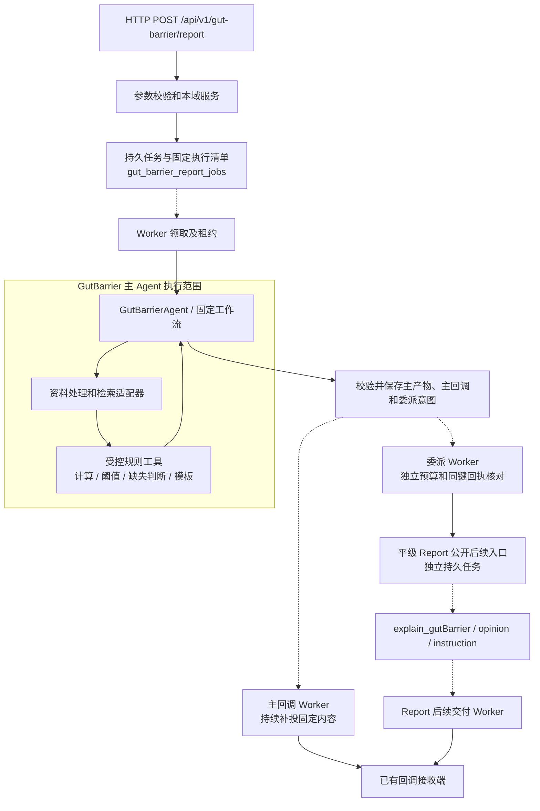
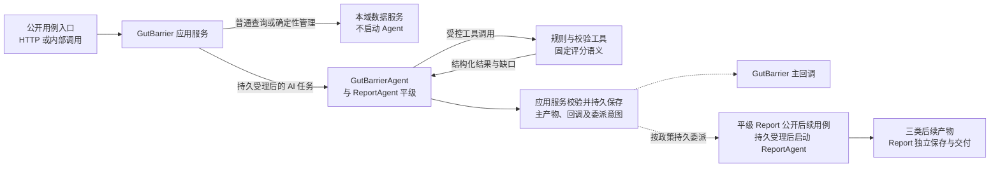

# 肠道屏障实现与运维

> 状态：本地重构候选实现，更新日期：2026-11-10。已增加 GutBarrierAgent、固定规则工具与公开持久 Report 委派；尚未完成真实模型、Mongo 并发、外部回调和部署验收。

外部请求、受理响应、回调字段及展示约定以 [API 文档的肠道屏障章节](../docs/api/API.md#肠道屏障报告接口) 为准。本页解释实现归属和运维入口，不重复评分公式或接口 Schema。

## 1. 当前调用链与所有权




| 边界 | 当前入口与职责 |
| --- | --- |
| 路由和注入 | [路由表](../web/routes.py)、[Handler](../web/handlers/gut_barrier.py)、[组合根](../bootstrap/factory.py)；Handler 校验请求并调用已注入服务 |
| 应用与生成 | [Service](../modules/gut_barrier/service.py) 管理受理、并发、租约、恢复和投递；[Pipeline](../modules/gut_barrier/pipeline.py) 按固定流程调用资料处理、规则评估、检索和模板生成主报告与内部审计，由 [GutBarrierAgent](../modules/gut_barrier/agent.py) 以固定工作流主 Agent 执行，不新增主控模型调用 |
| 基础设施 | [Adapter 工厂](../adapters/gut_barrier/factory.py) 注入来源、产品、循证、Report 后续模型及回调依赖；[Mongo Store](../adapters/gut_barrier/store.py) 保存任务、固定结果及交付状态 |
| 展示绑定 | [投递 Adapter](../adapters/gut_barrier/delivery.py) 发送模板绑定头；[render context](../adapters/gut_barrier/render_context.py) 关联报告、模板和摘要 |
| 生命周期 | [应用运行时](../runtime/application.py) 启动生成、恢复和投递扫描，排空时停止新领取并等待在途工作 |

生产使用独立的 `gut_barrier_report_jobs` 集合，当前名称由 Adapter 工厂固定；与 Report 的批次、产物及回调集合分开。回调目标共用 `SHULAN_REPORT_CALLBACK_URL`，受理时保存目标快照，投递并发、超时和退避配置复用现有 Report 配置。不能把修改配置视为迁移已受理任务的目标。

当前主 Agent 以确定性工作流控制原有流程。默认装配没有注入 Pipeline 的可选 narrative 整理器；资料处理仍可能调用 OCR，后续解读通过 Report 的 `report.followup` 能力调用模型。因此，“规则主导”不等于整个用例完全没有 AI，本批不增加自主研究循环。

## 2. 主报告、解读与恢复

- 本模块只保存和投递一份 `type=gutBarrier` 主报告，状态为 `success/partial/failed`，不同于原 Report 的 `partial_success`。当前主报告信封为 schemaVersion 2.0，正文为 gut-barrier-public.v2。
- 主报告终态保存时同时写入公开委派意图；成功、部分成功、失败和中断封口均使用冻结的主报告输入。独立 Worker 经 [PublicReportDelegationAdapter](../adapters/gut_barrier/delegation.py) 请求 Report 后续任务，仅生成 `explain_gutBarrier`、`opinion`、`instruction`，不额外生成 `evaluate/explain`。Report 内部仍复用原后续 Prompt 和内容映射。
- 主回调、委派、Report 后续生成和后续交付独立保存状态。主回调非 2xx 持续补投，失败不阻断委派；委派预算耗尽不停止任何已建立回调。受理回执未知时先按同一内部任务 ID 核对，不能创建第二个任务；终态 `needs_reconciliation` 需人工核对。Report 后续使用独立集合和内部 ID，回调保持原 `finalReportId/type`。
- 待开始任务可继续调度；已开始但租约过期的任务以中断失败结构收尾，不重新运行临床生成。主报告与解读的交付责任分开，本模块不新建独立解读队列，也不恢复或投递历史解读子任务。
- 主报告采用至少一次交付，当前幂等头为 `<finalReportId>:gutBarrier:v2`；未收到 2xx 时持续退避补投，接收端按类型和幂等标识处理重复投递。原 Report 查询接口不能直接用作本模块查询接口，当前没有额外肠道屏障查询路由。

## 3. 已实现的主 Agent 边界与后续演进

GutBarrierAgent 与 ReportAgent 平级，各自属于自己的业务域。下图表示职责边界：本批落地固定主工作流、规则工具及公开持久委派，后续是否增加理解或综合子 Agent 需本域独立评测；完整研究循环不强加给 GutBarrier。详细目标见 [架构方案](../docs/architecture/modular-multi-agent-architecture.md)。



- GutBarrierAgent 先封装现有资料处理、规则评估、检索与报告组织流程，再按需增加资料理解、缺口判断和综合子任务；可独立复用的能力提供为工具，任务目标、证据使用和表达要求配置为本域提示词。指标计算、评分公式、阈值、必做校验和正式保存仍由程序执行，不为封装强加一次主控模型调用。
- 普通查询和确定性管理属于 GutBarrier 模块，但不运行 GutBarrierAgent，也不要求模型可用。图中的公开用例不等于新增 HTTP 路由；当前仍没有额外肠道屏障查询路由，不能直接套用 Report 的查询接口。
- ReportAgent 是平级业务主 Agent，其公开后续能力不是 GutBarrier 的私有子 Agent。GutBarrier 通过冻结输入、固定版本与稳定幂等键持久委派；Report 独立拥有 `explain_gutBarrier`、`opinion`、`instruction` 产物及交付状态，双方不读写对方的私有状态。目标委派有独立重试预算与取消范围；明确取消时不新建尚未受理的 Report 任务，已受理任务按独立政策处理，受理回执未知时保持同键核对。
- Report 后续任务按三类预期产物恢复和对账，不补造评估来源的 evaluate/explain；内部任务身份与主报告引用分开，回调正文保留原 finalReportId/type。首期不将新内部任务加入现有 Report 评估目录或 Chat 自动选报候选。
- 主回调及 Report 后续回调未收到 2xx 时持续退避补投，不受生成或委派预算限制。读取画像继续遵守 Profile 唯一权威事实边界，不另建 GutBarrier 治理版本。
- Report 公开持久后续能力已经独立交付，GutBarrier 生产装配已移除私有 `_push_report` 调用；兼容注入仅用于旧测试且禁止与持久委派同时开启。新旧路径不会同时正式生成。

## 4. 模板和日志

当前新报告采用的固定模板为 [gut-barrier-static.v14.json](../adapters/gut_barrier/assets/gut-barrier-static.v14.json)，对应 [显示版本定义](../modules/gut_barrier/display_versions.py) 的 `LATEST_DISPLAY_TEMPLATE`；[v13 模板](../adapters/gut_barrier/assets/gut-barrier-static.v13.json) 仍随包保留供对应历史绑定使用。可用主报告回调附带模板版本、报告 ID 及报告摘要头；接收端应连同原 JSON 保存并校验。失败主报告不携带这些绑定头。

历史正文不能仅凭 gut-barrier-public.v2 推定使用最新模板。当前包未保留的旧模板预览需提供对应的外部归档；版本、摘要或标识不匹配时明确报错，不静默替换模板。固定模板合并规则以 API 文档和 [预览 Adapter](../adapters/gut_barrier/frontend_template.py) 为准，HTML 只是本地预览，不是生产 API 产物。

HTTP Handler 只记录访问摘要，不因打开正文日志配置而输出请求/响应预览。后台任务绑定持久化用户、会话和批次身份，投递日志以 `callback_scope=gut_barrier` 区分队列；详细规则见 [HTTP 日志](http-logging.md) 和 [公共日志工具](logging.md)。

## 5. 操作入口与验收

从项目根目录、shulan Conda 环境执行：

```bash
# 以下命令不连接数据库
python -m scripts.check_gut_barrier_queue --print-version
python -m scripts.render_gut_barrier_callback --help
python -m scripts.generate_gut_barrier_report --help

# 只读检查实际队列：使用具备读取权限的部署配置
python -m scripts.check_gut_barrier_queue
```

[队列检查工具](../scripts/check_gut_barrier_queue.py) 只输出聚合计数，检查其他版本的生成积压，不生成报告、不补投、不迁移数据。正常退出码为 0，存在阻断积压为 2，检查失败为 1；这是检查时点的快照，不锁定队列或替代投递验收。历史独立解读记录仅审计，不据此恢复旧解读 Worker。

[回调预览工具](../scripts/render_gut_barrier_callback.py) 读取已保存的终态回调 JSON，可传 `--callback-headers` 或可信 `--render-context` 绑定模板；历史模板使用 `--template-archive-dir`。[本地生成工具](../scripts/generate_gut_barrier_report.py) 的 `--offline` 显式跳过远程来源、模型和产品调用；生成/预览输出均放在源码目录之外。输入格式和必填参数通过上述 help 查看。

离线测试位于 `tests/unit/gut_barrier/`，预览测试在其 preview 子目录；统一运行方式见 [测试规范](../tests/README.md)。部署验收需分别验证真实 MongoDB 领取/续租/强退、主报告及解读分流、重复回调、模板绑定和接收端展示。队列检查、本地预览和替身测试都不能代替这些验收。

## 7. 固定执行版本与规则工具

受理任务持久保存 `gut-barrier-execution.v1`，包括主 Agent、Pipeline、规则、内容及显示模板版本、生成时间预算、依赖标识。真实执行通过主 Agent 进入既有 Pipeline；每项规则具有固定版本、唯一调用 ID、允许列表、参数签名校验、结果类型检查和最多八次调用预算，结果返回工作流供下一步使用。规则工具回执只进入内部审计，不改变公开主报告字段，也不把模型判断引入评分。

旧已开始任务继续封口，不重调模型。没有完整清单的旧排队任务应先由旧 Worker 排空；本版本对实际领取到的未知清单明确保存 `GUT_BARRIER_EXECUTION_VERSION_UNAVAILABLE` 失败，不自动采用新规则。不同 Pipeline 版本的队列仍需对应版本 Worker 或运维显式处理。重复受理保持原清单、原产物和原回调内容。

本域未新增查询路由。确定性数据读取及交付状态处理不进入 Agent。主 Agent 注册失败不会关闭共享 Runtime；本域停止新受理，已有回调继续由独立 Worker 投递。
