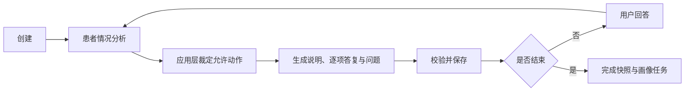

# 动态建档实现与升级

本文描述旧逐题 Record。新增独立整份问卷流程见 [建档问卷生产化](record-questionnaire.md)，两套状态与来源隔离；新问卷不进入本页的末尾QA阶段。

当前实现使用 `qaFlow.version=2`。公开契约见 [API 文档](../docs/api/API.md)，输出局部修复、30 秒生成预算和答案回执的细节见 [建档生成容错](qa-generation-resilience.md)。当前 API 版本标为 develop 待发布；部署及确认后才将完整文档归档为对应历史快照，本变更不表示测试服已升级。

## 主 Agent 与查询服务

截至 2026-11-10，本域 `RecordAgent` 以 `WorkflowAgentPort` 封装创建、答案提交和显式后台恢复整条用例，固定选择为 `record.main / contractVersion=1 / record-workflow-v1`，manifest 同时记录私有分析图 `record-patient-v11`、表达图 `record-response-v19`、流程及规则/内容版本。实际子任务调用传入完整 selection，不依赖可变默认别名。既有 `record.plan`、`record.question` 图仍是本域私有步骤，规则、提示词、模型次数、公开正常响应保持原样。创建回执、答案回执与恢复回执固定完整 manifest；旧回执缺少选择时映射到固定 `LEGACY_RECORD_*` 常量，无法执行该版本时明确失败，不隐式改用最新实现。`getSession/getHistory` 直接读取并投影保存快照，不调用主 Agent。 注册的 main port 是本域已受理任务的执行边界；创建和恢复必须带业务服务注入的租约及恢复快照，裸调用立即拒绝，不读写或调用模型。外部业务仍通过 Record service 受理，本批不增加跨域会话交接。

后台能力由 `QASessionManager` 的 `reply_recovery_store` 与 `completion_store` 成对注入，工厂分别为 `adapters.persistence.record_creation.create_application_record_reply_recovery_store` 与 `adapters.record.completion.create_application_record_completion_store`。组合根先调用 `modules.record.agent.install_record_agent(runtime, manager)`，原子注册主 port 并检查两个固定子图；安装失败阻止新的 AI 用例进入画像/文档处理，正常查询和已保存幂等回复仍可用，不关闭共享资源。组合根须周期调用 `recoverPendingReplies()` 并在停服时调用 `stopReplyRecovery()`；本域建议与已有创建恢复分开，每 15 秒扫描一次。本域实现不等于已部署，组合根接线与离线集成由独立集成批次验收。

## Record 文档消费边界

附件进入 Record 时，通过 `modules/record/ports.py` 的 `RecordDocumentPort` 返回本域的 `RecordDocumentContextV1`。应用服务只消费报告内容、文档引用与处理状态三部分，不再识别共享处理器的 `ProcessedHealthReport` 返回模型。`adapters/record/documents.py` 中的 `LegacyRecordDocumentAdapter` 由组合根注入，继续调用现有公共处理入口，保留原报告字段、来源标识和稳定报告 ID；它不新增画像发布。

本批消费投影固定为 `record-document-context.v1`。为兼容创建回执，检查点仍保存原有 `report/document/processing` 三键结构，已有回执按同一投影恢复。适配边界和检查点导出都会复制数据，避免上游对象或调用方修改已取得的上下文。附件并发上限、原始顺序、同文档报告去重、内容不可用降级、引用回调与已完成文件恢复继续由 Record 应用流程管理；首题、提示词、对外接口和画像来源保持原有行为。

这一步建立消费者自己的接口，并未切换 Document 的新版本选择协议，也未冻结共享处理器的输出版本。未来接入新版抽取或返回结构，需先由 Document 独立实现并合入提供方契约，再由 Record 单独迭代适配器与消费投影，完成兼容回归后显式启用。

## 状态与模型职责

`modules/record/application/flow.py` 定义分析、回应结构及确定性状态推进；`service.py` 统一承载普通提交与 SSE 的加载、租约、调用和保存。新会话正常10–15题，尽量充分了解至15题；前3题依次覆盖主诉、疾病史、血亲家族史，后段从24个受控生活细项选择7–12项，只有适用且有价值的新题确实耗尽时才提前收束，不重复确认凑数。历史原策略最多10题，显式短策略保留原4–6题预算。建档结束先简答此前真实疑问，再固定邀请提问；前置简答不占后续答疑额度，实际提问最多5轮，第5轮直接简答后收束，不继续补资料。连续2次无实际问题也会收尾，实际提问清零连续计数；明确结束仍可提前收尾。

复用 AgentHub 注册名 `record.plan` 与 `record.question`，均为无状态 LangGraph；当前提示词版本为 `record-patient-v11` 和 `record-response-v19`。前者现用于患者情况分析，输入只含资料来源、用户回答、已有疑问及其处理状态、各项困扰与已知/已问内容，不包含阶段、预算、轮次、处理次数。后者接收应用层裁定后的 action、指定答复清单和目标问题，关闭 thinking，按需沿用知识检索；使用本次分析合并后的患者资料，并区分“上一题”“本次回答”和接下来要执行的动作。对外 reasoning 仅来自首次分析调用；SSE 收到每个片段即原样发送，不等待分析 JSON 或正式回应完成，不在末尾重复发送完整推理。分析修复仍关闭 thinking，保留首次推理，回应生成不暴露推理。两阶段 JSON、来源、流程和正式文本校验及各阶段最多一次修复保持不变，保存成功才发送 question/finish。普通和 SSE 成功结果均原样保存首次推理，不因修复改写或清空；它可能与修正后的正文不完全对应，不是患者事实、正式答复或事实依据，业务回应始终在 assistantMessage 中。

患者分析使用中文字段、意图和信息角度表达结构化资料与结果，服务端校验后映射为内部字段；兼容既有字段名，但仍拒绝未知或冲突字段。用户回答和报告原始数据独立保留，内部依据通常可忠实概括或摘述；已答旧疑问本轮重提时，依据须直接来自本次用户表达，不能以历史原话冒充重问。来源类别可用性、归属和疑问 ID 覆盖仍须校验。此调整减少协议英文对分析的干扰，不增加推理语言指令，也不翻译、筛选或改写模型返回的 reasoning，模型自身的语言倾向仍需实测。公开字段与 `qaFlow.version=2` 不变，新旧版本 2 活动会话均沿现有状态继续。

首题自然邀请用户表达本次关注，不先介绍主诉采集的价值；尚未明确诉求时了解此次最希望解释、补充或改善什么，已有目标时连接补充题，不直接重问。第2题个人史主要承接真实主诉或健康目标，第3题家族史宽泛转入家人健康背景，不绑定主诉或报告中的某个指标，也不限定为已确认遗传病。对应主题已知时仍保留题位，只询问有无补充，不复述已知病史。无症状用户可以围绕体重、饮食或健康目标建档，不默认从消化或排便开始。

新策略后段充分了解不同生活细项，优先探索与报告异常、用户目标或已知情况可能有关的生活因素；同档先避开上一题大类，再优先累计问得较少的大类，最后保留模型候选顺序，不要求每次覆盖全部五类。没有报告或疾病线索时自然关心生活，不把用户当患者。不主动展开疾病或症状细节追问，不因其他科室报告强行转向消化，不把习惯断言为病因，不预设治疗效果。用户自发补充的跨主题信息仍应理解并保存，真实问题留待前置简答或答疑处理。

生活大类由程序统一映射，不能通过修改 topic 名称重置覆盖情况：

| 大类 | 具体维度 |
|---|---|
| 饮食与饮水 | `diet_structure`、`staple_portion`、`sweet_intake`、`salt_processed_food`、`meal_pattern`、`late_meals`、`hydration`、`water_intake` |
| 作息与睡眠 | `sleep`、`sleep_duration`、`sleep_consistency`、`bedtime_habits` |
| 运动与日常活动 | `activity`、`exercise_frequency`、`exercise_duration`、`sedentary`、`activity_breaks` |
| 烟草与饮酒 | `smoking`、`passive_smoking`、`alcohol`、`alcohol_amount` |
| 压力与放松 | `stress_coping`、`rest_schedule`、`work_breaks` |

分析模型先比较五类的价值，再给具体候选。`InformationGap.relevance`（“相关性”）仍为 `focused/general`：focused必须在非空reason中说明与已有资料的具体关联；general表示一般背景，旧格式缺省general，不是医学风险或因果证明。程序先排除已知、已问、未知、拒绝或不适用的同一细项，再按相关性档位、是否与上一题同类、该类累计题数、模型原顺序选择。五类都出现后仍交错；focused同类可优先于general异类。`essential`保留旧会话兼容，不再作为新策略第六题或扩展题位的门槛。模型候选缺失时继续检查受控题库，适用且有价值的新题确实耗尽才结束。

已问大类从已发布的问题历史及当前问题的 `intakeDimension` 派生；旧记录缺少元数据时，仅用进入本轮时已持久化的 `intake.asked` 细项补齐，不猜测宽泛 `habits` 的大类。本轮临时选中但尚未发布的目标不算已问。正常选题、部分结果保留和完整兜底沿用同一大类规则；缺少可信分析的兜底只选择尚未了解的生活背景，不编造报告关联。已缓存未答问题保持原样，不因新策略改写题干、选项或问题 ID。

压力与放松仅询问休息、放松及应对忙碌的行为，例如“忙碌时您通常怎样安排休息或放松？”。回答中的明确行为可进入 `lifestyle.stress_coping`，沿用有来源的 `user_reported + pending` 事实；单纯说压力大不生成行为事实，不推断焦虑、抑郁或确定病因。

全部题目的选项使用简短、独立、可直接记录的具体答案，覆盖三个固定主题、24个生活细项和状态题，不只优化主诉。尚未明确主诉时使用checkbox，最多12项，含最多10个具体关注项及“暂无改善需求”“不清楚”；可靠资料只影响候选排序，不预先生成用户事实，无依据时使用固定通用候选。其余问题按指定细项提供必要选项，不为凑数添加无关方向。禁止“其他／其它”“某个不适”“某种疾病”等占位、泛健康方向、括号解释、多实体拼接和拒绝作答项。频次、时长和数量范围保留单位，不推断杯瓶容量。未列出的答案通过文字或语音提交，用户原话仍照实保存。

补充邀请及含糊回答后的再次邀请由 `presentation.py` 提供固定问题、`radio` 题型和唯一选项“没有了”，并提示文字/语音补充。所有新建档问题、修复和兜底继续提供 radio/checkbox 快捷选项，不生成只能自由输入的 text 问题。`flow.validate_new_question` 统一约束正常发布与修复，兜底按本题目的提供匹配选项。首题超出12项、选项缺失、重复或不明确等进入现有一次修复，仍失败则保守发布。前端字段不变，非空 `other` 仍优先且不自动合并所选答案。原有已发布题目不重新套用新选项规则，恢复、重放和答案指纹保持原样。

选择题要求只约束新生成的问题。历史或已缓存的 text 问题继续按原题型和选项恢复、幂等返回和接受回答，不重新生成问题，也不执行缓存清理；仅AI展示文字中的内部处理提示统一移除。

`intake.py` 管理 `qaFlow.intake`，外围 `qaFlow.version=2` 不变。原九项生活分类保留兼容，新24项按实际覆盖的细项记录和去重；运动频次与时长同次明确提供时同时覆盖，饮品种类不代表饮水量已知。不饮酒时跳过饮酒量，不吸烟不代表没有二手烟接触。旧概览和habits不批量迁移，只根据实际证据标记可确定覆盖的细项，不用一个概览封住全部新题库。unknown/declined只封实际范围；明确拒绝整类时尊重该范围。体重等主动信息仍可保存，不作为新提问候选。事实继续带来源进入既有九类生活画像类型，不把AI关联、科普或建议写成行为、疾病或确定病因。

生活习惯是正常建档的必需主题，不再先插入“是否愿意补充背景”的邀请。选题需结合主诉、已知疾病及已提供的习惯信息，目的在于了解生活背景，不将相关性写成因果判断。旧背景补充意愿仍保留为既有状态；用户主动补充的信息照实记录，不因移除邀请而伪造缺失事实。

模型事实和缺口使用 `scope=complaint/general`（中文键“范围”）。`complaintIndexes`（“困扰索引”）为本轮 `complaints`（“困扰”）数组的零基索引：complaint 必须明确关联一项或多项困扰，general 使用空数组。引用已有困扰也将其列入本轮数组并沿用编号，新增编号为 null；服务端解析为稳定 `complaintIds` 后再合并与选题，不让模型生成内部编号。某项的时间、频率或无法回答状态不能阻止另一项的合理了解；仅在事实确实适用于多项时共享归属。

同轮多个事实解析到相同目标、内容分类和状态时，合并其 summary 与 evidence，保留各段事实和依据，避免多个伴随表现或诉求因共用分类而被拒绝。状态不同仍须由模型明确整理为一条一致或 conflicting 的记录，不能由后写值覆盖；聚合不放宽困扰身份、来源、数值或单位的含义约束。“出现时间”（onset）表示开始时间或持续时长，饭后、夜间等发生时机不代替病程，也不要求所有人补答病程。

事实可携带内部 `presence`、`specificity` 和 `entities`，分别区分存在性、具体程度和原文支持的具体内容；旧模型输出可缺省，旧会话不补猜。多条兼容事实聚合时各自保留在 `observations`，不把同一主题中不同疾病的否认范围互相覆盖。“身体不舒服”或“有病但忘了病名”保留报告存在及内容未明确，实体留空；是否有病史不清楚和明确没有病史分别保存未知与否认。未明确仍视为该内容已问，不生成澄清追问；未提及不生成未知或否认。主诉仅关注疾病不构成确诊，家族疾病未明确血亲时保留家族范围，不猜主体。

建档完成后的画像仍以原始 `qaHistory` 用户回答为证据。`condition.history_status` 承载个人病史否认、未知、病名未明确、冲突及需保留时间或恢复范围的既往描述；`family_history.reported` 承载本人报告的家族背景，避免具体家族疾病因亲属未明确而丢失。明确报告曾经患病仍为present，时间与已恢复范围保留原文，不混成存在性未知。两者均是本人名下的Record对象观察，不是本人当前患病的判断，不创建虚构亲属；明确稳定血亲阳性疾病仍用原 `family_history.condition`。Chat和摘要分别展示病史说明及家族背景，风险/循证锚点不将这些观察当作本人阳性病史。已恢复或仅历史的症状保留对象与时间描述，不作为当前风险依据。来源、幂等与 `user_reported/pending` 治理保持不变，不迁移历史事实。

`focusIds` 表示本轮选题涉及的困扰，`preferredId` 仅表示用户明确表达的优先项，两者不混用。模型通过 `preferredIndex`（“优先困扰索引”）报告本轮明确偏好；普通回答中 null 且没有 priority 事实表示保留既有偏好。明确表示同等关注、交由服务决定、无法排序或不愿排序时，按实际含义保存 priority 的 known/unknown/declined 事实；该事实与 null 一起清除旧偏好，并避免再次询问排序。旧 `primary` 字段保留输入兼容，默认 false，不再要求模型指定唯一主诉，也不据此生成偏好。`priorityClarificationNeeded` 只是可选排序建议，`priorityAsked` 防止重复询问；没有排序不阻塞其他有价值的了解。

信息缺口的 `dimension`（内容）决定原有 `aspect`（角度）：用药和既往史归入 medical_history，习惯、家族史、其他不适分别归入对应角度，其余为 symptoms。模型可省略角度，服务端统一生成，避免合法用药内容因重复分类不一致而让整轮失败；没有内容分类的旧格式仍按原有角度处理，未知内容分类及冲突字段仍拒绝。

前三个主题按固定顺序保留题位，已经覆盖时用自然关联连接补充题。后段使用稳定困扰编号与受控细项识别重复，topic改名不能重置覆盖；用户提前提供的多项习惯同步记录，选择其他仍适用且有价值的新细项，不反复询问同主题有没有补充。没有报告或疾病线索也保留生活习惯阶段，以日常关心的方式了解，而不把用户预设为患者。

新会话保存内部题数策略版本，正常10–15题、尽量充分至15题；检查模型候选和受控题库后，适用且有价值的新细项确实耗尽才提前收束。历史原策略最多10题，显式短策略保留原4–6题；两者保留20次总保护；新策略总保护为25次，容纳15题、5轮QA及既有含糊处理，不因原20次保护截断QA。创建发题、修复、失败、幂等复用和查询不额外消耗题位。`intakeQuestionCount`记录已处理主动题位，`qaRoundCount`记录前置简答后的实际答疑（0–5），`interactionCount`保留实质交互语义。新策略intake进度为 `min(50, round(intakeQuestionCount × 50 / 15))%`；历史原10题策略为 `min(50, interactionCount × 5)%`，显式短策略为 `min(50, intakeQuestionCount × 10)%`；supplement为60%，qa为 `min(95, 60 + qaRoundCount × 8)%`，finished为100%。它是阶段估计，不代表还剩固定题数。

建档收束时进入 supplement，先逐项简答此前已提出但未回应的实际问题，再展示固定补充邀请；这批前置简答不占后续 5 轮答疑。补充或答疑阶段不再回到 intake，不主动澄清疾病或症状细节。用户实际求解释、求建议或求答复时按问题处理；仅补充健康信息时记录并自然承接，不将信息缺口改写成用户问题。邀请后连续两次没有实际问题则结束，出现实际问题后清零连续计数；“没有了，但……”仍须理解其中的实际问题，不能只按关键词结束。

疑问保存来源依据、来源questionId、状态与handledCount；同次多个求答点逐项简答，合计一轮QA。普通QA取消clarify_concern路由，实际疑问直接给最终短答，再固定邀请或第5轮结束；clarify_supplement仅用于“有”等未说出实际问题的输入。通常2–4短句，采用一般解释、具体生活场景和可执行建议；个人信息较少只降低精度，正文任何位置都不强调“现有信息不足，所以无法判断”，后接有效建议也不能放行。不索要资料，不编造确诊、个体精确风险、剂量、真实病例或概率；保留“可能、一般”等合理不确定性。单项400字、本轮900字硬上限保留。技术失败仍保留pending，结束时以limited保留未答状态，不填入处理提示冒充答复，也不在公开正文描述内部失败。

分析上下文明确区分本轮问题、pending待答问题和answered/limited已答问题；limited不是每轮都要继续回答。已答旧疑问只有用户本轮主动重问才能再次进入任务，现有用户原话字段必须提供本轮依据；无依据重列的条目进入既有修复，失败时仅丢无效条目，保留本轮新问题及真正待答项。相同或相似重问沿用原疑问编号，表达参考已有回应，通常一至两句补充重点或换一种解释，不照搬旧全文或大段原句；不因handledCount达到阈值而直接复用原文，也不为改写编造新内容。响应仍逐项校验指定疑问ID，不按位置配对，正文不得附带任务外旧问题。答复表达策略升为15，历史回应只作表达去重参考，不作为用户事实；新轮次沿用已有表达调用，不增加调用阶段；已发布历史存储不变，对外AI文本副本移除内部处理提示。

## 选项、承接说明与文本校验

`presentation.py`仅移除选项末尾已知的操作提示，不通过截断或删除括号内的不同答案来伪造明确性。规范化后的新选项不得带括号解释、斜杠列举不同事物或多实体拼接；“其他（请补充）”不能清理成“其他”后放行。空值、重复、数量或明确性不合格仍进入一次修复，失败时合规兜底。普通题末尾统一“也可以通过文字或语音补充描述。”；正常补充邀请全文固定为“您还有其他想了解的问题吗？可以通过文字或语音补充描述”，保留“没有了”按钮，不叠加按钮说明或通用hint。旧邀请仍可原样恢复、直接结束和幂等重放，不改用户回答及历史。

首次了解个人疾病史、血亲家族史时，`target.choiceConstraints` 指定 `checkbox` 和具体疾病选项，问句仍由模型自然生成，重点询问有哪些疾病。正常发布和部分、完整兜底共用程序提供的选择约束，不能退回“有”“有，可以补充具体疾病”等有无选项。个人史提供高血压、糖尿病、血脂异常、冠心病、脑卒中、慢性肾病、脂肪肝；家族史提供高血压、糖尿病、冠心病、脑卒中、肺癌、结直肠癌、地中海贫血、血友病；两类均保留“没有”“不清楚”，移除“其他疾病”，未列出的疾病和具体血亲通过文字或语音输入。疾病可多选，“没有”“不清楚”应单独选择；已知主题的 `supplementation` 题承接后询问补充或更正，统一使用 `radio` 和“没有需要补充的内容”“目前记不清”两个明确状态，具体补充和更正直接自由输入，不要求重选已知内容。家族史同时覆盖家族聚集性疾病和明确遗传病，不能据此断言所有家族病均属遗传病。分析结合当前问题理解已选疾病，不把候选选项当成事实；家族题仅选疾病时不归为本人，也不猜测具体亲属，矛盾混选按 `conflicting` 保留。此调整不新增公开字段、模型调用或题位，已发布和缓存的问题不重写。

题干、acknowledgement、rationale 和每项 responses 正文分别检查明确的错误输入指令，例如在“其他疾病”里补充、在选项或按钮中填写、点击后输入或展开输入框；正常生成、局部结果保留、兜底和旧 AI 答复再次复用均沿用该约束。不合格组件进入现有一次修复，修复失败仍保留通过校验的组件并使用合规兜底，不额外增加模型调用。该检查只识别与真实按钮能力冲突的输入声明，不全局禁止医学正文中的“其他”，也不对最终拼接的用户疑问引用做全文拦截。原始用户回答、`other` 参数、问题 ID 和答案指纹均保持原有语义；状态查询、历史及幂等重放原样返回已经发布的结果。

`record.question`的内部assistantMessage保留acknowledgement、rationale、evidence，并增加可选focusRef。acknowledgement承载面向用户的完整交流，提问及无正式答复轮次非空，通常一至两句，不设最低字数并保留原长度上限。可以主动表达帮助用户分析困扰、了解改善方向的意图，不要求每轮重复主诉或帮助目的，也不强制采用“关注点加话题切换”的句式。rationale默认空字符串，仅兼容旧结构，不再要求新题提供，也不拼入公开正文；旧值仍接受结构和文本安全校验，选题依据保留在内部任务。提问阶段围绕当前细项及上下文自然延续，不先总结、评价或解释上一轮答案，不回顾频次、时长或“记不清”，也不夸赞习惯。不复述用户选项、行为、整段病史或思考流程，不介绍信息采集流程、泛泛解释主题重要性，不添加科普、生活建议、疗效承诺、确定病因或免责铺垫。实际询问只放question。有正式responses的前置简答及QA由答复首句自然承接，acknowledgement为空、focusRef为null，对外不另加客套引入或病史复述，也不添加“关于‘用户问题’”前缀。evidence仍用于内部来源校验，不在正文展示引文。

表达输入的`patient.对话衔接参考`只用于对话组织，包括当前细项、可用关注点、已发布使用、上一关注引用及最近完整对话。关注点以稳定ref引用真实主诉或健康目标（kind=goal）和可信报告事项（kind=report），携带text、source、quote、path及preferred，不能由模型创造。先沿用既有选题规则确定问题，再在现有表达调用中选择真实相关的关注点；尊重与本题相关的明确优先关注，明确引用时关联相当的候选优先避开上一关注点，再优先使用次数较少者，不因文案轮换改变选题。已建立的话题可以依靠上下文自然延续，无需为登记引用重新点名主诉；未明确引用具体关注时允许focusRef=null。个人史仅能引用goal，家族史保持focusRef=null且无具体关注锚点；缺少可靠关联时采用自然生活引入，不强行挂靠报告，也不把异常改称确诊。

使用关注点时，focusRef必须指向当前可用目录，acknowledgement实际提及该关注，evidence须支持对应source及quote；不能登记未在引入中使用的引用，也不能用上一轮答案回顾冒充关注衔接。提问阶段的来源只支持本轮表达实际使用的事实，不强制包含本次回答：引用更早的目标或报告时使用相应依据，未引用具体事实的中性引入允许evidence为空。非提问阶段的本次回答来源要求不变。上一题、本次回答和最近完整对话用于理解用户、保持连贯和去重，不要求在正文中重新陈述；其中AI表达不能作为患者事实。关注使用记录只从已发布问题派生，按questionId去重；草稿、修复和预选不计数。旧会话缺少元数据时不猜测使用次数，仍用历史文本避免重复。无效引用进入既有修复，失败时保留有效问题及答复、替换自然短引入。新引用及对话元数据不新增公开字段，不投影到患者分析或健康画像证据，不迁移历史。

明确否认、未知或冲突的目标不进入关注目录；模糊但确实存在的困扰仍可保留。聚合到同一事实槽位的多个健康目标按各自实体区分引用，不因证据扩展或观察顺序变化重置身份。目录有数量上限时先保留用户目标与报告已有异常标记事项；原始否认、时间条件及报告参考范围继续随来源提供，不推断新异常。QA转Chat后的历史公开响应也过滤内部关注引用，已保存正文和原始答案不变。

例如，“为了更好地帮您分析和改善入睡的问题，我需要先了解您以往的疾病情况。”直接面向用户表达帮助意图，可以使用；这不是每轮套用的模板。相邻生活问题应根据已建立的上下文自然延续，不必重新声明主诉。“跑步安排每周三次挺有规律，接下来看看您的晚间安排。”先复述、评价上一轮回答，仍不符合要求。提示词用少量不同语境的对话片段说明风格，不建立随机句库；模型结合最近对话和历史承接检查重复开头、句式及反复强调同一关注点，不能只换同义词。必要发布校验及中性兜底保留，不添加必须出现“帮助用户”的关键词检查或额外评审调用。

承接直接、主动地了解用户，不靠“我们一起看看”“和您一起了解”等空泛陪伴话术营造参与感；减少“也想”“也一起”“也看看”等无实际递进含义的连接，不机械改成“一并”“共同”或每句“我想”。“把两种情况放在一起考虑”等确有合并含义的表达仍可使用，“一起”“也”不是关键词黑名单，也不做全局删字或替换。提示词、主题规则及现有修复提示同步这一风格，并在同一次表达生成前核对上下文和句式，不新增模型评审调用；中性兜底继续直接引入主题。普通题固定提示“也可以通过文字或语音补充描述。”、QA正文、用户原话及已发布历史不做此类词语清理。

自然延续不等于先给上一题回执；acknowledgement只是兼容字段名，不要求写“我知道了”“心里有数了”或某个话题“说清楚了”。用户记不清时可以直接推进，不每轮追加安慰。也不以“某主题很重要”“主诉与某习惯有关”的通用陈述代替面向用户的交流。通常一至两句是篇幅建议，不要求凑足两句；模型在现有表达调用内结合前两轮自行检查这些倾向，未增加运行时关键词拦截或模型评审阶段。

承接、理由和每项答复按句检查“单凭现有信息无法准确判断”“具体原因仅凭现有信息无法确定”等强调资料不足的表达，不仅拦整段拒答。正常、局部修复、保留组件、兜底和新轮次历史答复处理共用约束，并检查跨组件可明确识别的长句重复；不会只因糖尿病等名称相同或必要地引用关注点而拒绝。提问引入中的明确行为回执、提问、方法解释和免责铺垫进入既有修复；分析或生成失败、原文保留、待处理等内部提示不得出现在公开AI正文。QA合理条件性解释、关联不等于病因等边界保留，不改原始回答、内部依据或历史存储；旧AI正文仅在公开投影中移除内部处理提示，不增加模型评审调用。

附件读取说明由 `documentProcessing[].message` 独立展示，不再强制前置到首题正文。模型上下文以“附件资料状态”替代“资料读取说明”，仅投影 fileIndex/status；partial 限于已确认内容，unavailable 不提供报告事实，空数组不证明完整读取。状态不作为健康事实或“本次报告”依据，分析概述与正文不主动复述处理故障；附件说明和错误响应仍独立返回，不能与AI正文过滤混同。此变化不改来源枚举、不增加模型调用；附件快照与原始正文存储保持原样，AI展示副本采用统一过滤。

展示说明的 `MessageEvidence` 另允许“基本信息”，对应patient基本信息；不能误标为报告或画像，也不能推导病史或症状。分析事实仍使用原五类来源，不因展示允许基本信息而扩大事实来源。结束时各项疑问仍在responses答复，程序随后追加既有结束语，不以模型长摘要代替。可明确识别的复述式开头和承接中的提问进入现有修复，来源证据仍可忠实概括；这些检查不证明医学语义正确，也不增加评审模型调用。

`responseTask.questionMode`明确下一步：generated按target生成问题，rationale可空；fixed提供fixedQuestion对象，由服务端展示补充邀请，模型question为null；none不再提问，fixedQuestion为null。生成模式的fixedQuestion也为null。固定邀请无正式答复时采用独立短引入，有指定答复时直接展示正式解释；结束采用指定答复及服务端固定结束语。所有模式均不拼接模型rationale，不为措辞调整新增模型调用。服务端合成原有公开assistantMessage字符串，与question分开展示；内部结构不作为新增API字段，thinking=false时也返回正式内容。最终回复、状态查询、历史和Chat公开回放均通过AI文本投影移除内部处理提示，不回写原始快照。

共享纯函数 `agents/llm/text_quality.py` 检测替换字符、孤立代理项、异常控制/不可见字符、非字符码点和高置信乱码标记；中文场景额外检查同一词中的异常文字混杂。合法拉丁医学缩写、希腊字母、单位、扩展汉字、换行和 emoji 保留，来源材料中确实出现的外文词可保留。默认不对其他业务强制执行，当前仅 Record 接入；后续业务应结合语言、流式发布与历史存储特点单独接入。

检测覆盖完整分析JSON、承接、答复、问题、选项和正式输出。每阶段最多修复一次，保留有效条目，仍无效或超时则保守回应，保存后发布。内部来源证据允许忠实概括；公开承接避免复述、问题和思考流程，题干及正文继续检查错误按钮输入指令。JSON、编号、来源可用性与归属、疑问覆盖和字符质量继续校验，不宣称自动证明语义正确。每次从独立草稿合成，避免修复重复增加处理次数。原始用户回答不做承接风格清理；推理原文不参与正文质量检查，也不因修复改写。日志只记录脱敏诊断，不记录患者正文。

实时推理可能先于后续生成或保存失败到达。模型生成失败但可保守回应时仍以 question/finish 正常发布，存储等不能降级的失败以现有 error 事件结束，不发布成功正文，也不新增推理撤回事件。已经发送的片段不能撤回；成功结果中的 reasoning 与首次推理原文一致，测试页面沿用最终结果替换临时文本。页面错误分支保留临时片段和当前问题，需手动恢复状态或等待后续成功结果刷新；片段出现不表示会话已经推进。幂等复用仅返回既有完整结果，不重放推理；调用方关闭流时逐层关闭执行流并释放会话租约；已保存的答案回执由独立后台恢复继续处理，不依赖下次查询。

检测无法保证识别由合法汉字组成的乱码、所有外文混杂或医学事实错误；图片字体/客户端解码异常也需要比对原始响应定位，不能只根据截图归因。历史和当前缓存不重生成题目，AI文本展示副本移除内部处理提示；新拼接输出中复用的历史答复也必须通过校验，不能把旧异常内容继续发布。

补充阶段只有“没有了”的有效回答（字符串、单元素数组或旧文本 content 对象）且无待回应疑问时，服务端直接生成固定结束说明，不调用模型。若仍有真正待回应的疑问，则在本轮逐项给出精度相称的简答后结束，不强调资料不足，也不再因这些疑问继续澄清。混合表达、多个选项或非空 other 仍按有效回答进入分析；不会忽略“没有了，但……”中的新问题，单纯健康信息补充也不被自动视为疑问。直接结束仍经过相同的租约、历史、幂等、完成落库及画像排队流程，控制性结束回答不增加实质交互计数。

## 一致性、重试与来源

`public_text.py` 统一约束对外AI文字：新生成的承接、理由、题干及答复中出现内部分析失败、生成超时、原文保留或待处理提示时进入既有修复；仍失败则仅保留有效组件，以自然引入、原有控制题或结束语继续。历史/缓存、已保存提交回执、状态查询、历史查询及Chat公开回放在返回副本中移除这类提示，保留相邻有效解释；整段仅含提示时使用自然短引入或结束语。该投影不回写存储、不迁移历史、不改变问题ID、选项、答案指纹、计数、用户原话或reasoning。请求错误的message、SSE error和documentProcessing附件状态仍按原契约返回，不能把这些字段作为AI正文统一清理。内部generationQuality、未处理分析和未答疑问仍如实保留，公开正文无提示不等于分析完整成功。

首轮还没有用户陈述的困扰，分析结果中的困扰应为空，`preferredIndex=null`；有依据且可分类的报告/画像背景事实使用 `general`，`complaintIndexes=[]`，不能替用户构造具体困扰归属。报告指标不适合建档内容分类时保留在情况理解中，事实数组允许为空。首轮提示同时给出分析与回应的完整结构，以及证据来源的固定取值。

模型 JSON、字段结构、来源依据、流程规则或文本质量校验失败时，普通日志输出 `Record output rejected`：包含 session_id、analysis/presentation 阶段、该阶段的尝试次数、runId、回复字符数、缺陷代码与字段路径。业务规则附带固定纠正说明，枚举错误补充服务器定义的允许值；不输出患者正文、Pydantic 输入值或模型自定义字段名。HTTP 异常链摘要也隐藏 Pydantic 输入，保留异常类型、数量和代码位置。重试提示会带上具体校验问题和待修复的上次输出；上次输出作为数据转义、最多保留 24,000 字符并标明是否截断，不进入普通诊断日志，修复必须返回完整 JSON。仍每阶段最多修正一次。

最终模型校验失败、调用超时或暂不可用时，`fallback.py` 保存可确认的分析和逐项答复，缺失部分使用确定性补充问题或自然引入，不再仅因这些问题返回 502。分析没有可用结果时不改变既有可靠事实，在内部保留原始答案及待处理状态；连续两次回答整体兜底后提供“先结束本次建档／继续补充”的普通选择题。任何可用的局部结果会中断整体兜底计数，完整成功同样重置；选择继续本身不增加实质交互次数。未分析原话和未解决疑问继续在内部保留，结束只展示有效答复和自然结束语，不输出内部处理说明或暗示自动补做。未分类异常或保存故障仍报错，不以“已保存”掩盖保存失败。内部质量记录不增加公开 API 字段。

旧日志中的 `INITIAL_QUESTION_FAILED attempt=2` 表示第二次建档尝试的首问生成失败，不等同于模型阶段的第二次修正。新流程对普通模型生成缺陷优先发布保守首题；文件、配置、存储或其他运行时故障仍按创建恢复机制处理，创建最多尝试三次，达到上限后停止自动恢复。诊断时结合具体校验日志、生成结果的 normal/repaired/partial/fallback 分类及后续 `qa/status`，不能把 HTTP 200 等同于模型完整成功。

在共享业务会话租约中加载并计算草稿，定时续租且写入前确认租约；题目 UUID 由服务端生成。生成前单独保存 `pendingSubmission`，包括原题、原始回答、答案指纹、本次执行参数及绝对截止时间；此时不追加历史或计数。生成或保守回应完成后，历史、下一问、计数、最近提交 hash 和原始响应在同一快照保存并移除回执。相同最近 questionId/有效回答直接复用结果，处理中相同答案继续本次处理，不同答案返回 409。普通提交消费完整处理过程后释放租约，SSE 断开时 Handler 继续消费至保存结束。分析、表达、各阶段至多一次修复和内部检索共用 30 秒预算；文件解析、保存和网络传输不在预算内，不承诺 HTTP 请求全程 30 秒结束。

自动结束先写 MongoDB，再删 Redis、投递画像任务。MongoDB 完成状态优先于遗留缓存，清理缓存失败不把已完成快照改回活动。画像 pending 标记随完成快照保存，后续投递使用已有来源版本幂等键；队列故障由现有 pending 补偿处理。跨 Redis/MongoDB 的网络分区和进程强制终止仍需在测试部署环境做故障联调，本地假存储测试不代替此验证。

AI 说明保存在 question.assistantMessage，最后答复保存在 qaFlow.finalMessage。用户原话独立保存在 qaHistory[].answer；画像摄取继续仅投影用户陈述等允许来源，不把 AI 答复升级为病史。转 Chat 时保留完整 qaFlow，并在交接摘要标注“AI 说明/答复，非用户事实”；Chat 历史额外返回 qaAssistantMessage 供最后答复展示。

`getSession` 与 `getHistory` 只读：正常已存问题与历史直接返回；存在 `pendingSubmission`、可明确识别的已存尾答缺回复或尚未提交的完成结果时，沿既有 409 冲突通道返回 `RECORD_REPLY_PENDING`。后台恢复终止时返回 `RECORD_REPLY_RECOVERY_FAILED`；不返回已答旧问题或新增成功状态。查询不申请执行租约、不调用模型、不发布画像、不迁移快照、不刷新 TTL。后台扫描兼容 type=qa、active/awaiting_decision、无流程或流程版本 2、尾答合法且当前题缺失或仍指向已答尾题的旧记录；正常未答问题、创建状态、完成记录及未知流程版本不自动重新生成。

`ReplyRecoveryCoordinator` 独立扫描 Redis 活动会话，在与答案提交相同的分布式租约下重新读取；新恢复回执持久保存身份、执行版本、尝试数、截止时间与下一次时间，默认最多 3 次、120 秒恢复窗口。原答案的 30 秒模型截止时间继续沿用，过期时仅发布已有确定性降级结果，不重新获取模型预算。旧尾答恢复保持关闭思考，优先复用已发布且目标唯一的 `lastSubmission`，否则执行现有恢复分支，不追加历史或重复计数。新结果先冻结在 `qaRecovery.resultJson`，后续保存失败重放固定问题与答案，不再次调用模型；冻结结果的提交次数和 120 秒期限另行持久保存，最多重放 8 次，终止后保留快照并显示失败。Redis 单键完整快照 CAS 配合同会话租约防止旧执行者覆盖新内容；恢复成功的活动会话沿用两小时 TTL。

完成草稿先冻结为 `qaCommit`，然后通过本域 `MongoRecordCompletionStore` 仅插入一次。`recordCompletionId` 保持到 Chat 接管后，同一完成结果重放只确认已有记录，不替换 Chat 消息；旧记录没有完成身份时必须匹配保留的 QA 证据及完成时间，否则明确冲突。集合复用既有 `session_business_identity` 唯一索引定义，仅首次发布时检查，不在启动时清理重复历史数据。提交最多 8 次、120 秒，计数与期限随 intent 持久化，终止后保留固定结果供排障。完成快照内保留已有画像 pending 标记，现有 Record 来源恢复器负责最终摄取，不引入第二条正式发布链。

首问在已有创建检查点内增加 `firstQuestionSession`：先冻结完整首问草稿再发布；发布失败后沿原创建尝试预算重放，保留题目 ID、资料与顺序，不重新调用模型或读取画像。创建中的文件处理状态、缺资料与部分完成语义不变。

## 版本 2 会话兼容与历史版本迁移

外围 `qaFlow.version=2`保持不变，保留多困扰归属与用户偏好。新创建保存内部题数策略版本；没有策略标记的历史记录使用原10题和20次保护，已有显式短策略的会话保留原4–6题和20次保护，已进入QA的不返回intake。计数只在处理或恢复草稿时补齐并随原保存落库，正常查询不迁移、不重生成未答题。旧概览事实不批量迁移；已发布题目、选项、ID、原始回答、答案指纹、资料快照及完成记录保留，不清理缓存。新表达、QA直接简答和旧答复版本限制只作用于新生成内容；旧澄清题继续恢复，内部处理提示在新旧AI正文的公开副本中统一移除。提示词与代码需同步部署。

后台恢复仅为上述缺失回复形态提供兼容：无 qaFlow 的旧记录以已答历史条数初始化交互计数和 intakeCount；awaiting_decision 且未达全程上限时补入现有 supplement 邀请，旧 active 缺题或版本 2 缺题按恢复流程生成并保存，达到全程上限时完成收尾。已有正常未答题的旧版记录仍返回 409，不因这项修复普遍迁移旧会话。恢复不要求执行缓存清理；以下保留历史版本 1 选择重开会话时的迁移流程：

1. 停止旧版本 QA 新请求，等待所有在途完整请求与 SSE 后台处理结束，再停旧实例。不能新旧实例交叉处理同一会话。
2. 在目标测试环境执行只读统计：`python -m scripts.clear_legacy_qa_cache`。
3. 确认流量已排空后执行 `python -m scripts.clear_legacy_qa_cache --apply --requests-drained`。工具仅删除明确 type=qa、active/awaiting_decision 且版本为空或 1 的旧缓存；使用值比较后删除，发生变化的项保留。工具不修改 MongoDB、Chat、已完成记录或新版活动记录。
4. 启动新版并恢复流量。旧题提交返回 409，前端生成新 sessionId 从 create 重开；保留旧完成历史可查。
5. 当前联调页面通过补充邀请中的“没有了”选项结束，先显示最终回应再进入完成状态，恢复/历史补齐说明。上线前同步正式前端并按公开契约联调。

本次开发不会执行实际缓存清理。CLI 在 import 或 --help 时不读取环境，真正运行时才加载目标环境配置；请仅在已停止旧请求的目标测试环境执行 apply。

## 验证与真实模型验收

本次隔离验收入口为 `python -m tests.unit.tools.record_dialogue_acceptance --output-dir C:/Temp/record-smoke`，默认使用合成资料、伪模型和内存存储。真实模型验收使用 `python -m tests.api.scripts.record_dialogue_acceptance --live --config .env --output-dir C:/Temp/record-live`，才读取模型配置并调用真实模型；使用新的仓库外输出目录，默认最多 140 次逻辑模型调用（含修复），总时限 600 秒，可用 `--scenarios` 选择多困扰、动态首轮或终轮场景。该入口不连接真实数据库、Redis、文档解析、画像或回调服务；保存完整合成对话、决策、调用统计及耗时。自动检查之后还需审读实际选题与正文，不能将 JSON 合法或流程无异常单独作为体验验收结论。

验收工具额外保存状态、历史和幂等重放的公开结果，独立检查成功响应的assistantMessage、question及历史AI字段中是否出现内部处理提示，并检查读取前后存储一致；用户回答、reasoning、原始模型调用和内部快照不纳入该公开文案检查。主动降级验收仅在合成内存gateway中对指定分析调用注入失败，保留真实表达调用，分别记录实际模型调用和注入次数；不新增生产故障开关，不触达外部持久化。除禁用提示外，还需人工审阅保留下来的话语是否自然、是否重复，以及未答状态是否被错误呈现为已解决。

合成场景覆盖无症状健康管理、非消化报告、只有画像及没有资料的开场；报告为预先构造的合成解析结果，不下载或调用 DocMind。旧版拒绝独立背景的场景仅用于兼容检查，不作为新版正常选项示例。真实模型验收时逐题检查前三个主题、生活习惯选题及已知内容的承接，不能只检查总轮数。

离线测试使用shulan环境；`tests/unit/conftest.py`提供虚拟配置并阻止.env加载，不访问真实模型、患者或存储。回归覆盖新10–15题、历史原10题及显式4–6题短策略的预算隔离、24细项覆盖与耗尽、一次回答覆盖多项、不适用和拒绝范围、五类都问过后仍交错、强相关同类优先、正常/部分/完整兜底一致、提问及无正式答复轮承接非空且不复述提问、正式答复轮直接进入解释、历史AI说明不入事实、前置简答免费、逐句拦截资料不足话术、只答本轮问题及主动重问短补充、第5轮答复后结束、连续含糊两次、普通/SSE、幂等、租约、保存失败、恢复和画像/Chat回放。

真实模型使用合成资料验证有报告且包含多个关注点、仅具体主诉、模糊主诉、无疾病健康目标及自由文本提前提供多项信息；审阅整段对话，确认个人史承接主诉、家族史不被指标限定，生活题关注点交替基于真实关联且不改变题目，不编造症状或因果，不复述病史、不讲采集流程或泛主题知识。重点逐段检查帮助用户的意图和上下文自然延续；连续三轮或更多沿用同一表达骨架、只替换名词的，表达验收判为未通过，不能用同义词替换冒充自然交流。首次重点使用single_goal_dialogue、report_focus_rotation、wellness_goals三场景，可按场景分别运行隔离入口以保持单次预算；必须保存完整对话及人工结论，退出码为0不代表措辞通过。分别在thinking=true/false下确认正常、修复和兜底的选项与自由输入，记录关联准确性、重复程度和自然度。离线测试只验证结构、状态、来源和资料传递，不能证明真实模型的相关性或措辞质量。可运行`python -m tests.api.scripts.record --supplement "饮食和运动有什么需要关注？"`或`record_stream`，它们会调用目标后端并写入测试数据。

v19在上述三个场景增加人工检查：空泛陪伴话术、无必要的“也”反复出现，或仅换成另一套固定句式，均不能判为表达通过；合法合并语义不因含“一起”被拒绝。同时检查复述、评价、回执及未经提供的行为描述，保留模型调用数、修复记录和中性兜底计数，不因本次措辞改善自动关闭I-029。真实对话只读审阅，不另外调用模型评审。

### 本次质量验收场景

| 场景 | 预期观察 |
| --- | --- |
| 餐后偶尔不适，随后说不清、有点恶心 | 保留实际困扰，不展开症状细节；依次补齐病史、家族史与生活细项，正常10–15题，真实新题耗尽才提前收束 |
| 用户已经说明困扰，或同时提及多个困扰 | 已明确时直接承接，多项分别保留；无需先选出唯一重点，不机械询问所有系统 |
| 用户说不清、不愿回答、明确否认 | 保存对应状态，避免换措辞继续问同一信息 |
| 已有报告依据或只有一般生活背景 | 提问轮通常一至两句，允许面向用户的帮助意图和上下文自然延续，不讲采集流程或科普；正式答复轮直接进入解释；无可靠关联时自然聊生活，不预设患病 |
| 连续生活题仅替换关注点或话题名，其他句式不变 | 人工逐段审阅，连续三轮或更多同一表达骨架判为表达验收未通过；不能只换同义词或改成重复帮助目的模板 |
| 具体主诉、模糊主诉、无疾病健康目标 | 个人史主要承接真实目标；模糊表述不扩写症状、不新增澄清；家族史始终自然转入完整血亲背景 |
| 报告多个关注点、用户有明确优先项 | 表达仅引用真实相关资料，同等关联时结合上一关注点及累计次数交替，尊重明确优先项，不改变题目排序 |
| 引用不存在、来源不符、个人史引用报告或家族史绑定指标 | 进入既有修复；修复失败只替换无效引入，保留有效问题与答复 |
| 新生成、局部保留或历史AI正文含未完成分析、原文保留、待处理提示 | 新生成进入既有修复，公开结果保留有效解释或自然引入；状态、历史和重放不泄漏提示，原存储、用户原话、reasoning及附件说明不变 |
| 刷新、重放、未发布修复及旧会话无关注元数据 | 发布题按ID计数一次，草稿不计数，旧记录不猜测；仅AI展示副本移除内部处理提示，原存储、选项、ID与答案指纹不变 |
| 表达关注引用、最近对话含AI解释或建议 | 仅作表达资料，不作为用户事实，不进入患者分析或画像证据 |
| 信息缺口提供合法用药内容，角度写成“用药情况”或省略 | 服务端归入既往病史，不因此中断问答；未知内容仍需修复 |
| 有相关病史的合成报告、只有画像、没有资料 | 区分来源，已有信息直接使用；报告发现不等于用户主诉，无资料不套用异常开场 |
| 非消化相关报告 | 首题自然邀请本人关注，不默认排便；生活题仅引用真实相关报告事项，不虚构肠道关联，已有报告事实不重复询问 |
| 无不适，关注体重、饮食或整体健康 | 以实际目标建档，可以没有症状困扰；不强迫用户先提供不适 |
| 已了解饮食但尚未了解活动 | 分别记录目的和适用对象，活动候选不会被饮食事实错误阻断 |
| 没有报告或缺少直接线索 | 仍按已知目标与疾病选择相关生活习惯，不先发背景同意邀请，不用病症细节凑题数，不断言习惯为诱因 |
| 明确排便困扰 | 简短引用真实主诉，后段只选相关生活习惯，不继续追问频率、时间、伴随症状等疾病细节 |
| 两个困扰的时间不同，其中一个说不清，或某项同义改写 | 沿用困扰身份并分别记录事实及已问内容，不跨项套用或误判重复 |
| 用户明确偏好、改为同等关注或交由服务决定、已问过排序 | 显式偏好与本轮关注分开保存；未谈偏好时保留旧值，明确不排序时清除旧偏好，不重复询问 |
| 涉及两项困扰的共同背景，或事实矛盾 | 只有实际共同信息共享归属；保留来源和冲突，QA给精度相称的一般解释，不开补资料链 |
| 新题或补充邀请生成独立提问理由 | rationale可空且不拼入正文，完整短引入由acknowledgement承载；无效文本进入既有修复，不增加模型调用 |
| 开场、病史或生活题含“其他／其它”占位，或“阅读、音乐或其他兴趣活动”等混合选项 | 正常、部分保留及兜底均拒绝泛化按钮；清理“其他（请补充）”后也不能发布，保留明确答案及文字/语音入口 |
| 题干、承接、理由、答复或再次复用的旧 AI 答复声称可在按钮中填写 | 不合格组件进入既有修复，失败时保留有效组件并合规兜底；不额外调用模型，不误改正常医学正文和用户疑问引用 |
| 已知主题的补充、更正题 | 使用两个明确单选状态“没有需要补充的内容”“目前记不清”，具体补充或更正通过文字或语音直接提交 |
| 旧版本 2 会话继续回答 | 正常查询、失败及已发未答题保持原状；后续成功提交沿兼容规则推进，不清理活动缓存 |
| 已存尾答但缺少后续问题，状态与历史同时查询 | 查询只读并返回待恢复冲突；独立后台恢复在同一租约下提交一次，已有回答和计数不重复；冻结后重试不重跑模型，期限后状态可见 |
| 新会话第10至15题、已有待回应问题、旧会话已达原上限 | 新会话充分选择有价值的新细项、最多15题，旧会话保留原预算；先简答旧问题再邀请，前置免费，重复提交不增计数 |
| 补充阶段仅陈述健康信息，或自由输入已覆盖其他主题 | 记录全部实际内容并自然承接；健康补充不算实际提问，连续两次无问题则收尾，不重开主动建档 |
| 无实际问题、有新问题、混合“没有了，但……” | 实际提问清零连续无问题计数；同条多个问题逐项回答、合计一轮，第五轮简答后强制收束 |
| 前置简答及QA夹带“仅凭现有信息无法判断”等话术 | 首句、中段、末尾都进入既有修复，后接有效建议不能放行；合理的不确定性和医学边界仍可表达 |
| 只问家族影响，或主动重问已答相似问题 | 不自动带回已答身体不适；重问沿用旧疑问、简短补充，不照搬旧全文或大段原句 |
| 承接和答复反复罗列亲属及本人病史 | 有正式答复时不单独展示承接，正文直接解释；明显长句重复进入修复，不按疾病名称机械去重 |
| 正式文本坏字符、错误承接来源、推理中的跨片段混杂字符 | 保留有效条目并定向修复；仍不可靠的部分使用自然引入或结束语，不展示内部处理限制；推理实时原样返回，其文本质量不触发正文修复 |
| 模型校验两次失败或生成预算到期 | 普通答案和 SSE 保存后返回保守的 question/finished；未经分析的原话独立保留，未回答疑问不假装已解决；诊断不泄漏患者原文 |
| 连续两次整轮兜底、用户选择继续或先结束 | 普通选择题提供控制项，继续保留既有内容，结束保留内部未完成状态并自然收尾，AI正文不展示处理提示，不新增轮次 |
| thinking 开关、完整/SSE、状态恢复、历史与 Chat | assistantMessage 为正常可见正文，承接和问题分区，用户事实与 AI 解释保持来源区分 |

离线测试使用伪模型/伪存储及页面模拟响应验证确定性边界；真实模型的表达自然度、选题相关性、报告解读准确性和客户正式前端仍需部署后联调，不能把离线通过当作完成真实模型验收。

### 本轮改动与阅读入口

| 位置 | 作用 |
| --- | --- |
| [分析提示词](../prompts/record/plan.txt) | 理解回答及跨主题信息、区分实际问题与健康补充、保留来源与不确定性 |
| [表达提示词](../prompts/record/question.txt)、[方向配置](../config/question_topics.json) | 承接与转向措辞、专科能力边界、动态快捷选项 |
| [访谈策略](../modules/record/application/interview.py)、[信息覆盖](../modules/record/application/intake.py) | 固定主题题位、生活习惯选择、阶段进度、已知内容承接与旧记录兼容 |
| [受控题库](../modules/record/application/lifestyle.py) | 24项生活细项、五大类、既有画像类型映射和明确兜底问题 |
| [流程与校验](../modules/record/application/flow.py)、[固定文案](../modules/record/application/presentation.py) | 新10–15题与旧预算隔离、前置简答、五轮直接答疑、精简邀请、承接风格及选项约束 |
| [局部修复](../modules/record/application/output_repair.py)、[兜底](../modules/record/application/fallback.py)、[服务](../modules/record/application/service.py) | 正常、修复及失败路径遵循相同题型与背景意愿规则 |
| [新增回归](../tests/unit/agents/graphs/record/test_patient_focus.py) | 无症状目标、报告去重、背景拒绝、目的划分、快捷选项、普通/SSE/恢复/重试 |

当前规则覆盖新会话题数、细项选择、交互保护，以及本轮修正的QA直接解释、逐句资料不足话术校验和重复答复准入；模型配置、HTTP字段、答案优先级和回答回执身份保留，恢复触发改为独立后台命令。结构校验不能自动判定相关性、真实病因或选项语义正确，仍需要真实模型样本审读。
