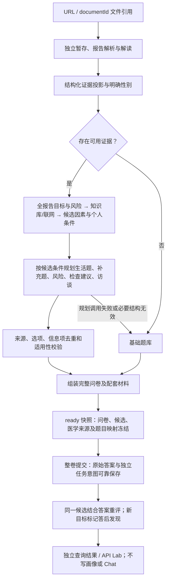

# 整份建档问卷生产化

状态：开发分支实现，完整病例与真实服务验收仍按下述边界单独记录。更新：2026-11-07。公开契约见 [API.md](../docs/api/API.md#建档问卷接口)。旧逐题链路见 [record-dynamic-flow.md](record-dynamic-flow.md)。

2026-11-06 客户新增的五步循证与诱因核实要求见 [建档问卷循证诱因分析与补充问题设计](../docs/architecture/record-questionnaire-evidence-workflow.md)。本文描述当前报告驱动的整卷、答前循证候选与答后因素分析实现；真实验收结论与源码接线分开记录。

## 独立生命周期

主 Agent 封装与后台恢复的当前边界见 [Questionnaire 主 Agent 与后台恢复](questionnaire-main-agent.md)。普通 GET 只投影状态；生成重试、过期清理和已受理提交恢复由后台周期任务执行，没有轮询客户端也会继续。

`modules/questionnaire/service.py`使用与Record/Chat相同userId+sessionId租约协调，独立Mongo问卷快照为来源真相，Redis只缓存查询结果。状态为queued→generating→ready→submitted；failed与expired不能进入Chat。ready起2小时过期，查询不续期；过期保留轻量归属，允许新实例，旧ID不可提交。submitted不可被Chat或重建覆盖。

生成阶段不调用旧HealthReportProcessingService及其自动画像/报告发布入口。独立文档归档保存原件、DocMind任务/结果与解读，采用现有分块能力和独立集合；documentId复用只校验归属并读取已有结果。ready归档与问卷共享截止时间。清理只由持有会话租约的生命周期恢复触发，不使用会与提交竞争的裸TTL删除。

提交先持久化pendingSubmission意图，再固定附件，最终提交状态和画像pending意图一起保存。恢复可完成已在有效期内受理的提交。questionnaireId、题目和value/text不变；客户端空值在规范化副本成为unknown，原始answers仍保留。指纹使用发布时的选择顺序、去重与文本首尾清理后的答案。

## 生成与来源边界

本节记录 `feature/record-questionnaire` 的当前开发实现。整卷保持“固定基础主题 + 相关生活细项 + 报告补充题”，新增答前循证候选与答后因素分析。仅使用当前问卷体检、检验、影像资料及本次答案，不依赖尚未出具的菌群结果；最终报告生成属于后续消费流程。



### 1. 输入资料与证据投影

`QuestionnaireGenerator.generate()` 先通过文档适配器取得报告解读，只使用状态为 `complete` 或 `partial` 且解读结构有效的结果。URL 文件使用底层下载、解析和 `HealthReportInterpreter`；`documentId` 只读复用已经校验归属的资料。此阶段不调用旧报告处理入口发布新的画像事实。

`build_evidence()` 将解读结果中的检查观测、影像发现及诊断记录投影为证据；报告中已有的诊断文本仍属于来源记录，不等于本次问卷生成模型作出确诊。主要规则如下：

- 检查观测保留项目、结果、单位、参考范围、异常标记和检查时间；时间优先使用观测时间，再回退至章节或报告时间，缺失时不补造日期。
- 在单份报告内去重，按异常标记优先排列。生产因素链使用全量证据投影并保留原始值；旧无因素适配器的兼容调用仍保留 16 条上限。因素分析另有完整分批索引和覆盖记录，预算超限明确记录未处理项。
- 排除标记为菌群报告的整份资料、章节及其根级镜像观测；生成提示词同时禁止以菌群信号触发问题。
- 为证据分配本次生成内的 ID，并保存 `reportIndex`、来源 `pointer` 和 `date`。生成快照的 `provenance.version` 标记当前生成版本。
- 性别仅从报告明确字段及文档适配器提供的性别来源归一化。缺失时为 `unknown`；多报告冲突时 `value` 仍为 `unknown`，`status` 为 `conflicting`，保留来源，不从姓名推断。

问卷规划调用的输入包括：

| 输入 | 内容 | 用途 |
| --- | --- | --- |
| `evidence` | 可定位原报告的结构化证据 | 规划风险方向、检查建议和个性化内容 |
| `gender` | 明确性别、缺失或冲突状态及来源 | 约束问题适用性 |
| `lifestyleTopics` | 受控生活细项的 key 与题干 | 选择需要了解的生活方向 |
| `informationFacets` | 信息目标枚举 | 标记问题目的，执行跨列表去重 |
| `factorContext` | 已获取医学依据的目标、候选、个人条件和信息缺口 | 优先询问能改变候选判断的信息，映射到实际发布题目 |

规划器使用 `questionnaire.report_plan` 的 `STATELESS` 配置。报告解读、因素准备与问卷规划是不同步骤；问卷内容仍由一次规划组织，因素分析按目标、材料批次和匹配阶段调用。规划器不接收用户既往画像、历史 Chat、其他问卷答案或整份 79 题文档。补充问题文档的采集方向已经整理进提示词，运行时不逐次读取该文档。

因素分析运行规则和医学表达边界见[五步分析文档](../docs/architecture/record-questionnaire-evidence-workflow.md#5-生产初版的数据流)。答前失败不阻塞基础问卷采集，答后可补做并真实标记阶段；材料不足保留证据缺口。`factorPreparation` 与提交任务标记仅内部保存；查询因素结果使用独立只读接口，不改首次提交回执，不触发重算。

独立 Mongo 集合由 `SHULAN_MONGODB_COLL_QUESTIONNAIRE_FACTOR_TASKS` 配置，默认 `questionnaire_factor_tasks`，禁止与现有集合重名。运行时分别调度因素任务领取和投递补偿；租约续期、写入令牌及有限重试防止旧 worker 覆盖新结果。未提交资料过期清理包含答前快照，提交后结果独立持久化。没有新增 API 开关。

AION 调用只经过共享网关，依赖统一固定为 `aion[docmind]@v0.6.0`。每个目标先检索自有知识库，校验材料及适用范围；没有适用材料时，才用 `LLMRequest.web_search=True` 和独立 `search_query` 发起联网。检索词与模型任务正文分别传递，DeepSeek 检索词限 1～128 个字符；SDK 的 `search=True` 会先执行搜索和必要的网页获取，再调用模型。Chat、Report 等已有业务仍默认关闭联网。

实际来源从 SDK `search_trace.sources` 进入内部 `search_sources`，将 `excerpt` 映射为材料 `text` 并保留 `excerpt_origin`；完整追踪保留 `query`、SDK 原始 `sources` 与 `operations`。完整与流式尾部追踪均单独处理，模型生成的链接或引文不作为来源材料。问卷适配器返回 `searchTrace`，流水线将完整追踪和触发原因保存于内部 `factorPreparation.searchTraces`，公开结果结构不变；来源 passage 的 `locator.excerpt_origin` 保留摘录来源。当前 DeepSeek SDK 最多返回 5 条来源、每条最多 1200 字符的摘录；这些不是全文，也不能自动证明医学可靠。候选仍须有适用材料和可定位引文支持，材料不足或失败保留证据缺口。

### 2. 问卷组成与选题顺序

| 组成 | 数量 | 生成方式 |
| --- | --- | --- |
| 基础主题 | 固定 3 题 | 健康目标或主要不适、医生确诊的个人疾病史、血亲家族史；使用受控题目和选项 |
| 生活习惯 | 固定 7 题 | 从五大类 24 个受控细项中选择，使用题库中的原题干、选项和类型 |
| 报告补充题 | 0～5 题 | 模型针对报告证据生成，经过来源、信息目标及具体选项校验后保留 |

完整问卷为 10～15 题。实际页面顺序为 `health_background` → `report_follow_up`（有合格补充题时）→ `daily_habits`，各题及选项发布后冻结，填写过程中不再逐题调用模型调整。

生活题选择保留模型 `lifestyleKeys` 中有效 key 的顺序，剔除未知 key，并与默认细项合并去重后取前七项。默认补足项依次为食物搭配、进餐规律、运动频次、睡眠时长、吸烟情况、饮酒频次和放松方式。因此有报告时的七题可以变化；无报告或规划失败时使用默认七题。个性化主要体现在选题、报告补充题和承接说明，模型不重写受控生活题的题干或选项。

报告与生活主题的关联由模型在给定采集范围内判断，当前没有“某指标必选某题”的固定映射表，也没有确定性的疾病风险评分算法。例如某份合成报告的血糖记录可以使模型优先选择饮食或活动细项，并提出复查状态问题；这是选题方式的示例，不是对所有同类报告的固定输出要求。

### 3. 问卷与健管师清单共同规划

同一次规划返回 `lifestyleKeys`、`risks`、`tests`、`questions`、`interview`，以及可选的 `bridges`。问卷负责可用短选项表达的存在性、类型和频次；健管师清单负责需要开放沟通的症状经过、时间关系、用药变化、具体数值、治疗反馈及实际执行困难。清单最多 8 项，可为空，不为达到数量而追加通用背景问题。

程序先为三个基础主题和选中的七个生活细项保留 `informationFacet`，再依次接受报告补充题和健管师条目。已经使用的 facet 不再接受，重复的补充题或访谈题原文也会被剔除。模型须给同一信息目标使用相同 facet；程序另对部分“是否复查”措辞归一到 `followup_status`，避免仅改标签绕过去重。这是枚举及部分文本规则校验，不是全面的语义重复检测。

同一主题的不同信息层次可以保留。例如问卷采集 `followup_status`（是否复查），健管师采集 `followup_result`（若已复查，日期和结果是什么）。生成时客户尚未作答，涉及症状、用药、手术等后续细节必须按适用条件表述；程序对已配置的细节 facet 补上条件引导，不能将待询问事项当作患者已经存在的情况。

[菌群检测后健康评估补充问题清单](../docs/product/菌群检测后健康评估补充问题清单.docx) 仅用于说明后续报告希望补齐的信息类型。当前规划仍由体检报告证据触发，不照搬其检测阶段或全部问题。

### 4. 承接说明与配套输出

问卷使用 [问卷 Schema](../docs/product/survey-system-schema.md) 的 `description` 承载说明、`title` 承载实际问题。两者分别渲染，选项维持具体、简短、可明确记录的含义。

首题 `health_goals.description` 由报告摘要与合格的风险分析拼接：当前 `_summary()` 按异常优先取最多 4 条证据记录拼接摘要，风险分析则来自规划模型的独立输出。该摘要实现不等同于模型对原报告全文作综合总结。个人史和选中的生活题可采用带来源引用的 `bridges`；没有合格桥接时使用原有中性说明。家族史保持宽泛，不绑定单个指标。

| 输出字段 | 当前构造方式与上限 |
| --- | --- |
| `reports` | 各文件处理状态及对应报告解读 |
| `guidance.reportSummary` | 上述报告证据摘要；无证据时为基础问卷引导 |
| `guidance.riskAssessment` | 最多 3 条有证据引用的模型分析，说明关注方向和跟进重点；不只重复数值，不把异常直接等同于确诊 |
| `guidance.riskNote` | 合格风险分析的展示拼接，无合格条目时为空 |
| `guidance.suggestedTests` | 最多 4 条有证据引用的复查或补查名称与理由，供与医生讨论 |
| `guidance.clientCheckupMessage` | 程序将检查建议组装成可复制发送的健管师文案；无建议时使用问卷填写引导 |
| `guidance.managerInterview` | 最多 8 项 `question + reason`，保留信息目标与证据关联 |
| `questionnaire` | 按 Schema 组装的完整分页问卷，不混入配套材料或 API 外层包装 |

风险和检查建议在过滤无效条目后按模型原顺序截取；当前未按风险 `priority` 进行二次排序。风险方向、建议和问题本身均是 AI 生成材料，不是用户健康事实。

### 5. 发布校验与降级边界

模型输出的风险、检查建议、报告补充题、访谈及桥接均须提供 `evidenceIds`。`_linked()` 要求引用列表非空且每个 ID 属于本次输入，随后去重并保留最多 4 个引用。通过后保存为 `evidenceRefs`，问题来源另存入 `provenance.questionSources`。基础题和普通生活题可以标记为 `template`，不伪造报告来源。

| 约束 | 当前执行位置及边界 |
| --- | --- |
| 来源可追溯 | 程序校验引用 ID 是否存在；不能据此宣称已经程序化证明医学推论成立 |
| 信息目标与重复 | 程序校验 facet 枚举、已占用信息目标及重复题目原文；语义归类仍依赖模型 |
| 补充题答案 | 程序校验 2～7 个具体选项、重复标签及禁止的占位或输入入口；复用旧 Record 的选项和问题校验 |
| 性别适用性 | 明确字段归一化，结合提示词及有限关键词过滤；男性排除月经等内容，未知或冲突使用通用内容 |
| 年龄及特殊阶段 | 提示词禁止无依据推断儿童、孕哺或老年专属情况；规划输入目前没有独立年龄字段 |
| 医学解释与自然表达 | 主要由提示词引导，仍需真实模型验收；不额外增加模型评审调用 |

单个候选不合格时仅过滤该条，保留合格内容，不必将整份问卷切换为基础模式。没有合格报告补充题时仍可输出 10 题；没有合格风险、检查或访谈时相应列表为空，不补造结论。

| 场景 | 当前行为 |
| --- | --- |
| 未提供文件 | 不调用规划器，返回基础问卷；`mode=basic`、`processing.status=complete`、`reason=no_reports` |
| 部分报告可用 | 只使用可用的结构化证据继续规划，文件级失败仍保留在各报告状态中 |
| 提供文件但没有可用证据 | 返回基础问卷；`mode=basic`、`processing.status=fallback`、`reason=reports_unavailable` |
| 规划调用异常、默认 45 秒超时，或 `risks/tests/questions/interview` 必需数组结构无效 | 返回基础问卷；`mode=basic`、`processing.status=fallback`、`reason=planner_unavailable` |
| 暂存、保存或任务基础设施异常 | 由既有任务失败或错误响应处理，不伪装为规划成功 |

基础模式保留三个主题和默认七个生活细项；风险、检查、报告补充题及健管师清单为空。若仍有可用报告证据，保留其摘要和报告解读。降级原因记录在结构化处理状态，不向问卷正文追加内部处理说明。

### 6. 画像与后续消费

QUESTIONNAIRE 画像任务只读 `submitted` 快照。共享 `RecordAnswerCandidateExtractor` 的证据校验方法，但使用独立 `source_type/source_id/pointer` 与候选身份。选项代码依据冻结的 text 转换；默认未知不进提取输入。报告按独立 HEALTH_REPORT 来源发布，既有 `documentId` 不重复发布；全部事实继续沿用已有主体、USER_REPORTED 和待确认治理。

Chat 普通、SSE 及 custom 入口统一检查持久问卷状态；提交成功即可转换，原问卷和回执留在独立集合。每轮只读已提交答案与可靠报告观测的上下文投影，未将配套 AI 文案写成患者事实。Report 只读同一投影并映射现有 `hospitalData`，显式请求资料优先；不重新下载已经保存的问卷附件，不自动生成最终报告。

### 7. 实现与验证入口

| 文件 | 职责 |
| --- | --- |
| [generation.py](../modules/questionnaire/generation.py) | 证据投影、性别归一、整卷组装、去重、来源校验与生成降级 |
| [questionnaire_generation.py](../adapters/questionnaire_generation.py) | 规划模型输入和单次无状态调用 |
| [report_plan.md](../prompts/questionnaire/report_plan.md) | 选题、解释、补查和访谈规划约束 |
| [lifestyle.py](../modules/record/application/lifestyle.py) | 24 个生活细项、受控题干、选项及默认承接 |
| [questionnaire_documents.py](../adapters/questionnaire_documents.py) | 附件暂存、解析、解读及已有文档只读复用 |
| [test_generation.py](../tests/unit/questionnaire/test_generation.py) | 生成规则、来源、适用性、去重和降级的离线回归 |

本节为源码核对后的实现说明，不新增医学效果或真实模型验收结论；真实服务验收状态见下方记录。

## 启用与运行

新问卷接口随应用启动提供，不使用环境变量控制 API 的开启与关闭。独立集合由`SHULAN_MONGODB_COLL_QUESTIONNAIRES`、`SHULAN_MONGODB_COLL_QUESTIONNAIRE_DOCUMENTS`、`SHULAN_MONGODB_COLL_QUESTIONNAIRE_CHUNKS`及`SHULAN_MONGODB_COLL_QUESTIONNAIRE_FACTOR_TASKS`配置。禁止与旧会话或旧文档集合共用名称。

运行时每15秒扫描问卷生成/提交/清理恢复；画像Worker注册QUESTIONNAIRE处理与pending补偿。失败日志仅记录ID和分类，不输出健康正文。现有HTTP日志层对问卷需避免健康内容预览。API Lab的9080只提供静态、代理和回调，问卷页面完全调用生产接口；URL/documentId入口不预先调用interpret。

## 验收与退出旧版

先运行`tests/unit/questionnaire`、画像/Chat/Report与API Lab回归，再执行全仓离线测试、Ruff、Node检查与文档JSON检查。真实验收使用合成报告：具体主诉、多报告风险、男性/未知/冲突、全部解析失败、提交后立即Chat、过期与重复提交。真实模型与Mongo/Redis验收单独记录，离线通过不视为已部署。

通过并行验收后先停旧Record新建，允许在途完成，再停回答入口；保留历史读取和既有来源消费，不迁移旧画像或历史对话。本次保持旧接口行为，不增加 API 环境变量开关。


## 本轮验收记录（2026-11-05）

实现分支为 `feature/record-questionnaire`，基于 develop 的 `717d76f`。原有未提交资料及暂存状态已保留；本轮未执行 Git 暂存或提交，未部署及切换线上接口。

| 检查 | 结果 |
| --- | --- |
| 全仓离线 `python -m pytest` | 10153 passed、275 skipped，0 failed，257.66 秒；移除 API 环境开关后的完整复验 |
| API Lab `node --test tests/unit/api/api_lab.test.cjs` | 94 passed |
| 本次涉及的 41 个 Python 文件 | Ruff check、format --check 通过 |
| 修改的 JavaScript | node --check 通过 |
| 当前 API 文档 | 125 个 JSON 代码块均可解析，ready 示例来自实际基础问卷构造器 |
| Git 差异与新增源码 | diff --check、空白检查通过 |
| `.env.example*` 模板一致性 | dev/test/production 三次显式 check-env 检查均退出0；各78项变量一致、0错误，保留5项既有示例占位值提示；未查看或修改其他 `.env*` |

浏览器验收使用真实 Tornado 问卷处理器、QuestionnaireService 和 QuestionnaireGenerator，报告与规划器使用合成数据，存储与租约使用内存替身。验证了异步生成及轮询、报告表格和风险/客户文案分区、部分作答和全空作答、提交回执恢复、直接 Schema/答案 JSON 下载、切换 session 清空业务视图，以及跳转 Chat 后保持相同用户和 session。下载文件经服务端 Schema 校验，答案下载仅包含 `{answers}`。验证服务仅监听本机，结束后已关闭，未停止用户原有 API Lab 服务。

本轮没有使用真实患者资料，没有运行真实模型、DocMind、MongoDB 或 Redis 联调；页面中的风险文案是合成规划结果，不作为真实措辞质量验收。当前进程没有注入模型凭据，本轮未读取部署私有环境文件。真实验收入口为 `python -m tests.api.scripts.questionnaire_live --backend <验收服务地址> --user-id <合成用户> --session-id <新会话> --report-url <合成体检报告URL> --output-dir <仓库外输出目录>`；脚本默认提交空答案并核对回执重放，使用 `--no-submit` 可先审阅整卷和配套材料。

正式并行测试还需验证真实模型的关联准确性、自然表达和问卷/清单互补性，以及真实 Mongo/Redis 的提交恢复、清理竞争和画像补偿。共享会话首次问卷 claim 使用部分唯一身份索引；启用前应核查既有 userId/sessionId 重复记录及索引兼容性，代码不会自动改写历史重复记录。

## 因素分析初版验收（2026-11-06）

本轮最终完整 `python -m pytest`：**10359 passed、275 skipped、0 failed**，260.32 秒。跳过数量与修改前基线一致。本次 30 个 Python 文件的 Ruff 和格式检查通过；API Lab Node 107 项通过；当前 API 的 128 个 JSON 代码块均可解析，文档格式及 Git 差异检查通过。未执行 Git 暂存、提交或部署。

生产代码使用独立因素流水线与任务查询，既有单病例试验 `questionnaire_factor_case` 仍是离线对照工具，不被生产模块引用。因素展示的四层分别为：报告目标及风险解读、初步候选及医学来源、最终相关因素及关系、实际问题和回答如何支持或反对。原报告 AI 解读独立折叠展示，不混作原始检验记录。

离线回归覆盖全报告索引、原文/AI/背景隔离、知识库与 AION 联网契约、引用完整性、否认与未知、答前题目绑定、答后新增目标、任务幂等/租约/恢复和容量保护。API Lab Node 回归 107 项通过；静态页面与合成响应的 Chromium 验收覆盖 1440×1000、390×844、失败后重新查询、下载及横向溢出，所有请求均在本地拦截，未访问真实后端。

真实验收沿用正式脚本，使用新参数读取合成答案并等待因素结果：

```bash
python -m tests.api.scripts.questionnaire_live --backend <验收服务地址> --user-id <合成用户> --session-id <新会话> --report-url <合成报告URL> --answers-file <answers.json> --with-factors --output-dir <已授权输出目录>
```

答案文件为客户端导出的 `{"answers": {...}}`，不带通用响应包装；不提供文件时仍默认提交空答。`--with-factors` 与 `--no-submit` 互斥。脚本保存 `factor-assessment.json`（纯结果）、`factor-assessment-status.json`（任务状态）和 `factor-assessment-acceptance.json`（覆盖及实质验收标记）。分析失败、不可用或覆盖不完整会保存现有结果并非零退出；覆盖完整仅说明链路校验完成，不能替代医学关联、措辞和引文实质审阅。该审阅标记只属于验收记录，不是产品新增的人工审批流程。

上述 2026-11-06 验收未执行真实 AION、知识库、DocMind、MongoDB 或 Redis 联调，不能把离线通过描述为联网效果已验证。该轮 `.env.example*` 四份模板同步增加任务集合名称，三组显式 `check-env --no-values` 均无结构错误；未查看或修改任何其他 `.env*` 文件。

## AION 0.6.0 适配与验收边界（2026-11-07）

本轮同步依赖、独立检索词及 SDK 结构化来源适配，不新增环境变量或更改环境模板。普通文档搜索验证仅覆盖真实搜索链路与来源结构，不能代表完整问卷、知识库回退、医学适用性、MongoDB/Redis 恢复或 DocMind 联调验收。适配后的离线回归和真实请求结果须按实际执行记录，不沿用上一轮测试数量作为本轮结论。

最终代码执行完整 `python -m pytest`：10423 通过、275 跳过、0 失败，耗时约 255 秒。相关 11 个 Python 文件通过 Ruff 与格式检查；6 份当前文档、128 个 JSON 代码块检查通过。回归覆盖真实 AION SDK 配合模拟 HTTP 的完整与流式检索、失败追踪、独立检索词边界、上下文原子性、模型重试统计和问卷来源到候选引用的贯通；答后重新准备时的内部检索阶段标记同步校正。

真实请求通过已授权的 `config.env` 生产加载路径和 AION `deepseek-flash` 执行，仅使用公开查询及合成医学目标，未写数据库，也未使用真实患者资料。共享完整调用取得 5 条非空来源摘录，耗时约 3.89 秒，模型重试数为 0；流式调用约 1.41 秒，末尾独立追踪块保留 5 条来源，正文与 usage 正常聚合。

问卷链路使用“甘油三酯升高”这一合成目标，显式注入无知识库的测试依赖以验证联网回退；搜索查询为通用医学概念，不包含个人数据。首轮综合断言未通过，该次未输出足以定位原因的阶段明细，不能将其描述为成功。同查询诊断复测中，搜索约 6.42 秒返回 5 条原始材料，候选分析约 6.00 秒产出 2 项通过现有来源 ID、段落 ID 和逐字引文校验的候选。人群、剂量与材料覆盖限制继续作为证据缺口保留；这证明真实检索材料可以进入候选证据链，不证明医学材料充分性或个人病因成立，也不替代完整病例的效果验收。
